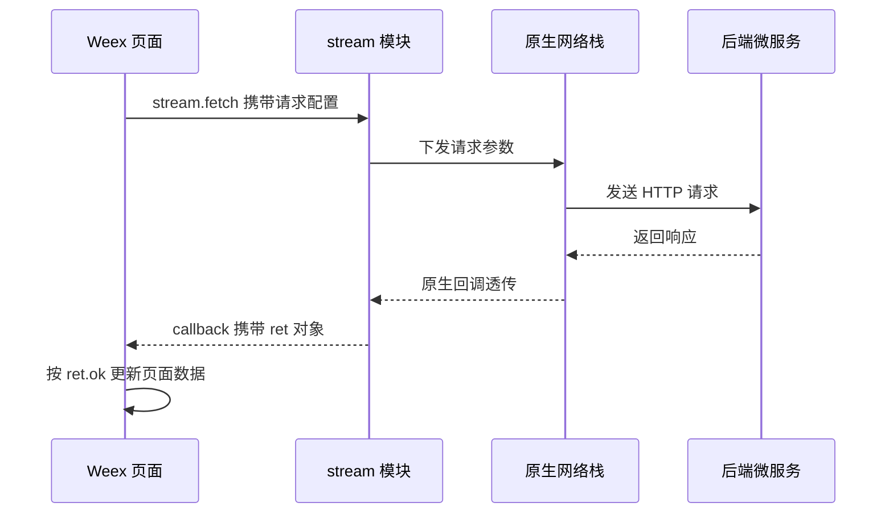

# Weex 内置模块 stream：原生环境里发 HTTP 请求

文章列表页的骨架搭好后，数据从哪来？浏览器里前端工程师顺手就用 axios，但 Weex 页面跑在原生环境，没有 XMLHttpRequest，axios 到了这里直接失灵。Weex 官方内置的 stream 模块就是替代品：提供基本的网络请求能力，GET 与 POST 都支持，本项目的移动端调用文章微服务全靠它。这一课把 fetch 的参数、回调、GET 与 POST 的写法以及项目里的封装思路一次讲完。

## 先给结论

- stream 是 Weex 内置模块，通过 weex.requireModule('stream') 取用，承担组件生命周期内与服务端交互的网络请求。
- 核心方法 fetch(options, callback, progressCallback)，options 五个配置：method、url、headers、type、body。
- body 仅支持字符串：传对象要先 JSON.stringify；GET 请求不支持 body 传参，参数拼在 URL 上。
- 默认 Content-Type 是 application/x-www-form-urlencoded，POST 发 JSON 数据必须手动设置 application/json。
- 回调是函数式而非 promise 式：callback 里用 ret.ok（状态码 200 到 299）判断成功，data 按 type 解析；项目里封装成 promise 后才能 .then 与 .catch。

## 为什么 Weex 里用不了 axios

axios 的能力建立在浏览器环境上：底层是 XMLHttpRequest，请求与响应的拦截、异步调度都依赖浏览器的运行时。Weex 原生端没有 DOM 也没有 XHR 对象，这些依赖全部落空。Weex 的解法是把网络能力下沉到原生层，JS 侧通过内置模块调用，stream.fetch 在原生层发起真正的 HTTP 请求。

一次请求的完整链路：



链路里的分工值得注意：JS 侧只负责描述请求与消费结果，真正的连接建立与数据收发都发生在原生网络栈。文章列表页要拿文章微服务的数据，走的正是这条链路。

## fetch 的参数与回调

options 的五个配置项：

```text
fetch(options, callback, progressCallback)
  options 请求的配置选项：
    method  HTTP 请求方法，值为 GET / POST / PUT / DELETE / PATCH / HEAD
    url     请求的 URL 字符串
    headers HTTP 请求头
    type    响应的解析类型：json 或 text 或 jsonp
    body    HTTP 请求体
```

callback 收到的 ret 对象字段：status 是状态码；ok 在状态码处于 200 到 299 区间时为 true；statusText 是状态描述；data 是返回的数据，type 为 json 时直接是对象，否则是字符串；headers 是响应头。progressCallback 在请求完成前持续回调，携带 readyState（1 请求连接中，2 返回响应头中，3 正在加载返回数据）、status、length 与 headers，做下载进度展示时用得上。

文档加粗强调的两条 TIP 要单独记：默认 Content-Type 为 application/x-www-form-urlencoded，fetch 里设置的 type 是响应类型而不是请求体类型；要发送 JSON 数据，需要把请求头的 Content-Type 设为 application/json。

## GET 与 POST 的写法

GET 请求的模板，参数拼在 URL 上，请求头带登录 token：

```javascript
const stream = weex.requireModule('stream');

export default {
  methods: {
    getArticles: function () {
      const self = this;
      stream.fetch({
        method: 'GET',
        url: 'http://api.example.com/articles?page=1&size=10',
        headers: { token: this.userToken },
        type: 'json'
      }, function (ret) {
        if (ret.ok) {
          self.articleList = ret.data;   // type 为 json 时 data 已是对象
        } else {
          console.log('请求失败：' + ret.status);
        }
      }, function (ret) {
        // progressCallback：请求完成前持续回调
        console.log('进度：' + ret.readyState);
      });
    }
  }
}
```

POST 请求的模板，重点是 body 的处理与 Content-Type：

```javascript
stream.fetch({
  method: 'POST',
  url: 'http://api.example.com/articles',
  headers: {
    'Content-Type': 'application/json',
    token: this.userToken
  },
  type: 'json',
  body: JSON.stringify({
    title: this.title,
    content: this.content
  })
}, function (ret) {
  if (ret.ok) {
    console.log('发布成功');
  } else {
    console.log('发布失败：' + ret.status);
  }
}, function (ret) {});
```

POST 有三个细节：body 是对象时不被接受，必须 JSON.stringify 转成字符串；headers 里手动把 Content-Type 设为 application/json，Spring 后端的 @RequestBody 才能反序列化；type 保持 json 是为了让响应里的 data 自动解析成对象。GET 传参则一律拼 URL，问号后带键值对。

## 封装成项目可用的请求层

原生回调风格有两个工程痛点：嵌套一深就是回调地狱，错误处理散落各处。项目里的做法是包一层 promise，把 baseURL、token、错误提示统一收口（以下为按本课写法补全的示例，真实封装在文章列表前端章节落地）：

```javascript
const stream = weex.requireModule('stream');
const modal = weex.requireModule('modal');
const BASE_URL = 'http://api.example.com';

function request(options) {
  return new Promise(function (resolve, reject) {
    stream.fetch({
      method: options.method || 'GET',
      url: BASE_URL + options.url,
      headers: Object.assign({
        'Content-Type': 'application/json',
        token: options.token || ''
      }, options.headers || {}),
      type: 'json',
      body: options.body ? JSON.stringify(options.body) : ''
    }, function (ret) {
      if (ret.ok) {
        resolve(ret.data);
      } else {
        modal.toast({ message: '请求失败：' + ret.status, duration: 2 });
        reject(ret);
      }
    }, function () {});
  });
}

// 页面里的调用方式
request({ method: 'GET', url: '/articles?page=1' })
  .then(function (data) { console.log(data); })
  .catch(function (ret) { console.log(ret); });
```

封装做完，页面代码从回调嵌套变成 then 与 catch，token 与 Content-Type 也不必每处手写。与 axios 的差异归拢成一张表：

| 维度 | axios | Weex stream |
|---|---|---|
| 依赖环境 | 浏览器 XMLHttpRequest | 原生网络栈，经内置模块调用 |
| 调用风格 | promise，天然支持 .then 与 .catch | 回调函数，需自行包装成 promise |
| 请求体 | 对象自动序列化 | 仅支持字符串，需 JSON.stringify |
| Content-Type | 发 JSON 自动设置 | 默认表单编码，发 JSON 要手动设置 |
| 拦截器 | 内置拦截器机制 | 无，统一逻辑写在封装层 |

## 常见误区

- **body 直接传对象。** body 仅支持字符串，直接赋对象后端收不到参数，统一先 JSON.stringify 再赋值。
- **GET 请求塞 body。** 文档明确 GET 不支持 body 方式传参，参数用 URL 拼接，问号后带键值对。
- **POST JSON 忘设 Content-Type。** 默认编码是表单格式，不设置 application/json 时后端的 @RequestBody 解析不到字段，排查时还容易误判成参数名写错。
- **不判 ret.ok 直接用 data。** 请求失败时 data 可能为空字符串，先判 ok 再取 data，失败分支里做提示或兜底。
- **把 stream.fetch 当 axios 用。** 它的返回值不是 promise，await 与 .then 都无效，要么接受回调风格，要么先封装。

## 面试可能被问到的问题

1. 面试官追问：「Weex 里为什么不能用 axios？」
   答：axios 的底层是浏览器的 XMLHttpRequest，Weex 原生端没有 DOM 与 XHR 对象，依赖不成立。Weex 把网络能力下沉到原生层，通过内置模块 stream 暴露 fetch 方法，JS 侧描述请求、原生栈完成收发，这是官方提供的替代通道。
2. 面试官追问：「stream.fetch 的 body 有什么限制？怎么传 JSON？」
   答：body 仅支持字符串，不能直接传对象，传 JSON 数据要先 JSON.stringify 转成字符串再赋给 body；同时把请求头 Content-Type 设为 application/json，后端才能按 JSON 反序列化，默认编码是表单格式。
3. 面试官追问：「GET 请求怎么传参数？」
   答：文档明确 GET 不支持 body 方式传参，参数拼接在 URL 上，问号后带键值对，多个参数用与号连接，特殊字符要做 URL 编码。请求头可经 headers 配置携带 token 等鉴权信息。
4. 面试官追问：「callback 里 ret.ok 是按什么标准判断的？」
   答：状态码处于 200 到 299 区间时 ok 为 true，否则为 false。data 字段按 type 解析：type 为 json 时直接是对象，text 与 jsonp 时是字符串。正确姿势是先判 ok 再消费 data，失败分支读 status 定位问题。
5. 面试官追问：「项目里如何统一带 token？封装层要做哪些事？」
   答：封装一个 request 函数包成 promise，内部调用 stream.fetch，在 headers 里统一带上 token 与 Content-Type，baseURL 收口一处配置，失败时统一 toast 提示并 reject。页面侧只写 then 与 catch，与 axios 拦截器的思路对齐。
6. 面试官追问：「stream.fetch 与 axios 在使用风格上最大的差别是什么？」
   答：调用风格。axios 返回 promise，天然支持 await 与拦截器；stream.fetch 是回调函数风格，成功与进度各一个回调，promise 需要自己包。请求体处理也不同，axios 自动序列化对象，stream 要求字符串并手动设置 Content-Type。

## 配套资料

- 代码：`materials/code/05/头条day02/`，资料目录下的 weex 组件综合示例（`weex组件介绍.vue`）以 weex.requireModule('stream') 取模块，含事件回调与组件数据更新的串联写法；资料包内层目录名冠以项目原名，正文统一以「头条类资讯项目」指代。
- 说明：day02 无 Java 后端源码；请求封装与 token 示例为按本课写法补全，真实的前后端联调在文章列表前端章节完成。
