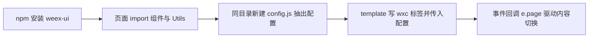

# weex-ui 组件库：给资讯项目装上底部与顶部标签栏

Weex 内置组件是原子件，div、text、image、list 能搭出静态结构与滚动列表，但底部导航栏这种带手势、带选中态、带未读红点的交互件，从零手写费时费力，还要在 Android 与 iOS 两端反复调一致性。资讯类 App 偏偏离不开两件导航：底部主导航与顶部频道栏。weex-ui 组件库就是为这类场景准备的现成答案，这一课把它装进项目，跑通底部与顶部两个标签栏，文章列表页从下一课起就在这个骨架上搭建。

## 先给结论

- weex-ui 是基于 Weex 封装的富交互、轻量级、高性能 UI 组件库，定位类似 Vue 生态里的 Element UI，npm 安装后按需 import，组件名一律以 wxc- 开头。
- 组件的可变内容抽到页面同目录的 config.js：tabTitles 定义页签内容，tabStyles 定义样式，页面代码只负责引入与装配。
- config.js 缺失会在编译期直接报 Module not found，在引入组件的页面同级目录新建文件、从官方 example 拷入配置即可。
- 页面高度用 Utils.env.getPageHeight() 动态获取，取不到时按屏幕宽高换算；页签切换回调里 e.page 是当前下标，从 0 开始。
- 组件库覆盖布局、导航、数据输入、日历、倒计时、富文本等场景，动手手写之前先查它。

## 组件库的定位与官方文档

一句话定义：weex-ui 是一个基于 Weex 的富交互、轻量级、高性能 UI 组件库。它把移动端页面里高频出现的交互模式封装成现成组件，官方仓库托管在 GitHub 的 alibaba/weex-ui，文档按布局、导航、数据输入等场景分组，每个组件都配了可直接运行的 example。本项目重点使用导航组的两件：底部标签栏 WxcTabBar 做 App 主导航，顶部标签栏 WxcTabPage 做文章列表的频道栏。

它和 Element UI 的关系用一句话说清：两者都是「封装常用交互、开箱即用」的思路，差别在渲染目标。Element UI 的组件渲染成浏览器 DOM，weex-ui 的组件渲染成原生控件，因此它只能装进 Weex 工程，不能被浏览器端的 Vue 项目引用，组件属性也要遵循 Weex 的样式约束。

## 三步接入：安装、引入、补 config

```bash
npm i weex-ui -S
```

接入的完整链路如下：



把官方 example 的模板与脚本拷进演示页 main.vue，一编译就报错，提示找不到 ./config。原因在脚本的 `import Config from './config'`：组件把「有哪些页签、长什么样式」全部抽到了 config.js，官方示例默认你已经准备好这个文件。做法是在引入组件的页面同级目录新建 config.js，内容从官方仓库 example 目录的 tab-bar/config.js 拷贝，编译随即通过，底部导航栏直接出现在预览页上。

## config.js：页签内容与样式都在这

打开拷来的 config.js，结构是两个导出项：

```javascript
export default {
  // 页签数组：一个对象对应一个页签
  tabTitles: [
    {
      title: '首页',
      icon: 'https://gw.alicdn.com/tfs/TB1HudSpxXXXXXcXXXXXXXXXX-72-72.png',
      activeIcon: 'https://gw.alicdn.com/tfs/TB1kCk1XkXXXXXcXXXXXXXXXX-72-72.png'
    },
    {
      title: '特别推荐',
      icon: 'https://gw.alicdn.com/tfs/TB1ARoKsXXXXXcXXXXXXXXXX-72-72.png',
      activeIcon: 'https://gw.alicdn.com/tfs/TB1kCk1XkXXXXXcXXXXXXXXXX-72-72.png'
    },
    {
      title: '消息中心',
      icon: 'https://gw.alicdn.com/tfs/TB1VMK5sXXXXXcXXXXXXXXXX-72-72.png',
      activeIcon: 'https://gw.alicdn.com/tfs/TB1aTg2SXkXXXXXcXXXXXXXXXX-72-72.png',
      badge: 5            // 未读条数，页签上出现带数字的红标
    },
    {
      title: '我的主页',
      icon: 'https://gw.alicdn.com/tfs/TB1o3tSXXXXXcXXXXXXXXXX-72-72.png',
      activeIcon: 'https://gw.alicdn.com/tfs/TB1LhMhSpXXXXXcXXXXXXXXXX-72-72.png',
      dot: true           // 红点提示：有新内容但不强调数量
    }
  ],
  // 全部样式收口在这里
  tabStyles: {
    bgColor: '#FFFFFF',
    titleColor: '#666666',
    activeTitleColor: '#303030',
    activeBgColor: '#FFFFFF',
    isActiveTitleBold: true,
    iconWidth: 70,
    iconHeight: 70,
    width: 160,
    height: 170,
    fontSize: 24,
    textPaddingLeft: 10,
    textPaddingRight: 10
  }
};
```

四个字段值得点名。title 是页签文字；icon 与 activeIcon 分别是未选中、选中两态的图标，选中变亮不是加了滤镜，就是换了一张图，想换风格改这两个地址即可。badge 是带数字的红标，表达「未读 5 条」这类精确数量；dot 只是一个小红点，表达「有新内容」但不强调数量。tabStyles 收口整个标签栏的视觉：背景色、标题颜色、图标尺寸、字号、内边距，全在这里调。

图标模式之外还有 iconfont 模式：tabIconTitles 数组里每个页签用 codePoint 指定字体图标的码点，省去一整套图片资源，图标的颜色与大小直接跟样式走。

## 页面装配：注册、高度与切换事件

main.vue 的脚本部分把三样东西装在一起：

```vue
<script>
import { WxcTabBar, Utils } from 'weex-ui';
import Config from './config';

export default {
  components: { WxcTabBar },
  data () {
    return {
      tabTitles: Config.tabTitles,
      tabStyles: Config.tabStyles,
      tabPageHeight: 1334
    };
  },
  created () {
    // 页面实际高度：标签栏的内容区按它撑满
    this.tabPageHeight = Utils.env.getPageHeight();
    // 高度取不到时的换算方案：屏幕高 × 宽 ÷ 750
    // this.tabPageHeight = Utils.env.deviceHeight * Utils.env.deviceWidth / 750;
  },
  computed: {
    contentStyle () {
      return { height: this.tabPageHeight + 'px' };
    }
  },
  methods: {
    wxcTabBarCurrentTabSelected (e) {
      // e.page 是选中页签的下标，从 0 开始
      const index = e.page;
      console.log('当前选中：' + index);
    }
  }
};
</script>
```

模板里，四个内容区作为默认插槽写进 wxc-tab-bar 标签内部：

```html
<wxc-tab-bar :tab-titles="tabTitles"
             :tab-styles="tabStyles"
             title-type="icon"
             :tab-page-height="tabPageHeight"
             @wxcTabBarCurrentTabSelected="wxcTabBarCurrentTabSelected">
  <div class="item-container" :style="contentStyle"><text>首页</text></div>
  <div class="item-container" :style="contentStyle"><text>特别推荐</text></div>
  <div class="item-container" :style="contentStyle"><text>消息中心</text></div>
  <div class="item-container" :style="contentStyle"><text>我的主页</text></div>
</wxc-tab-bar>
```

三处装配细节决定页面能不能正常动起来。**第一，components 注册不能省。** import 进来却没有在 components 里声明的组件，模板不会识别，页签区域一片空白。**第二，高度必须动态取。** created 里调 Utils.env.getPageHeight() 拿当前设备的页面可用高度，写死 1334 在别的设备上要么留白要么溢出。**第三，切换逻辑全挂在事件回调上。** 演示时点一个页签打印一个下标，从 0 到 3 依次对应四个页签；实际项目里拿这个下标去切换展示的内容。

## 顶部标签栏：WxcTabPage

底部标签栏跑通后，顶部标签栏是同一套思路：组件名换成 WxcTabPage，config.js 换成顶部栏的配置，事件名换成 wxcTabPageCurrentTabSelected，WxcPanItem 则承担每个列表项的手势交互。真正的差异在内容区：底部导航的内容一般是整页切换，顶部标签栏的内容区通常是一个 list，每个页签对应一条可滚动的列表，这正是资讯频道的形态：

```html
<wxc-tab-page :tab-style="tabStyles"
              :tab-page-height="tabPageHeight"
              @wxcTabPageCurrentTabSelected="wxcTabPageCurrentTabSelected">
  <list v-for="(item, key) in tabList" :key="key">
    <!-- 每个频道一个列表，数据在后面的课程接上 -->
  </list>
</wxc-tab-page>
```

文章列表页用的就是这套结构，页签换成「动态」「推荐」加各技术频道，页签数据带频道标识，接入细节在下一课展开。

## 组件库里还有什么

导航之外，组件库按场景铺开了一批常用件：轮播图（幻灯片）、倒计时、日历选择、单选与复选、富文本 rich-text、弹窗 popup 等，官方文档里每个都有配好参数的 example。开发时的取用顺序因此很明确：先翻组件库找现成的，找到就拷 example 调 config，找不到才考虑自己封装，这与后端「先查公共模块再造轮子」的习惯是同一回事。

## 常见误区

- **只拷模板不建 config.js。** `import Config from './config'` 指向页面同目录的文件，缺失时编译直接失败报 Module not found，新建文件并拷入官方 example 的配置即可。
- **想换图标样式去改组件源码。** 选中与非选中就是 icon 与 activeIcon 两张图，换图就行；node_modules 里的源码改动会在下次安装时被覆盖。
- **页面高度写死。** 不同设备可用高度不同，写死一个值必然在部分机型上错位，用 Utils.env.getPageHeight() 动态获取，取不到再按屏幕宽高换算。
- **import 完忘记注册 components。** 表现是标签不被识别、区域空白，编译往往不报错，排查时先检查 components 声明。

## 面试可能被问到的问题

1. 面试官追问：「weex-ui 与 Element UI 的定位差别是什么？」
   答：两者都是把高频交互封装成开箱即用的组件，降低页面开发成本。差别在渲染目标：Element UI 渲染成浏览器 DOM，weex-ui 渲染成原生控件，只能在 Weex 工程里使用，属性与样式也要遵循 Weex 的约束，两者不能混用。
2. 面试官追问：「为什么把页签配置抽到 config.js？」
   答：页签的标题、图标、样式是纯配置，与页面逻辑无关。抽出去之后页面脚本只剩引入与装配，调整导航不改业务代码；官方 example 也按这个结构组织，模板、脚本、config 三件对号入座，团队协作时配置与逻辑的修改互不干扰。
3. 面试官追问：「底部标签栏切换内容怎么实现？」
   答：组件在页签切换时抛出 wxcTabBarCurrentTabSelected 事件，回调参数 e.page 是选中页签的下标，从 0 开始。页面拿到下标后更新当前展示的内容或跳转对应模块，全部内容切换逻辑都收在这个回调里。
4. 面试官追问：「badge 与 dot 分别适合什么场景？」
   答：badge 是带数字的红标，适合未读数量明确的消息场景，比如消息中心 5 条未读；dot 只是小红点，适合表达有新内容但不强调数量，比如我的主页有新动态。两者都是页签对象上的字段，配置即可生效。
5. 面试官追问：「页面高度为什么要动态取？」
   答：标签栏内容区要撑满剩余屏幕，不同设备的可用高度不同，写死会在部分机型上留白或溢出。Utils.env.getPageHeight() 返回当前页面可用高度，取不到时用屏幕高乘宽除以 750 换算，750 是 Weex 的标准宽度基准。

## 配套资料

- 代码：`materials/code/05/头条day02/`，资料目录下的 weex 组件综合示例（`weex组件介绍.vue`）覆盖 a、text、image、list、loading、refresh 等内置组件与 stream 模块的串联用法，可与组件库封装对照理解；资料包内层目录名冠以项目原名，正文统一以「头条类资讯项目」指代。
- 说明：day02 无 Java 后端源码；weex-ui 的安装、接入与 config.js 内容按官方 example 与画面线整理补全，图标地址为官方示例资源。
