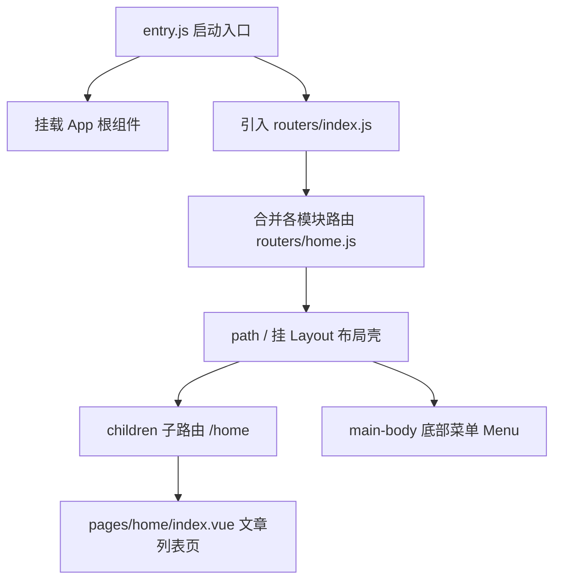

# 文章列表页初始化：路由骨架、频道栏落位与首屏数据槽

前端工程上一课已经跑起来：手机壳预览页带着搜索框与底部菜单。home 页面本身还是空的，文章列表的第一步不是发请求，而是把页面骨架立起来：路由怎么把用户带进这个页面，布局壳怎么套，顶部频道栏怎么落位，首屏又凭什么先渲染出东西。这一课走完初始化全流程，产出一张结构完整、能看能切的列表页，真实数据从下一课接上。

## 先给结论

- 启动加载链固定几步：entry.js 引入 App 根组件与路由入口，routers/index.js 汇总各模块路由，home 路由把 / 挂到 Layout 布局壳，子路由 /home 指向 pages/home/index.vue。
- Layout 是通用壳：router-body 放二级路由视图，main-body 放底部菜单，各模块页面只写自己的内容区。
- 频道栏用 weex-ui 的 WxcTabPage 加 WxcPanItem，页签内容与样式抽到同目录 config.js，tabTitles 里每个页签带一个 id 作频道标识。
- created 阶段取页面高度并按频道数初始化数据槽，默认频道先塞一组固定数据跑通渲染；mounted 里通过 $refs 调 setPage(1) 把默认选中切到「推荐」。
- 搜索栏是 components 下的业务组件 HomeBar，import 之后必须在 components 里声明，模板里才能用。

## 从 entry.js 到 home 页：一条加载链

页面初始化先要弄清「页面是怎么被加载出来的」。启动项目后，入口文件 entry.js 做两件事：把 App 根组件挂载进实例，同时引入路由配置。路由入口在 src/routers 下，index.js 负责汇总，各业务模块的路由分散在同级文件里，home 模块的配置就是文章列表页的出生证明：



home 模块的路由定义如下，路径里的 @ 指向 src 根目录：

```javascript
// src/routers/home.js：home 模块的路由
import Layout from '@/components/layouts/layout_main';
import Home from '@/pages/home/index';

let routes = [
  {
    path: '/',
    component: Layout,
    children: [
      {
        path: '/home',
        name: 'Home',
        component: Home
      }
    ]
  }
];

export default routes;
```

这是一组父子路由：path 为 / 的节点挂 Layout，/home 作为子节点挂在它下面。routers/index.js 只做合并，把各模块导出的数组收拢成一个总表交给实例，按合并职责补全后的写法是 `import home from './home'` 后展开合并导出。Layout 布局壳决定了所有页面的公共骨架：

```vue
<template>
  <div class="wrapper">
    <!-- 二级路由视图：各模块页面渲染在这里 -->
    <div class="router-body"><router-view></router-view></div>
    <!-- 公共底部菜单 -->
    <div class="main-body"><Menu></Menu></div>
  </div>
</template>

<script>
// 引入底部菜单
import Menu from '@/components/menus/menu';

export default {
  name: 'Weex-Layout-Main',
  components: { Menu }
};
</script>
```

router-view 是二级路由的出口，/home 指向的页面渲染在 router-body 里；底部菜单 Menu 写死在 main-body 里，切到任何子页面它都在。这也解释了预览页上「只有底部菜单、内容区空着」的现象：路由通了，home 页面还没内容。

## 频道栏落位：config.js 先行

内容区要放的是顶部频道栏，选型直接沿用上一课的 weex-ui：WxcTabPage 加 WxcPanItem。把官方 example 的模板与脚本拷进 index.vue，编译报错提示找不到 config，与底部标签栏那课是同一款问题，解法也一样：在 pages/home 目录下新建 config.js，写入频道页签与样式：

```javascript
export default {
  // 页签数组：id 是频道标识，切换频道时随请求带给后端
  tabTitles: [
    { title: '动态', id: '_dyna_' },
    { title: '推荐', id: '_all_' },
    { title: 'JAVA', id: 1 },
    { title: 'Python', id: 2 },
    { title: 'VUE', id: 3 },
    { title: 'WEEX', id: 4 },
    { title: '大数据', id: 5 },
    { title: 'Docker', id: 6 },
    { title: '其它', id: 0 }
  ],
  tabStyles: {
    bgColor: '#FFFFFF',
    titleColor: '#B6665B',
    activeTitleColor: '#31D3D3',
    isActiveTitleBold: true,
    width: 120,
    height: 80,
    fontSize: 24,
    hasActiveButton: true,
    activeBottomColor: '#31D3D3',
    activeBottomHeight: 6,
    normalBottomColor: 'rgba(0,0,0,0.4)',
    normalBottomHeight: 2,
    textPaddingLeft: 10,
    textPaddingRight: 10,
    hasRightIcon: false,
    rightOffset: 100
  }
};
```

顶部栏是纯文字样式，与底部标签栏的图标模式不同：hasActiveButton 加 activeBottomColor、activeBottomHeight 画出选中页签底部的高亮短横，选中色与未选中色分开配置。tabTitles 里每个页签除了标题还带一个 id，它是频道标识，「动态」与「推荐」两个聚合页签用 _dyna_ 与 _all_ 这样的占位值，普通页签直接用频道 ID。这个 id 现在还用不上，切频道发请求时它就是请求参数的取值来源，配置阶段先定好，后面就不会临场翻 config 找编号。

## 页面骨架与组件注册

index.vue 的模板分两块：上面的搜索区，下面整个频道栏加各频道的列表区：

```html
<template>
  <div class="wrapper">
    <!-- 顶部搜索区：业务组件 -->
    <home-bar></home-bar>
    <!-- 频道栏 + 各频道列表 -->
    <wxc-tab-page ref="wxc-tab-page"
                  :tab-titles="tabTitles"
                  :tab-styles="tabStyles"
                  title-type="text"
                  :tab-page-height="tabPageHeight"
                  @wxcTabPageCurrentTabSelected="wxcTabPageCurrentTabSelected">
      <list v-for="(demo, key) in tabList" :key="key">
        <cell v-for="(v, index) in demo" :key="index">
          <!-- 每篇文章一个可点击项，url 带文章 id 跳详情 -->
          <wxc-pan-item :url="detailUrl(v)">
            <div class="content"><text>{{v.title}}</text></div>
          </wxc-pan-item>
        </cell>
      </list>
    </wxc-tab-page>
  </div>
</template>
```

脚本的引入部分有一个现场坑值得记录：搜索栏组件 HomeBar 在 src/components/bars 下，import 进来后如果忘了在 components 里声明，编辑器里这个标签会显示成灰色、页面不渲染，声明补上才生效：

```javascript
const dom = weex.requireModule('dom');
import { WxcTabPage, WxcPanItem, Utils, BindEnv } from 'weex-ui';
import Config from './config';
import HomeBar from '@/components/bars/home_bar.vue';

export default {
  components: { WxcTabPage, WxcPanItem, HomeBar },
  data () {
    return {
      tabTitles: Config.tabTitles,
      tabStyles: Config.tabStyles,
      tabList: [],
      // 联调前用于占位的固定数据
      demoList: [1, 2, 3, 4, 5, 6, 7, 8, 9],
      tabPageHeight: 1334
    };
  },
  created () {
    this.tabPageHeight = Utils.env.getPageHeight();
    // 按频道数量生成槽位，每个页签占一格
    this.tabList = [...Array(this.tabTitles.length).keys()].map(i => i);
    // 默认频道先塞固定数据，请求接上之前页面先能看出结构
    Vue.set(this.tabList, 0, this.demoList);
  },
  methods: {
    wxcTabPageCurrentTabSelected (e) {
      // 切换频道时在这里补齐数据，下一课发请求后填充
    },
    detailUrl (v) {
      // 点击卡片跳详情页，文章 id 作为跳转参数
      return 'http://你的详情页地址/article-detail?id=' + v.id;
    }
  }
};
```

## created 与 mounted 的分工

两个生命周期钩子在本页各管一段。created 阶段 DOM 还没渲染，适合做纯数据准备：取页面高度、生成 tabList 槽位、给默认频道塞固定数据。tabList 的初始化写法是官方 example 带来的技巧，先按页签数量生成一串下标占位，再用 Vue.set 把第 0 格替换成 demoList，固定数据 1 到 9 渲染成一列占位卡片，页面立刻有了「资讯流」的样子，联调前的视觉验收就靠它。

mounted 阶段 DOM 已经就绪，ref 也能取到了：

```javascript
mounted () {
  // 默认选中第 2 个页签「推荐」，下标从 0 数起
  this.$refs['wxc-tab-page'].setPage(1);
}
```

setPage 的参数是页签下标，从 0 开始，传 1 选中的就是「推荐」。这个调用还有一层意义：它会连带触发 wxcTabPageCurrentTabSelected 事件，等于替用户完成了一次页签切换，后面把请求挂进事件处理时，默认频道的数据加载也能被这一句带起来。

页面跳转参数在本页有两处入口。一处是 wxc-pan-item 的 url 属性，点击卡片跳详情页，文章 id 拼在地址上，详情页按 id 加载内容，上面的 detailUrl 方法就是干这个的；另一处是路由层面的 /home 路径，它决定页面地址，配合 setPage 的下标参数，完成「进页面即落在指定频道」的效果。

## 常见误区

- **import 完忘记在 components 里声明。** 模板里的标签不渲染也不报错，编辑器里标签变灰是典型信号，HomeBar 没声明时搜索区整块消失。
- **tabPageHeight 写死。** 官方示例里的默认值只在特定设备上正确，必须用 Utils.env.getPageHeight() 取实际高度，否则频道栏内容区在多数机型上高度错位。
- **固定数据用下标直接赋值。** `this.tabList[0] = this.demoList` 这种写法在 Vue 2 里不保证触发视图更新，要用 Vue.set 或整体替换数组。
- **页签不配 id。** 切频道时请求参数要从 tabTitles 里取频道标识，配置阶段漏掉 id，后面切换频道就不知道该向后端要哪个频道的数据。

## 面试可能被问到的问题

1. 面试官追问：「从 entry.js 到页面渲染，中间经过哪些环节？」
   答：entry.js 挂载 App 根组件并引入路由配置；routers/index.js 汇总各模块路由文件；home 路由把 / 挂到 Layout 布局壳，/home 作为子路由指向 pages/home/index.vue；Layout 里 router-view 渲染子页面、Menu 渲染公共底部菜单。整条链路把「入口、路由、布局、页面」四层职责分开。
2. 面试官追问：「created 与 mounted 的区别？本页各做了什么？」
   答：created 时实例完成数据初始化但 DOM 未渲染，mounted 时 DOM 已就绪、ref 可用。本页 created 里取页面高度、初始化 tabList 槽位并塞入默认频道的固定数据；mounted 里通过 $refs 调 setPage(1) 设置默认选中页签，涉及视图与组件实例的操作放在 mounted。
3. 面试官追问：「父子路由里 Layout 起什么作用？」
   答：Layout 是公共布局壳，把各页面共用的结构（底部菜单）收敛在一处，router-view 作为二级路由出口渲染子页面。子页面只关心内容区，公共骨架的调整只在 Layout 一处进行，避免每个页面复制一份菜单。
4. 面试官追问：「tabTitles 里的 id 有什么用？」
   答：id 是频道标识，切换页签时从当前页签对象上取出来塞进请求参数，后端按它过滤对应频道的数据。「动态」「推荐」这类聚合页签用约定占位值，普通页签直接用频道 ID，配置与请求参数因此一一对应。
5. 面试官追问：「setPage(1) 是什么含义？」
   答：setPage 是 WxcTabPage 提供的方法，参数是页签下标、从 0 开始，传 1 即选中第二个页签「推荐」。它常在 mounted 里调用以设定默认频道，调用还会触发页签切换事件，默认频道的数据加载可以借这个事件带起来。

## 配套资料

- 代码：`materials/code/05/头条day02/`，资料目录下的 weex 组件综合示例（`weex组件介绍.vue`）含 list、cell、loading、refresh 与 stream 的串联写法，可对照本课页面里的同名结构；资料包内层目录名冠以项目原名，正文统一以「头条类资讯项目」指代。
- 说明：文章列表页的 index.vue、config.js、路由与布局文件不在资料包内，文中代码为按画面线与主流写法补全的可运行版本；routers/index.js 的合并逻辑按其汇总职责补全，接口口径与接口定义、接口编码两课保持一致。
