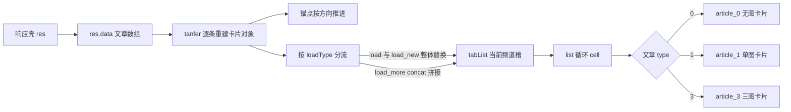

# 文章列表数据展示：三种卡片、数据转换与上拉下拉拼接

请求已经通了，控制台打印出统一响应壳，页面还是空的。这一课把数据真正画上屏幕：先过一道转换层，把响应壳里的文章数组重建成卡片需要的形状；再按文章形态把数据分发给三种卡片组件；最后把上拉与下拉两个手势接上，资讯流「刷新、续读」的完整闭环就此形成。

## 先给结论

- 文章卡片三种形态：0 无图、1 单图、3 三图，components/cells 下 article_0、article_1、article_3 三个组件各管一种，页面按文章的 type 字段条件渲染。
- 接口返回先过 tanfer 转换：从 res.data 取文章数组，逐条重建成卡片对象，再按当前频道下标回填 tabList；上拉方向用 concat 拼接，首次与下拉方向整体替换。
- 时间字段是 13 位毫秒时间戳，卡片组件里的 formatDate 负责转成「x 分钟前」「x 小时前」这类相对时间。
- 上拉把 loadType 切到 load_more 并用已加载最早一条的时间作锚点，下拉切到 load_new 用最新一条，方向不同，数据语义一个是拼接一个是替换。
- 切换频道时把页签的 id 赋给 params.channelId 再发请求，否则数据会落错频道页。

## 三种卡片：一个形态一个组件

需求分析课定过信息流的卡片形态：文章展示分三种情况，无图、单图、多图，多图固定渲染三张。前端把每种形态做成独立组件，放在 src/components/cells 下，命名直接用形态编号：article_0.vue 无图、article_1.vue 单图、article_3.vue 三图。

组件编码上有一个口径要分清：数据库 ap_article 表的 layout 字段用 0、1、2 标注无图、单图、多图，接口返回给前端的文章对象里叫 type，取值 0、1、3。前端只认接口的 type，两套编码不要混着判断。

无图卡片最简单，标题加一行元信息：

```html
<template>
  <div class="item-container">
    <text class="title">{{item.title}}</text>
    <div class="meta">
      <text class="meta-text">{{item.source}}</text>
      <text class="meta-text">{{item.comment}} 评论</text>
      <text class="meta-text">{{formatDate(item.publishTime)}}</text>
    </div>
  </div>
</template>

<script>
export default {
  props: ['item'],
  methods: {
    // 13 位毫秒时间戳转相对时间
    formatDate (ts) {
      const diff = Date.now() - ts;
      const minute = 60 * 1000;
      const hour = 60 * minute;
      if (diff < hour) {
        return Math.max(1, Math.floor(diff / minute)) + ' 分钟前';
      }
      if (diff < 24 * hour) {
        return Math.floor(diff / hour) + ' 小时前';
      }
      const d = new Date(ts);
      return d.getFullYear() + '-' + (d.getMonth() + 1) + '-' + d.getDate();
    }
  }
};
</script>
```

单图卡片在无图版式上加一张右侧配图，元信息不变；三图卡片则把图片区放在标题下方，用 v-for 循环文章的图片数组：

```html
<template>
  <div class="item-container">
    <text class="title">{{item.title}}</text>
    <!-- 多图形态：图片数组循环渲染，横排三张 -->
    <div class="images">
      <image class="thumb"
             v-for="(img, i) in item.images"
             :key="i"
             :src="img"
             resize="cover"></image>
    </div>
    <div class="meta">
      <text class="meta-text">{{item.source}}</text>
      <text class="meta-text">{{item.comment}} 评论</text>
      <text class="meta-text">{{formatDate(item.publishTime)}}</text>
    </div>
  </div>
</template>
```

三个组件结构同源，都是 props 接收一个 item 对象，模板与样式按形态各自展开。拆成三个组件而不是一个组件里堆 v-if，好处是每种版式独立演进，加新形态时新增一个组件、分发处加一个分支即可，互不牵连。

## tanfer：从响应壳到卡片数据

数据进页面前要先过一道转换，方法名叫 tanfer。它的诞生带着一个调试现场：最初把请求结果直接交给循环渲染，页面毫无反应；在方法里打断点单步跟，循环变量出来是 undefined。原因在响应壳的结构上，request.js resolve 回来的是 ResponseResult，外层还有 code 与 message，文章数组在 res.data 里，直接循环拿到的是空。修正成先取 res.data，数据立刻就通了。

转换层做三件事，代码如下：

```javascript
// 数据转换：响应壳里的文章数组重建成卡片对象，按频道槽位回填
tanfer (res) {
  const self = this;
  const data = res.data || [];
  const arr = data.map(a => ({
    id: a.id,
    type: a.type,                 // 0 无图 1 单图 3 三图
    title: a.title,
    source: a.authorName,         // 来源展示作者昵称
    comment: a.comment,
    publishTime: a.publishTime,   // 13 位毫秒时间戳
    images: a.images || []
  }));

  // 锚点维护：列表按发布时间倒序，按加载方向各取所需
  if (arr.length > 0) {
    if (self.loadType === 'load') {
      self.params.maxTime = arr[arr.length - 1].publishTime;
      self.params.minTime = arr[0].publishTime;
    } else if (self.loadType === 'load_more') {
      self.params.maxTime = arr[arr.length - 1].publishTime;  // 向更早推进
    } else {
      self.params.minTime = arr[0].publishTime;               // 向更新推进
    }
  }

  // 组装新 tabList：上拉拼接，首次与下拉替换，其余频道槽位原样保留
  const slot = self.tabIndex;
  self.tabList = self.tabList.map((v, i) => {
    if (i != slot) {
      return v;
    }
    if (self.loadType === 'load_more' && Array.isArray(v)) {
      return v.concat(arr);
    }
    return arr;
  });
}
```

重建字段、维护锚点、按方向回填，缺一不可。锚点维护的条件分支值得细看：首次加载两个方向的锚点都由本批数据的头尾确定；上拉方向只把 maxTime 推向更早，minTime 必须留在原值，否则已加载与最新一批之间的文章会被跳过；下拉方向反之。回填时整体替换 tabList 数组，而不是 `this.tabList[slot] = arr` 这样的下标赋值，Vue 2 对数组下标赋值的响应支持不完整，整体替换最稳。数据的完整流向如下图：



关键路径在 tanfer 到 cell 之间：转换层输出的数组结构，就是卡片组件 props 接收的 item，两层靠这份字段契约对齐。

## 频道切换与模板分发

卡片组件 import 进页面后在 components 里注册，模板的 cell 里按 type 分发，替换掉原来的占位 text：

```html
<cell v-for="(v, index) in demo" :key="index">
  <article-0 v-if="v.type == 0" :item="v"></article-0>
  <article-1 v-else-if="v.type == 1" :item="v"></article-1>
  <article-3 v-else-if="v.type == 3" :item="v"></article-3>
</cell>
```

频道切换是数据展示的最后一块拼图。页面上有个隐蔽的错位现象：数据明明请求回来了，动态页签下有内容，「推荐」页签却空着。原因是 mounted 里 setPage(1) 只把选中态切到了「推荐」，请求参数里的频道标识还停留在初始值，数据被填进了别的槽位。修正方法是在页签切换事件里同步频道标识：

```javascript
wxcTabPageCurrentTabSelected (e) {
  const self = this;
  const index = e.page;
  self.tabIndex = index;
  // 当前页签的 id 就是频道标识，聚合页签的占位值按默认频道处理
  const tab = self.tabTitles[index];
  self.params.channelId = (tab.id == '_all_' || tab.id == '_dyna_') ? null : tab.id;
  // 没有数据的频道才发请求，已加载过的不重复拉
  if (!Array.isArray(self.tabList[index]) || self.tabList[index].length == 0) {
    self.loadType = 'load';
    self.load();
  }
}
```

下标与频道标识同步之后，setPage 触发的事件会把「推荐」的请求带上正确的 channelId，数据落进选中页签的槽位，首屏列表完整展示。

## 上拉与下拉：方向参数与拼接

手势部分沿用基本组件课的结构，loading 挂列表尾部承担上拉，refresh 挂列表头部承担下拉，提示文案分别配「加载更多」与「加载更新」：

```html
<list v-for="(demo, key) in tabList" :key="key">
  <cell v-for="(v, index) in demo" :key="index">...</cell>
  <!-- 上拉加载更多 -->
  <loading class="loading"
           @loading="onloading"
           :display="showLoading ? 'show' : 'hide'">
    <text class="loading-text">{{loadMoreText}}</text>
    <loading-indicator></loading-indicator>
  </loading>
  <!-- 下拉刷新 -->
  <refresh class="loading"
           @refresh="onrefresh"
           :display="showRefresh ? 'show' : 'hide'">
    <text class="loading-text">{{loadNewText}}</text>
    <loading-indicator></loading-indicator>
  </refresh>
</list>
```

data 里补上指示器状态与文案字段，两个手势的处理函数都归结为「切方向、开指示器、发请求」三步：

```javascript
// 上拉：方向切到 load_more，锚点用已加载最早一条
onloading () {
  this.loadType = 'load_more';
  this.showLoading = true;
  this.load();
},
// 下拉：方向切到 load_new，锚点用已加载最新一条
onrefresh () {
  this.loadType = 'load_new';
  this.showRefresh = true;
  this.load();
}
```

真正按方向改参数、拼接数据、复位指示器的位置都在 load 与 tanfer 里，load 的 then 与 catch 两个分支都要把 showLoading、showRefresh 连同 loading 一起复位，这正是基本组件课留下的那个坑：不复位，转圈动画不消失，后续手势也不再触发。测一遍完整流程：下拉列表顶部，指示器短暂出现后消失，新文章混进列表头部；滚到底继续上拉，下一批文章拼在尾部，锚点随每批数据推进，滚多久都不重不漏。

## 常见误区

- **拿响应壳直接循环。** res 外层还有 code 与 message，必须先取 res.data 拿到文章数组再遍历，直接循环响应壳得到 undefined。
- **上拉加载用替换而不是拼接。** 直接给当前频道槽位赋新数组会丢掉前几页数据，load_more 方向的正确语义是 concat 拼在旧列表后面。
- **时间戳直接上屏。** 发布时间按全局序列化口径是 13 位毫秒值，直接展示是一串数字，卡片组件里用 formatDate 转成相对时间或日期。
- **tabList 用下标赋值回填。** `this.tabList[slot] = arr` 在 Vue 2 里不保证触发视图更新，用整体替换或 Vue.set。
- **切频道不带 channelId。** setPage 只切了选中态，请求参数里的频道标识要靠切换事件里同步页签 id，漏了这步数据就落错频道页。

## 面试可能被问到的问题

1. 面试官追问：「三种卡片形态怎么分发渲染？为什么拆成三个组件？」
   答：cell 里对文章的 type 做 v-if 分支，0、1、3 分别渲染 article_0、article_1、article_3。拆组件让每种版式独立演进，结构与样式互不干扰，新增形态只加组件加分支；三图组件内部用 v-for 循环图片数组，天然支持多图扩展。
2. 面试官追问：「tanfer 转换层解决了什么问题？」
   答：它隔离了接口数据与视图数据。响应壳剥壳、字段重建成卡片需要的形状、锚点按方向推进、按频道槽位回填都收在这一层；接口结构调整时只改转换层，卡片组件与页面逻辑不动，出了渲染问题也先在这一层打断点。
3. 面试官追问：「上拉与下拉的请求参数差异在哪？」
   答：loadType 分别取 load_more 与 load_new，决定请求 load_more 还是 load_new 接口；锚点方向相反，上拉传已加载里最早一条的发布时间给 maxTime，查更早的一批，下拉传最新一条给 minTime，查更新的一批。数据语义也不同，上拉 concat 拼接，下拉整体替换。
4. 面试官追问：「tabList[slot] = arr 为什么可能不更新视图？」
   答：Vue 2 的响应系统基于 Object.defineProperty，对数组只拦截了部分变异方法，按下标赋值不在其中，数据变了视图不刷新。解决办法是整体替换数组或用 Vue.set 指定下标，项目里选了整体替换，顺带把其余槽位的保留逻辑写在一处。
5. 面试官追问：「发布时间为什么后端传时间戳、前端格式化？」
   答：时间戳是唯一确定的时间表示，不受时区与格式影响，序列化口径全工程统一；展示格式属于前端关注点，资讯流习惯用「x 分钟前」这类相对时间，详情页用完整日期，同一个字段两种渲染互不干扰。后端传格式化字符串会把展示决策锁死在服务端，改版式就得动接口。
6. 面试官追问：「切换频道时数据落在错误页签，这类问题怎么排查？」
   答：先确认选中态与请求参数是否同步，setPage 改的只是组件选中态，请求参数要靠切换事件把页签 id 同步进 params；再核对数据回填的下标是否取自同一个状态变量。本质是「视觉选中」与「数据槽位」两条线没有对齐，把 tabIndex 作为唯一事实来源即可根治。

## 配套资料

- 代码：`materials/code/05/头条day02/`，资料目录下的 weex 组件综合示例（`weex组件介绍.vue`）含 list、cell、loading、refresh 与 stream 的完整串联写法，可对照本课列表结构中的同名部件；资料包内层目录名冠以项目原名，正文统一以「头条类资讯项目」指代。
- 说明：day02 无 Java 后端源码；三种卡片组件、tanfer 与手势处理代码不在资料包内，文中代码为按画面线与主流写法补全的可运行版本；type 取值 0、1、3 与锚点方向语义按画面线与接口口径整理，与接口定义、接口编码两课保持一致。
