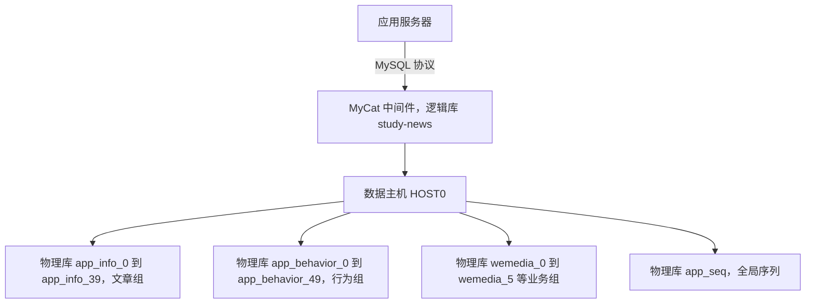
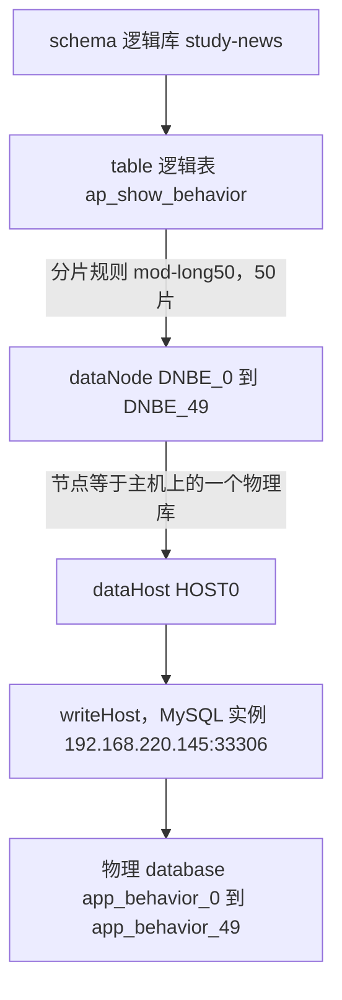

# MyCat 概念落地：逻辑库、分片节点与数据主机的三层映射

> 🔒 安全提示：文中示例的口令/密钥均为课程教学环境演示口径，生产环境的安全要求见《安全与合规须知》。

上一课算了量级账，结论是必须拆。这一课把 MyCat 的名词表一次立清：逻辑库、逻辑表、分片节点、数据主机、分片规则。这些概念不是五个孤立词条，而是一张从应用到物理机的三层映射表，每一层都能在项目真实的 schema.xml 里找到对应行。概念讲解按《MyCat 权威指南》的口径来（MyCat 开源项目组编写，课程资料随 mycat 配置一并提供），落点全部对到真实配置。

## 先给结论

- MyCat 是数据库中间件：对上实现 MySQL 协议，应用像连单库一样连它；对下按规则把 SQL 路由到 N 个物理库并聚合结果。
- 三层映射：逻辑表属于逻辑库 schema，逻辑库映射到一组分片节点 dataNode，每个 dataNode 落在某个数据主机 dataHost 的某个物理 database 上。
- 逻辑表四类：分片表（多片各存一部分）、非分片表（只存一片）、全局表（每片全量冗余）、ER 表（父子表绑定同片）。
- 分片规则 rule 由分片列加算法函数组成，rule.xml 里一条 tableRule 绑一列、一列挂一个 function，项目主力是 mod-long 取模。
- 主键由全局序列接管：server.xml 的 sequnceHandlerType 为 1 走数据库方式，sequence_db_conf.properties 给每张表指定序列存放节点，联调课写死 id 的伏笔在这里收口。

## 数据库中间件：一个伪装成 MySQL 的路由器

没有中间件的世界里，应用直连数据库；一旦拆成多个库，应用要维护多套数据源、自己判断 SQL 去哪个库、自己合并结果。MyCat 把这件事接过去：应用只连 MyCat 一个地址，用的还是 MySQL 协议与 JDBC，感知不到后面有几个库。项目资料的 mycat 配置给出的映射全景如下：



图上所有分片都挂在 HOST0 一台主机下，这是课程环境的单机演示形态：每个分片是同一 MySQL 实例里的一个 database，概念结构一应俱全。生产环境把 dataHost 指向不同机器即可，配置骨架不变，分片与机器本来就是两个层级的事。

## 逻辑库与逻辑表：应用看到的那一层

逻辑库就是 schema 标签，name 属性是应用连接后看到的库名，`use study-news` 之后操作的全部是里面的逻辑表，背后有多少物理库与应用无关。schema 上还有两个常被忽略的属性：checkSQLschema 为 true 时剥掉语句里的库名前缀，sqlMaxLimit 为 100 给没有 limit 的查询自动兜底，防止单表失控查询打穿分片。应用侧的账号与授权在 server.xml 里定义：

```xml
<user name="root">
    <property name="password">123456</property>
    <property name="schemas">study-news</property>
</user>
```

user 的 schemas 属性把这个账号可用的逻辑库圈死，应用连接 MyCat 默认端口 8066（server.xml 注释里的 serverPort 配置项可改）。逻辑库名按中性口径改写，原配置的命名含机构前缀，结构与语义照录。

逻辑表分四类，前两类的区别就在 table 标签的 dataNode 写法上：

```xml
<!-- 分片表：40 片，按 rule 路由，每片只存一部分数据 -->
<table name="ap_article" dataNode="DNAP_$0-39" autoIncrement="true" primaryKey="id" rule="mod-long40"/>
<!-- 非分片表：只落在 DNAP_0 一个节点，整表数据都在那 -->
<table name="ap_author" dataNode="DNAP_0" autoIncrement="true" primaryKey="id"/>
<!-- 全局表：每个分片全量冗余一份，type 为 global -->
<table name="QUARTZ_QRTZ_TRIGGERS" dataNode="DNSQ" type="global"/>
```

分片表是拆分的主角，同一张表在每个分片各有一份骨架，数据按规则切开。非分片表量小、少关联，放一个节点即可，路由直接透传。全局表是字典类小表的专用形态：数据量不大但到处要 join（调度器配置、频道、标签这类），干脆每个分片放全量，join 在本地完成，牺牲一点存储换掉跨库 join 这个最大的麻烦。ER 表按父子关系绑定分片：子表跟随父表的分片键走，一篇文章与其评论落在同一片，关联查询不需要跨库，配置上通过子表沿用父表的规则实现。

## dataNode 与 dataHost：库与机器的两级落点

dataNode 是「某台主机上的某个库」的具名引用，一行三个属性把名字、主机、物理库绑在一起：

```xml
<dataNode name="DNAP_0" dataHost="HOST0" database="app_info_0"/>
<dataNode name="DNBE_0" dataHost="HOST0" database="app_behavior_0"/>
```

schema.xml 里几十行 dataNode 排下来，分片拓扑一目了然：DNAP 组 40 个、DNBE 组 50 个、自媒体与爬虫各 6 个，每组指向 HOST0 上的一个 database。逻辑表的 dataNode 属性用 `DNAP_$0-39` 这种区间写法引用一组节点，与 40 条手写等价。

dataHost 描述一台数据库机器的连接方式与策略：

```xml
<dataHost name="HOST0" maxCon="600" minCon="200" balance="0"
          writeType="0" dbType="mysql" dbDriver="native" switchType="1" slaveThreshold="100">
    <heartbeat>select user()</heartbeat>
    <writeHost host="HOST0_M" url="192.168.220.145:33306" user="root" password="123456"/>
</dataHost>
```

maxCon 与 minCon 是 MyCat 到这台机器的连接池上下限，上一课说的连接数收敛就落在这个属性上；heartbeat 每隔一段时间对写节点做探活，是故障切换的依据；writeHost 声明写节点地址，balance 与 switchType 是读写分离与主从切换的开关位，项目当前单写节点、不做读写分离，先取关闭值。dbDriver 用 native 表示 MyCat 用原生 MySQL 协议直连。

## rule.xml：分片列与算法函数

一条分片规则由 tableRule 与 function 两段拼成，tableRule 指定列，function 指定算法：

```xml
<tableRule name="mod-long40">
    <rule>
        <columns>id</columns>
        <algorithm>mod-long40</algorithm>
    </rule>
</tableRule>

<function name="mod-long40" class="io.mycat.route.function.PartitionByMod">
    <property name="count">40</property>
</function>
```

语义是 id 对 40 取模，结果落在 DNAP_0 到 DNAP_39 中的哪一个。规则名与 dataNode 数量对应（mod-long40 配 40 片、mod-long50 配 50 片），一张表引哪条规则，写进 schema.xml 的 table 标签即可。分片列的选择要贴着查询模式走：按 id 取模利于点查与写入均匀，代价是范围查询要扫全片；行为组另有一类自定义的 burst 规则，按主体聚簇并预留节点量（单组容量 5 亿、50 个节点），算法类为项目自研实现，引用时类名做了中性化改写。规则一旦上线不要轻易改，改规则意味着数据重分布，代价与迁移无异。

## 主键序列：收掉写死 id 的伏笔

分片之后主键不能靠任何单一实例自增，MyCat 的答案是全局序列。server.xml 里一行开关选定发号方式：

```xml
<property name="sequnceHandlerType">1</property>
```

1 是数据库方式：序列值集中存到一个物理库（app_seq，对应 dataNode DNSQ），发号走数据库保证唯一。哪张表的序列放在哪个节点，由 sequence_db_conf.properties 按表名大写逐行指定：

```properties
AP_ARTICLE=DNSQ
AP_SHOW_BEHAVIOR=DNSQ
```

schema.xml 里分片表的 autoIncrement 设为 true、primaryKey 指向 id，两处配置合起来，应用侧 insert 不再需要给 id 赋值，MyCat 取序列填好再路由。联调课的过渡方案在这里兑现：insert 语句里的 id 列可以整体删掉，id 与 article_id 同值的写死数据一并清理，主键从「应用自己维护」变成「中间件统一发号」。

## 三层映射收束

从应用的一条 SQL 到物理库的一行数据，映射链是：逻辑表（分片规则）到分片节点，分片节点到数据主机，数据主机到物理 database。



读配置时顺着这条链走：先看 schema 里表的 rule 与 dataNode 区间，再按节点名查 dataNode 行落到哪个主机哪个库，最后看 dataHost 行的连接与策略。三张配置文件（schema.xml、rule.xml、server.xml）加一份序列映射（sequence_db_conf.properties）就是 MyCat 的全部核心配置，概念的每一层都有唯一的落点，不存在悬空的名词。

## 常见误区

- **把逻辑库当物理库。** 一个逻辑库背后可能覆盖几十个物理库，库名相同不代表是同一个库；删表、改表这类 DDL 要意识到它可能作用在多个分片上。
- **dataNode 与 dataHost 混为一谈。** 节点是库级别的概念，主机是机器级别的概念，一台主机上可以挂任意多个节点；容量规划按节点算，机器与连接按主机算。
- **全局表当分片表配置。** 全局表要标 type 为 global 且不配 rule，漏标会把字典表当分片表切开，join 反而跨库；反向给分片表标 global 则等于放弃拆分。
- **分片列随便选。** 列一旦定下，数据分布与查询路由全部锁死；选一个业务上会修改的字段，或与主要查询模式错位的字段，后续都是数据迁移级别的返工。
- **配了 autoIncrement 应用还手填 id。** 序列接管后两套发号来源并存，迟早撞号；接入 MyCat 后把 insert 里的 id 列与写死值一并移除。

## 面试可能被问到的问题

1. 面试官追问：「schema.xml 的三层结构分别是什么？」
   答：schema 层定义逻辑库与逻辑表，table 标签声明表是分片表、非分片表还是全局表并绑定规则；dataNode 层把节点具名为某主机上的某个物理库；dataHost 层描述机器的连接池、心跳与读写节点。三层从上到下完成逻辑到物理的映射。
2. 面试官追问：「全局表的原理与适用场景？」
   答：全局表在每个分片都存一份全量数据，写入时同步到所有节点，join 在本地分片内完成。适合数据量小、读多写少、到处关联的字典表，如频道、标签、调度配置；用少量存储冗余换掉跨库 join。
3. 面试官追问：「mod-long 取模规则的优劣是什么？」
   答：优点是写入均匀、点查一次定位、实现极简；缺点是扩容要改 count 导致全量重分布，范围查询退化为扫全片。点查为主、写入均匀的场景合适，范围查询密集或频繁扩容的场景要考虑一致性哈希类规则。
4. 面试官追问：「MyCat 的全局序列有哪几种方式？」
   答：本地文件方式简单但性能与可靠性受限；数据库方式把序列集中在专门库发号，可靠性好且有批量取段的优化；本地时间戳类算法无中心依赖但时钟敏感；还有借 ZooKeeper 协调的方式。项目取数据库方式，sequnceHandlerType 为 1。
5. 面试官追问：「应用从直连 MySQL 切到 MyCat 要改什么？」
   答：连接串换成 MyCat 地址与默认端口 8066，库名换成 server.xml 里授权的逻辑库名，账号密码换成 MyCat 侧定义的 user；SQL 与 ORM 层基本不动，但要注意跨库 join 与事务在新架构下的语义变化。
6. 面试官追问：「dataHost 上的 balance 与 switchType 各管什么？」
   答：balance 控制读负载的分配策略，决定查询走写节点还是均衡到读节点；switchType 控制故障切换的行为与探测方式，配合 heartbeat 的探活结果把写节点切到备机。单写节点、暂不做读写分离时两者取关闭值。

## 配套资料

- 代码：`materials/code/05/头条day02/`，mycat 相关配置四件套：schema.xml、rule.xml、server.xml、sequence_db_conf.properties，文中全部配置节选出自其中。
- 说明：《MyCat 权威指南》为口播提到的参考书目，概念口径依书；配置节选为真实资料内容，逻辑库名与自定义分片算法类名做了品牌中性化改写，其余连接地址与参数保留课程环境原值。
