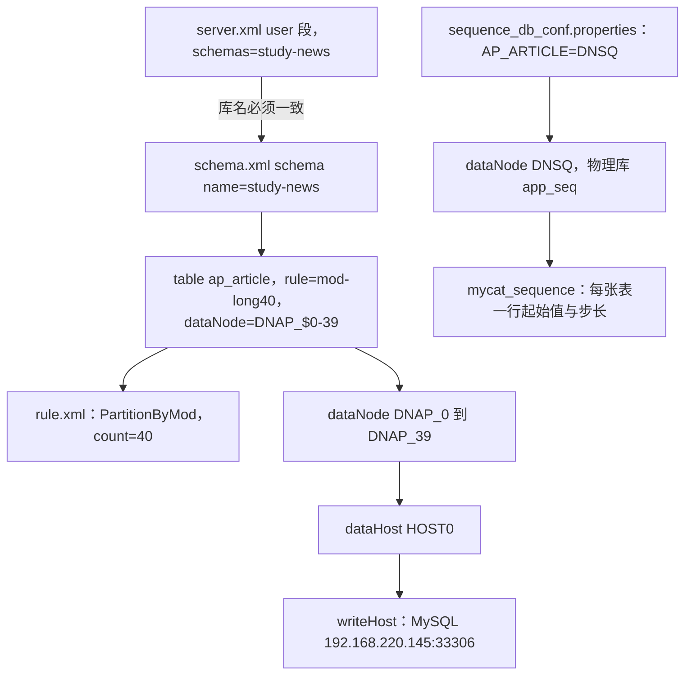

# MyCat 配置落地：四份文件各管什么，全量分库脚本怎么导

> 🔒 安全提示：文中示例的口令/密钥均为课程教学环境演示口径，生产环境的安全要求见《安全与合规须知》。

节点规划表定稿后，轮到把拓扑写进 MyCat 的配置里。MyCat 的配置集中在 conf 目录下的四份文件，各管一段：server.xml 管连接凭据与运行参数，schema.xml 管逻辑库与分片节点，rule.xml 管分片策略，sequence_db_conf.properties 管全局序列登记。配置之外还有一件容易低估的工作：把几十个物理库一口气建出来，靠一份全量脚本而不是几十条手敲的建库语句。这一课把四份文件逐段拆开讲，再走一遍脚本导入。

## 先给结论

- MyCat Windows 版解压到干净目录即可用，本机要有 JDK 环境，双击 bin 下的启动脚本拉起进程，控制台滚出连接池建连日志即为启动成功。
- server.xml 的 user 段定义应用连 MyCat 的凭据，schemas 属性填逻辑库名，它必须与 schema.xml 里 schema 标签的 name 完全一致，错一个字符应用就找不到库。
- schema.xml 自上而下写三类东西：逻辑表（全局表、分片表、非分片表）、dataNode（节点等于某主机上的某个物理库）、dataHost（真实 MySQL 的地址与账号）。
- writeHost 里的用户名密码是 MyCat 连真实数据库用的，必须与 MySQL 实例一致；user 段里的密码是应用连 MyCat 用的，两套凭据语义不同，别混着理解。
- 建库用资料提供的 bak.sql 全量脚本，导入后生成 app_info_0 到 39、app_behavior_0 到 49 等全部分片库，物理库名与 dataNode 的 database 属性一一对上才算映射生效。

## 装一个能跑的 MyCat

配置之前得先有 MyCat。资料包的 mycat 相关目录里备好了 Windows 版发行包，解压到一个干净的目录即可，不需要安装程序；解压目录就是安装目录，conf 与 bin 都在里面。MyCat 本体基于 Java，本机必须装好 JDK 并配好环境变量，否则启动脚本一闪而过。

启动动作是进入 bin 目录，双击启动脚本（Windows 版为 `startup_nowrap.bat`）。启动成功的标志在控制台日志里：一串数据源初始化与连接池创建连接的记录滚动输出，说明 MyCat 已经完成到后端 MySQL 的连接预热。这份发行包里的配置文件保持原样也可以启动，接下来按四份文件的顺序把它们改成项目的拓扑。

## server.xml：凭据与运行参数

server.xml 管两件事：给应用用的连接账号，以及 MyCat 自身的运行参数。账号在 user 段：

```xml
<user name="root">
    <property name="password">123456</property>
    <property name="schemas">study-news</property>
</user>
```

user 的 name 与 password 就是应用连接 MyCat 时填的账号密码，设置成什么无所谓，代码里连库时对上即可。真正不能错的是 schemas 属性：它列出这个账号可用的逻辑库名，值必须与 schema.xml 里 schema 标签的 name 逐字一致，两边名字对不上，连接成功也查不到任何表。逻辑库名按项目口径做了中性化改写，结构与语义照录。

system 段是 MyCat 的运行参数，默认值能跑，但有几行要认识一下：

```xml
<property name="sequnceHandlerType">1</property>
<!-- 分布式事务开关，0 为不过滤 -->
<property name="handleDistributedTransactions">0</property>
<!-- off heap for merge/order/group/limit，1 开启 0 关闭 -->
<property name="useOffHeapForMerge">1</property>
<property name="memoryPageSize">1m</property>
<property name="spillsFileBufferSize">1k</property>
<property name="systemReserveMemorySize">384m</property>
<!-- 是否采用 zookeeper 协调切换 -->
<property name="useZKSwitch">true</property>
```

`sequnceHandlerType` 为 1 是全局序列走数据库方式，发号动作落在专门的序列库里；`handleDistributedTransactions` 关闭表示跨库事务不过滤，写入语义由业务侧自行把握；`useOffHeapForMerge` 开启后归并排序走堆外内存，分片多、结果集大时减轻 JVM 压力。注释掉的 serverPort 一行标着默认端口 8066，连接测试课会用到。

## schema.xml：把三层映射写全

schema.xml 是拓扑的主文件，从上到下分三段。第一段是 schema 标签与逻辑表清单：

```xml
<schema name="study-news" checkSQLschema="true" sqlMaxLimit="100">
    <!-- 全局表：调度器表 44 张全挂 DNSQ，type 为 global -->
    <table name="QUARTZ_QRTZ_TRIGGERS" dataNode="DNSQ" type="global"/>
    <!-- 分片表：40 片，按 id 取模，自增主键走全局序列 -->
    <table name="ap_article" dataNode="DNAP_$0-39" autoIncrement="true" primaryKey="id" rule="mod-long40"/>
    <table name="ap_show_behavior" dataNode="DNBE_$0-49" rule="mod-long50" autoIncrement="true" primaryKey="id"/>
    <!-- 非分片表：只落一个节点 -->
    <table name="ap_author" dataNode="DNAP_0" autoIncrement="true" primaryKey="id"/>
</schema>
```

table 标签的属性各司其职：name 是逻辑表名，与应用看到的表一致；dataNode 是数据落在哪组节点，`DNAP_$0-39` 的区间写法等价于手写 40 行；autoIncrement 与 primaryKey 成对出现，声明这张表的主键由 MyCat 发号；rule 指向 rule.xml 里的分片规则名。全局表的 type 标成 global，每个节点冗余全量，调度器这类到处要 join 的字典表全走这个形态；非分片表不配 rule，dataNode 只指一个节点，路由直接透传。

mod-long40 的路由语义用两个 id 算一遍：id 为 1 时，1 对 40 取模余 1，落 DNAP_1；id 为 40 时余 0，落 DNAP_0；id 41 到 80 又逐个错开铺满 40 个节点。写入按余数均摊，每片的量保持均衡。

第二段是 dataNode 清单，一行把节点名、主机、物理库绑死：

```xml
<dataNode name="DNSQ" dataHost="HOST0" database="app_seq" />
<dataNode name="DNAP_0" dataHost="HOST0" database="app_info_0" />
<dataNode name="DNBE_0" dataHost="HOST0" database="app_behavior_0" />
```

database 属性填的是物理库名，正是待会儿脚本要建出来的那些库；名字对不上，MyCat 路由过去就是连不上库的报错。

第三段是 dataHost，描述真实数据库怎么连：

```xml
<dataHost name="HOST0" maxCon="600" minCon="200" balance="0"
          writeType="0" dbType="mysql" dbDriver="native" switchType="1" slaveThreshold="100">
    <heartbeat>select user()</heartbeat>
    <writeHost host="HOST0_M" url="192.168.220.145:33306" user="root" password="123456"/>
</dataHost>
```

writeHost 的 url、user、password 是 MyCat 连接真实 MySQL 的三件套，这里的账号密码不能随便设，必须与那台实例上的真实账号一致；课程环境是虚拟机里的 MySQL，端口 33306。heartbeat 里的 `select user()` 定期探活，是后面故障切换的依据。maxCon 与 minCon 划出 MyCat 到这台主机的连接池上下限，几十个分片共享这一个池。

## rule.xml 与序列登记：规则从哪里来

table 标签里写的 `mod-long40` 只是规则名，真正的算法定义在 rule.xml，tableRule 指列、function 指算法，两段拼成一条规则：

```xml
<tableRule name="mod-long40">
    <rule>
        <columns>id</columns>
        <algorithm>mod-long40</algorithm>
    </rule>
</tableRule>

<function name="mod-long40" class="io.mycat.route.function.PartitionByMod">
    <property name="count">40</property>
</function>
```

MyCat 内置的算法类都在 `io.mycat.route.function` 包里，取模、哈希、按月、按范围各有实现，改动只发生在 rule.xml；项目自研的 burst 算法也会登记在同一处，路由开发课程动手实现。

rule.xml 之外还有第四份文件 sequence_db_conf.properties。schema.xml 里凡是 autoIncrement 为 true 且 primaryKey 有值的表，都要在这里登记一行，键是表名大写，值是序列存放的节点：

```properties
AP_ARTICLE=DNSQ
AP_SHOW_BEHAVIOR=DNSQ
AP_USER=DNSQ
```

登记还不够，每张表的序列起点与步长存在物理库 app_seq 的 mycat_sequence 表里，表结构三个字段：name 是表名，current_value 是当前值，increment 是步长。给文章表插一行：

```sql
INSERT INTO mycat_sequence (name, current_value, increment) VALUES ('AP_ARTICLE', 18100, 1000);
```

18100 是演示环境里文章数据已经跑到的量级，1000 是步长，按这张表的数据新增速率设置：增长越快的表步长越大，MyCat 一次向数据库取一段号段缓存住，应用侧 insert 不带 id，MyCat 发号填好再路由。

## 导入全量脚本：一口气建出全部分片库

配置里引用了几十个物理库，手工逐个 create database 既慢又容易漏。资料的 day02 目录里备了全量脚本 bak.sql，体积约 50 MB，里面除了建库建表语句还带初始化数据。导入用数据库客户端做：在目标 MySQL 实例上运行 SQL 文件，选中 bak.sql 执行，等待跑完。

导入完成的效果是物理库一排排出现：app_info_0 到 app_info_39 共 40 个、app_behavior_0 到 app_behavior_49 共 50 个、wemedia_0 到 wemedia_5、crawlers_0 到 crawlers_5、admin_0 到 admin_3，外加序列库 app_seq。这些库名必须与 schema.xml 里 dataNode 的 database 属性逐字对应，映射关系靠同名才成立。四份配置与物理库的引用关系如下图：



顺着图读一遍就是配置校验的顺序：从应用侧凭据出发核对逻辑库名，沿 table 的 rule 与 dataNode 两个引用查到算法与物理库，最后确认 writeHost 能通、序列表有值，五个环节全绿再启动连接测试。

## 常见误区

- **两套密码混为一谈。** user 段的 123456 是应用连 MyCat 的凭据，writeHost 里的 123456 是 MyCat 连 MySQL 的凭据，演示环境里恰好同值纯属巧合；语义上它们指向两个不同的认证方向，改其一不动另一个。
- **schemas 与 schema 的 name 打错一个字符。** server.xml 的 schemas 与 schema.xml 的 name 必须逐字一致，含连字符与大小写；不一致时客户端能连上 MyCat 却看不到库，报错不直接指向这两个文件，排查容易绕远路。
- **只登记 properties 不插 mycat_sequence。** 全局序列生效要两处：properties 里按表名大写指节点，序列表里为每张表插起始值与步长；漏插后 autoIncrement 表一执行 insert 就报取号失败。
- **区间写法写错找不到节点。** `DNAP_$0-39` 的美元符加区间是 MyCat 的展开语法，写成 `DNAP_0-39` 会被当成一个叫 `DNAP_0-39` 的节点名，启动时直接报节点不存在。

## 面试可能被问到的问题

1. 面试官追问：「MyCat 的四个核心配置文件各负责什么？」
   答：server.xml 管应用侧连接账号与系统运行参数，包括全局序列方式与分布式事务开关；schema.xml 管逻辑库、逻辑表、dataNode 与 dataHost 的三层映射；rule.xml 管分片规则，tableRule 定分片列，function 定算法实现；sequence_db_conf.properties 管自增表到序列节点的登记。
2. 面试官追问：「server.xml 的 schemas 和 schema.xml 的 name 有什么约束？」
   答：schemas 列出账号可用的逻辑库名，必须与 schema 标签的 name 逐字一致。不一致时连接能建立但看不到库；一个账号也可以授权多个逻辑库，schemas 里逗号分隔即可。
3. 面试官追问：「mod-long 规则下一条 insert 是怎么落到分片的？」
   答：解析出分片列的值，对 function 的 count 取模得到节点下标，路由到对应 dataNode。id 对 40 取模，余几落 DNAP_几；查询同理，带分片键的等值查询路由单分片，不带则广播全部分片再归并。
4. 面试官追问：「数据库方式的全局序列要在哪几处配置？」
   答：三处。server.xml 里 sequnceHandlerType 设为 1 选定数据库方式；sequence_db_conf.properties 里按表名大写指定序列所在 dataNode；序列物理库里 mycat_sequence 表为每张表插一行 current_value 与 increment，步长按表的写入速率设定。
5. 面试官追问：「writeHost 的连接池参数怎么估？」
   答：maxCon 是 MyCat 到该主机的连接上限，按后端实例的 max_connections 与分片数折算，所有分片共享这一个池；minCon 是预热下限。应用侧连接打满的报错先看 MyCat 侧池余量，再查后端实例上限。
6. 面试官追问：「几十个分片库为什么用脚本导入而不是手工建？」
   答：量与一致性。四十多个库、上百张同构表手工建必然漏，脚本一次成型且可重复执行；脚本还带初始化数据，连接测试与对账直接可用，后续重建环境也是同一份脚本幂等跑一遍。

## 配套资料

- 代码：`materials/code/05/头条day02/`，mycat 相关目录收录配置四件套：schema.xml、rule.xml、server.xml、sequence_db_conf.properties，文中全部配置节选出自其中。
- 说明：MyCat Windows 发行包与全量数据库脚本 bak.sql 随课程资料提供，本资料目录未收录，解压、启动与导入步骤按画面线整理；逻辑库名按项目口径做了中性化改写（原配置含机构前缀），其余连接地址、账号与参数保留课程环境原值。
