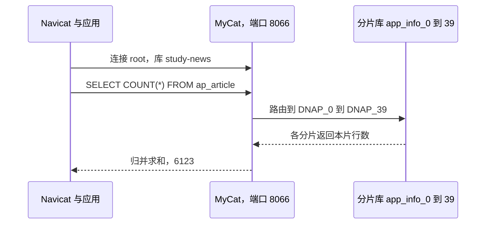

# MyCat 连接测试：8066 端口上的逻辑库与一次分片对账

> 🔒 安全提示：文中示例的口令/密钥均为课程教学环境演示口径，生产环境的安全要求见《安全与合规须知》。

配置四件套就位、全量脚本导完、MyCat 已在 8066 端口监听，接下来要证明这条链路真的通了。验证分两步：先用数据库客户端手工连一次，看逻辑库的形态；再切应用程序的数据源，跑一遍真实的文章查询。中间还藏着一个最有说服力的对账动作：同一张 ap_article 表，单库只有一百多条，连 MyCat 查出来六千多条，差额就是分片存在的证据。

## 先给结论

- 客户端连 MyCat 填的是 MyCat 的凭据：主机为 MyCat 所在机器，端口 8066，账号密码取 server.xml 的 user 段，与 MySQL 的账号密码是两回事。
- 打开逻辑库 study-news 能看到 117 张表，它们是逻辑表，数据分布在几十个物理库上，客户端看上去与普通库无异。
- 对账验证分片：物理库 app_info_0 的 ap_article 只有 153 条，走 MyCat 聚合查询 count 出 6123 条，中间件把语句路由到 40 个分片再归并求和。
- 应用侧切换只动连接三件套：库名换逻辑库、端口换 8066、账号密码换 MyCat 侧定义，SQL 与业务代码零改动。
- 连不上按顺序查四件事：MyCat 是否活着、端口是不是 8066、凭据是否 user 段的、逻辑库名与 schemas 是否一致。

## 客户端先连一次：确认 MyCat 活着

用数据库工具新建一个 MySQL 连接，与平时连库唯一的区别在三个值上：主机填 MyCat 所在机器的地址，本机演示填 localhost；端口填 8066，这是 MyCat 的服务端口，手滑填成 3306 会直接连到真 MySQL 上；用户名与密码填 server.xml 里 user 段定义的 root 与 123456。这三样都对，测试连接立即通过。

打开连接，里面只有一个逻辑库 study-news，双击展开，117 张表整齐列在下面，QUARTZ 调度表、ap_article、ap_show_behavior 都在，与之前连过的任何一个库看起来没有区别。区别藏在表后面：这些是逻辑表，每张表的数据被切在若干个物理库里，客户端只是把 MyCat 提供的表清单原样展示。逻辑库还配了 `sqlMaxLimit=100`，不带 limit 的查询会自动补上 100 行的截断，直接点开表浏览时看到的行数偏少属于这个配置的副作用，数总量要用聚合查询。

## 单片与聚合的对账

连接通过了还不算证明分片生效，最有力的证据是同一张表的两个数字。先连到物理库直查：打开 app_info_0 这个库，ap_article 表里一共 153 条。再走 MyCat 查同一张表：

```sql
-- 经 MyCat 的 8066 端口对逻辑库执行
SELECT COUNT(*) FROM ap_article;
```

结果 6123 条。这条语句的执行过程是：MyCat 解析后没有分片键，把 count 路由到 DNAP_0 到 DNAP_39 全部 40 个分片，各片数自己的行数，结果回传后归并求和。153 是其中一个分片的份额，6123 是 40 个分片的总和，两个数字一对照，数据确实按 id 取模散在 40 个库里的设计就落到了实处。



对账法在以后排查时同样好用：怀疑某张表数据分布异常，取任一物理库的行数与 MyCat 侧聚合数对比，单库数字在聚合数内且各库相加吻合，分片就在正常工作。

## 应用侧切换数据源

客户端连上只代表中间件工作正常，最终应用程序也要连上来。article 服务连库走的是测试环境参数文件，改动集中在连接三件套（其余键一概不动，驱动、Mapper 扫描等保持原值）：

```properties
# maven_test.properties，测试环境连接参数
# 端口从 3306 换成 MyCat 的 8066，库名换成 server.xml 授权的逻辑库
mysql.core.jdbc.url=jdbc:mysql://localhost:8066/study-news?autoReconnect=true&useUnicode=true&characterEncoding=utf8&serverTimezone=Asia/Shanghai
# 账号密码取 MyCat 侧 user 段的定义，不是 MySQL 的账号
mysql.core.jdbc.username=root
mysql.core.jdbc.password=123456
```

改完重编译生效。JDBC 对 MyCat 毫无感知：MyCat 在协议层伪装成一个 MySQL，驱动照常握手、照常发 SQL，应用层没有一行代码因此改动。这正是选数据库中间件而不是应用侧分库组件的兑现时刻，切换成本收敛在一份 properties 文件里。

跑一遍之前写好的文章查询测试做终验：

```java
package com.study.headline.article.test;

import org.junit.Test;
import org.junit.runner.RunWith;
import org.springframework.beans.factory.annotation.Autowired;
import org.springframework.boot.test.context.SpringBootTest;
import org.springframework.test.context.junit4.SpringRunner;

@RunWith(SpringRunner.class)
@SpringBootTest(classes = ArticleApplication.class)
public class ArticleTest {

    @Autowired
    private ApArticleService apArticleService;

    @Test
    public void testArticle() {
        // 未走网关拦截器，手动塞用户上下文，模拟登录态
        AppUser appUser = new AppUser();
        appUser.setId(1104L);
        AppThreadLocalUtils.setUser(appUser);
        ResponseResult result = apArticleService.load(null, ArticleConstants.LOADTYPE_LOAD_MORE);
        System.out.println(result.getData());
    }
}
```

容器起来后执行测试，控制台打印出文章列表数据，说明从 MyCat 连接、逻辑库路由到分片查询、结果归并的整条链路在应用程序视角下全部可用。包名按项目口径做了改写，类与注解结构照录测试原码。

## 连不上的常见原因

连接失败按出现频率排四个原因排查。一是 MyCat 根本没起来：启动脚本一闪而过通常是 JDK 未装或环境变量缺失，回控制台看日志定位；判断进程是否存活再看 8066 是否处于监听。二是端口填错：填成 3306 连到了真 MySQL，表现为「能连上但看不到 study-news」，这类失败反而是最容易自我安慰成连接成功的，务必核对端口号。

三是凭据对象搞混：应用侧账号密码以 server.xml 的 user 段为准，不是 MySQL 实例的账号；两边恰巧同为 root 时更要分清语义，改了 MySQL 密码去连 MyCat 是无效操作。四是库名不一致：连接串里的库名、server.xml 的 schemas、schema.xml 的 schema name 三处必须同名，任何一处漂移都表现为连接成功但 use 库失败。远程连接还可能撞上防火墙或白名单，server.xml 注释里的 firewall 段默认关闭，bindIp 默认 0.0.0.0 监听全部网卡，先确认网络可达再怀疑配置。

## 常见误区

- **把「能连上」当成「连对了」。** 端口填 3306 会连到后端真 MySQL，一样测试通过；判定依据是展开后能看到逻辑库名 study-news，而不是连接成功的提示框。
- **浏览行数少以为数据丢了。** `sqlMaxLimit=100` 会给无 limit 的查询自动截断，点开表只回 100 行是兜底配置在起作用；核对数据量用 COUNT 或自己带 limit 翻页。
- **单片数据当全量。** 在任一物理库直接看到的行数只是该分片的份额，对账时要把 40 个分片相加才与 MyCat 侧可比；拿单库 153 条质疑聚合 6123 条，是方向搞反了。
- **改配置不重启。** server.xml 与 schema.xml 在启动时加载，改完凭据或库名不重启进程，新旧配置并存，问题表现得毫无规律。

## 面试可能被问到的问题

1. 面试官追问：「MyCat 的服务端口和管理端口分别是多少，各干什么用？」
   答：服务端口默认 8066，应用与客户端走 MySQL 协议连它做数据操作；管理端口默认 9066，用于运维侧查看连接、心跳、路由等运行信息。两者都在 server.xml 的 system 段注释中标注，可改。
2. 面试官追问：「怎么验证分片真的生效了？」
   答：对账法。任取一个物理库数某张表的行数，再经 MyCat 对同一逻辑表做 COUNT，单库数应远小于聚合数且所有分片相加吻合；写入侧再按分片键的模数推算落片，逐条对得上即路由正确。
3. 面试官追问：「应用从直连 MySQL 切到 MyCat，改动有多大？」
   答：只动数据源配置：地址与端口指向 MyCat，库名换逻辑库，账号密码换 MyCat 侧 user 定义。JDBC 协议层 MyCat 伪装成 MySQL，驱动、ORM、业务 SQL 零改动；要重新评估的是跨库 join、事务与深分页这些语义变化。
4. 面试官追问：「不带分片键的 COUNT 会怎么执行？」
   答：路由器识别不到分片值，把语句广播到该逻辑表的所有分片，各片本地执行后回传结果，由归并器聚合返回。代价是全片扫描，大表高频做这类聚合要靠缓存或离线统计承接。
5. 面试官追问：「客户端连上 MyCat 看不到库，可能是什么原因？」
   答：按序查三处：连接串里的库名是否真实存在；server.xml 里该账号的 schemas 是否授权了这个逻辑库；schema.xml 的 schema name 与 schemas 是否逐字一致。三处任一漂移都表现为连接正常但库不可见。

## 配套资料

- 代码：`materials/code/05/头条day02/`，mycat 相关目录收录配置四件套：schema.xml、rule.xml、server.xml、sequence_db_conf.properties，端口、凭据与逻辑库名的口径均出自其中。
- 说明：ArticleTest 测试类与测试环境参数文件不在本资料包内，按画面线与工程既有口径补全，包名统一改写为 `com.study.headline`；对账数字（单库 153 条、聚合 6123 条）来自课程演示环境，其余排查项按主流运维经验整理。
