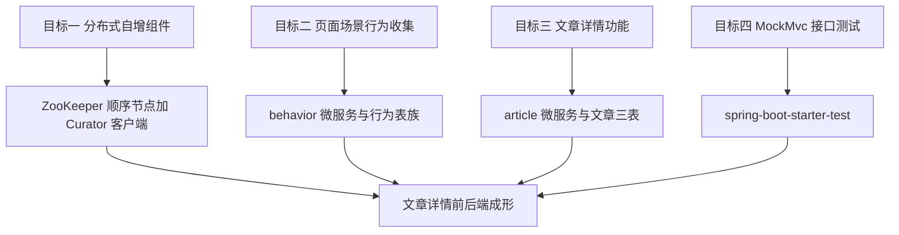

# 第三天任务书：文章详情、分布式主键与接口测试一起成形

> 🔒 安全提示：文中示例的口令/密钥均为课程教学环境演示口径，生产环境的安全要求见《安全与合规须知》。

day02 收官时留下一个明确的尾巴：行为数据落库的主键还是临时写死的，一直在等一个正式的发号方案。列表页已经能在移动端刷起来，点进一张文章卡片之后的详情页却还缺席。day03 的任务书就冲着这两件事来，外加一条贯穿全程的工程习惯：接口写完要能被自动化测试验证。开课这一支视频只有不到一分钟，交代的是目标清单，真正的分量藏在每个目标背后的技术选型里。

## 先给结论

- day03 有四个目标：用 ZooKeeper 封装一个分布式自增组件，收掉临时主键的尾巴；做页面场景行为的收集；完成 App 端文章详情功能，理清里面有哪些接口、实现代码的流程是什么；用 MockMvc 做接口测试。
- 分布式主键是本天的技术主角：客户端选 Curator（版本 4.2.0），依赖导入是动手的第一步，day03 配套讲义以「文章详情前后端成形记」为题组织，开篇小节就是它。
- 行为收集不是顺手记日志：行为数据是后续推荐功能赖以运转的原材料，转发、分享这类做不了完整功能的行为，也要把动作记录留下来。
- MockMvc 的定位是不启动完整容器就能打接口的测试工具，属于工程能力而非业务功能，使用场景与方法是本天的收尾目标。

## 目标一：分布式自增组件，把临时主键收掉

day01 导入行为功能时，行为表的 id 是硬编码顶上去的；day02 接入 MyCat 完成分库分表后，走 mod 规则的表已经由 MyCat 全局序列发号，但点赞、收藏、阅读、行为实体这一批 burst 规则的表没有接入全局序列，主键要由应用自己生成。多实例并发写行为数据，号从哪来、会不会撞，都要求发号这件事独立出来。

方案是 ZooKeeper：它的顺序节点天然给出全局唯一且递增的编号。声音线的选型口径说得很直白：分布式自增用 Redis、数据库、ZooKeeper 都能轻松实现，考虑中间件的负载均衡思想与演示 ZooKeeper 实战应用的目的，本项目采用 ZooKeeper 来生成分布式自增 id；实际项目里这也是常用手段。

封装之前先搭环境、导依赖。客户端用 Curator，它把原生 API 里连接管理、重试这些繁琐逻辑封装掉了。依赖落两处：版本号收进聚合工程的 properties，坐标放进 common 模块，让序列能力全局复用而不是某个服务私有：

```xml
<properties>
    <curator.version>4.2.0</curator.version>
</properties>
<!-- curator ZK 客户端 -->
<dependency>
    <groupId>org.apache.curator</groupId>
    <artifactId>curator-framework</artifactId>
    <version>${curator.version}</version>
</dependency>
<dependency>
    <groupId>org.apache.curator</groupId>
    <artifactId>curator-recipes</artifactId>
    <version>${curator.version}</version>
</dependency>
```

环境搭建、服务端安装与连接配置，是本天第一支实操课的内容，发号链路怎么在代码里跑起来，由后续的封装课程逐层展开。

## 目标二：页面场景行为的收集

详情页是行为的高发区：一进页面就是展示行为，读完是阅读行为，顺手可能有点赞、不喜欢、收藏、转发、分享。这些动作统一上报给 behavior 微服务，落到对应的行为表。数据的价值不在当下而在后面：推荐功能要按用户喜好排内容，原材料就是这批行为记录。声音线在定义课里也点破了这层意思：转发与分享只记行为不做完整功能，就是在为后面的推荐课程收集参考数据。

## 目标三：文章详情功能，接口与实现流程

App 文章详情是本天的业务主线，也是全课程的重点内容之一。推进顺序是先做需求分析与术语对齐，再按接口逐个实现：详情页要展示标题、作者名称、头像、发布时间、富文本正文，还要回显当前用户与文章的关系状态。声音线特别强调两个抓手：一是理清里面到底有哪些接口，二是理清每个接口的实现代码流程。详情页读多写少、正文发布后基本不变，这个特征也为后续的静态化提速留了口子。

## 目标四：MockMvc 接口测试

接口写完不能只靠肉眼与手点。MockMvc 由 spring-boot-starter-test 提供，能在不启动完整容器、不发真实网络请求的前提下，把请求打进控制器并断言响应。它的使用场景与方法是本天的收尾目标，详情接口的测试就会用到：

```java
@SpringBootTest
@AutoConfigureMockMvc
public class ArticleContentApiTest {

    @Autowired
    private MockMvc mockMvc;   // 由 spring-boot-starter-test 提供

    @Test
    public void testLoadContent() throws Exception {
        // 模拟 POST 请求直打控制器，不经过网络端口
        mockMvc.perform(post("/api/v1/article/load_content")
                .contentType(MediaType.APPLICATION_JSON)
                .content("{\"articleId\": 1300000189}"))
            .andExpect(status().isOk())                 // HTTP 层断言
            .andExpect(jsonPath("$.code").value(200));  // 业务层断言
    }
}
```

静态导入（post、status、jsonPath 等）已省略；测试类为按本课写法补全的示例，接口路径与返回结构以后续实现课为准。

## 目标与技术点映射

| 目标 | 关键技术点 | 落点 |
|---|---|---|
| 分布式自增组件封装 | ZooKeeper 顺序节点、Curator 客户端 | common 模块的序列封装组件 |
| 页面场景行为收集 | behavior 微服务、行为表族 | 点赞、不喜欢、阅读、收藏等行为表 |
| 文章详情功能 | 文章三表、富文本展示、状态检查 | article 微服务的详情接口 |
| MockMvc 接口测试 | spring-boot-starter-test | 各服务的测试代码 |

四个目标不是并列关系，而是一条流水线：主键解决「写进去的时候 id 从哪来」，详情接口解决「读出来怎么组装」，行为收集解决「看完之后留下什么」，MockMvc 解决「怎么证明上面的都对」。整张地图如下：



四条支线在 day03 结束时汇合：详情页能打开、能回显状态、能记录行为，且接口有测试兜底。

## 常见误区

- **把学习目标当成组件罗列。** 四个目标每个都挂在业务问题上：主键挂在分库分表后的并发写入，行为挂在推荐数据，MockMvc 挂在接口可验证性。脱离业务背组件，面试一追问就露底。
- **依赖随手导进业务服务。** Curator 坐标进 common 模块，序列能力是全局基础设施；散落在单个服务里，第二个要用的服务只能复制粘贴，版本还容易漂移。
- **MockMvc 当成手点两下的冒烟工具。** 它的价值在断言与可重复：随代码进版本库、进流水线，接口被改坏时测试先红，而不是等测试同学上线前才发现。
- **以为行为收集可以等推荐上线再做。** 行为数据有时间价值，用户今天的行为今天不记，明天就补不回来；转发分享这类轻量记录尤其容易被砍掉，砍掉的正是推荐侧的特征。

## 面试可能被问到的问题

1. 面试官追问：「day03 为什么把分布式主键排在第一个讲？」
   答：它是详情功能的前置依赖。行为接口一开，点赞、阅读这类高频写入立刻需要全局唯一主键，burst 分片表又没有接入 MyCat 全局序列，发号问题不解决，后面的接口都没法落库。先立发号方案，再写业务接口，依赖顺序才顺。
2. 面试官追问：「分布式自增为什么选 ZooKeeper，而不是 Redis 或数据库？」
   答：三者都能实现。数据库方式每取一个号都要一次数据库往返，行为洪峰下序列库容易成为热点；Redis 方案要额外处理持久化与原子性。本项目出于演示中间件负载均衡思想与 ZooKeeper 实战的目的选择 ZK，顺序节点天然保证唯一递增，代价是每次发号一次 ZK 写操作，用吞吐换简单可靠。
3. 面试官追问：「MockMvc 和 Postman 这类工具的区别是什么？」
   答：Postman 是进程外的手工或脚本化请求，需要服务先跑起来；MockMvc 在测试进程内模拟请求，不占端口、可断言响应码与响应体，随构建自动执行，适合接口层的回归测试与持续集成。
4. 面试官追问：「行为收集为什么连转发、分享这种做不完的功能也要记？」
   答：行为记录的价值在数据而非功能完整度。用户有没有转发意愿、在什么场景分享，是推荐模型的重要特征；功能可以做简，记录必须落库，否则后续推荐永远缺这批特征。

## 配套资料

- 代码：`materials/code/05/头条day03/`。该日资料包解压结果为空（未含源码文件），Curator 依赖坐标取自画面线讲义，代码示例为按本课写法补全。
- 代码：`materials/code/05/头条day02/`，mycat 配置四件套（schema.xml、rule.xml、server.xml、sequence_db_conf.properties），burst 规则表未接入全局序列、主键应用自管的口径可在其中核对。
- 环境：课程集群 node01~node03，MySQL root/123456。
