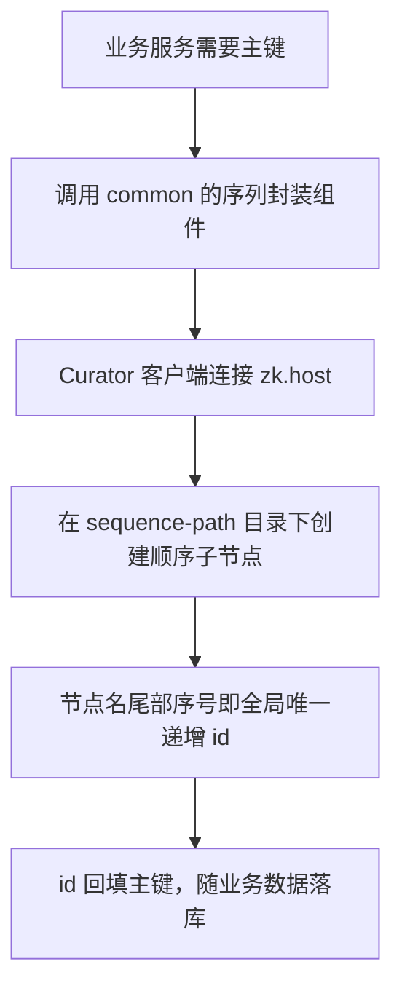

# 为什么 MyCat 序列之外还要 ZooKeeper：分布式主键环境就位

> 🔒 安全提示：文中示例的口令/密钥均为课程教学环境演示口径，生产环境的安全要求见《安全与合规须知》。

行为接口要落库，主键先要有着落。day01 里行为表的主键是临时写死的；day02 接入 MyCat 后，走 mod 规则的表已经由全局序列发号，但点赞、收藏、阅读、行为实体这一批 burst 规则的表，主键仍要应用自己出。day03 的第一个章节是分布式组件的封装，动手封装之前，先把发号环境搭起来：选型理由、服务端、客户端依赖、连接参数，逐一就位。

## 先给结论

- 选型口径：此功能用 Redis、数据库、ZooKeeper 都能轻松实现，考虑中间件的负载均衡思想与演示 ZooKeeper 实战应用的目的，本项目采用 ZooKeeper 生成分布式自增 id；实际项目里这也是常用手段。
- 服务端单机起步即可：ZooKeeper 3.4.6 依赖 JDK 环境，解压后脚本启动，`Mode: standalone` 表示单机模式正常。
- 客户端选 Curator 4.2.0：curator-framework 加 curator-recipes 两个坐标，版本收进聚合工程 properties，依赖放进 common 模块。
- 连接参数配置化：common 模块 resources 下新建 `zookeeper.properties`，服务端地址与序列存储路径两个键；开发期写在默认配置里，多环境切换时各环境各配一份。

## 为什么 MyCat 全局序列之外还要一个发号器

分库分表之后，「主键从哪来」被拆成了两类口径。走 mod 规则的表在 schema.xml 里配了 `autoIncrement="true"` 与 `primaryKey="id"`，插入时 MyCat 按全局序列发号，应用不用管；而 burst 规则的表（点赞、收藏、阅读、行为实体）没有接入这套序列，主键必须由应用侧生成，因为 burst 值的第一段就是行主键，路由要靠它算出来，号必须先于插入存在。

把发号器独立出来的理由还有两条。**一条是吞吐与单点。** MyCat 全局序列走数据库方式（server.xml 的 sequnceHandlerType 为 1），每次取号都要到序列库走一趟，行为类写入是高频小事务，序列库很容易成为热点；数据库自增更不能直接用，多片各自自增必然冲突。**另一条是解耦。** 发号依赖 ZooKeeper 之后，发号能力不再绑定任何一个数据库实例，业务服务各自连 ZK 取号，中间件的负载均衡思想在这里落地：谁承压谁扩容，与存储层互不拖累。

至于为什么是 ZooKeeper 而不是 Redis 或数据库：三者都能实现，Redis 发号要自己处理持久化与原子性，数据库方式吞吐受限，ZooKeeper 的顺序节点天然给出全局唯一递增的编号，且项目后续还要用它做协调类功能，复用一套中间件。代价是每次发号一次 ZK 写操作，吞吐不如雪花算法这类纯内存方案，在这个数据量级下，用一点性能换简单可靠是划算的。

## 服务端就位：安装、启动与状态检查

ZooKeeper 是 Java 写的，装它的机器必须有 JDK 环境，缺了 JDK 它起不来，安装前先确认 Java 环境可用。Linux 上解压即用，目录里 conf 放配置、bin 放脚本。检查服务状态：

```bash
[root@localhost ~]# cd zookeeper-3.4.6
[root@localhost zookeeper-3.4.6]# ls
build.xml  conf  ivy.xml  NOTICE.txt  README.txt  zookeeper-3.4.6.jar  zookeeper-3.4.6.tar.gz  zookeeper-3.4.6.tar
[root@localhost zookeeper-3.4.6]# ./bin/zkServer.sh status
Mode: standalone
```

`Mode: standalone` 说明当前是单机模式，本课用它起步足够。没有现成 Linux 环境的，课程资料里提供了装好环境的镜像，直接挂载就能用，镜像里的 ZooKeeper 已经启动。生产与高可用场景要部署集群，课程集群的 node01~node03 三台节点就能按 3 节点 ZK 集群扩展；单机方案边界很清楚：ZK 进程一挂，发号全部停摆。

## 客户端就位：导入 Curator 依赖

原生 ZooKeeper 客户端 API 用起来繁琐：连接要自己管理、断线要自己重试、watcher 一次注册一次生效。Curator 在原生 API 之上做了封装，连接管理、重试策略、节点操作都替你处理了，Java 技术栈里封装 ZK 基本默认用它。依赖落两处，版本号统一收进聚合工程 leadnews 的 properties，坐标放进 common 模块：

```xml
<properties>
    <curator.version>4.2.0</curator.version>
</properties>
<!-- curator ZK 客户端 -->
<dependency>
    <groupId>org.apache.curator</groupId>
    <artifactId>curator-framework</artifactId>
    <version>${curator.version}</version>
</dependency>
<dependency>
    <groupId>org.apache.curator</groupId>
    <artifactId>curator-recipes</artifactId>
    <version>${curator.version}</version>
</dependency>
```

放在 common 的理由与 Redis 封装同层：序列能力是全局基础设施，article、behavior 各个微服务都可能要发号，一处引入处处可用。工程里这个依赖此前已经导入过，集成时不必重复添加；自己从零集成的时候，这一步不能忘。

## 连接参数就位：zookeeper.properties 与多环境

连上 ZooKeeper 还差两个参数：连哪里、序列节点存哪里。约定放在 common 模块的 `src/main/resources` 下，新建 `zookeeper.properties`：

```properties
# ZooKeeper 服务端地址与端口
zk.host=192.168.220.145:2181
# 序列节点的存储根路径，项目内独立目录
zk.sequence-path=/leadnews/sequence
```

两个键各管一件事。`zk.host` 是服务端地址加端口，2181 是 ZooKeeper 的默认服务端口；`zk.sequence-path` 是序列节点的挂载目录，后续所有顺序节点都建在它下面，相当于给分布式主键划了一个专属存储区。路径值按工程中性名补全，以实际配置为准，但「一个项目一个独立路径」的约定不变。此前 MySQL 相关参数也有过写死在代码里的做法，统一挪进配置文件让它读配置即可。

多环境的口径要提前立好：开发阶段先写在默认配置里，默认加载这份；实际开发中有切换环境的需求时，dev、test、prod 三套配置文件里要分别配置各自的 ZooKeeper 地址。配置跟着环境走，不跟代码走。

## 发号链路预览

环境三件就位后，完整的发号链路是下面这条：



关键路径在 D 到 E 两步：顺序节点的编号由 ZooKeeper 服务端单点串行化分配，谁创建谁拿到下一个号，并发创建也不会重复，天然没有冲突。序列封装、client 封装与配置装配的实现细节，由 day03 后续的封装课程逐层展开，本课到环境就位为止。

## 常见误区

- **Curator 版本与服务端版本不匹配。** Curator 4.x 默认面向 ZooKeeper 3.5 系服务端编译，服务端是 3.4.6 时要统一客户端携带的 ZooKeeper 依赖版本，或选用面向 3.4 编译的 Curator 2.x 系，否则运行期会出现协议兼容类异常。
- **服务端没装 JDK 就启动。** ZooKeeper 依赖 Java 环境，JDK 缺失时启动直接失败，报错还往往不在 ZooKeeper 自己的日志里，排查成本高；装服务端先确认 `java -version` 可用。
- **连接信息硬编码在类里。** 地址写死在代码里，换环境只能改代码重新发布；地址与路径一律进 `zookeeper.properties`，多环境靠配置文件切换。
- **把单机 standalone 当生产形态。** 单机模式省事，但可用性没有保障；生产按 3 节点部署集群，牺牲一点写入性能换故障容忍。

## 面试可能被问到的问题

1. 面试官追问：「分库分表后为什么不能继续用数据库自增主键？」
   答：多片各自维护自增起点，同一张逻辑表的数据落在不同物理库里，各自生成的 id 会重复，主键失去全局唯一性；即便用 MyCat 全局序列兜底，取号也要走数据库往返，高频写入下序列库是热点。
2. 面试官追问：「ZooKeeper 顺序节点为什么能保证分布式 id 唯一递增？」
   答：客户端在指定目录创建顺序节点时，服务端在该目录内维护一个单调递增的计数，给节点名追加序号后返回。计数由服务端串行化分配，并发创建也拿不到相同序号，所以天然全局唯一且递增。
3. 面试官追问：「用 ZK 发号的性能瓶颈在哪，怎么权衡？」
   答：每次发号是一次 ZK 的写操作，要过集群多数派确认，吞吐远低于本地内存发号。数据量级不高、发号频率可控时，简单可靠优先；到了超高频场景会换雪花算法这类本地算法，用机器标识保证唯一，代价是引入时钟与机器位分配的问题。
4. 面试官追问：「Curator 相比原生 ZooKeeper 客户端解决了什么？」
   答：连接建立与断线重连、会话超时、重试策略、watcher 的重复注册，这些原生 API 里要自己写的样板逻辑 Curator 都封装好了，还提供顺序节点、分布式锁等 recipe 级组件，业务代码只面对高层语义。
5. 面试官追问：「多环境下 ZooKeeper 地址怎么管理？」
   答：地址进配置文件不进代码。common 模块定义 `zookeeper.properties`，dev、test、prod 三套环境各自维护一份地址配置，构建或启动时按环境加载，切换环境不改一行 Java 代码。

## 配套资料

- 代码：`materials/code/05/头条day03/`。该日资料包解压结果为空（未含源码文件），依赖坐标与启动命令取自画面线，配置示例为按本课写法补全。
- 代码：`materials/code/05/头条day02/`，mycat 配置四件套（schema.xml、rule.xml、server.xml、sequence_db_conf.properties）。burst 规则表未配置 autoIncrement、sequnceHandlerType 为 1 等口径可在其中核对。
- 环境：课程集群 node01~node03，MySQL root/123456；ZooKeeper 单机实例的地址与端口以 `zookeeper.properties` 为准。
