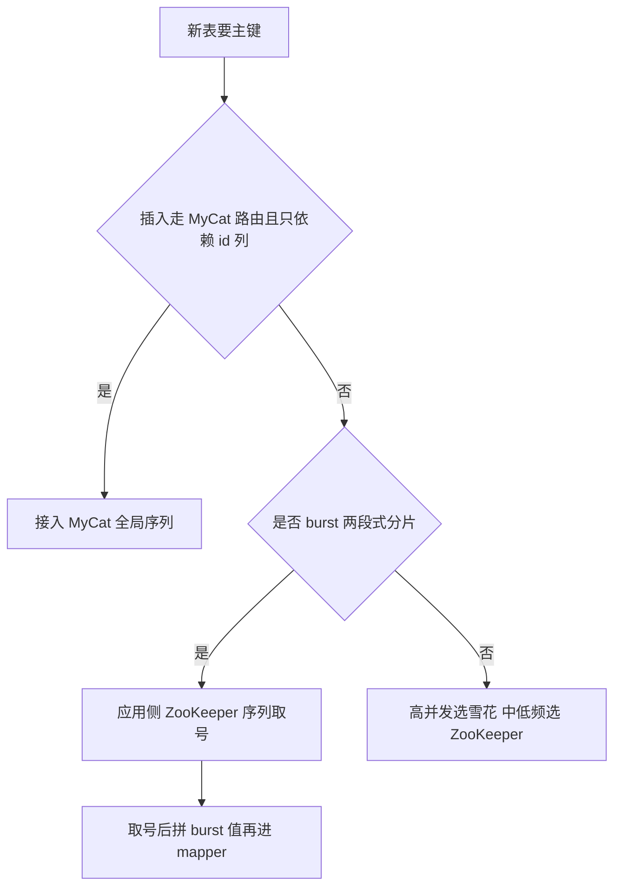

# 从打出 null 到连续取号：ZooKeeper 主键封装的联调验证

封装四件套齐了：枚举、ZkSequence、ZookeeperClient、ZkConfig 加 Sequences。能不能用要跑过才算数。这一课把测试架在 behavior 行为微服务上，第一次运行就打出一个 null，顺着断点找出两处笔误，修完单次取号返回 1，循环五十次从 2 排到 51，最后把并发场景与三种发号方案的取舍一起收口。

## 先给结论

- 测试前要先解决 bean 可见性：ZkConfig 在 common 模块，behavior 的引导类扫不到，需要补一个 `@Configuration` 加 `@ComponentScan` 的引导配置类。
- 测试类用 `@SpringBootTest(classes = BehaviorApplication.class)` 指定引导类，注入 Sequences 调取号方法。
- 第一次运行打出 null 的根因有两个：Map 查询键传了枚举对象而键其实是表名字符串，取号条件又写成了 `seq == null`，两处修正后链路打通。
- 自增性验证：单次取到 1，循环 50 次打印 2 到 51，说明计数持久在 ZooKeeper 侧，测试重启接着往后发号，不重不漏。
- 选型收口：MyCat 全局序列服务 MyCat 路由的插入，雪花吞吐高但不连续，ZooKeeper 方案强一致、连续、跨实例唯一，代价是每次取号一次 ZK 写入，适合行为表这类中低频写入。

## 测试搭台：把 common 的配置扫进来

试验场选 behavior 行为微服务，它挂着的都是走 burst 规则的行为表，发号需求最真实。动手测试前有一个前置问题：ZkConfig、Sequences 都在 common 公共模块的 `com.study.headline.common.zookeeper` 包下，而 behavior 的引导类 BehaviorApplication 在 `com.study.headline.behavior` 包，Spring Boot 默认只扫引导类所在包及子包，common 里的配置类不在这个范围。做法是在 behavior 里补一个引导配置类：

```java
@Configuration
@ComponentScan("com.study.headline.common.zookeeper")
public class ZookeeperConfig {
}
```

两个注解各管一件事：`@Configuration` 声明它是配置类，`@ComponentScan` 把 common 的 zookeeper 包拉进扫描范围，ZkConfig 与 Sequences 就能随引导类一起加载。

测试类放在 behavior 的测试源码目录下：

```java
@RunWith(SpringRunner.class)
@SpringBootTest(classes = BehaviorApplication.class)
public class ZkTest {

    @Autowired
    private Sequences sequences;

    @Test
    public void test1() {
        Long id = sequences.sequenceReadBehavior();
        System.out.println(id);
    }
}
```

`@SpringBootTest` 的 classes 属性指定引导类，让测试以完整容器的形式启动；注入 Sequences，调 `sequenceReadBehavior()` 打印返回值，测试目标很单纯：看封装好的发号器给不给号。

## 第一次运行就给了 null

测试跑完，控制台打出一个 null。断点跟进排查：服务启动正常，initZkSequence 没报错，Map 里能看到表名，但 map.get 之后的 seq 是 null，方法最终走到返回 null 的分支。

问题出在两处。Map 的键在绑定时存的是枚举的 name 字符串，查询时却把枚举对象当键传了进去，`Map.get` 的参数类型是 Object，编译器不拦，运行期类型对不上只会安静地返回 null；取号的条件还写反了，初版代码是「查不到才去调 `seq.sequence()`」，查到了反而直接返回 null。修正后的取号方法：

```java
public Long sequence(ZkSequenceEnum name) {
    ZkSequence seq = zkSequenceMap.get(name.name());
    if (seq != null) {
        try {
            return seq.sequence();
        } catch (Exception e) {
            logger.error("获取[{}]Sequence错误: {}", name, e);
        }
    }
    return null;
}
```

查询键换成 `name.name()`，条件改成 `seq != null`，取到计数器才调它。第二次断点跟进，seq 有值了，放行后控制台打出 1。从 null 到 1 的过程也说明：封装层的问题大多在第一次联调集中爆发，断点按「初始化是否成功」「键是否匹配」「条件是否写反」的顺序逐层排除，是一条固定路径。

## 自增性验证：1，然后 2 到 51

单次取号只能证明链路通，证明不了「自增」。再写一个循环测试：

```java
@Test
public void testBatch() {
    for (int i = 0; i < 50; i++) {
        System.out.println(sequences.sequenceReadBehavior());
    }
}
```

执行结果从 2 开始，一直排到 51：前面单次测试拿走的是 1，循环接着往下发，没有重复。这说明计数器的状态不在服务内存里，而是持久在 ZooKeeper 的计数节点上，测试进程重启、服务实例更换，号都接着往后走，跨实例的唯一性由节点写入的原子性兜底。

ZooKeeper 侧可以直接看到这个状态：zkCli 里 get 计数节点，data 里就是当前计数值，取一次号看一次，节点数据同步增长；ZooInspector 这类图形化客户端也能直接读节点，观察起来更直观。

并发下的唯一性可以压一遍验证（视频里用单线程循环做了同样的自增验证，下面这段并发版为按本课写法补全的示例）：

```java
@Test
public void testConcurrent() throws InterruptedException {
    int times = 100;
    Set<Long> ids = ConcurrentHashMap.newKeySet();
    CountDownLatch latch = new CountDownLatch(times);
    for (int i = 0; i < times; i++) {
        new Thread(() -> {
            Long id = sequences.sequenceReadBehavior();
            if (id != null) {
                ids.add(id);
            }
            latch.countDown();
        }).start();
    }
    latch.await();
    System.out.println("取号 " + times + " 次，去重后 " + ids.size() + " 个");
}
```

一百个线程各取一号，去重后的数量与取号次数相等才算通过。每次取号对应一次 ZooKeeper 的事务写入，并发越高吞吐越受限，这也划定了这套方案的适用边界。

## 收口：三种发号方案怎么选

到这里项目里有了三种主键来源，边界要分清：

- **MyCat 全局序列**：接了 autoIncrement 的分片表在 insert 时由中间件发号，服务的是「路由发生在 MyCat 内部」的插入，只认 id 列。
- **ZooKeeper DistributedAtomicLong**：burst 两段式分片的行为表用，应用侧取号、连续自增、跨实例唯一，代价是每次取号一次网络写。
- **雪花算法**：本地生成、吞吐最高，趋势递增但不连续，workerId 分配与时钟回拨要自己兜底，适合高并发且主键不要求连续的场景。

发号方案的决策过程如下：



关键分支在第二问：burst 表的路由条件要应用自己拼，主键必须先于 SQL 生成，发号器就只能放在应用侧，这正是这套封装存在的理由。业务代码的最终形态是注入 Sequences、调表对应方法取号，再把返回的主键与分片字段一起拼进 burst 值。

## 常见误区

- **测试起不来就先把锅甩给封装。** bean 找不到、类加载失败这类报错多半是扫描范围问题，common 模块的配置类要显式 `@ComponentScan` 拉进来，与 ZooKeeper 本身无关。
- **看到 null 直接判「中间件坏了」。** Map.get 传错键类型、条件写反这类低级笔误在封装层最常见，先断点确认 Map 内容与键类型，再怀疑中间件。
- **以为重启服务号会重置。** 计数在 ZooKeeper 节点上持久存在，重启从上次的位置继续发号；看到「跳号」先查有没有别的实例在共用同一张表的计数器。
- **取到 null 还往表里写。** 主键为 null 的插入要么报错要么落成脏数据，取号失败必须终止本次写入，按错误类别决定重试还是告警。

## 面试可能被问到的问题

1. 面试官追问：「你们的分布式主键为什么选 ZooKeeper 而不是雪花？」
   答：这批是 burst 两段式分片的行为表，主键在应用侧生成且要求跨实例唯一、严格递增。雪花本地生成吞吐更高，但不连续且要处理 workerId 与时钟回拨；行为表写入频率中低，用 ZooKeeper 的分布式原子自增换强一致与连续性，代价可以接受。
2. 面试官追问：「DistributedAtomicLong 并发取号会重号吗？」
   答：不会。它把计数存在 ZooKeeper 节点 data 里，自增是带版本号的乐观锁写回，版本冲突自动重读重写，整个读改写由 ZooKeeper 串行化，一个号只发一次。
3. 面试官追问：「测试第一次跑出 null，你的排查思路是什么？」
   答：先确认初始化没报错、Map 绑定成功，再断点看取号方法的中间值，发现查询键与存储键类型不一致导致 get 永远返回 null，加上取号条件写反，两处修正后链路即通。低级错误要靠断点逐层排除，不要一上来就怀疑中间件。
4. 面试官追问：「服务重启之后，主键会从 1 重新开始吗？」
   答：不会。计数持久在 ZooKeeper 的计数节点上，与发起取号的服务实例无关，重启或换实例都接着上次的值继续发号，这也是它能当分布式主键用的前提。
5. 面试官追问：「每次取号都要写一次 ZooKeeper，性能扛得住吗？」
   答：单次取号是一次带持久化语义的 ZK 事务写入，吞吐比本地方案低一到两个数量级。它适合行为表这类中低频写入，高并发大流量场景要换本地雪花或号段模式，选型看写入频率与唯一性要求，不要一套方案打天下。

## 配套资料

- 代码：`materials/code/05/头条day03/`，本课资料包提取清单为空，测试类与配置源码未随包提供，文中代码为按视频画面线与课程写法补全的示例，包名统一改写为 com.study.headline，引导类名按中性口径写作 BehaviorApplication；并发测试为补充示例，视频中的验证形态是单线程循环 50 次。
- 代码：`materials/code/05/头条day02/`，mycat 配置四件套，对照 burst 表未接入全局序列、主键需应用维护的现状。
- 说明：课程环境 ZooKeeper 为单机 node01；取号结果 1、连续序列 2 到 51 与 null 排障过程均按视频画面整理。
