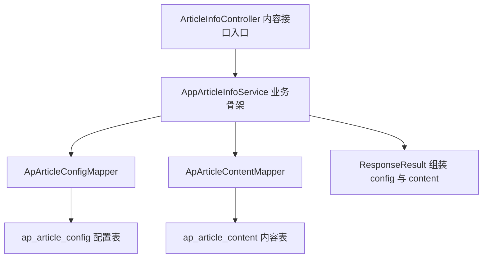
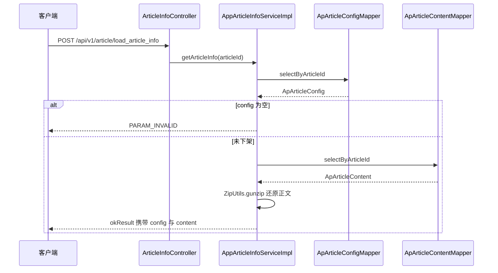
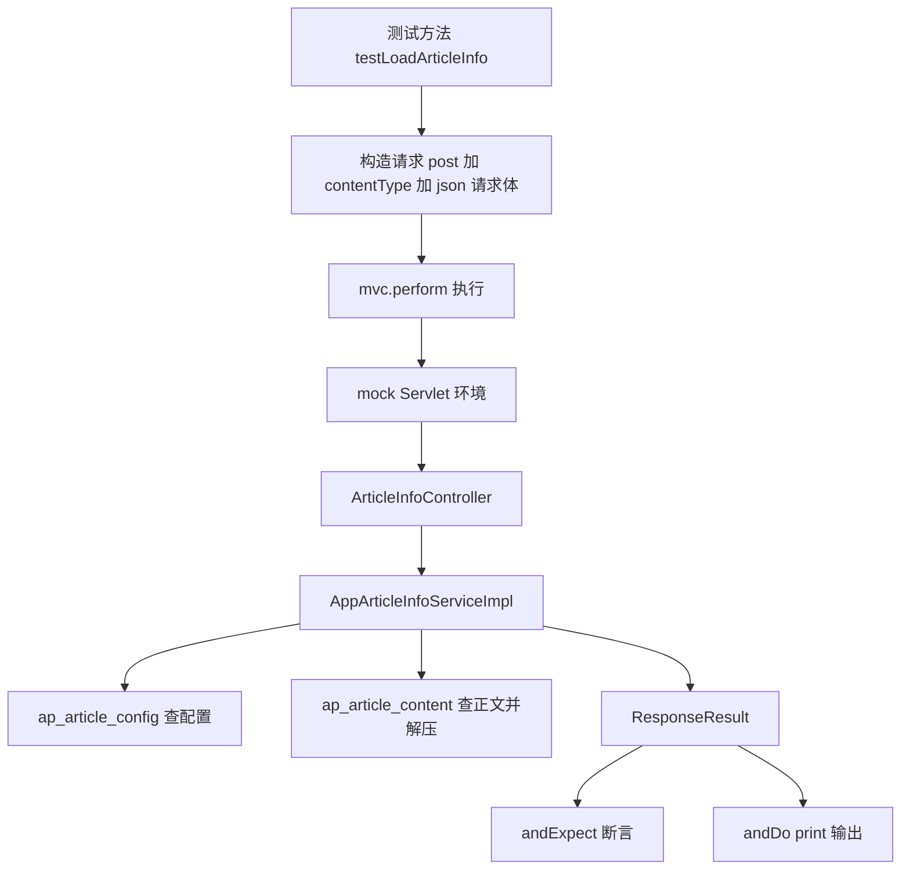
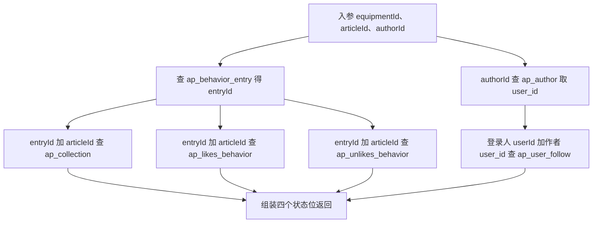
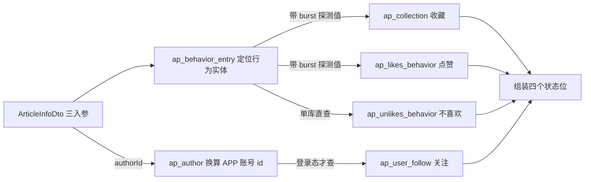
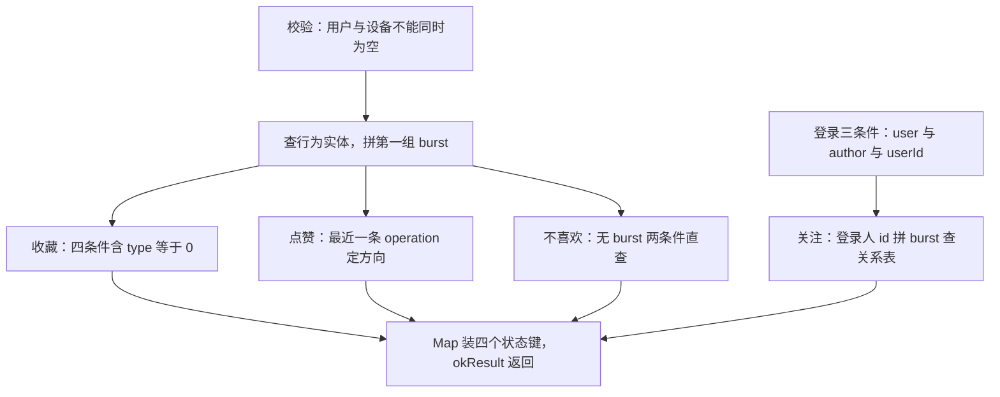
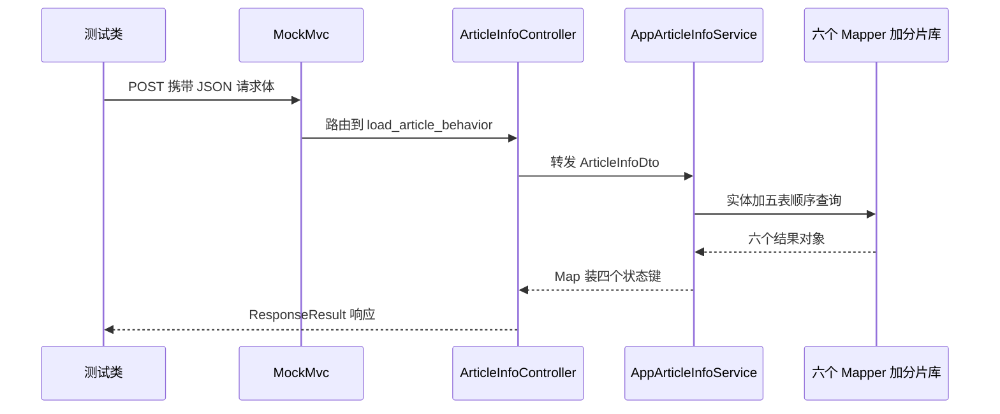

# app文章详情_文章系列实现：内容接口与文章关系接口从 Mapper 到 MockMvc 测试

> 🔒 安全提示：文中示例的口令/密钥均为课程教学环境演示口径，生产环境的安全要求见《安全与合规须知》。

## 先给结论

app文章详情的文章接口分两个方向：内容接口负责查一篇文章的正文与配置，文章关系接口负责查用户对文章的点赞、阅读、收藏、评论四个状态位。全系列六个部分沿着同一条动线推进：接口定义、Mapper 与 Service、Controller、MockMvc 测试，两个方向各走一遍。
内容接口的三篇覆盖从 Mapper 文件、Service 骨架到参数校验、状态检查、组装返回的完整实现，再用 MockMvc 发真实请求，把两次调试的坑踩实。关系接口的三篇先讲清六张表各回答什么问题、五步查询思路与分片约束，再落成带 @Param 的 Mapper 与先立默认值再翻转状态的 Service，最后全链路测试核对游客态与登录态。
六个部分依次是：
- 内容接口 Mapper 与 Service 定义：内容与配置两个 POJO、成对的接口与 XML。
- 内容接口 Service 实现与 Controller：查配置、判状态、组装返回、契约挂载。
- 内容接口 MockMvc 测试：请求构造、两次调试与测试链路全景。
- 关系接口需求分析：四个状态位、六张表与五步查询思路。
- 关系接口 Mapper 定义：六表路由、@Param 注解与状态组装代码。
- 关系接口 Controller 与测试：两层落地、全链路请求与结果核对。

## 第1部分：内容接口开工：内容与配置两个 Mapper 和 Service 骨架

详情接口的对外定义在术语课已经立好：入参 `ArticleInfoDto` 里真正用得上的只有 articleId，出参按 Map 分列成 `config` 与 `content` 两块，文章已删除时 content 不返回。定义看着只有几行，落到代码里却是一条完整链路：两张表各配一个 Mapper，业务层再立一个 Service 接口与实现。这一课先把地基打牢，Mapper 与 Service 的骨架立起来，业务逻辑留给下一课填充。接口文档里的注意事项只有一句话，但整条链路的查询顺序都由它决定，值得先把这句话读懂。

### 接口定义与两个 POJO

接口文档把内容接口的出入参写得很直白：请求体是 `com.study.headline.model.article.dtos.ArticleInfoDto`，响应体用 Map 分列，`config` 对应 `ApArticleConfig`，`content` 对应 `ApArticleContent`，注意事项是文章已删除时 content 属性不返回。返回的是两块内容：第一块 config 是文章的配置信息，第二块 content 是文章详情正文。判断是否删除的依据在 `ap_article_config` 表里，这张表有 article_id、是否可评论、是否转发、是否下架等字段；`ap_article_content` 则只有 article_id 和一个文本型大字段 content，正文内容一般比较长，所以单独成表。

两张表对应的 POJO 在 model 工程的 article 包下已经存在，与表字段一一对应（day03 资料包为空，代码按画面线抄录并按本课写法补全）：

```java
package com.study.headline.model.article.pojos;

import com.study.headline.model.annotation.IdEncrypt;
import lombok.Data;

@Data
public class ApArticleConfig {
    private Integer id;
    // 增加 @IdEncrypt，JSON 序列化时对 id 类字段自动混淆
    @IdEncrypt
    private Integer articleId;
    private Boolean isComment;   // 是否可评论
    private Boolean isForward;   // 是否可转发
    private Boolean isDown;      // 是否下架，详情入口的删除检查看它
}

@Data
public class ApArticleContent {
    private Integer id;
    @IdEncrypt
    private Integer articleId;
    private String content;      // 富文本正文，大字段
}
```

两个类都用了 Lombok 的 `@Data` 省去样板代码，id 类字段统一挂 `@IdEncrypt`，序列化时由全局 Jackson 规则把数值 id 混淆成字符串，口径与列表功能时期一致。config 的三个布尔开关各管一件事：isComment 关掉后评论入口不再展示，isForward 控制转发按钮，isDown 承载下架语义，接口文档说的「文章已删除 content 不返回」，判断依据就是这一位。

### 两个 Mapper：接口与 XML 成对出现

Mapper 接口放在 model 工程的 `mappers.app` 包下。MyBatis 的 Mapper 接口没有手写的实现类，运行时由框架按 XML 的 namespace 与接口全限定名做绑定，所以两边的名字必须一字不差。内容表的 Mapper 接口只有一个查询方法：

```java
package com.study.headline.model.mappers.app;

import com.study.headline.model.article.pojos.ApArticleContent;
import org.apache.ibatis.annotations.Param;

public interface ApArticleContentMapper {

    /** 根据文章 id 查询正文内容 */
    ApArticleContent selectByArticleId(@Param("articleId") Integer articleId);
}
```

XML 落在 resources 的 `mappers/app` 目录下，文件名与接口同名。内容表的 XML 完整如下：

```xml
<?xml version="1.0" encoding="UTF-8"?>
<!DOCTYPE mapper PUBLIC "-//mybatis.org//DTD Mapper 3.0.0//EN" "http://mybatis.org/dtd/mybatis-3-mapper.dtd">
<mapper namespace="com.study.headline.model.mappers.app.ApArticleContentMapper">
    <resultMap id="BaseResultMap" type="com.study.headline.model.article.pojos.ApArticleContent">
        <id column="id" property="id"/>
        <result column="content" property="content"/>
    </resultMap>
    <sql id="Base_Column_List">
        id, article_id
    </sql>
    <sql id="Blob_Column_List">
        content
    </sql>
    <select id="selectByArticleId" resultMap="BaseResultMap" parameterType="java.lang.Integer">
        select
        <include refid="Base_Column_List"/>
        ,
        <include refid="Blob_Column_List"/>
        from ap_article_content
        where article_id = #{articleId}
    </select>
</mapper>
```

这份 XML 有三个值得注意的写法。**第一，namespace 是绑定凭证。** 它必须是接口的全限定名，`selectByArticleId` 的 id 必须与方法名一致，对不上号就是 Invalid bound statement 这类启动后才炸的错。**第二，resultMap 负责列名到属性的映射。** 数据库列是下划线风格，Java 属性是驼峰风格，显式写映射最稳，不依赖全局驼峰配置是否开启。**第三，列清单拆成两个片段。** `Base_Column_List` 装窄字段，`Blob_Column_List` 装正文大字段，之后列表这类不需要正文的查询只 include 前者，避免背着大字段跑。

配置表的 Mapper 同构，方法名一样，返回类型换成 `ApArticleConfig`，列多一些而已：

```xml
<mapper namespace="com.study.headline.model.mappers.app.ApArticleConfigMapper">
    <resultMap id="BaseResultMap" type="com.study.headline.model.article.pojos.ApArticleConfig">
        <id column="id" property="id"/>
        <result column="article_id" property="articleId"/>
        <result column="is_comment" property="isComment"/>
        <result column="is_forward" property="isForward"/>
        <result column="is_down" property="isDown"/>
    </resultMap>
    <sql id="Base_Column_List">
        id, article_id, is_comment, is_forward, is_down
    </sql>
    <select id="selectByArticleId" resultMap="BaseResultMap" parameterType="int">
        select
        <include refid="Base_Column_List"/>
        from ap_article_config
        where article_id = #{articleId}
    </select>
</mapper>
```

文件头与 DOCTYPE 和上一份相同，此处省略。两张表的查询条件都是 article_id，SQL 简单到没有优化空间，重点全在写法规范上：接口与 XML 同名同包、映射显式声明、大字段独立片段。这三条纪律在后面所有 Mapper 上都会重复。

### Service 骨架：接口在前，实现在后

Service 定义在 leadnews-article 服务里，类名带 App 前缀，用来区分 APP 端接口与后续自媒体端的同类能力：

```java
package com.study.headline.article.service;

import com.study.headline.model.common.dtos.ResponseResult;

public interface AppArticleInfoService {

    /**
     * 加载文章详情：config 配置与 content 正文两块数据
     * @param articleId 文章 id
     * @return config 与 content 组装的 Map 结果
     */
    ResponseResult getArticleInfo(Integer articleId);
}
```

方法签名很朴素：入参一个 articleId，出参统一包成 `ResponseResult`。返回体里装什么，术语课的契约已经定了，config 与 content 两块，所以出参类型不需要再开新类，用 Map 装即可。实现类放在 `service.impl` 包下，本课先立骨架：

```java
package com.study.headline.article.service.impl;

import com.study.headline.article.service.AppArticleInfoService;
import com.study.headline.model.common.dtos.ResponseResult;
import org.springframework.stereotype.Service;

@Service
public class AppArticleInfoServiceImpl implements AppArticleInfoService {

    @Override
    public ResponseResult getArticleInfo(Integer articleId) {
        // 1.检查参数
        // 2.根据文章 id 查 config，判断文章是否已删除
        // 3.未删除再查 content，组装返回
        return null;
    }
}
```

`@Service` 注解把实现类交给 Spring 容器管理，之后 controller 与测试类都能直接注入。注释里三步就是下一课要填的全部业务，先写注释再填代码，思路不会散。

### 实现思路：状态检查前置的两步走

把 mapper 与 service 串起来，内容接口的数据访问结构如下：



关键路径在 service 这一站分岔：config 查出来先做状态判断，文章已下架或已删除就到此为止，正文那张表碰都不碰；状态正常才落到 content 查询。这个顺序不是风格偏好，是接口文档的硬约束「文章已删除，content 属性将不返回」，把检查放在正文查询之前，既省一次大字段 IO，也避免把不该给的数据吐出去。
## 第2部分：内容接口落地：Service 两步实现与 Controller 契约挂载

上一课把 Mapper 与 Service 骨架立好了，实现类里还躺着一个 return null。这一课填业务并挂上 HTTP 入口，整个过程不到一百行代码，却埋着两个后患不小的细节：controller 入参上的 `@RequestBody`，以及正文入库时的压缩编码。前者不写，测试时接口永远返回参数错误；后者不处理，前端拿到的是一串不可读的编码。两处坑都会在下一课的调试环节现出原形，先把正确的写法立起来。

### 参数校验与依赖注入

实现类的第一步不是查库，是把不合法的请求挡在门外。articleId 等于空，或者小于 1，都直接返回参数错误。判断依据很朴素：文章主键是自增正整数，不存在小于 1 的合法值，空值与非法值共用一个错误码 PARAM_INVALID，它是全局错误码枚举 AppHttpCodeEnum 里的第一个成员，语义就是参数错误：

```java
if (articleId == null || articleId < 1) {
    return ResponseResult.errorResult(AppHttpCodeEnum.PARAM_INVALID);
}
```

接着把两个 Mapper 注入进来：

```java
@Autowired
private ApArticleConfigMapper apArticleConfigMapper;
@Autowired
private ApArticleContentMapper apArticleContentMapper;
```

IDEA 会在字段注入的波浪线警告上提示 field injection is not recommended，它不影响编译与运行；课程口径统一用字段注入保持风格一致，工程上更推荐构造器注入，两者取舍属于团队规范问题，不必纠结。

### 查配置、判状态、组装返回

完整实现按注释里的三步展开（day03 资料包为空，代码按画面线与主流写法补全）：

```java
@Override
public ResponseResult getArticleInfo(Integer articleId) {
    // 1.检查参数：文章 id 非空且大于 0
    if (articleId == null || articleId < 1) {
        return ResponseResult.errorResult(AppHttpCodeEnum.PARAM_INVALID);
    }
    Map<String, Object> data = new HashMap<>();
    // 2.根据文章 id 查询配置信息
    ApArticleConfig apArticleConfig = apArticleConfigMapper.selectByArticleId(articleId);
    if (apArticleConfig == null) {
        return ResponseResult.errorResult(AppHttpCodeEnum.PARAM_INVALID);
    }
    data.put("config", apArticleConfig);
    // 3.未下架才返回正文，已删除的文章不吐 content
    if (!apArticleConfig.getIsDown()) {
        // 4.查询正文：入库时经压缩编码，返回前用 gunzip 还原
        ApArticleContent apArticleContent = apArticleContentMapper.selectByArticleId(articleId);
        if (apArticleContent != null) {
            String content = ZipUtils.gunzip(apArticleContent.getContent());
            apArticleContent.setContent(content);
            data.put("content", apArticleContent);
        }
    }
    return ResponseResult.okResult(data);
}
```

这段代码有四个决策点值得逐个说透。**config 为空按参数错误处理。** 查不到配置意味着文章不存在或数据残缺，与其返回一个半空结构，不如直接以错误码终止，让调用方走异常提示。**状态检查前置。** isDown 为 true 表示文章已被下架删除，此时 data 里只有 config，没有 content，正文表根本不会被访问，这就是接口文档「文章已删除，content 属性将不返回」的实现位置。**正文出库要还原。** 项目素材库的文章正文在采集入库时做过压缩编码，直接把库里的字符串吐给前端是一串不可读的编码，公共 utils 工程的 ZipUtils 提供 gzip 压缩与 gunzip 解压两个静态方法，装 Map 之前先解压再 set 回对象。**出参用 Map 分列。** 接口定义文档的口径就是 Map 里放 `config` 与 `content` 两个 key，语义上对应术语课契约里的内容对象，落地时选了更轻的写法。

整条链路的调用时序如下：



分支点全在 config 之后的判断：config 为空是终止分支，已下架是只回 config 的半数据分支，未下架才走完全体。读懂这张图，接口行为就全部清楚了。

### Controller：契约挂成 HTTP 入口

对外契约先立接口：术语课把详情域的两个读接口立成 ArticleClient 契约，落到 leadnews-article 里，契约接口与控制器同包放置，本课先落内容接口这一个方法，关系接口的方法随下一节扩展进来：

```java
package com.study.headline.article.controller.v1;

import com.study.headline.model.article.dtos.ArticleInfoDto;
import com.study.headline.model.common.dtos.ResponseResult;

/**
 * 文章详情读接口契约，实现落在 ArticleInfoController
 */
public interface ArticleInfoControllerApi {

    /** 加载文章内容：查配置与正文，已删除的文章不返回 content */
    ResponseResult loadArticleInfo(ArticleInfoDto dto);
}
```

控制器实现契约并挂载路径：

```java
package com.study.headline.article.controller.v1;

import com.study.headline.article.service.AppArticleInfoService;
import com.study.headline.model.article.dtos.ArticleInfoDto;
import com.study.headline.model.common.dtos.ResponseResult;
import org.springframework.beans.factory.annotation.Autowired;
import org.springframework.web.bind.annotation.PostMapping;
import org.springframework.web.bind.annotation.RequestBody;
import org.springframework.web.bind.annotation.RequestMapping;
import org.springframework.web.bind.annotation.RestController;

@RestController
@RequestMapping("/api/v1/article")
public class ArticleInfoController implements ArticleInfoControllerApi {

    @Autowired
    private AppArticleInfoService appArticleInfoService;

    @Override
    @PostMapping("/load_article_info")
    public ResponseResult loadArticleInfo(@RequestBody ArticleInfoDto dto) {
        return appArticleInfoService.getArticleInfo(dto.getArticleId());
    }
}
```

类级 `@RequestMapping("/api/v1/article")` 定服务前缀，方法级 `@PostMapping("/load_article_info")` 定动作路径，拼起来就是接口文档里的完整地址。控制器本身没有一行业务，从 dto 里取出 articleId 转手交给 service，协议适配与业务逻辑的边界就在这一行调用上。

入参 DTO 是整个详情域共用的载体，三个字段都挂了 `@IdEncrypt`（示例按本课写法补全）：

```java
package com.study.headline.model.article.dtos;

import com.study.headline.model.annotation.IdEncrypt;
import lombok.Data;

@Data
public class ArticleInfoDto {
    // 设备 id
    @IdEncrypt
    private Integer equipmentId;
    // 文章 id
    @IdEncrypt
    private Integer articleId;
    // 作者 id
    @IdEncrypt
    private Integer authorId;
}
```

内容接口本课只消费 articleId，equipmentId 与 authorId 留给文章关系接口启用，共用一个 DTO 能让详情域的读接口入参形态保持一致。
## 第3部分：用 MockMvc 给内容接口做一次真实请求测试

接口写完了，怎么证明它真的能通？直接调 service 方法只验了业务层，HTTP 这一层的方法映射、参数绑定、序列化都没经过。Postman 和 Swagger 都能测，这一课再给一种写进代码的方式：MockMvc。它是 Spring 测试体系里的一把利器，把请求构造、断言、结果输出全部写进测试类，可重复执行，也能进持续集成流水线。上一课埋的两处伏笔，`@RequestBody` 与正文解压，会在这一课的调试里真实现形。

### 测试类怎么搭

测试类放在被测 controller 同包下，包名与 `ArticleInfoController` 一致，类名按惯例以 Test 结尾（示例按本课写法补全）：

```java
package com.study.headline.article.controller.v1;

import com.fasterxml.jackson.databind.ObjectMapper;
import com.study.headline.article.ArticleJarApplication;
import com.study.headline.model.article.dtos.ArticleInfoDto;
import org.junit.Test;
import org.junit.runner.RunWith;
import org.springframework.beans.factory.annotation.Autowired;
import org.springframework.boot.test.autoconfigure.web.servlet.AutoConfigureMockMvc;
import org.springframework.boot.test.context.SpringBootTest;
import org.springframework.http.MediaType;
import org.springframework.test.context.junit4.SpringRunner;
import org.springframework.test.web.servlet.MockMvc;
import org.springframework.test.web.servlet.request.MockMvcRequestBuilders;

import static org.springframework.test.web.servlet.result.MockMvcResultHandlers.print;
import static org.springframework.test.web.servlet.result.MockMvcResultMatchers.jsonPath;
import static org.springframework.test.web.servlet.result.MockMvcResultMatchers.status;

@RunWith(SpringRunner.class)
@SpringBootTest(classes = ArticleJarApplication.class)
@AutoConfigureMockMvc
public class ArticleInfoControllerTest {

    @Autowired
    private MockMvc mvc;

    @Autowired
    private ObjectMapper objectMapper;
}
```

三个注解各司其职。`@RunWith(SpringRunner.class)` 让 JUnit 跑在 Spring 的测试运行器上，注解与注入才能生效，day01 测 service 时已经写过。`@SpringBootTest(classes = ArticleJarApplication.class)` 按指定的启动类装配完整上下文，数据源、MyBatis、Jackson 全部就位，相当于把整个服务装进测试进程。`@AutoConfigureMockMvc` 是 MockMvc 测试的开关，它替你维护好一个 MockMvc 实例，注入即可用，不用自己 new。MockMvc 不是 service，注入它的目的不是调业务，而是模拟一次完整的 HTTP 请求。

### 请求构造与执行

测试方法把请求写成一条链：

```java
@Test
public void testLoadArticleInfo() throws Exception {
    ArticleInfoDto dto = new ArticleInfoDto();
    dto.setArticleId(1);
    mvc.perform(MockMvcRequestBuilders.post("/api/v1/article/load_article_info")
                    .contentType(MediaType.APPLICATION_JSON_VALUE)
                    .content(objectMapper.writeValueAsBytes(dto)))
            .andExpect(status().isOk())
            .andExpect(jsonPath("$.code").value(0))
            .andExpect(jsonPath("$.data.config").exists())
            .andExpect(jsonPath("$.data.content").exists())
            .andDo(print());
}
```

逐段拆开看。**请求构造器选方法。** controller 上是 `@PostMapping`，测试就必须用 `MockMvcRequestBuilders.post`，用 get 去打 post 接口会得到 405。路径是类级与方法级注解拼出来的完整地址。**contentType 指定媒体类型。** 前台往后台传数据必须声明类型，这里用 `MediaType.APPLICATION_JSON_VALUE`，对应请求头 Content-Type 为 application/json。**content 承载请求体。** 这个方法只收 String 或字节数组，dto 要先序列化，项目里已集成 Jackson，直接注入 ObjectMapper，`writeValueAsBytes` 一行搞定。**断言与输出。** `andExpect` 里 status 断言 HTTP 层，jsonPath 断言响应体结构：业务码为 0，data 下有 config 与 content 两块；`andDo(print())` 把完整请求响应打到控制台，是最省事的现场证据。日后复用这套模板，通常只有路径和参数两处要改。

### 两次调试：把坑踩实

第一次运行，在 controller 打断点，dto 里什么都没有，articleId 是 null，请求体明明发了 JSON。原因就在入参声明：方法参数上没有 `@RequestBody`，Spring 不知道要去解析 JSON 体，退回到查询参数与表单的绑定方式，结果自然是全空。补上注解再跑，断点里 articleId 为 1，放行后响应回来：状态 200，业务码 0，config 与 content 都在。

第二次调试暴露的是数据形态问题。content 打出来是一串编码，不是可读正文。原因在入库侧：素材库的文章正文在采集入库时经过压缩编码，这一层处理属于采集链路的口径，细节在后续课程展开；展示侧必须还原。修复点在 service 装配返回体之前，加两行解压：

```java
String content = ZipUtils.gunzip(apArticleContent.getContent());
apArticleContent.setContent(content);
```

再跑一遍，print 出来的响应体里 content 已经是可读的文章文本。整理后的响应结构如下（id 类字段实际输出会按 IdEncrypt 口径混淆，此处以画面记录为参照）：

```json
{
  "code": 0,
  "errorMessage": "操作成功",
  "data": {
    "config": {
      "id": 1,
      "articleId": 1,
      "isComment": true,
      "isForward": true,
      "isDown": false
    },
    "content": {
      "id": 1,
      "articleId": 1,
      "content": "解压后的文章正文文本"
    }
  }
}
```

isDown 为 false 表示文章正常，isComment 与 isForward 都为 true，正文完整返回，内容接口的契约全部兑现。两次调试各留下一课一个知识点：参数绑定看注解，数据形态看存储口径。

### 测试链路全景

把 MockMvc 一次 perform 走过的路画出来：



关键路径在两端：入口端请求构造决定 controller 能不能收到参数，出口端断言决定这次测试给出了什么证据，中间那段与真实运行完全一致。
## 第4部分：文章关系接口：四个状态位背后的六表查询思路

用户点进详情页，第一眼就该看到：当前文章点没点过赞、收没收藏、关没关注这位作者。这些状态不能等用户点了按钮才去查，必须随详情一起回显。内容接口只碰文章域的两张表，关系接口却要横跨行为域与用户域，六张表协作，是 day03 里逻辑最绕的一个接口。这一课不写实现，先把需求与思路捋直：接口定义长什么样、六张表各自回答什么问题、查询按什么顺序走。思路不在这里掰清楚，下一课的 mapper 会写得毫无章法。

### 接口定义：回显语义与出参形态

接口定义文档对它的描述是：此接口用于加载当前行为实体与文章、文章作者之间的关系，比如点赞、不喜欢、收藏、关注。入参沿用内容接口的 ArticleInfoDto，出参按 Map 组织四个状态位（示例按本课写法补全）：

```java
// 出参按 Map 组织四个状态位，取值 0 否 1 是
// 字段口径沿用关系 DTO：islike、isunlike、iscollection、isfollow
Map<String, Object> result = new HashMap<>();
result.put("islike", islike);             // 是否已点赞
result.put("isunlike", isunlike);         // 是否已表态不喜欢
result.put("iscollection", iscollection); // 是否已收藏
result.put("isfollow", isfollow);         // 是否已关注作者
return ResponseResult.okResult(result);
```

它与内容接口分开成两个读接口，理由在需求分析课已经立过：两者读的表完全不同，正文的变动频率以天计而关系状态以秒计，分开之后内容侧可以放心缓存、关系侧保持实时，前端还能并行发请求。还有一个容易混的分工要划清：详情页的按钮「能不能点」由配置表的 is_comment、is_forward 开关管，那是内容接口回传 config 的职责；按钮「亮不亮」由关系接口管。一个管权限，一个管状态，谁也不替谁干活。

### 六张表：每张回答一个问题

接口里没有任何写操作，全部是按条件查有没有，六张表各自回答一个问题：

| 表 | 回答什么 | 查询条件 |
|---|---|---|
| ap_behavior_entry | 当前是谁：设备或登录用户 | equipmentId 或 userId |
| ap_collection | 是否已收藏 | entryId 加 articleId |
| ap_likes_behavior | 是否已点赞 | entryId 加 articleId |
| ap_unlikes_behavior | 是否已不喜欢 | entryId 加 articleId |
| ap_author | 作者 id 对应的 APP 账号 id | authorId |
| ap_user_follow | 是否已关注作者 | 登录人 userId 加作者 userId |

行为实体是整条链路的第一站，术语课的定义在这里兑现：产生行为的对象，登录用户或设备二选一，type 字段区分类型，entry_id 承载设备标识或用户 id。收藏、点赞、不喜欢三张行为表都用「实体主键加文章 id」定位，所以实体查不到，后面三问全部无从谈起。

第六张表 ap_author 是关注判断的关键跳板，它的结构里藏着答案（取自课程库表结构）：

```sql
CREATE TABLE `ap_author` (
  `id` bigint(20) unsigned NOT NULL AUTO_INCREMENT COMMENT '主键',
  `name` varchar(100) NOT NULL DEFAULT '' COMMENT '作者名',
  `create_time` datetime DEFAULT NULL COMMENT '创建时间',
  `user_id` int(11) NOT NULL COMMENT '用户ID',
  `type_name` varchar(50) DEFAULT NULL COMMENT 'APP文章作者类型',
  PRIMARY KEY (`id`)
) ENGINE=InnoDB DEFAULT CHARSET=utf8 COMMENT='作者表';
```

**作者有两个身份。** id 是自媒体侧的作者主键，文章表里挂的 authorId 就是它；同时作者在 APP 里也是一个普通用户，user_id 存的就是这个 APP 账号 id。关注表 ap_user_follow 存的是用户对用户的关注关系，认的是 APP 账号 id，不认自媒体侧的作者主键，所以关注判断必须先经 ap_author 换算一次。

### 五步查询思路

把查询顺序画成图，两条支路一目了然：



分步说。**第一，定位行为实体。** 用设备 id 或登录用户 id 查 ap_behavior_entry，拿到实体主键 entryId，登录用户还能顺带拿到用户 id，未登录时设备 id 兜底。**第二，查收藏。** entryId 加 articleId 查 ap_collection，有数据就是已收藏，没有就是未收藏。**第三，查点赞。** 同样两个条件查 ap_likes_behavior，决定 islike。**第四，查不喜欢。** 条件不变查 ap_unlikes_behavior，决定 isunlike。**第五，两跳查关注。** 先用 authorId 查 ap_author 换出作者的 APP 账号 id，再用登录人 userId 加这个账号 id 查 ap_user_follow，有数据即已关注。查询骨架的伪代码如下（mapper 均按本课写法补全）：

```java
// 1.定位行为实体：设备 id 或登录用户 id，拿到实体主键
BehaviorEntry entry = behaviorEntryMapper
        .selectByEquipmentIdOrUserId(dto.getEquipmentId(), userId);
Integer entryId = entry.getId();
// 2.收藏：实体主键加文章 id
boolean iscollection = collectionMapper
        .countByEntryAndArticle(entryId, dto.getArticleId()) > 0;
// 3.点赞：同样两个条件
boolean islike = likesMapper
        .countByEntryAndArticle(entryId, dto.getArticleId()) > 0;
// 4.不喜欢：同样两个条件
boolean isunlike = unlikesMapper
        .countByEntryAndArticle(entryId, dto.getArticleId()) > 0;
// 5.关注：先换算作者的 APP 账号 id，再查关注表
ApAuthor author = authorMapper.selectById(dto.getAuthorId());
boolean isfollow = followMapper
        .countByUserIdAndFollowUserId(userEntryId, author.getUserId()) > 0;
```

三条行为表查询结构完全一致，只有表名不同，落实现时一个查询模板就能复制三份；关注那条因为多一跳换算，单独成段。

### 语义边界与分片约束

有四个边界点，思路阶段不划清，实现阶段一定出乱子。**isunlike 无数据推不出 islike。** 不喜欢与点赞是两张独立表里的独立事实，用户可以既没点赞也没不喜欢，也可以点赞之后再表态不喜欢；「没有不喜欢」只说明未表态，不能反向理解成喜欢。**分片环境拼不出一条大 SQL。** 行为表族按 day02 的分片口径分散放置：点赞、收藏这类高频表按 burst 规则拆在几十个库里，不喜欢、关注这类低频表也在不同节点，跨表 join 在 mycat 环境下走不通，只能逐表发查询、内存里拼装状态位。**按钮状态与用户状态两层别混。** config 开关决定功能入口是否存在，关系状态决定亮灭，前端两份数据合在一起渲染。**未登录是前置分支。** 设备 id 与用户 id 一个都拿不到时，行为实体无法定位，接口应该引导登录而不是硬返回全否。
## 第5部分：关系接口的代码体：六张表的 Mapper 与四个状态位的组装

关系接口要做的事，需求上一句话就能说完：告诉页面，当前的行为实体（登录用户或设备）与当前文章之间，点赞、不喜欢、收藏、关注四个状态各是什么。落到工程里却是六张表、五份新 Mapper 加一段组装逻辑的组合拳：有的表必须带 burst 才查得快，有的表连分片都没有，还有一张表的列名会骗人。三个视频连成一节课，把 mapper 与 service 一次写全，写的过程中每一张表都要单独过一遍脑子。

### 查之前先算账：六张表与两种路由

**第一，把表和入参对上号。** 入参 `ArticleInfoDto` 只有三个字段：设备 id、文章 id、作者 id，都挂 `@IdEncrypt` 混淆注解。查询要动的表有六张，各自的分工与路由方式先列表摆清：

| 表 | 回答的问题 | 路由方式 | 查询条件 |
|---|---|---|---|
| ap_behavior_entry | 谁在看 | burst5050，50 分片 | userId 或 equipmentId |
| ap_collection | 收没收藏 | burst5050，50 分片 | 实体 id 加文章 id 加 type 加 burst |
| ap_likes_behavior | 点没点赞 | burst5050，50 分片 | 实体 id 加文章 id 加 burst |
| ap_unlikes_behavior | 表没表态不喜欢 | 单节点 DNBE_0 | 实体 id 加文章 id |
| ap_user_follow | 关没关注作者 | burst4040，40 分片 | 登录人 id 加被关注人 id 加 burst |
| ap_author | 作者 APP 账号 id 是几 | 单节点 DNAP_0 | 主键 authorId |

`ap_author` 是最后一环的桥，把入参里的 authorId 换算成作者的 APP 账号 id，关注查询才有第二个坐标。day01 做展示行为时行为实体的查询已经写完，这里直接复用，只做一处小改动。

**第二，路由方式决定查询形态。** 收藏表与点赞表都是 50 分片的 burst 表，主键由 ZooKeeper 序列发放，burst 值两段式，查询侧不知道行主键，只能拿行为实体 id 拼第一组探测值；不喜欢表量级小，路由定义里只配了单节点 DNBE_0，没有分片，也就不需要 burst；关注表 `ap_user_follow` 走 burst4040 规则，分组的锚点是用户 id；作者表单独放一个节点，按主键直查即可。day02 的 mycat 配置四件套里这些规则都能核对到。查询路径汇总如下：



这张图讲的是六张表怎么被三入参串起来。关键路径在两个分支：点赞与收藏必须先有行为实体才能拼 burst，所以行为实体查询是所有分片查询的前置；关注查询的条件里有一个登录人 id，游客态拿不出来，这一支在代码里要显式短路。

路由表里的量级数字也值得读一遍：收藏按 100 万、点赞按 500 万的量级预估分片，行为写入的洪峰决定了这批高频表必须走 ZooKeeper 序列主键加 burst 分片的组合；不喜欢的量级单个库装得下，路由定义里就只配一个节点。分片数与量级是配套决策，查询形态的差异全部由此而来，这也是为什么六个 Mapper 里只有它一个不带 burst 参数。

这批表还能分成两类：三张行为表是流水，记录「发生过什么」，取消也是流水的一行；关注表是关系，记录「现在是什么状态」，取消要删行而不是补一行反向记录。流水与关系的写法差异到点赞、关注两批接口里会各自展开，查询侧只需记住取向：流水查最近一条定状态，关系查存在性定状态。

### Mapper 接口：@Param 一个都不能少

五份新接口都放 model 工程的 mappers.app 包，方法参数超过一个时每个参数都要显式 `@Param`，MyBatis 多参数只认 param1、arg0 这类默认名，XML 里的 `#{}` 取不到值会在调用时报错。五个接口的签名如下（day03 资料包未含源码文件，代码按画面线与既有工程风格补全，包名统一为 `com.study.headline`）：

```java
package com.study.headline.model.mappers.app;

import com.study.headline.model.article.pojos.ApCollection;
import com.study.headline.model.behavior.pojos.ApLikesBehavior;
import com.study.headline.model.behavior.pojos.ApUnlikesBehavior;
import com.study.headline.model.author.pojos.ApAuthor;
import com.study.headline.model.user.pojos.ApUserFollow;
import org.apache.ibatis.annotations.Param;

public interface ApCollectionMapper {

    /** 按行为实体、文章、类型加 burst 定位一条收藏记录 */
    ApCollection selectForEntryId(@Param("burst") String burst,
                                  @Param("objectId") Integer objectId,
                                  @Param("entryId") Integer entryId,
                                  @Param("type") Short type);
}

public interface ApLikesBehaviorMapper {

    /** 查询某主体对某篇文章的最近一条点赞记录 */
    ApLikesBehavior selectLastLike(@Param("burst") String burst,
                                   @Param("objectId") Integer objectId,
                                   @Param("entryId") Integer entryId);
}

public interface ApUnlikesBehaviorMapper {

    /** 不喜欢表单库存放，无 burst，两条件直查 */
    ApUnlikesBehavior selectByEntryIdAndArticleId(@Param("objectId") Integer objectId,
                                                  @Param("entryId") Integer entryId);
}

public interface ApUserFollowMapper {

    /** 按登录人、被关注人与 burst 查关注关系 */
    ApUserFollow selectFollowId(@Param("burst") String burst,
                                @Param("userId") Long userId,
                                @Param("followId") Integer followId);
}

public interface ApAuthorMapper {

    /** 按主键查作者，拿 APP 账号 userId */
    ApAuthor selectById(@Param("id") Integer id);
}
```

五份映射文件的产出方式不是从零敲，是从既有映射文件拷一份改名，拷完的核对清单固定三处：namespace 与接口全限定名一致、resultMap 的 type 与实体包路径一致、select 的 id 与方法名逐字一致。XML 没有编译期检查，启动时语句注册成 Map，调用时按「namespace 加方法名」查找，三处任何一处对不上都只会在运行期炸，这也是关系接口这类批量拷贝最容易翻车的地方。

实体类里有两个要点，先把承载枚举的实体看清楚（以收藏实体为例，按画面线补全）：

```java
@Data
public class ApCollection {
    @IdEncrypt
    private Long id;
    @IdEncrypt
    private Integer behaviorEntryId;   // 行为实体 id
    @IdEncrypt
    private Integer entryId;           // 文章 id，列名与语义错位
    private Short type;                // 0 文章 1 动态
    private Date collectionTime;
    @JsonIgnore
    private String burst;              // 分片键，不随序列化外泄

    public enum Type {
        ARTICLE((short) 0), DYNAMIC((short) 1);
        short code;
        Type(short code) {
            this.code = code;
        }
        public short getCode() {
            return this.code;
        }
    }
}
```

收藏实体 `ApCollection` 带一个 `Type` 枚举，`ARTICLE` 对应 0、`DYNAMIC` 对应 1，收藏分文章收藏与动态收藏，详情场景全是文章收藏，查询参数用 `ApCollection.Type.ARTICLE.getCode()` 拿枚举码而不是写死数字。魔数收进枚举换来两个好处：读代码的人不用回表查注释才知道 0 是什么意思，改枚举值时编译器会把所有引用点一起报出来。点赞实体 `ApLikesBehavior` 的 `operation` 字段区分点赞与取消点赞，同样立成枚举，`LIKE` 为 0、`UNLIKE` 为 1；不喜欢实体的 `type` 字段也是一对枚举值，0 表示不喜欢、1 表示取消不喜欢。三张行为表的共同设计是行为流水：取消动作也留痕，表里查到的任何一行都只是「曾经发生过」，所以点赞状态要查「最近一条」而不是数行数。

**收藏表与点赞表的 XML 是重点。** 两份映射文件结构相同，resultMap 与列清单照表字段逐列抄，select 带四个条件：

```xml
<mapper namespace="com.study.headline.model.mappers.app.ApCollectionMapper">

    <resultMap id="BaseResultMap" type="com.study.headline.model.article.pojos.ApCollection">
        <id column="id" property="id"/>
        <result column="behavior_entry_id" property="behaviorEntryId"/>
        <result column="entry_id" property="entryId"/>
        <result column="type" property="type"/>
        <result column="collection_time" property="collectionTime"/>
        <result column="burst" property="burst"/>
    </resultMap>

    <sql id="Base_Column_List">
        id, behavior_entry_id, entry_id, type, collection_time, burst
    </sql>

    <select id="selectForEntryId" resultMap="BaseResultMap">
        select <include refid="Base_Column_List"/>
        from ap_collection
        where behavior_entry_id = #{objectId}
          and entry_id = #{entryId}
          and type = #{type}
          and burst = #{burst}
    </select>
</mapper>
```

这里藏着本课最大的坑：收藏表与点赞表里，`behavior_entry_id` 这一列装的是行为实体 id，`entry_id` 这一列装的是文章 id，列名与语义是错位的。屏幕原样的接口参数名就叫 `object_id` 与 `entry_id`，理解时必须按列语义来：`#{objectId}` 接行为实体 id，`#{entryId}` 接文章 id。点赞表的 `selectLastLike` 同构，只是把 type 换成 operation，并且尾部要取最近一条：

```xml
<select id="selectLastLike" resultMap="BaseResultMap">
    select <include refid="Base_Column_List"/>
    from ap_likes_behavior
    where behavior_entry_id = #{objectId}
      and entry_id = #{entryId}
      and burst = #{burst}
    order by created_time desc
    limit 1
</select>
```

`order by created_time desc limit 1` 是按画面线「查最后一条点赞记录」的语义补全的：同一主体对同一文章反复点赞取消点赞，流水表里会积累多行，状态只由时间上最新的那条决定。

**不喜欢表与关注表各有一份短 XML。** 不喜欢表没有 burst 条件；关注表三个条件齐全：

```xml
<select id="selectByEntryIdAndArticleId" resultMap="BaseResultMap">
    select <include refid="Base_Column_List"/>
    from ap_unlikes_behavior
    where behavior_entry_id = #{objectId}
      and entry_id = #{entryId}
</select>
```

```xml
<select id="selectFollowId" resultMap="BaseResultMap">
    select <include refid="Base_Column_List"/>
    from ap_user_follow
    where user_id = #{userId}
      and follow_id = #{followId}
      and burst = #{burst}
</select>
```

关注表的两列方向要先说死：`user_id` 是登录人，`follow_id` 是被关注的人，谁查关注状态，谁的用户 id 就进 `user_id`。作者表的查询最简单，按主键 `id` 查 `ap_author` 单行，目的只有一个，取 `user_id` 字段里存的作者 APP 账号 id。

**行为实体的查询做了一处小改。** day01 的版本是两段 if 用 or 连接，两段条件可能同时成立；关系接口这里改成互斥分支，userId 在场只走用户分支，userId 为空且设备 id 在场才走设备分支，登录用户带设备号上报时以用户为准：

```xml
<select id="selectByUserIdOrEquipment" resultMap="BaseResultMap">
    <if test="userId != null">
        select <include refid="Base_Column_List"/>
        from ap_behavior_entry
        where type = 1 and entry_id = #{userId}
        limit 1
    </if>
    <if test="userId == null and equipmentId != null">
        select <include refid="Base_Column_List"/>
        from ap_behavior_entry
        where type = 0 and entry_id = #{equipmentId}
        limit 1
    </if>
</select>
```

两个分支各自是一条完整 select，`test` 表达式判断的是 `@Param` 标注名。服务层已经把「用户与设备同时为空」挡在校验里，走到 XML 时至少一个分支成立。

### Service：先立默认值，再逐个翻转

方法直接加在内容接口时期建好的 `AppArticleInfoService` 上，实现类里先注入六个 Mapper：

```java
@Autowired
private ApBehaviorEntryMapper apBehaviorEntryMapper;
@Autowired
private ApCollectionMapper apCollectionMapper;
@Autowired
private ApLikesBehaviorMapper apLikesBehaviorMapper;
@Autowired
private ApUnlikesBehaviorMapper apUnlikesBehaviorMapper;
@Autowired
private ApAuthorMapper apAuthorMapper;
@Autowired
private ApUserFollowMapper apUserFollowMapper;
```

方法骨架按五步注释立好，校验和定位先行：

```java
@Override
public ResponseResult loadArticleBehavior(ArticleInfoDto dto) {
    //1. 通过 equipmentId 或 userId 查看行为实体
    //2. 通过行为实体与文章 id 查收藏表，有数据即已收藏
    //3. 通过行为实体与文章 id 查点赞表，最近一条的 operation 决定状态
    //4. 通过行为实体与文章 id 查不喜欢表，type 决定状态
    //5. 通过 authorId 换算作者 APP 账号 id，登录人 id 与它一起查关注表
    AppUser user = AppThreadLocalUtils.getUser();
    if (user == null && dto.getEquipmentId() == null) {
        return ResponseResult.errorResult(AppHttpCodeEnum.PARAM_REQUIRE);
    }
    Long userId = null;
    if (user != null) {
        userId = user.getId();
    }
    ApBehaviorEntry apBehaviorEntry = apBehaviorEntryMapper
            .selectByUserIdOrEquipment(userId, dto.getEquipmentId());
    boolean islike = false, isunlike = false, iscollection = false, isfollow = false;
    String burst = BurstUtils.groupOne(apBehaviorEntry.getId());
    // 四段查询见下文
}
```

方法骨架里的五步注释值得单独说一句：多表组装的方法最容易写成思路不清的长方法，把每一步要查哪张表、命中意味着什么先写成注释，再让代码追着注释走，写的时候每一段都有明确的靶子，读的人也能按注释把方法拆成五个独立的小节。这套「注释先行」的写法在行为域的实现里会反复用到，值得当成模板记住。开头的校验用 `PARAM_REQUIRE`，语义是缺少必要参数：用户与设备同时为空，行为实体无从定位，查询没有继续的意义，直接交出错误码。

两处细节值得停一下。**第一处是判空要自己动手。** 用户从 ThreadLocal 取出，游客态是 null，直接链式调 `user.getId()` 就是 NPE，所以先声明 `Long userId = null`，用户在场才赋值；null 传进 Mapper 走设备分支，恰好符合语义。**第二处是 burst 的来历。** `BurstUtils.groupOne()` 固定以 0 打头拼第一组探测值：burst 值第一段是行主键，参与组号计算，主键除以单组容量 5 亿，0 到 5 亿之间的任何值组号都是 0；查询时拿不到行主键，用行为实体 id 拼出 `0-实体id` 形态的值，只要数据在第一组，路由结果与真实主键算出来的一致。收藏与点赞两个查询共用这一个 burst。

四个状态位逐个落。收藏查询传四个参数，类型用枚举码，命中即翻转：

```java
ApCollection apCollection = apCollectionMapper.selectForEntryId(burst,
        apBehaviorEntry.getId(), dto.getArticleId(),
        ApCollection.Type.ARTICLE.getCode());
if (apCollection != null) {
    iscollection = true;
}
```

点赞查询拿最近一条，用 operation 判断方向，取消点赞的记录命中时要把状态压回 false：

```java
ApLikesBehavior apLikesBehavior = apLikesBehaviorMapper.selectLastLike(burst,
        apBehaviorEntry.getId(), dto.getArticleId());
if (apLikesBehavior != null
        && apLikesBehavior.getOperation() == ApLikesBehavior.Type.LIKE.getCode()) {
    islike = true;
}
if (apLikesBehavior != null
        && apLikesBehavior.getOperation() == ApLikesBehavior.Type.UNLIKE.getCode()) {
    islike = false;
}
```

`islike` 默认就是 false，第二个 if 看似多余，实际是防御：万一后续默认值调整，取意义的分支写全才不会悄悄漏语义。不喜欢表查询不带 burst，两个参数直查，命中且 type 为 0（枚举里 `LIKE` 对应的码，课程表结构如此，表示不喜欢）才算真的不喜欢，type 为 1 是取消不喜欢的流水：

```java
ApUnlikesBehavior apUnlikesBehavior = apUnlikesBehaviorMapper
        .selectByEntryIdAndArticleId(apBehaviorEntry.getId(), dto.getArticleId());
if (apUnlikesBehavior != null
        && apUnlikesBehavior.getType() == ApUnlikesBehavior.Type.LIKE.getCode()) {
    isunlike = true;
}
```

关注查询的门槛最高，三个条件缺一不可：登录人在场、作者查得到、作者的 APP 账号 id 不为空。作者信息按入参的 authorId 直查：`ApAuthor apAuthor = apAuthorMapper.selectById(dto.getAuthorId());`。burst 也不能复用前面那个，关注表按用户 id 分组，探测值要用登录人 id 重新拼：

```java
if (user != null && apAuthor != null && apAuthor.getUserId() != null) {
    String followBurst = BurstUtils.groupOne(user.getId());
    ApUserFollow apUserFollow = apUserFollowMapper.selectFollowId(followBurst,
            user.getId(), apAuthor.getUserId().intValue());
    if (apUserFollow != null) {
        isfollow = true;
    }
}
```

`intValue()` 是一次类型适配：作者实体的 `userId` 是包装类型，Mapper 参数声明为 `Integer`，拆箱发生在调用前，作者查不到时外层条件已经把空值挡住了。四个状态备齐，按接口定义的键名装进 Map 返回，键全小写，与前端约定一致：

```java
Map<String, Object> data = new HashMap<>();
data.put("isfollow", isfollow);
data.put("islike", islike);
data.put("isunlike", isunlike);
data.put("iscollection", iscollection);
return ResponseResult.okResult(data);
```

整条组装链如下：



出参用 `Map` 而不是另立一个强类型 DTO，是接口定义阶段的契约口径：四个状态键的形态还在跟随前端联调微调，Map 让键名增减不经过编译期，联调期代价最小。代价是键名拼写失去编译器保护，`isfollow` 写成 `isFollow` 编译照过、前端就是拿不到值，所以组装前要回看接口定义逐字核对，课程里四个键全小写正是对齐契约的结果。查询顺序上，行为实体必须是第一步，它既是三个状态查询的参数来源，也是 burst 探测值的原料；作者查询独立在前，关注查询排在最后，这样条件不齐时后面的查询自然短路，不产生无谓的库访问。

这张图讲的是 service 内部的汇流结构。关键路径是两条入口：前三个状态共用行为实体这一条路，游客态也能走；第四个状态要登录三条件齐备才出发，游客态直接跳过，这就是 isfollow 在游客态恒 false 的代码级原因。
## 第6部分：关系接口的对外出口：controller 落地与 MockMvc 全链路测试

service 把四个状态位攒齐了，还差最后一层 HTTP 出口，页面才能真的拿到这组数据。出口本身只有几行代码，真正的戏份在测试：一次 MockMvc 请求打穿 controller、service、六个 Mapper 直到分片库，四个状态位的值、响应壳的格式、登录态与游客态的差异，全在这一跑里验收。测试也是照妖镜，mapper XML 里漏一个 `@Param` 这类启动期毫无动静的问题，第一次调用就会现形。

### 契约与 controller：一个方法两层落地

契约先行是本章接口开发的固定节奏。关系接口的契约方法挂在内容接口时期立好的 `ArticleInfoControllerApi` 上，apis 层补一个方法声明（day03 资料包未含源码文件，代码按画面线与既有工程风格补全，包名统一为 `com.study.headline`）：

```java
package com.study.headline.article.apis;

import com.study.headline.model.article.dtos.ArticleInfoDto;
import com.study.headline.model.common.dtos.ResponseResult;

public interface ArticleInfoControllerApi {

    /** 加载文章内容：状态检查通过才返回正文 */
    ResponseResult loadArticleInfo(ArticleInfoDto dto);

    /** 加载文章关系：回显点赞、不喜欢、收藏、关注状态 */
    ResponseResult loadArticleBehavior(ArticleInfoDto dto);
}
```

需求口径里这组数据叫「文章关系接口」，端点名落成 `load_article_behavior`，把回显的数据称作行为关系，与内容接口的 `load_article_info` 共用同一个 URL 前缀族。两个名字说的是同一件事，联调文档里按端点名沟通即可。controller 实现契约并补上 HTTP 注解：

```java
@RestController
@RequestMapping("/api/v1/article")
public class ArticleInfoController implements ArticleInfoControllerApi {

    @Autowired
    private AppArticleInfoService appArticleInfoService;

    @Override
    @PostMapping("/load_article_info")
    public ResponseResult loadArticleInfo(@RequestBody ArticleInfoDto dto) {
        return appArticleInfoService.getArticleInfo(dto.getArticleId());
    }

    @Override
    @PostMapping("/load_article_behavior")
    public ResponseResult loadArticleBehavior(@RequestBody ArticleInfoDto dto) {
        return appArticleInfoService.loadArticleBehavior(dto);
    }
}
```

controller 本身没有业务，只有转发，但 `@RequestBody` 一个注解决定 DTO 是否有值：请求体是 JSON，没挂注解时 Spring 不会做反序列化，dto 的三个字段全是 null，service 的校验会以「缺少参数」拒绝。类上的 `@RequestMapping` 定前缀，方法上的 `@PostMapping` 定端点，URL 版本与 controller 的 v1 子包两层同时落地，与文章列表、内容接口的惯例一致。

### MockMvc 测试：一次请求打穿三层

测试类挂 Spring Boot 测试骨架，JUnit 4 风格的两个注解各司其职，再加 MockMvc 的自动装配：

```java
package com.study.headline.article;

import com.fasterxml.jackson.databind.ObjectMapper;
import org.junit.Before;
import org.junit.Test;
import org.junit.runner.RunWith;
import org.springframework.beans.factory.annotation.Autowired;
import org.springframework.boot.test.autoconfigure.web.servlet.AutoConfigureMockMvc;
import org.springframework.boot.test.context.SpringBootTest;
import org.springframework.http.MediaType;
import org.springframework.test.context.junit4.SpringRunner;
import org.springframework.test.web.servlet.MockMvc;
import org.springframework.test.web.servlet.request.MockHttpServletRequestBuilder;
import org.springframework.test.web.servlet.request.MockMvcRequestBuilders;
import org.springframework.test.web.servlet.result.MockMvcResultHandlers;
import org.springframework.test.web.servlet.result.MockMvcResultMatchers;

@RunWith(SpringRunner.class)
@SpringBootTest(classes = ArticleApplication.class)
@AutoConfigureMockMvc
public class ArticleInfoControllerTest {

    @Autowired
    private MockMvc mvc;

    private final ObjectMapper mapper = new ObjectMapper();

    @Test
    public void testLoadArticleBehavior() throws Exception {
        ArticleInfoDto dto = new ArticleInfoDto();
        dto.setArticleId(1);
        dto.setEquipmentId(1);
        dto.setAuthorId(1);
        // 拼请求与断言见下
    }
}
```

`@SpringBootTest` 的 classes 属性指向引导类 `ArticleApplication`，测试类与引导类同包时可以省略，显式写出省得多想一层；`@AutoConfigureMockMvc` 让容器把 `MockMvc` 装配进来，它持有完整的过滤器链与路由映射，POST 进来走的就是真实请求路径。测试体三步：组 DTO、拼请求、执行校验，后两步如下：

```java
MockHttpServletRequestBuilder builder = MockMvcRequestBuilders
        .post("/api/v1/article/load_article_behavior")
        .contentType(MediaType.APPLICATION_JSON_VALUE)
        .content(mapper.writeValueAsString(dto));
mvc.perform(builder)
        .andExpect(MockMvcResultMatchers.status().isOk())
        .andDo(MockMvcResultHandlers.print());
```

请求链路如下：



这张图讲的是一次测试请求经过的四层。关键路径在 service 到 Mapper 一段：六个查询按顺序真跑，任何一个 XML 绑定问题都在这里现形，这正是集成测试比只调 service 更值得跑的原因。

测试参数的三个 1 不是随手填的：文章 1、设备 1、作者 1 都是种子里有数据的主，行为实体表里有设备 1 的记录，作者表里有 id 为 1 的作者。参数造在数据存在的点上，查询才有机会走完全程。

### 结果核对：游客态与登录态各看什么

跑一次测试，`print()` 输出里最值得看的是 Body：

```json
{"code":"0","errorMessage":"操作成功","data":{"isfollow":false,"islike":false,"isunlike":false,"iscollection":false}}
```

四个 false 是预期结果而不是查询失败：设备 1 没有对文章 1 的任何点赞、不喜欢、收藏记录，关注查询又因游客态缺登录人被短路，四个状态位按默认值返回。响应壳 code 为 0、提示操作成功，说明整条链路没有异常，接口验收通过。

登录态的核对逻辑同源但路径不同：请求方带上登录态后，ThreadLocal 里有用户，行为实体按用户 id 定位，收藏、点赞、不喜欢的三路查询换成用户主体的实体去扫；isfollow 的三重条件第一次有机会全部满足，若登录人确实关注了文章作者，该位翻 true。两种状态核对下来各有验收点：游客态看「默认值与短路是否正确」，登录态看「定位主体是否切换、命中是否翻转」。课程演示用的是游客态，种子数据的实际行为记录可以在物理库里按 behavior_entry_id 造几条，再回来观察状态位翻转，验收闭环更完整。

第一次跑这段测试时出过一次意外：点赞 Mapper 的 XML 参数最多，接口上漏了一个 `@Param`，启动、装配全部绿灯，一调用就报参数找不到。回头逐个补齐五份接口的注解，再跑就绿了。这条经验值得固化成习惯：mapper 接口参数超过一个，写完立刻逐参数数一遍 `@Param`。
## 常见误区

- **namespace 或方法 id 与接口对不上。** 接口叫 `ApArticleContentMapper`，XML 的 namespace 少写一个包名，启动不报错，调用时才抛绑定异常；改名时两边要一起改。
- **大字段混进通用列清单。** 图省事把 content 写进 `Base_Column_List`，将来列表查询复用这个片段就会每次拖出正文，带宽与缓存两头受损；大字段必须独立片段按需拼装。
- **省掉 @Param 注解不当回事。** 单参数时 `#{articleId}` 能靠参数名对上，一旦方法变成多参数，没有 `@Param` 的参数在 XML 里无法引用；统一加注解是低成本的保险。
- **实现类忘了 @Service。** 接口与实现都写好了，注入时却报找不到 bean，多半是注解漏了或扫描路径没覆盖 `service.impl` 包。
- **入参漏标 `@RequestBody`。** Spring 会退回表单与查询参数的绑定方式，JSON 体原样被忽略，dto 全空，service 返回参数错误；现象像业务 bug，根因在注解。
- **状态检查放到查正文之后。** 先查 content 再判 isDown，已删除的文章也会白背一次大字段查询，带宽与 IO 双输；检查必须前置。
- **config 不判空直接用。** 拿到 config 就取 getIsDown，配置缺失时直接空指针，错误码体系被 500 打穿；判空返回 PARAM_INVALID 才是正解。
- **把解压塞进 controller 或前端。** 压缩编码是存储口径的一部分，还原动作收在 service 里，换一个调用方也不用各自补一遍解压逻辑。
- **忘加 `@AutoConfigureMockMvc`。** 只写 @SpringBootTest 时容器里没有现成的 MockMvc bean，注入直接报找不到；测试 web 层必须开这个开关。
- **只断言状态码 200。** 本项目的接口业务失败也返回 HTTP 200，错误藏在响应体的 code 里；断言要落在 `$.code` 等字段上，HTTP 层与业务层各验各的。
- **断言写死具体 id 值。** id 类字段经 IdEncrypt 混淆后输出形态会变，断言结构存在性比断言具体数值更稳。
- **contentType 不设置。** 服务端无法识别请求体格式，轻则绑定不上参数，重则 415；JSON 接口必须显式声明 application/json。
- **把 isunlike 取反当 islike。** 两张行为表各自独立，取反运算出来的「喜欢」是伪状态；每个状态位只认自己那张表的查询结果。
- **拿 authorId 直接查关注表。** authorId 是自媒体侧的作者主键，关注表里存的是 APP 账号对 APP 账号的关系，不换算必然查空；必须先过 ap_author 拿 user_id。
- **试图一条 join 查六张表。** 分片口径下这些表不在同一个库，join 语义与路由都对不上；逐表查询加内存拼装才是分片环境的正确姿势。
- **忽略行为实体这一跳。** 直接拿设备 id 去查行为表查不到东西，行为表的关联键是实体主键 entryId；先定位实体再查行为，顺序不能倒。
- **分片查询不带 burst。** burst 表 50 个分片，条件里没有 burst 值时 MyCat 只能把语句广播到全部分片再汇总，单次查询放大成五十次；探测值用 `BurstUtils.groupOne()` 拼第一组，这是查询侧唯一正确的形态。
- **按列名直觉理解 entry_id。** 收藏、点赞、不喜欢三张表里 `entry_id` 装文章 id，主体 id 在 `behavior_entry_id`，与 `ap_show_behavior` 里 entry_id 表示主体的用法恰好相反；两套语义共存于同一批行为表，写条件前先对一遍表注释。
- **游客态直接链式取用户 id。** `AppThreadLocalUtils.getUser()` 在未登录时返回 null，`user.getId()` 直接空指针；先声明局部变量再条件赋值，null 交给 Mapper 的分支判断去消化。
- **关注查询绕过登录校验。** 关注表条件里的登录人 id 在游客态根本不存在，漏掉三条件前置就会拿 null 去查库；isfollow 的语义天然绑定登录态，游客态短路是设计而不是偷懒。
- **漏挂 `@RequestBody`。** controller 方法拿到的是全 null 的 DTO，service 返回缺少参数，症状像业务 bug，根因在参数注解；对照契约接口逐方法检查是唯一的防线。
- **只断言 200 不看 Body。** 状态码 200 只说明没抛异常，四个状态位的值、响应壳的格式才是接口语义；`print()` 的输出里 Body 一行必看。
- **测试数据想当然。** 期待 iscollection 为 true 却没在收藏表造数据，测试结果与预期不符时先查种子，再怀疑代码；参数值要落在数据存在的点上。
- **多参数漏 `@Param`。** 启动期毫无动静，调用时报参数找不到；XML 无编译期检查，注解数与参数数对齐要靠人工清点。

## 面试可能被问到的问题

1. 面试官追问：「MyBatis 的 Mapper 接口没有实现类，XML 是怎么跟接口绑定的？」
   答：框架用动态代理在运行时生成接口实现，代理根据 XML 的 namespace 找接口全限定名、根据方法 id 找对应语句，两边名字一致就能绑定；对不上号会在调用期抛 Invalid bound statement。

2. 面试官追问：「content 大字段为什么要单独一个 sql 片段？」
   答：正文是长文本，只有详情场景需要。拆出 Blob_Column_List 后，列表等场景复用窄字段片段即可，避免每次查询都拖出大字段，节省 IO 与带宽，也让缓存行更小。

3. 面试官追问：「resultMap 什么情况下必须用？」
   答：列名与属性名不一致且没开驼峰映射时必须用，比如 article_id 对 articleId；大字段类型、嵌套映射、一对多收集这些场景也依赖 resultMap，显式映射比依赖全局配置更可控。

4. 面试官追问：「`#{}` 与 `${}` 有什么区别？」
   答：`#{}` 是预编译占位符，参数以 PreparedStatement 形式传入，能防 SQL 注入；`${}` 是字符串拼接，值直接进 SQL 文本，只该用于列名、排序字段这类白名单场景。本课的条件值一律用 `#{}`。

5. 面试官追问：「为什么 service 方法返回 ResponseResult 而不是直接返回 Map？」
   答：ResponseResult 统一承载 code、errorMessage 与 data，错误码口径（如参数非法）由全局枚举管理，调用方只认一种包裹结构；裸 Map 没有状态语义，出错时无法与成功响应区分。

6. 面试官追问：「参数校验为什么放在 service 而不是 controller？」
   答：controller 只做协议适配，业务规则收敛在 service；这样同一个 service 被其他入口复用时校验不丢，错误码口径也统一在业务层管理。

7. 面试官追问：「config 查不到直接返回参数错误，会不会掩盖文章不存在的情况？」
   答：会有一点语义混叠，参数非法与文章不存在共用 PARAM_INVALID。更细的做法是给文章不存在单独错误码，本课按课程口径合并处理，重点是兜住空指针并给调用方明确失败。

8. 面试官追问：「正文为什么要 gunzip 之后才返回？」
   答：正文在采集入库时经过压缩编码，这是存储口径，目的是减小大字段的存储与传输体积；展示前必须还原成明文，还原点收敛在 service 装配返回体的地方。

9. 面试官追问：「出参用 Map 还是强类型 DTO，怎么取舍？」
   答：Map 灵活、贴合接口文档的分列口径，适合字段组合还在变化的联调期；强类型 DTO 有编译期检查、字段可文档化，适合契约稳定后固化。课程先按 Map 分列落地，口径与契约语义一致。

10. 面试官追问：「@RestController 与 @Controller 加 @ResponseBody 等价吗？」
   答：等价，@RestController 是组合注解，类里每个方法默认把返回值序列化写入响应体；本项目所有接口统一返回 ResponseResult，用它最省事。

11. 面试官追问：「MockMvc 和 Postman 直接调接口有什么区别？」
   答：MockMvc 在测试进程内走 mock 的 Servlet 环境，不占端口、不发真实网络包，请求构造与断言都是代码，可重复执行、可进 CI；Postman 更适合手工联调，两者互补。

12. 面试官追问：「@SpringBootTest 为什么要写 classes 属性？」
   答：显式指定启动类，测试按这个配置装配上下文，避免测试类所在包扫描不到主类导致容器装配失败，也便于在多模块工程里锁定唯一的上下文来源。

13. 面试官追问：「接口返回 HTTP 200 但业务失败了，测试该怎么写？」
   答：统一响应体把业务状态放在 code 字段，断言必须同时覆盖 status().isOk() 与 jsonPath 对 code 的校验；只断言状态码会把业务失败误判为成功。

14. 面试官追问：「content 方法为什么不直接收对象？」
   答：HTTP 请求体本质是字节流，MockMvc 的 content 只收 String 或字节数组；对象要先用 ObjectMapper 序列化成 JSON 字节，顺带验证了序列化口径与线上一致。

15. 面试官追问：「测试数据怎么选才稳？」
   答：选种子数据，比如本课的 articleId 为 1 的文章，配置与正文齐全且不会被例行清理；测试依赖不稳定数据会间歇性红，定位成本远高于造一条固定数据。

16. 面试官追问：「关系状态为什么要单独一个接口，不并进内容接口？」
   答：读的表族不同，内容接口读文章域两表、关系接口读行为域加用户域；变动频率差几个量级，正文近乎不变而状态随时变，分开后内容可以激进缓存、状态保持实时，前端还能并行请求。

17. 面试官追问：「关注状态为什么比其他三个状态多一跳查询？」
   答：关注表存的是用户对用户的 APP 账号关系，而入参里的 authorId 是自媒体侧的作者主键，两者不在一个命名空间，必须经 ap_author 的 user_id 字段换算后再查，多这一跳是身份体系决定的。

18. 面试官追问：「不喜欢表查不到数据，能说明用户点赞了吗？」
   答：不能。点赞与不喜欢是两个独立状态位，各查各的表；用户可能两者都未表态，用取反逻辑推断会把大量中间态误判成点赞。

19. 面试官追问：「分片环境下这类多表状态查询怎么做？」
   答：放弃大 join，按表逐个发查询，条件都是实体主键加文章 id 这类带路由字段的等值条件，查回后在内存组装状态位；并行发起还能摊平总耗时。

20. 面试官追问：「行为实体在关系查询里起什么作用？」
   答：它是「谁在操作」的统一定位。登录用户与未登录设备统一成 ap_behavior_entry 里的一行，行为表全部挂实体主键，先查实体再查行为，设备与用户两套身份就收敛成一套查询逻辑。

21. 面试官追问：「查询分片表为什么要拼 burst 探测值，不带会怎样？」
   答：burst 值是路由键，条件里带上它 MyCat 才能把语句定向到单个分片。不带时语句广播到全部 50 个分片逐个执行再归并，延迟与数据库压力都放大几十倍。查询侧不知道行主键，用 `groupOne` 以第一组前缀加已知字段拼探测值，数据在第一组时路由结果与真实值一致。

22. 面试官追问：「点赞状态为什么查最近一条记录，而不是统计点赞行数？」
   答：点赞与取消都作为流水落表，状态语义是「当前是否处于点赞中」，只由时间最新的一条 operation 决定。数行数回答的是历史行为量，回答不了当前状态；按创建时间倒序取一条，一次索引查询即可。

23. 面试官追问：「四个状态位为什么默认 false 再翻转，而不是查到什么返回什么？」
   答：默认值先立住，查询分支只负责把命中的状态翻成 true，任何一个查询失败或未命中，接口都返回合法的完整结构。这样接口的出参形态稳定，前端拿到的永远是四个键俱全的对象，不存在缺键或空指针。

24. 面试官追问：「isfollow 的查询为什么要三重条件，游客态直接返回 false 不行吗？」
   答：关注关系表的条件是登录人 id 加作者 APP 账号 id，游客态没有登录人 id，查询无法成立；作者可能不存在或未绑定 APP 账号，条件缺失时查库只会产出无意义的空结果。三重条件把两类非法输入都短路掉，是防御式写法也是语义要求。

25. 面试官追问：「行为实体的查询为什么要改成互斥分支，原来的 or 写法有什么问题？」
   答：原写法两段条件独立判断，登录用户同时带设备号上报时两个分支都可能命中，limit 1 取到哪条不确定，主体可能在用户与设备之间漂移。改成 userId 优先的互斥分支后，有登录态一定按用户定位，主体唯一，行为归属才稳定。

26. 面试官追问：「作者表在关注查询里起什么作用？」
   答：入参里只有作者域的 authorId，而关注关系存的是用户域的账号 id，`ap_author` 的 user_id 字段把两个域打通。先按 authorId 查作者，再拿 APP 账号 id 去查关注表，跨域关联收敛在一个查询步骤里，前端不需要感知两套 id。

27. 面试官追问：「MockMvc 测试与直接调用 service 的测试，各验证什么？」
   答：直接调 service 验证业务与数据层，跳过了参数反序列化、路由与过滤器；MockMvc 从 HTTP 请求进入，验证 controller 注解、JSON 反序列化、状态码与响应体的完整链路。业务分支先用 service 层测试定位问题，接口验收用 MockMvc 兜底，两层互补。

28. 面试官追问：「@AutoConfigureMockMvc 做了什么，不发真实网络请求为什么能测 controller？」
   答：它在测试上下文里装配一套 Mock 的 Servlet 环境，MockMvc 持有路由映射与过滤器链，请求在内存里走完 DispatcherServlet 的完整分发流程。没有网络开销，但注解、参数绑定、异常处理器全部真实生效。

29. 面试官追问：「游客态四个状态位全 false，怎么确认是默认值正确而不是查询出错？」
   答：两层证据。响应壳 code 为 0 且提示操作成功，说明链路无异常；日志里能看到六条 SQL 按序执行，条件里的设备 id 与文章 id 正确。再往物理库造一条设备主体的点赞记录重跑，对应状态位翻转，默认值语义即验证闭环。

30. 面试官追问：「为什么测试里设备 id、作者 id、文章 id 都用 1？」
   答：测试参数必须落在种子数据存在的点上。行为实体表有设备 1 的记录，实体查询才能命中并拼出 burst；作者表有 id 1，关注查询的作者条件才成立。参数造在空点上，查询链路走不完，测试覆盖的分支会悄悄变少。

31. 面试官追问：「多参数 Mapper 漏 @Param 为什么启动不报错？」
   答：MyBatis 的 Mapper 代理在启动期只注册语句与接口的映射，参数名的解析推迟到每次调用时；漏注解的参数会落到 param1、arg0 这类默认名上，XML 里写的是业务名，运行期找不到对应值直接抛异常。错误后置是 XML 无编译期检查的天然代价，测试跑一遍等于补了一次绑定校验。

## 配套资料

- 代码：`materials/code/05/头条day03/`。该日资料包解压结果为空（未含源码文件），POJO、Mapper XML 与 Service 示例按画面线抄录并按本课写法补全。
- 代码：`materials/code/05/头条day02/`，mycat 配置四件套（schema.xml、rule.xml、server.xml、sequence_db_conf.properties）。内容与配置两表的路由规则、全局序列口径可在其中核对。
- 环境：课程集群 node01~node03，MySQL root/123456。
- 代码：`materials/code/05/头条day03/`。该日资料包解压结果为空（未含源码文件），Service 实现与 Controller 代码按画面线抄录并按本课写法补全。
- 代码：`materials/code/05/头条day02/`，mycat 配置四件套（schema.xml、rule.xml、server.xml、sequence_db_conf.properties）。文章内容与配置两表的路由与序列口径可在其中核对。
- 代码：`materials/code/05/头条day03/`。该日资料包解压结果为空（未含源码文件），测试类与断言示例按画面线抄录并按本课写法补全。
- 代码：`materials/code/05/头条day02/`，mycat 配置四件套（schema.xml、rule.xml、server.xml、sequence_db_conf.properties）。测试所连的文章库分片与序列口径可在其中核对。
- 代码：`materials/code/05/头条day03/`。该日资料包解压结果为空（未含源码文件），出参与伪代码示例按画面线描述并按本课写法补全，ap_author 表结构取自画面线库表记录。
- 代码：`materials/code/05/头条day02/`，mycat 配置四件套（schema.xml、rule.xml、server.xml、sequence_db_conf.properties）。收藏、点赞等行为表的 burst 分片与低频行为表的单库放置均可在其中核对。
- 代码：`materials/code/05/头条day01/`，含项目原型等资料（内层目录含项目原名，引用截至该层级）。详情页关注按钮高亮与否的原型描述可佐证状态回显需求。
- 代码：`materials/code/05/头条day03/`。该日资料包解压结果为空（未含源码文件），文中 Mapper 接口、XML 与 service 代码为按画面线抄录并按既有工程风格补全的可运行版本，包名统一改写为 `com.study.headline`。
- 代码：`materials/code/05/头条day02/`，mycat 配置四件套（schema.xml、rule.xml、server.xml、sequence_db_conf.properties）。收藏、点赞、不喜欢、关注各表的路由规则（burst5050、单节点 DNBE_0、burst4040）与 DNAP、DNBE 系列分片定义均可在其中核对。
- 代码：`materials/code/05/头条day01/`，内层资料目录含数据库规范设计说明书、PowerDesigner 使用手册与前后台项目原型 HTML；原始目录与文件名冠以项目原名，正文统一以「头条类资讯项目」指代。
- 代码：`materials/code/05/头条day03/`。该日资料包解压结果为空（未含源码文件），文中契约接口、controller 与测试类为按画面线抄录并按既有工程风格补全的可运行版本，包名统一改写为 `com.study.headline`。
- 代码：`materials/code/05/头条day02/`，mycat 配置四件套。测试涉及的行为表路由口径（burst5050 与单节点 DNBE_0）可在 schema.xml 与 rule.xml 中核对。
- 代码：`materials/code/05/头条day01/`，内层资料目录含数据库规范设计说明书与项目原型 HTML，状态回显的页面形态可对照原型；原始目录与文件名冠以项目原名，正文统一以「头条类资讯项目」指代。
