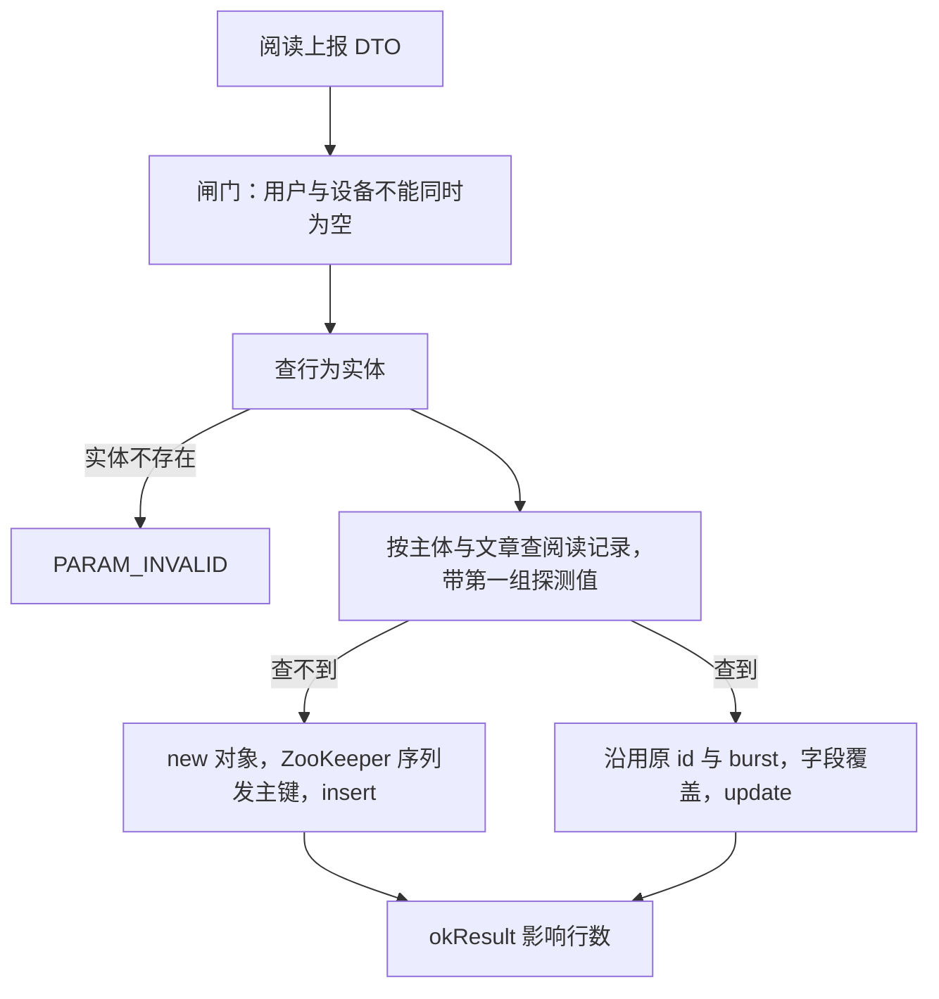

# 点赞、不喜欢、阅读三接口：同一骨架下的三种落库形态

> 🔒 安全提示：文中示例的口令/密钥均为课程教学环境演示口径，生产环境的安全要求见《安全与合规须知》。

行为域的收尾工作是三个接口：点赞、不喜欢、阅读。展示行为与关注行为已经把骨架立了两遍，两道参数闸门、行为实体定位、实体组装、单条落库，这套动作在三个新接口里原样复用。真正拉开差距的是三张表的路由方式：点赞表 50 分片还带 burst，不喜欢表单库直存，阅读表既要插入又要更新。主键从哪来、语句长什么样、写之前要不要先查，全由路由说了算。

三个接口各自要一个视频才讲得完，代码却高度同构，放在一篇里对照着看反而更清楚：骨架怎么复用，差异从哪长出来，幂等与计数这三本账为什么各管各的。

## 先给结论

- 三个接口共用同一骨架：校验用户与设备、查行为实体、组实体、落库；service 全在 behavior 工程，差异全部来自表的路由方式。
- `ap_likes_behavior` 走 burst5050，主键用 ZooKeeper 序列在应用侧生成，insert 带 id 与 burst；`behavior_entry_id` 装主体、`entry_id` 装文章的列名错位在这张表仍然成立。
- `ap_unlikes_behavior` 单节点 DNBE_0 且 autoIncrement，insert 不写 id 不带 burst；`type` 语义为 0 不喜欢、1 取消不喜欢，表态也是流水。
- `ap_read_behavior` 先查后写：一主体一文章只留一行，查不到走 insert、查到走 update，阅读次数、时长、百分比、加载耗时整体覆盖。
- 端点统一挂在 /api/v1/behavior 下：/like_behavior、/unlike_behavior、/read_behavior，入参全是 `@RequestBody` DTO。

## 同一骨架，三种路由

先摆一张对照表，三个接口的所有差异都能从这张表推出来：

| 表 | 路由 | 主键来源 | 写入形态 |
|---|---|---|---|
| ap_likes_behavior | burst5050，50 分片 | ZooKeeper 序列 | 直接 insert，带 id 与 burst |
| ap_unlikes_behavior | 单节点 DNBE_0 | MyCat 全局序列 | 直接 insert，无 id 无 burst |
| ap_read_behavior | burst5050，50 分片 | ZooKeeper 序列 | 先查，insert 或 update |

day02 的 schema.xml 里这三行配置可以直接核对：`ap_likes_behavior` 与 `ap_read_behavior` 都挂 DNBE_$0-49 配 burst5050，没有 autoIncrement，主键归应用侧；`ap_unlikes_behavior` 挂单节点 DNBE_0 且 autoIncrement，主键由 MyCat 序列发放，应用侧只管装字段。路由方式决定了主键来源，主键来源又决定了 insert 语句的形态，一层扣一层。

骨架部分每个接口都一样：登录态与设备 id 同时为空报 `PARAM_REQUIRE`，行为实体查不到报 `PARAM_INVALID`，这套两道闸门的分工从展示行为保存一课沿用至今。真正动手时三份 service 的差异只在第 3、4 步，组装什么实体、调哪个 Mapper。

## 点赞接口：四个语义字段与 50 分片落库

点赞是三兄弟里字段语义最丰富的一个。入参 `LikesBehaviorDto` 四个字段：设备 id、目标 id、类型、操作位。`entryId` 装的是点赞对象，文章、动态还是评论由 `type` 区分，0 文章、1 动态、2 评论，详情页场景绝大多数是 0；`operation` 才是点赞方向，0 点赞、1 取消点赞。注意 DTO 里没有单独的 userId，主体身份从 ThreadLocal 登录态与设备 id 来。

Mapper 层只有一条新增语句，查询方法是关系接口一课建好的 `selectLastLike`，本课补 insert。写之前先把主键的来路想清楚：这张表没有 autoIncrement 配置，主键必须应用侧生成，而 burst 值的首段又要用这个主键参与分组，生成主键与拼装分片键是一对耦合动作，缺谁另一边都立不住。这也解释了为什么分片表的行为 service 里总能看到 `Sequences` 的身影，而单库流水表里没有：

```java
public interface ApLikesBehaviorMapper {

    /** 查询某主体对某篇文章的最近一条点赞记录（关系接口一课已建） */
    ApLikesBehavior selectLastLike(@Param("burst") String burst,
                                   @Param("objectId") Integer objectId,
                                   @Param("entryId") Integer entryId);

    /** 保存点赞流水 */
    int insert(ApLikesBehavior record);
}
```

```xml
<insert id="insert" parameterType="com.study.headline.model.behavior.pojos.ApLikesBehavior">
    insert into ap_likes_behavior (id, behavior_entry_id, entry_id, type, operation,
        created_time, burst)
    values (#{id}, #{behaviorEntryId}, #{entryId}, #{type}, #{operation},
        #{createdTime}, #{burst})
</insert>
```

列清单里 `behavior_entry_id` 与 `entry_id` 并排出现，正是关系接口一课提醒过的列名错位：前者装行为实体 id（谁点的），后者装文章 id（在哪篇文章点的），按列名直觉理解一定装反。service 里两个 set 的先后与来源要盯紧：

```java
@Service
@SuppressWarnings("all")
public class ApLikesBehaviorServiceImpl implements ApLikesBehaviorService {

    @Autowired
    private ApBehaviorEntryMapper apBehaviorEntryMapper;
    @Autowired
    private ApLikesBehaviorMapper apLikesBehaviorMapper;
    @Autowired
    private Sequences sequences;

    @Override
    public ResponseResult saveLikeBehavior(LikesBehaviorDto dto) {
        //1. 两道闸门：用户与设备不能同时为空；行为实体必须存在
        AppUser user = AppThreadLocalUtils.getUser();
        if (user == null && dto.getEquipmentId() == null) {
            return ResponseResult.errorResult(AppHttpCodeEnum.PARAM_REQUIRE);
        }
        Long userId = null;
        if (user != null) {
            userId = user.getId();
        }
        ApBehaviorEntry apBehaviorEntry = apBehaviorEntryMapper
                .selectByUserIdOrEquipment(userId, dto.getEquipmentId());
        if (apBehaviorEntry == null) {
            return ResponseResult.errorResult(AppHttpCodeEnum.PARAM_INVALID);
        }
        //2. 组装点赞流水并保存
        ApLikesBehavior alb = new ApLikesBehavior();
        alb.setId(sequences.sequenceApLikesBehavior());
        alb.setBehaviorEntryId(apBehaviorEntry.getId());
        alb.setEntryId(dto.getEntryId());
        alb.setType(dto.getType());
        alb.setOperation(dto.getOperation());
        alb.setCreatedTime(new Date());
        alb.setBurst(BurstUtils.groupOne(alb.getId(), apBehaviorEntry.getId()));
        int insert = apLikesBehaviorMapper.insert(alb);
        return ResponseResult.okResult(insert);
    }
}
```

四个组装动作各有讲究。主键 `id` 由 `Sequences` 发放，`ap_likes_behavior` 没有 autoIncrement 配置，应用侧不生成主键这条 insert 就发不出去；`behaviorEntryId` 取行为实体的 id，`entryId` 从 DTO 透传，两列各装各的；burst 用行主键加行为实体 id 拼出，首段参与分组，50 个分片的定向就靠这一列。取消点赞与点赞是同一条语句，差别只在 `operation` 的取值，表里不会有 update 语句。

## 不喜欢接口：单库表的减法

不喜欢的写法比点赞还短，因为表被刻意做轻了。入参 `UnLikesBehaviorDto` 只有三个字段：设备 id、文章 id、`type` 操作位，`type` 为 0 表示不喜欢、1 表示取消不喜欢。没有目标类型字段，不喜欢的对象只有文章一种；没有操作位以外的方向字段，`type` 一个字段就把表态与撤回都说完了。

表的轻量体现在配置上：单节点 DNBE_0，autoIncrement 为 true。点赞表按 500 万量级预估分了 50 片，不喜欢属于低频动作，单库装得下，设计上就不给它分片的负担。主键由 MyCat 全局序列在路由时补发，序列的发放节点映射在 day02 资料包的 sequence_db_conf.properties 里可以直接核对：`AP_UNLIKES_BEHAVIOR=DNSQ`，同一条目里还躺着 `AP_FOLLOW_BEHAVIOR=DNSQ`，上一课的关注行为流水正是同一套发放机制。于是 insert 语句里既没有 id 列也没有 burst 列：

```xml
<insert id="insert" parameterType="com.study.headline.model.behavior.pojos.ApUnlikesBehavior">
    insert into ap_unlikes_behavior (entry_id, article_id, type, created_time)
    values (#{entryId}, #{articleId}, #{type}, #{createdTime})
</insert>
```

对照点赞的语句，少了两列，service 里就少两个 set。列名也别忘了对表：这张表的 `entry_id` 直接装行为实体 id，`article_id` 装文章 id，点赞表那种错位在这里不存在。service 主体如下：

```java
@Service
@SuppressWarnings("all")
public class ApUnlikesBehaviorServiceImpl implements ApUnlikesBehaviorService {

    @Autowired
    private ApBehaviorEntryMapper apBehaviorEntryMapper;
    @Autowired
    private ApUnlikesBehaviorMapper apUnlikesBehaviorMapper;

    @Override
    public ResponseResult saveUnlikesBehavior(UnLikesBehaviorDto dto) {
        //1. 两道闸门：与展示、关注行为完全同构
        AppUser user = AppThreadLocalUtils.getUser();
        if (user == null && dto.getEquipmentId() == null) {
            return ResponseResult.errorResult(AppHttpCodeEnum.PARAM_REQUIRE);
        }
        Long userId = null;
        if (user != null) {
            userId = user.getId();
        }
        ApBehaviorEntry apBehaviorEntry = apBehaviorEntryMapper
                .selectByUserIdOrEquipment(userId, dto.getEquipmentId());
        if (apBehaviorEntry == null) {
            return ResponseResult.errorResult(AppHttpCodeEnum.PARAM_INVALID);
        }
        //2. 组装不喜欢流水并保存：无 id 无 burst，主键由 MyCat 序列发放
        ApUnlikesBehavior alb = new ApUnlikesBehavior();
        alb.setEntryId(apBehaviorEntry.getId());
        alb.setArticleId(dto.getArticleId());
        alb.setType(dto.getType());
        alb.setCreatedTime(new Date());
        int insert = apUnlikesBehaviorMapper.insert(alb);
        return ResponseResult.okResult(insert);
    }
}
```

`type` 的两个取值都是流水：0 记一次不喜欢，1 记一次取消不喜欢，两次动作各占一行，表里永远查得到历史表态轨迹。状态语义由查询侧解释，最近一条的 `type` 决定当前是否处于不喜欢中，这与点赞表查最近一条 `operation` 是同一个思路。

## 阅读接口：查了再写的合并账

阅读接口是三个里唯一带判断的。需求里的原话值得抄一遍：通过阅读时长、阅读百分比等数据进一步计算出用户对文章的喜爱程度，主要数据由前端收集，后端只做保存。前端把阅读次数、阅读时长（单位秒）、阅读百分比、文章加载耗时一并上报，后端不做任何加工，原样落表，算法侧怎么用是另一层的事。落表时发现：同一主体对同一篇文章反复阅读，不该堆出一堆行，而应该保住一行不断覆盖。于是写入形态变成先查后写，Mapper 配三个方法：

```java
public interface ApReadBehaviorMapper {

    /** 按主体、文章与第一组探测值查阅读记录 */
    ApReadBehavior selectById(@Param("burst") String burst,
                              @Param("entryId") Integer entryId,
                              @Param("articleId") Integer articleId);

    /** 新增阅读记录 */
    int insert(ApReadBehavior record);

    /** 按主键更新阅读记录 */
    int update(ApReadBehavior record);
}
```

```xml
<resultMap id="BaseResultMap" type="com.study.headline.model.behavior.pojos.ApReadBehavior">
    <id column="id" property="id"/>
    <result column="entry_id" property="entryId"/>
    <result column="article_id" property="articleId"/>
    <result column="count" property="count"/>
    <result column="read_duration" property="readDuration"/>
    <result column="percentage" property="percentage"/>
    <result column="load_duration" property="loadDuration"/>
    <result column="created_time" property="createdTime"/>
    <result column="updated_time" property="updatedTime"/>
    <result column="burst" property="burst"/>
</resultMap>

<select id="selectById" resultMap="BaseResultMap">
    select id, entry_id, article_id, count, read_duration, percentage,
        load_duration, created_time, updated_time, burst
    from ap_read_behavior
    where burst = #{burst} and entry_id = #{entryId} and article_id = #{articleId}
</select>

<insert id="insert" parameterType="com.study.headline.model.behavior.pojos.ApReadBehavior">
    insert into ap_read_behavior (id, entry_id, article_id, count, read_duration,
        percentage, load_duration, created_time, updated_time, burst)
    values (#{id}, #{entryId}, #{articleId}, #{count}, #{readDuration},
        #{percentage}, #{loadDuration}, #{createdTime}, #{updatedTime}, #{burst})
</insert>

<update id="update" parameterType="com.study.headline.model.behavior.pojos.ApReadBehavior">
    update ap_read_behavior
    set read_duration = #{readDuration},
        percentage = #{percentage},
        load_duration = #{loadDuration},
        count = #{count},
        created_time = #{createdTime},
        updated_time = #{updatedTime},
        burst = #{burst}
    where id = #{id}
</update>
```

查询条件里 `entry_id` 装行为实体 id、`article_id` 装文章 id，语义与不喜欢表一致，与点赞表相反。写判断的路由依据也在动手前核过：打开路由定义找到 `ap_read_behavior` 那一行，burst5050，分片列是 burst，探测值照旧用 `BurstUtils.groupOne` 以行为实体 id 补位拼第一组。service 把判断收敛成一个布尔标识：

```java
@Service
@SuppressWarnings("all")
public class AppReadBehaviorServiceImpl implements AppReadBehaviorService {

    @Autowired
    private ApBehaviorEntryMapper apBehaviorEntryMapper;
    @Autowired
    private ApReadBehaviorMapper apReadBehaviorMapper;
    @Autowired
    private Sequences sequences;

    @Override
    public ResponseResult saveReadBehavior(ReadBehaviorDto dto) {
        //1. 两道闸门：与点赞、不喜欢同构
        AppUser user = AppThreadLocalUtils.getUser();
        if (user == null && dto.getEquipmentId() == null) {
            return ResponseResult.errorResult(AppHttpCodeEnum.PARAM_REQUIRE);
        }
        Long userId = null;
        if (user != null) {
            userId = user.getId();
        }
        ApBehaviorEntry apBehaviorEntry = apBehaviorEntryMapper
                .selectByUserIdOrEquipment(userId, dto.getEquipmentId());
        if (apBehaviorEntry == null) {
            return ResponseResult.errorResult(AppHttpCodeEnum.PARAM_INVALID);
        }
        //2. 先查：同一主体对同一文章只保留一行阅读记录
        ApReadBehavior apReadBehavior = apReadBehaviorMapper.selectById(
                BurstUtils.groupOne(apBehaviorEntry.getId()),
                apBehaviorEntry.getId(), dto.getArticleId());
        boolean isInsert = false;
        if (apReadBehavior == null) {
            isInsert = true;
            apReadBehavior = new ApReadBehavior();
            apReadBehavior.setId(sequences.sequenceReadBehavior());
        }
        //3. 组装字段：新增与修改共用同一套赋值
        apReadBehavior.setEntryId(apBehaviorEntry.getId());
        apReadBehavior.setArticleId(dto.getArticleId());
        apReadBehavior.setCount(dto.getCount());
        apReadBehavior.setReadDuration(dto.getReadDuration());
        apReadBehavior.setPercentage(dto.getPercentage());
        apReadBehavior.setLoadDuration(dto.getLoadDuration());
        apReadBehavior.setCreatedTime(new Date());
        apReadBehavior.setUpdatedTime(new Date());
        apReadBehavior.setBurst(BurstUtils.groupOne(
                apReadBehavior.getId(), apReadBehavior.getEntryId()));
        //4. 按标识走 insert 或 update
        int count = 0;
        if (isInsert) {
            count = apReadBehaviorMapper.insert(apReadBehavior);
        } else {
            count = apReadBehaviorMapper.update(apReadBehavior);
        }
        return ResponseResult.okResult(count);
    }
}
```

标识法的思路值得记一笔：查到了不新建对象，直接在查出的行上覆盖字段，主键沿用原值，update 按 id 定位；查不到才 new 一个、发新主键、走 insert。两条路径共用同一段组装代码，不会出现新增与修改字段清单漂移的问题。burst 的拼法在两条路径下也自然一致，insert 用新 id 拼，update 覆盖写回原 burst 值，路由不漂移。`created_time` 与 `updated_time` 一对时间列在两条路径下都刷新，首读与复读在行上留的是同一套时间语义，区分度交给表外的时间轴。

先查后写还有一个并发缝隙要心里有数：两个请求同时到达、同时查不到行，就会各自 new 一条然后各插一行，单行承诺被打破。查询与插入之间的窗口在应用层堵不住，兜底交给数据库侧按主体加文章的组合唯一约束，第二条插入报错回滚即可。并发量级上来后，更彻底的做法是把阅读上报丢进队列串行化，写侧永远单线程消费同一主体，先查后写的窗口就不复存在。整条判断链如下：



这张图讲的是阅读接口比另外两个接口多出的那一段分叉。关键路径在查询一步：探测值按行为实体 id 拼，命中与否决定主键是新发还是沿用，两种落库共享同一套字段赋值。

## 端点命名与统一出口

三个端点都收在 behavior 工程的 `BehaviorController` 里，与此前展示行为的 `/save_behavior` 同门。API 接口放 behavior 工程 apis 包，controller 实现并挂路径：

```java
@RestController
@RequestMapping("/api/v1/behavior")
public class BehaviorController implements BehaviorControllerApi {

    @Autowired
    private ApLikesBehaviorService apLikesBehaviorService;
    @Autowired
    private ApUnlikesBehaviorService apUnlikesBehaviorService;
    @Autowired
    private AppReadBehaviorService appReadBehaviorService;

    @Override
    @PostMapping("/like_behavior")
    public ResponseResult saveLikeBehavior(@RequestBody LikesBehaviorDto dto) {
        return apLikesBehaviorService.saveLikeBehavior(dto);
    }

    @Override
    @PostMapping("/unlike_behavior")
    public ResponseResult saveUnlikesBehavior(@RequestBody UnLikesBehaviorDto dto) {
        return apUnlikesBehaviorService.saveUnlikesBehavior(dto);
    }

    @Override
    @PostMapping("/read_behavior")
    public ResponseResult saveReadBehavior(@RequestBody ReadBehaviorDto dto) {
        return appReadBehaviorService.saveReadBehavior(dto);
    }
}
```

端点命名的口径从此固定下来：模块前缀 `/api/v1/behavior` 加行为名词 `*_behavior`，POST 提交，JSON 体进 `@RequestBody`。三个 DTO 的 id 字段都挂 `@IdEncrypt` 混淆注解，前端拿到的混淆 id 原样传回，网关层解密后才是真实主键。service 接口的方法名也与端点一一对应，`saveLikeBehavior`、`saveUnlikesBehavior`、`saveReadBehavior`，controller 只做转发不夹业务，路径、方法、service 三层对得上，排查问题时从端点一路顺下去不用查表。

测试留到集成前端之后统一走页面联测。这样取舍的理由不难想：三个接口的骨架段与展示行为、关注行为完全同构，那两段已经分别在各自的首讲里联测验收过，再对同构代码重复一次 MockMvc 用例，验的还是同一套逻辑；真正的新差异在三张表的落库形态上，而落库形态的最终裁判是数据库数据，页面联测时对着三张表逐条核对反而更直接。本课先把代码立稳，接口留好联测的入口。

## 幂等与计数：三本账各管各的

三个接口都不做插入前的查重拦截，重复上报会重复落行，这不是疏漏，是三本账各自语义下的选择。**点赞的账本允许重复。** 同一用户连点两次，表里就是两条 operation 不同的流水，点与取消都留痕；页面上的点赞状态由查询侧解释，取最近一条的 operation 定方向，取消点赞本质是补一条反向流水让状态回退，而不是去修改旧行。这套消费逻辑在关系接口一课的 `selectLastLike` 里已经写好，写侧只管忠实记录。**不喜欢的账本同理。** type 翻转靠两条流水表达，历史表态轨迹完整保留。**阅读的账本被查了再写合并掉了。** 行级覆盖让重复阅读不增行，历史维度只有最新一次的快照，这与点赞不喜欢的流水取向恰好相反，原因在消费方不同：点赞状态要回放历史定方向，阅读状态只要当前快照。

三本账对并发的容忍度也不一样。点赞与不喜欢的流水表没有唯一性约束，并发重复上报多记两条流水，状态解释不受影响，容忍代价为零；阅读表的单行承诺对并发敏感，靠组合唯一约束兜底，见上一节的讨论。三本账还有一个共同点值得点破：状态语义都收敛在查询侧解释，写侧不维护任何状态标记，这让写路径永远是最简单的单条语句，接口耗时稳定，也为后续把行为上报整体挪进消息队列留了余地。

文章侧的计数是另一本账。详情页的点赞数、阅读数常驻展示，冗余列放在文章表里，动作发生时同步加一减一，或由异步任务汇总行为流水后批量更新，两种做法的取舍随量级而定。本课代码只落行为流水，不动文章表计数，把「流水记动作、冗余列记总量」的两层结构立住，计数的具体实现留作后续改造的接口。

## 常见误区

- **把点赞表的 `entry_id` 当行为实体 id。** `ap_likes_behavior` 里 `behavior_entry_id` 装主体、`entry_id` 装文章，列名与语义错位；而 `ap_unlikes_behavior` 与 `ap_read_behavior` 的 `entry_id` 装的正是行为实体。同一批行为表两套语义并存，写条件前先对表注释，别用一张表的规律套另一张。
- **给不喜欢表的 insert 手写 id。** 这张表配了 autoIncrement，主键由 MyCat 序列发放，语句里出现 id 列就绕开了序列；反过来点赞与阅读表没配 autoIncrement，应用侧不发主键就是主键为空，两张表的处理方式必须分清。
- **阅读接口跳过先查直接 insert。** 每次阅读都插新行，同一主体同一文章的记录无限膨胀，状态查询也要多翻几行；先查后写的合并账就是为了控住行数，查到就走 update 覆盖。
- **把重复点赞上报当 bug 修。** 流水表记两条是设计允许的，要修的是状态消费侧取最近一条的逻辑；强行在写侧去重，取消点赞的回退流水就再也记不进来了。

## 面试可能被问到的问题

1. 面试官追问：「点赞和取消点赞为什么都记流水，而不是 update 一个状态位？」
   答：行为数据要服务推荐与分析，历史轨迹回答「用户对这个内容互动过什么」，状态位只有当前值，历史全丢。流水每次动作一行，取消也是一行，页面状态由最近一条 operation 决定。写入永远 append，不与并发更新打架，代价是查询要取最近一条，一次带排序的条件查询就能解决。
2. 面试官追问：「不喜欢表为什么不分片，点赞表却分了 50 片？」
   答：分片数按写入量级预估。点赞是高频动作，按 500 万量级配 burst5050；不喜欢是低频动作，单库装得下，就配单节点 DNBE_0 加 autoIncrement，主键交给 MyCat 序列。量级与路由是配套决策，不分片换来 insert 不带 id 不带 burst 的轻量写法。
3. 面试官追问：「阅读行为为什么先查再写，而不是每次插入？」
   答：消费方只要当前快照：读了多少次、读到百分之几、加载多久。同一主体同一文章保一行，每次上报覆盖更新，行数可控，查询一次命中。若按流水追加，行数随阅读次数线性膨胀，状态查询还要自己挑最新行，得不偿失。
4. 面试官追问：「行为流水里记了阅读，文章表的总阅读数怎么涨？」
   答：两层账。行为表记个体快照，文章表的阅读数是冗余总量，动作发生时同步 update 加一最直接，量级上来后改成异步汇总或由数据层离线计算。本课代码只落行为层，计数层留给后续改造，两层解耦让各自的改造互不影响。
5. 面试官追问：「三个行为接口的 service 几乎一样，你怎么看这种重复？」
   答：前半段的两道闸门与实体定位是标准起手式，重复是模板复用的结果，收口成一个公共校验方法是合理的重构方向；后半段的组装与落库差异是表结构决定的，硬抽公共层反而要传一堆差异参数。可收敛的收敛，该分化的分化，比一味追求 DRY 更符合工程判断。
6. 面试官追问：「type 字段在点赞表和不喜欢表里语义完全不同，怎么避免用错？」
   答：点赞表的 type 是目标类型，0 文章、1 动态、2 评论；不喜欢表的 type 是表态方向，0 不喜欢、1 取消。两个 type 都应收进各自的枚举，调用点用枚举码而不是裸数字，编译器把取值范围锁死，code review 时看到裸数字即可拦截。

## 配套资料

- 代码：`materials/code/05/头条day03/`。该日资料包解压结果为空（未含源码文件），文中 Mapper 接口、XML、service 与 controller 代码为按画面线抄录并按既有工程风格补全的可运行版本，包名统一改写为 `com.study.headline`。
- 代码：`materials/code/05/头条day02/`，mycat 配置四件套（schema.xml、rule.xml、server.xml、sequence_db_conf.properties）。`ap_likes_behavior` 与 `ap_read_behavior` 的 burst5050、`ap_unlikes_behavior` 的单节点 DNBE_0 加 autoIncrement 均可在其中核对。
- 代码：`materials/code/05/头条day01/`，内层资料目录含数据库规范设计说明书，三张行为表的字段命名与流水设计可对照其规范条目；原始目录与文件名冠以项目原名，正文统一以「头条类资讯项目」指代。
- 环境：课程集群 node01~node03，MySQL root/123456。
