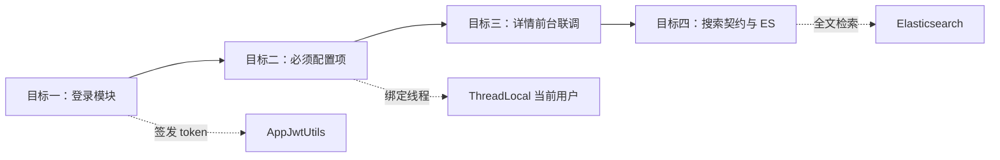

# day04 任务书：登录补全、详情联调与搜索开工

> 🔒 安全提示：文中示例的口令/密钥均为课程教学环境演示口径，生产环境的安全要求见《安全与合规须知》。

day03 收官时详情域的后台已经齐了三件：内容接口、关系接口、关注行为流水，可这些接口还没被一个真实的 App 用户用过，因为整个系统至今没有登录入口，前台也从没真正点开过一个详情页。day04 的任务书就冲着这个缺口来：先把用户请进门，再把公共配置落位，让前台把详情页整条链路跑通，最后为搜索功能立好契约。

## 先给结论

- day04 分四块任务，按依赖顺序排：登录模块开发、后台必须配置项、详情前台流程与联调测试、搜索需求与接口定义，前一块都是后一块的地基。
- 登录落在新微服务 leadnews-login：手机号加密码验证用户，成功签发 JWT 字符串并连同用户信息一起返回，签发工具复用 day01 工具课的 `AppJwtUtils`。
- 后台必须配置只有两件：每个微服务扫描 Jackson 混淆配置让 ID 加解密生效，user 服务启用 token 校验过滤器把当前用户绑进线程。
- 前台线的主角是详情页：登录后从列表点进文章，页面初始化时并发调 `load_article_info` 与 `load_article_behavior`，内容与四个行为状态位一并回显。
- 搜索功能今天只立契约不写实现：历史、热词、联想、文章搜索的接口先定下来，文章检索的存储从 MySQL like 换道 Elasticsearch。

## 四个目标怎么排兵

四个目标不是并列关系，而是一条依赖链：没有登录就没有 token，没有 token 过滤器就没有「当前用户」，没有当前用户则详情页的关注、点赞全是无主行为，搜索的个性化部分同样无从谈起。目标到技术点的映射如下：



关键路径在目标一与目标二的交接处：登录接口负责把用户信息变成一串 token，过滤器负责在后续每个请求里把这串 token 还原成用户，一签一验合起来才是完整的认证闭环。目标三是把 article、behavior、login、user 四个微服务与前端工程一次拉起做联调，day01 到 day03 的成果在这天接受第一次全链路检验。目标四是下一阶段的起点，Elasticsearch 的环境搭建与接口编码从随后的课程铺开，今天先把需求与接口定义站稳。

## 登录接口契约先行

课件对登录接口的基本定义只有一句话：通过用户输入的用户名和密码验证用户，并返回 JWT 字符串。App 端的用户名就是手机号，请求体直接复用用户域的 `ApUser` 实体，响应走统一 `ResponseResult`，data 里装 token 与 user 两样东西。契约落成方法签名如下（示例按本课写法补全，包名统一 `com.study.headline`）：

```java
public interface ApUserLoginService {

    /**
     * 登录验证：校验手机号与密码
     * 入参 ApUser 只用 phone 与 password 两个字段
     * 出参 data 内含 token（JWT 字符串）与 user（脱敏后的用户信息）
     */
    ResponseResult loginAuth(ApUser user);
}
```

承载它的微服务是本天新建的 leadnews-login，工程仍按既有模板四件套起步：内部公共模块依赖、web 与 test starter、`application.properties` 加 `log4j2.xml`、引导类加 MysqlConfig，具体创建过程由登录开发课展开。签发侧的工具方法在工具类课已备好，登录成功处一行即可拿到 token：

```java
// 登录成功后按用户 id 签发 token，有效期一天
String token = AppJwtUtils.getToken(apUser.getId());
```

token 的载荷只放用户 id，不放手机号与密码这类敏感字段，这条边界在工具课立过，登录课签发时要继续守住。

## 详情前台与搜索的前瞻

前台流程可以预演成三步：登录成功后把 token 存进本地缓存，列表页点击文章把整条 item 带进详情路由，详情页初始化时 `loadInfo` 与 `loadBehavior` 两个请求并行发出，前者拿内容与文章配置，后者拿是否点赞、是否不喜欢、是否收藏、是否关注四个状态位。行为按钮的保存动作与阅读时长的定时上报也都在详情页内完成，具体代码由前台流程课逐段拆。

搜索线的接口清单先亮在这里，代码从搜索需求课起逐个实现：

| 接口 | 作用 | 数据来源 |
|---|---|---|
| 查询搜索记录 | 回显用户搜过的词 | MySQL 搜索历史表 |
| 删除搜索记录 | 删单条或多条历史 | MySQL 搜索历史表 |
| 清空搜索记录 | 一键清空历史 | MySQL 搜索历史表 |
| 查询今日热词 | 按当天日期展示热搜词 | MySQL 热词统计 |
| 查询联想词 | 按输入前缀联想候选词 | MySQL 联想词表 |
| 文章搜索 | 按关键字搜文章列表 | Elasticsearch 索引 |

表格里能看出搜索功能的存储分两派：历史、热词、联想这类结构化小数据继续留在 MySQL，文章搜索换到 Elasticsearch。换道的理由是 like 查询在数据量与大字段全文匹配上的先天不足，需求课会把这笔账算清楚。

## JWT 为什么今天才登场

工具类课把 `AppJwtUtils` 讲过一遍：`getToken` 按用户 id 签发三段式字符串，`parseToken` 把字符串还原回载荷。当时它只是躺在 utils 工程里的静态方法，没有业务调用方。让一个工具类活起来需要两个入口：签发入口在登录接口，本课补上；消费入口在 token 校验过滤器，配置项课接上。过滤器从请求头取出 token 解析出 id，查回用户绑进 ThreadLocal，之后行为保存代码里的 `getUser` 才有值可取。两课连起来看，认证闭环的两端都在 day04 落地，中间的存量代码只是原地受益。

## 常见误区

- **把登录当 user 服务的顺手功能。** 认证职责独立成 leadnews-login 微服务，查的数据虽是用户域的 ap_user 表，但登录、后续实名认证等认证动作与用户中心业务彼此独立，混在一起后面拆不开。
- **以为 token 里存了用户全部信息。** 载荷只放 id，解析后还要回库补全用户；往载荷里塞手机号是典型的安全漏洞，token 只是编码不是加密。
- **把目标清单当流水账读。** 每条目标都带验收标准：登录模块以 test 账号能换到 token 为准，详情联调以浏览器里点开文章、关注点赞落库为准，搜索目标以接口契约评审通过为准。
- **以为今天就要把 ES 写完。** 今天只做需求与接口定义，环境搭建、数据导入、接口编码、前后端联调是后面四节课的量，先把契约立稳，实现才不会来回返工。

## 面试可能被问到的问题

1. 面试官追问：「登录为什么独立成微服务，而不放进 user 服务？」
   答：认证是横切能力，login 与 user 的变更节奏不同，独立后认证相关改动不影响用户中心，也便于后续接入实名、风控等认证动作。数据可以共享，model 工程的实体与 Mapper 两边通用，职责边界靠服务划分。
2. 面试官追问：「JWT 与 session 方案怎么选？」
   答：session 状态在服务端，多实例要么粘性会话要么共享存储；JWT 状态在令牌里，服务端无状态、水平扩展自然。代价是签发后无法主动作废，只能靠短有效期加黑名单弥补。多微服务且各服务都要识别用户的场景，JWT 更顺手。
3. 面试官追问：「token 签发后放哪里，为什么？」
   答：App 端放本地缓存，请求时放请求头带上。本地缓存随端走、容量可控；cookie 在原生 App 场景不好使，localStorage 在 weex 里对应 storage 模块。放请求头与过滤器约定同名键，服务端解析成本最低。
4. 面试官追问：「文章搜索为什么不直接用 MySQL like？」
   答：like 加前后通配符会全表扫描，数据量上来先拖垮查询；它不做分词，搜「微服务」匹配不到「微服务治理」这类变体；也不给相关度排序。Elasticsearch 用倒排索引加分词器解决这三件事，代价是多一套存储与同步链路，适合搜索这种读多写少的场景。

## 配套资料

- 代码：`materials/code/05/头条day04/`。该日资料包解压结果为空（未含源码文件），文中登录契约与方法签名示例按画面线与既有工程风格补全，包名统一改写为 `com.study.headline`；引用路径截至 `头条dayNN/` 层级，内层目录冠以项目原名，正文统一以「头条类资讯项目」指代。
- 代码：`materials/code/05/头条day01/`，内层资料目录含数据库规范设计说明书，ap_user 表字段与登录入参的对应关系可对照其规范条目核对。
- 环境：课程集群 node01~node03，MySQL root/123456。
