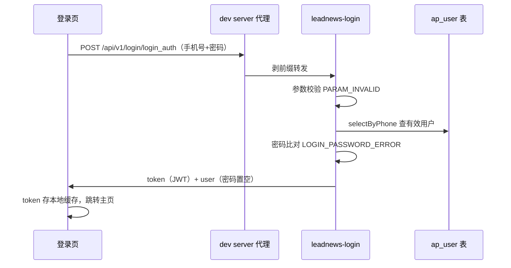

# App 登录接口落地：login 微服务、三道校验与 JWT 签发

> 🔒 安全提示：文中示例的口令/密钥均为课程教学环境演示口径，生产环境的安全要求见《安全与合规须知》。

详情页的一切用户行为都建立在「当前用户」之上，而这个身份的源头是登录。目标课把契约立好之后，这一课把 leadnews-login 微服务从零建起来，接口三层写完：Mapper 按手机号查用户，Service 过三道校验并签发 token，Controller 挂上 POST 端点。测试这一课先不跑，token 的首次实战留给前端联调。

## 先给结论

- 登录落在新建微服务 leadnews-login，工程照既有模板起步：内部三模块加 utils 依赖、web 排除默认日志、`application.properties` 加 `log4j2.xml`、引导类加 MysqlConfig。
- 校验三关对应三个错误码：参数为空 `PARAM_INVALID`、用户不存在 `AP_USER_DATA_NOT_EXIST`、密码错误 `LOGIN_PASSWORD_ERROR`，全部走统一 `ResponseResult` 返回。
- 登录成功组装一个 Map：token 用 `AppJwtUtils` 按用户 id 签发，user 为库中查回的实体；返回前把密码字段置空，凭据绝不出服务端。
- 端点落成 `POST /api/v1/login/login_auth`，契约接口与控制器同包放置，与文章域的 apis 惯例一致。
- 画面线的密码比对是明文 equals，属于教学简化；工程上应改为 MD5 加盐或 BCrypt 校验，ap_user 表预留的 salt 字段就是给这条路用的。

## 工程创建：照模板抄，改三处

新微服务的创建动作与前两天完全同构：在聚合工程 leadnews 下新建模块 leadnews-login，打包 jar，依赖清单照行为服务抄一份。内部模块是 model、common、apis、utils 四件，外加 web 与 test 两个 starter 和 jackson 的 xml、yaml 数据格式支持（pom 不在资料包内，按画面线与主流写法补全）：

```xml
<dependencies>
    <!-- 内部公共模块：实体 pojos、通用装配、接口契约、工具类 -->
    <dependency>
        <groupId>com.study</groupId>
        <artifactId>leadnews-model</artifactId>
    </dependency>
    <dependency>
        <groupId>com.study</groupId>
        <artifactId>leadnews-common</artifactId>
    </dependency>
    <dependency>
        <groupId>com.study</groupId>
        <artifactId>leadnews-apis</artifactId>
    </dependency>
    <dependency>
        <groupId>com.study</groupId>
        <artifactId>leadnews-utils</artifactId>
    </dependency>

    <dependency>
        <groupId>org.springframework.boot</groupId>
        <artifactId>spring-boot-starter-web</artifactId>
        <!-- 排除默认日志绑定，工程统一使用 log4j2 -->
        <exclusions>
            <exclusion>
                <groupId>org.springframework.boot</groupId>
                <artifactId>spring-boot-starter-logging</artifactId>
            </exclusion>
        </exclusions>
    </dependency>
    <dependency>
        <groupId>org.springframework.boot</groupId>
        <artifactId>spring-boot-starter-test</artifactId>
        <scope>test</scope>
    </dependency>
    <dependency>
        <groupId>com.fasterxml.jackson.dataformat</groupId>
        <artifactId>jackson-dataformat-xml</artifactId>
    </dependency>
    <dependency>
        <groupId>com.fasterxml.jackson.dataformat</groupId>
        <artifactId>jackson-dataformat-yaml</artifactId>
    </dependency>
</dependencies>
```

resources 下两个配置文件从模板拷来，必改的是端口与应用名，值从 common 统一清单里取，与前文 article 9001、behavior 9004、user 9005 不重复（示例值 9002 按不重复原则演示）：

```properties
# 端口与应用名：以 common 统一清单为准，示例值 9002 为演示
server.port=9002
spring.application.name=leadnews-login
```

包结构照 article 的骨架落位，引导类 `LoginApplication` 放 `com.study.headline.login` 包根，config 包放 MysqlConfig 显式扫入 common 的 mysql.core，数据源与 Mapper 代理启动时一并装配，Mapper 扫描仍指向 model 工程的 mappers 包：

```java
package com.study.headline.login.config;

import org.springframework.context.annotation.ComponentScan;
import org.springframework.context.annotation.Configuration;

@Configuration
@ComponentScan("com.study.headline.common.mysql.core")
public class MysqlConfig {
}
```

查用户用的 `ApUserMapper` 是 model 工程的存量资产，`selectByPhone` 按手机号查有效用户数据，本课直接注入使用，不重复造。

## Service：三道校验 + 一份凭据

接口先立，方法名 `loginAuth` 统一返回 `ResponseResult`；实现类里三道校验按顺序把关（实现类按画面线整理，`@SuppressWarnings` 原样保留）：

```java
package com.study.headline.login.service.impl;

import com.study.headline.model.common.constants.AppHttpCodeEnum;
import com.study.headline.model.common.dtos.ResponseResult;
import com.study.headline.model.mappers.app.ApUserMapper;
import com.study.headline.model.user.pojos.ApUser;
import com.study.headline.login.service.ApUserLoginService;
import com.study.headline.utils.jwt.AppJwtUtils;
import org.apache.commons.lang3.StringUtils;
import org.springframework.beans.factory.annotation.Autowired;
import org.springframework.stereotype.Service;

import java.util.HashMap;
import java.util.Map;

@Service
@SuppressWarnings("all")
public class ApUserLoginServiceImpl implements ApUserLoginService {

    @Autowired
    private ApUserMapper apUserMapper;

    @Override
    public ResponseResult loginAuth(ApUser user) {
        //1. 参数校验：手机号与密码不能同时缺席
        if (StringUtils.isEmpty(user.getPhone()) || StringUtils.isEmpty(user.getPassword())) {
            return ResponseResult.errorResult(AppHttpCodeEnum.PARAM_INVALID);
        }
        //2. 按手机号查用户，查不到视为账号不存在
        ApUser apUser = apUserMapper.selectByPhone(user.getPhone());
        if (apUser == null) {
            return ResponseResult.errorResult(AppHttpCodeEnum.AP_USER_DATA_NOT_EXIST);
        }
        //3. 密码比对，不一致报密码错误
        if (!user.getPassword().equals(apUser.getPassword())) {
            return ResponseResult.errorResult(AppHttpCodeEnum.LOGIN_PASSWORD_ERROR);
        }
        //4. 登录成功：签发 token，用户脱敏后一并返回
        Map<String, Object> map = new HashMap<>();
        map.put("token", AppJwtUtils.getToken(apUser));
        apUser.setPassword(null);
        map.put("user", apUser);
        return ResponseResult.okResult(map);
    }
}
```

三道校验的次序有讲究。**第一关拦请求残缺。** 手机号与密码任一为空，后面的查询与比对都无从谈起，直接返回错误码；画面线用的是 `PARAM_INVALID`，若按行为域「缺参数报 `PARAM_REQUIRE`」的分工口径，这里换成 `PARAM_REQUIRE` 语义更贴切，两种取法都成立，关键是一致。**第二关拦账号不存在。** 手机号在 App 端就是用户名，`selectByPhone` 查不到说明账号从未注册，返回用户数据不存在。**第三关拦凭据不对。** 查到的实体与入参密码不一致即拒绝，提示密码错误。三关全过才算登录成功。

成功路径上还有两个动作值得圈出来。**token 签发复用存量工具。** `AppJwtUtils.getToken` 收用户实体即按其 id 签发三段式 JWT，载荷只有 id，有效期一天，工具课的实现一行未改直接复用。**返回体必须脱敏。** 实体带着密码原样出服务端，等于把凭据写给前端，`setPassword(null)` 这一行是安全底线，缺了它整个接口都不合格。

## Controller：契约接口加 POST 端点

控制器沿用 apis 惯例：契约接口先立，控制器实现它。端点是类级前缀加方法级路径拼出来的：

```java
package com.study.headline.login.controller.v1;

import com.study.headline.login.apis.LoginControllerApi;
import com.study.headline.login.service.ApUserLoginService;
import com.study.headline.model.common.dtos.ResponseResult;
import com.study.headline.model.user.pojos.ApUser;
import org.springframework.beans.factory.annotation.Autowired;
import org.springframework.web.bind.annotation.PostMapping;
import org.springframework.web.bind.annotation.RequestBody;
import org.springframework.web.bind.annotation.RequestMapping;
import org.springframework.web.bind.annotation.RestController;

@RestController
@RequestMapping("/api/v1/login")
public class LoginController implements LoginControllerApi {

    @Autowired
    private ApUserLoginService apUserLoginService;

    @PostMapping("/login_auth")
    public ResponseResult login(@RequestBody ApUser user) {
        return apUserLoginService.loginAuth(user);
    }
}
```

入参上的 `@RequestBody` 是老坑新防：漏了它 Spring 不解析 JSON 体，dto 全空，三道校验的第一关就会把请求打回。方法名 `login` 只是本地命名，真正对外的是 `/api/v1/login/login_auth` 这个地址。

## 密码怎么存才算工程化

本课画面线的比对是明文 equals，教学期为了聚焦链路可以接受，生产上这一行要换掉。主流写法有两种：一种是 MD5 加盐，注册时给用户生成随机 salt 存进 ap_user 的 salt 字段，校验时把入参密码与盐拼接后做摘要再比对：

```java
// 工程化改造示例：MD5 加盐校验（salt 取自 ap_user.salt 字段）
String pswd = DigestUtils.md5DigestAsHex(
        (user.getPassword() + apUser.getSalt()).getBytes());
if (!pswd.equals(apUser.getPassword())) {
    return ResponseResult.errorResult(AppHttpCodeEnum.LOGIN_PASSWORD_ERROR);
}
```

另一种是 BCrypt，摘要算法内置随机盐，校验调 `matches` 一步完成，无需自行维护 salt 列。两种方案都把「库中不放明文」立为前提，注册侧与校验侧必须用同一套算法，否则密码永远对不上。选型的取舍与迁移思路留到安全专题再展开。

整条登录链路走通后是下图的样子：



关键路径在返回那一步：token 与 user 同时到前端，token 进本地缓存供后续请求携带，user 立即用于页面展示，一次登录喂饱两个消费方。

## 常见误区

- **密码明文入库或明文比对上生产。** 教学画面是明文 equals，工程上必须 MD5 加盐或 BCrypt；库里存明文等于把所有用户凭据裸奔，泄露事故的追溯成本远高于改造成本。
- **返回体里带密码。** 成功路径忘记 `setPassword(null)` 是高频事故，前端不需要密码，响应里的每个字段都要过一遍「能不能给」的审查。
- **token 载荷塞手机号。** 载荷可被任何人解码，只放 id 这类无敏感性标识；需要完整用户信息时回库查，别图省事往载荷里装。
- **把 `@RequestBody` 当可选注解。** POST 接口收 JSON 体必加；漏掉的表象是「参数永远是 null」，根因在绑定方式退回了查询参数。

## 面试可能被问到的问题

1. 面试官追问：「登录校验的错误码为什么要拆成三个？」
   答：三个错误码对应三类问题：请求缺参、账号不存在、密码错误。拆开之后前端能分别提示，运营与排查能按码统计，攻击面分析也能从错误码分布看出异常。合并成一个「登录失败」会让前端与排查两头都抓瞎。
2. 面试官追问：「MD5 加盐和 BCrypt 怎么选？」
   答：MD5 加盐实现简单，但 MD5 本身计算快，暴力破解成本低，盐还要自己管；BCrypt 内置随机盐且计算慢，天然抗暴力破解，主流推荐 BCrypt。存量系统从 MD5 迁移通常用「登录时重算升级」的渐进方案，避免一次性重置全量密码。
3. 面试官追问：「登录接口会被高频刷，怎么防？」
   答：入口层限流与验证码抬门槛，服务层对同一账号的失败次数计数并临时锁定，错误提示不区分「账号不存在」与「密码错误」以免撞库枚举。日志里记录来源与失败分布，配合网关层黑名单。
4. 面试官追问：「token 有效期一天，用户正在用的时候过期了怎么办？」
   答：前端捕获 token 失效的业务码后引导重新登录，或用 refresh token 静默换新；服务端也可以在校验时对临期令牌续签。关键是过期错误要有明确的业务码，不能让前端把过期当成系统异常。
5. 面试官追问：「selectByPhone 这种查询要注意什么？」
   答：手机号列要有索引，查询条件里带上有效状态位，把停用、注销账号挡在查回之外；返回前对手机号做脱敏，日志里不打全号，避免中间件与日志系统留存敏感信息。

## 配套资料

- 代码：`materials/code/05/头条day04/`。该日资料包解压结果为空（未含源码文件），文中 pom、配置文件、Service、Controller 与密码改造示例按画面线抄录并按既有工程风格补全为可运行版本，包名统一改写为 `com.study.headline`；端口 9002 为示例值，以 common 统一清单实际分配为准。
- 代码：`materials/code/05/头条day01/`，内层资料目录含数据库规范设计说明书，ap_user 表的 phone、password、salt 字段口径可对照其规范条目核对；原始目录与文件名冠以项目原名，正文统一以「头条类资讯项目」指代。
- 环境：课程集群 node01~node03，MySQL root/123456。
