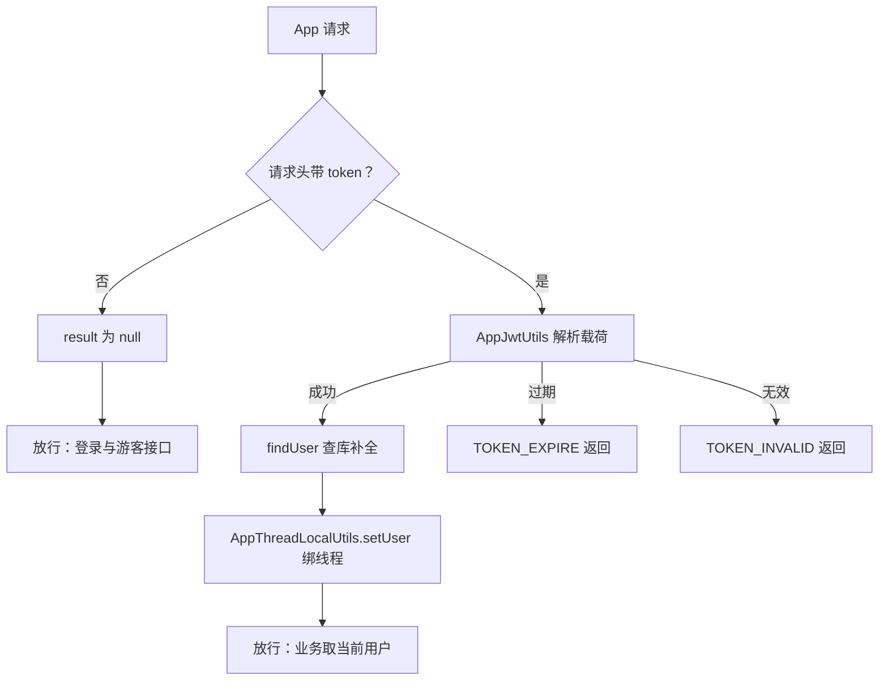

# 两件必须配置：Jackson 混淆生效与 token 校验过滤器进场

> 🔒 安全提示：文中示例的口令/密钥均为课程教学环境演示口径，生产环境的安全要求见《安全与合规须知》。

登录接口写完，代码层面看着齐了，但两个公共能力还没通电：响应里的 ID 混淆依赖 Jackson 定制模块，没人扫描它就不生效；登录签发的 token 也没有任何环节去解析，ThreadLocal 里的当前用户永远取不到。这一课把这两处补上，配置本身都只有几行，难点在理解它们为什么非加不可、加在哪些服务。

## 先给结论

- 必须配置一共两件：Jackson 混淆配置与 token 校验过滤器，都是 common 工程写好、各微服务扫描激活的模式。
- Jackson 混淆要生效，每个微服务放一个 `InitConfig`，用 `@ComponentScan("com.study.headline.common.common.init")` 把 common 的 `InitJacksonConfig` 扫进来，article、behavior、login、user 四个服务全部要加。
- token 过滤器本体 `AppTokenFilter` 在 common 工程 web 包下，`doFilter` 取请求头 token 解析 JWT，成功查回用户绑进 ThreadLocal，失败区分 `TOKEN_EXPIRE` 与 `TOKEN_INVALID` 两个业务码。
- 过滤器的激活靠 `SecurityConfig` 的 `@ServletComponentScan("com.study.headline.common.web.app.security")`，本课先加在 user 服务，后续哪个服务需要再加哪个。
- `doFilter` 里 `true ||` 的短路是联调期全放行的临时口子，收紧时靠 `result == null` 的游客放行与 `isProd` 的环境开关组合，登录这类天然无 token 的路径就是靠 result 为 null 通过的。

## 配置一：Jackson 混淆的最后一环

ID 混淆的原理在 jackson 序列化课立过：连续自增 id 不许裸奔，出服务端要加密、进服务端要解密，这件事挂在统一的 ObjectMapper 上做。common 工程里 `InitJacksonConfig` 已经把带混淆模块的 ObjectMapper 注册成了 Bean：

```java
package com.study.headline.common.common.init;

import com.fasterxml.jackson.databind.ObjectMapper;
import org.springframework.context.annotation.Bean;
import org.springframework.context.annotation.Configuration;

@Configuration
public class InitJacksonConfig {

    @Bean
    public ObjectMapper objectMapper() {
        ObjectMapper objectMapper = new ObjectMapper();
        // 注册 ID 混淆模块：序列化加密、反序列化解密
        objectMapper = ConfusionModule.registerModule(objectMapper);
        return objectMapper;
    }
}
```

问题在于 Bean 的作用范围：类在 common 工程里，而每个微服务启动时只扫描自己的包根，common 里没人替它注册。激活动作就是每个服务加一个空壳配置类，把 common 的 init 包显式扫进来：

```java
package com.study.headline.article.config;

import org.springframework.context.annotation.ComponentScan;
import org.springframework.context.annotation.Configuration;

@Configuration
@ComponentScan("com.study.headline.common.common.init")
public class InitConfig {
}
```

这一课把同样的 `InitConfig` 分别加进 article、behavior、login、user 四个服务。一行扫描背后挂的是 common 工程整包能力，这是这套工程结构反复出现的手法：能力写一次，谁用谁扫描，配置零重复。

## 配置二：token 校验过滤器

过滤器本体在 common 工程的 web 包下，按端拆分，本课用的是 App 端的 `AppTokenFilter`。它的职责一句话说清：请求进来时从请求头把 token 还原成用户，绑到当前线程，业务代码随后随取随用。按画面线整理的核心逻辑如下（错误返回按主流写法补全为显式 `return`）：

```java
@Order(2)
@WebFilter(filterName = "appTokenFilter", urlPatterns = "/*")
public class AppTokenFilter extends GenericFilterBean {

    @Override
    public void doFilter(ServletRequest req, ServletResponse res, FilterChain chain)
            throws IOException, ServletException {
        HttpServletRequest request = (HttpServletRequest) req;
        HttpServletResponse response = (HttpServletResponse) res;
        ResponseResult<?> result = checkToken(request);
        // 联调期短路放行：true || 恒真；收紧后仅 result 为 null（游客）或非生产环境放行
        if (true || result == null || !Contents.isProd()) {
            chain.doFilter(req, res);
        } else {
            response.setCharacterEncoding(Contents.CHARSET_NAME);
            response.setContentType("application/json");
            response.getOutputStream().write(JSON.toJSONString(result).getBytes());
        }
    }

    private ResponseResult<?> checkToken(HttpServletRequest request) {
        String token = request.getHeader("token");
        if (StringUtils.isNotEmpty(token)) {
            // 解析载荷：过期或签名不符时 parseToken 返回 null
            Map<String, Object> claims = AppJwtUtils.parseToken(token);
            if (claims != null) {
                // 载荷里有 id：查库补全用户，绑定当前线程
                ApUser user = new ApUser();
                user.setId(Long.valueOf(claims.get("id").toString()));
                user = findUser(user);
                if (user.getId() != null) {
                    AppThreadLocalUtils.setUser(user);
                }
                return null;
            }
            // 解析失败按成色细分：过期报 TOKEN_EXPIRE，签名不符报 TOKEN_INVALID
            return ResponseResult.errorResult(AppHttpCodeEnum.TOKEN_EXPIRE);
        }
        // 无 token 的请求（登录、游客接口）在此放行
        return null;
    }
}
```

逐段拆开看。**取头与判空。** 请求头约定键名为 token，没有 token 不代表要拦，登录接口、游客可访问的列表接口天然不带，返回 null 走放行分支。**解析与绑定。** token 在手就交给 `AppJwtUtils` 解析载荷，拿到 id 后查库补全用户实体，`setUser` 绑进 ThreadLocal；行为保存、关注操作代码里的 `getUser` 取到的就是这里放进去的对象。**失败的两种成色。** 过期与无效要分开报：`TOKEN_EXPIRE` 提示用户重新登录即可，`TOKEN_INVALID` 往往意味着令牌被伪造或篡改，处理等级完全不同。**放行的口径。** `result == null` 放行是白名单机制的骨架，谁能免检由「有没有 token、token 对不对」自然决定；`!Contents.isProd()` 让非生产环境跳过强校验，方便联调；`true ||` 则是教学期的全放行口子，链路全部验证通过后应删除，让校验真正长牙。

激活它的方式与 Jackson 配置同构，但注解不同：过滤器是 Servlet 组件，要用 `@ServletComponentScan` 扫，普通 `@ComponentScan` 扫不到它。扫描入口加在 user 服务：

```java
package com.study.headline.user.config;

import org.springframework.context.annotation.Configuration;
import org.springframework.boot.web.servlet.ServletComponentScan;

@Configuration
@ServletComponentScan("com.study.headline.common.web.app.security")
public class SecurityConfig {
}
```

user 服务先启用是因为关注接口马上要靠 ThreadLocal 里的当前用户，其他服务按需跟进，不必一次配齐。

## 各服务端口与配置现状

配置铺到这里，App 端四个微服务的家底一并盘一遍（端口口径以 common 统一清单为准，login 为示例值）：

| 微服务 | 应用名 | 端口 | InitConfig | AppTokenFilter |
|---|---|---|---|---|
| 文章服务 | leadnews-article | 9001 | 已加 | 按需后补 |
| 行为服务 | leadnews-behavior | 9004 | 已加 | 按需后补 |
| 登录服务 | leadnews-login | 9002（示例） | 已加 | 不需要 |
| 用户服务 | leadnews-user | 9005 | 已加 | 已启用 |

login 服务不用过滤器有一层容易忽略的道理：过滤器拦的是「带 token 的请求」，登录恰恰是造 token 的地方，请求到达时用户还没有 token，强制校验只会自锁。一张请求穿过过滤器的路径如下图：



关键路径是绑定那一步：过滤器把 id 还原成完整用户实体，而不是把半成品塞进线程，业务层拿到的始终是可用的用户对象，这是 filter 与 ThreadLocal 配合的纪律。

## 常见误区

- **用 `@ComponentScan` 扫过滤器包。** `@WebFilter` 标注的是 Servlet 组件，激活必须 `@ServletComponentScan`；注解用错，容器照常启动、过滤器却不存在，表现是 ThreadLocal 永远为空。
- **把过滤器当成网关。** 它只管本服务进来的请求，跨服务的认证口径要靠统一约定（同一请求头键名、同一套错误码），真网关另有其职，两者别混。
- **无 token 一律拦截。** 登录、文章列表这类游客接口没有 token 是正常态，把它们也拦下会自断入口；放行判断要区分「没有 token」与「token 错了」。
- **ThreadLocal 只设不清。** Tomcat 线程复用，请求结束不清除，下个请求可能读到上个用户的身份；过滤器链收尾要调 remove，这个动作在公共拦截器收口时统一补。

## 面试可能被问到的问题

1. 面试官追问：「过滤器为什么要用 ServletComponentScan 而不是 ComponentScan？」
   答：`@WebFilter`、`@WebServlet` 属于 Servlet 规范注解，Spring 容器默认不把它们当普通 Bean 扫描，只有 ServletComponentScan 开启后才会按注解注册成 Servlet 组件并生效。用 ComponentScan 扫了也不报错，只是过滤器压根不工作，这类静默失效排查成本最高。
2. 面试官追问：「token 过期与 token 无效为什么分开返回？」
   答：过期是正常生命周期，前端静默引导重新登录即可；无效可能来自伪造、篡改或密钥更换，要记日志、必要时封禁来源。分开编码让前端策略与安全策略各自精确，合并则两者都做不好。
3. 面试官追问：「这段代码里 true || 短路是什么意图，怎么收？」
   答：教学联调期故意全放行，让过滤器先空跑观察，避免早期联调被认证卡死。收紧时删掉 true 分支，保留 result 为 null 的游客放行与环境开关，登录路径等白名单靠 null 判定自然通过，再配合 isProd 只在生产强制校验。
4. 面试官追问：「每个微服务都配 InitConfig 会不会太啰嗦，有没有更优雅的做法？」
   答：可以用自动配置机制把 common 的装配做成 starter，条件注解控制生效，服务方只引依赖不写扫描；当前工程的显式扫描是教学期的直白做法，换来的是每一处激活都看得见，两种路线的取舍在于可读性与配置量的平衡。
5. 面试官追问：「过滤器里查库会不会拖慢每个请求？」
   答：会多一次查询，但这是把 token 还原成完整用户的最直接办法，量级可控时可以接受。优化路径按序是：缓存用户到 Redis 并短 TTL、过滤器只绑 id 由业务按需加载、必要时网关层统一解析透传用户上下文，别在过滤器里做重查询。

## 配套资料

- 代码：`materials/code/05/头条day04/`。该日资料包解压结果为空（未含源码文件），文中 `InitConfig`、`InitJacksonConfig`、`AppTokenFilter`、`SecurityConfig` 按画面线抄录，错误返回与 URL 匹配写法按主流工程口径补全为可运行版本，包名统一改写为 `com.study.headline`。
- 代码：`materials/code/05/头条day02/`，mycat 配置四件套（schema.xml、rule.xml、server.xml、sequence_db_conf.properties），行为域分片表插入时过滤器绑定的用户与分片键来源可在此核对。
- 环境：课程集群 node01~node03，MySQL root/123456。
