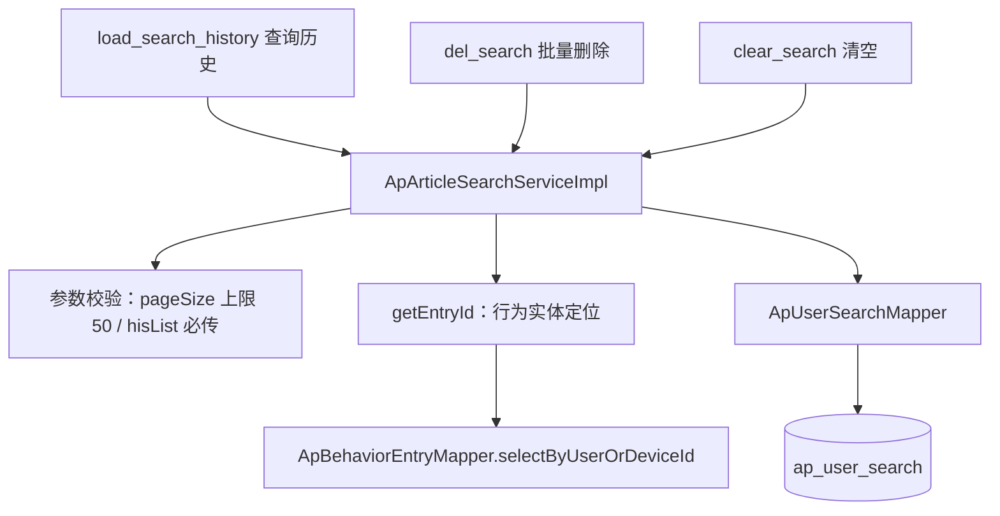

# 搜索历史三接口落地：行为实体统一身份，逻辑删除承接删除与清空

> 🔒 安全提示：文中示例的口令/密钥均为课程教学环境演示口径，生产环境的安全要求见《安全与合规须知》。

搜索历史的交互每家 App 都长一个样：进搜索页先铺历史词，长按或点叉删一条，右上角一键清空。契约在需求分析那一课定完，搜索家族一共六个接口，这一课先拿下与历史表打交道的三个：查询历史、批量删除、一键清空，热词、联想与文章搜索留给后面的课。功能不复杂，落地时却有三个真实决策要当场做：历史记录到底挂在谁头上，游客和登录用户怎么统一；删除要不要真的从库里抹掉；一次查询最多吐多少条才算可控。这三个决策做错了，返工的不只是三接口本身，后面所有要挂身份字段的行为类接口都会跟着返工。

先交代代码位置。搜索域的服务与控制器先随文章微服务落地：服务接口 `ApArticleSearchService`、实现类 `ApArticleSearchServiceImpl`、控制器 `ArticleSearchController`，契约里的搜索家族保持了独立成域的空间，检索量上来后再整体拆出搜索微服务属于后续演进。查历史要靠行为实体定位身份，行为域的 `ApBehaviorEntryMapper` 直接复用，当前用户从 `AppThreadLocalUtils` 取，登录链路在前几课铺平，这里直接受益。契约清单里前端配置的键名是 load_search、del_search、clear_search，控制器上的真实路径按画面线整理为 load_search_history、del_search、clear_search，前者对搜索页配置，后者对后端代码，联调时把两份配置对齐即可。

## 先给结论

- 三条接口走同一条链路：Controller 收 `UserSearchDto`，Service 先校验参数、再取行为实体、最后落 Mapper，统一 POST、统一 `ResponseResult` 返回。
- 历史记录挂在行为实体上：ap_user_search 的 entry_id 存 ap_behavior_entry 的主键，游客的设备号与登录用户的账号在行为实体表里被统一成一个 id。
- 查询按 created_time 倒序取前 N 条，pageSize 由服务端强校验，上限 50；重复搜索的置顶语义一半在排序字段，一半在保存接口刷新时间。
- 删除与清空都是逻辑删除，一条 update 把 status 置 0：批量删走 foreach 摊开选中 id，清空只带 entry_id 一个条件，两个接口都返回影响条数。
- 验证用 MockMvc 发 POST 请求，请求路径必须与 Controller 注解一字不差，跑完回数据库对照 status 的翻转才算闭环。

## 一张小表与一个通用 DTO：三接口的地基

ap_user_search 只有两个业务字段加三个管理字段：entry_id 记「这是谁的历史」，keyword 记搜的什么词，status 标这条还有效与否，created_time 记什么时候搜的，id 做主键。实体类与之一一对应（day04 资料包为空，实体与后文代码均按本课写法补全，包名统一 `com.study.headline`）：

```java
package com.study.headline.model.search.pojos;

import java.util.Date;

/** 用户搜索历史表 ap_user_search 对应实体 */
public class ApUserSearch {
    private Integer id;
    /** 行为实体 id：登录用户或游客设备 */
    private Integer entryId;
    /** 搜索词 */
    private String keyword;
    /** 状态：1 有效，0 已删除 */
    private Integer status;
    private Date createdTime;
}
```

请求侧不为三个接口各开一套 DTO，沿用统一的 `UserSearchDto`，在本课按画面线补齐设备号与历史列表字段：

```java
package com.study.headline.model.search.dtos;

import com.study.headline.model.common.dtos.PageRequestDto;
import com.study.headline.model.search.pojos.ApUserSearch;
import java.util.List;

/** 搜索域通用请求体：查询历史、删除历史、清空、热词、联想共用 */
public class UserSearchDto extends PageRequestDto {

    /** 设备 id：游客身份必传 */
    private Integer equipmentId;

    /** 搜索关键字：删除、联想、文章搜索必传 */
    private String searchWords;

    /** 来源标记：all、article、login、author */
    private String tag;

    /** 删除历史时回传的选中记录列表 */
    private List<ApUserSearch> hisList;

    /** 热词日期，格式 yyyy-MM-dd，不传按今天 */
    private String hotDate;

    /** 计算分页起始下标 */
    public int getFromIndex() {
        if (this.getPageNum() == 0) {
            return 0;
        }
        return this.getPageSize() * (this.getPageNum() - 1);
    }
}
```

表小的代价是另一个问题浮上来：entry_id 到底存什么。直接存用户 id，游客就没地方挂；直接存设备号，登录后历史接不上。行为实体就是为这个问题准备的统一答案：ap_behavior_entry 用 type 区分实体类型（设备或用户），entry_id 列存设备号或用户号，对外暴露的是这张表自己的主键 id。历史表、行为表一律挂这个主键，身份判断收拢到一处：

```java
public ResponseResult getEntryId(UserSearchDto dto) {
    ApUser user = AppThreadLocalUtils.getUser();
    // 用户与设备不能同时为空
    if (user == null && dto.getEquipmentId() == null) {
        return ResponseResult.errorResult(AppHttpCodeEnum.PARAM_REQUIRE);
    }
    Integer userId = null;
    if (user != null) {
        userId = user.getId();
    }
    // 用户 id 与设备 id 二选一定位行为实体
    ApBehaviorEntry entry = apBehaviorEntryMapper.selectByUserOrDeviceId(userId, dto.getEquipmentId());
    // 行为实体逻辑上必有值，查不到就是参数错误
    if (entry == null) {
        return ResponseResult.errorResult(AppHttpCodeEnum.PARAM_INVALID);
    }
    return ResponseResult.okResult(entry.getId());
}
```

这段私有方法会被三个接口共用。流程上它先从 ThreadLocal 里拿当前登录用户，没登录就看 DTO 里的 equipmentId，两者都缺直接返回缺参错误；再拿用户号或设备号去行为实体表定位，查不到同样按无效参数处理；查到了就把行为实体主键装进 `ResponseResult` 往下传。

行为实体自身的结构值得交代一句：ap_behavior_entry 的主键 id 是各行为表真正挂的值，type 列区分实体来自设备还是用户，entry_id 列存对应的设备号或用户号。selectByUserOrDeviceId 的查询语义因此是「先按用户号找，找不到再按设备号找」的合并定位，同一个人登录前后在表里可能各有一条记录，但历史表挂着哪条就写到哪条，登录衔接的兜底由注册或登录时绑定实体的逻辑负责。把「我是谁」的判断收进这一个私有方法后，删除与清空不需要第二遍身份推导，后续文章搜索保存记录时也是直接复用。

三个接口的全貌一张图说清：



图的右下是唯一的落库点：三接口殊途同归到 `ApUserSearchMapper`，行为实体定位则是共用的前置步骤。理解了这张图，三条方法体的骨架就都一样了。

## 查询接口：一段 XML 承担全部条件

Mapper 接口三个方法一次定义齐，查询这条最简单：

```java
public interface ApUserSearchMapper {

    /** 按行为实体查有效历史，按时间倒序取前 limit 条 */
    List<ApUserSearch> selectByEntryId(@Param("entryId") Integer entryId, @Param("limit") int limit);

    /** 逻辑删除：把指定 id 的历史置为失效 */
    int delUserSearch(@Param("entryId") Integer entryId, @Param("hisIds") List<Integer> hisIds);

    /** 清空该行为实体的全部有效历史 */
    int clearUserSearch(@Param("entryId") Integer entryId);
}
```

查询的全部条件都压在 XML 里，Java 侧只剩一个方法调用：

```xml
<mapper namespace="com.study.headline.model.mappers.app.ApUserSearchMapper">
    <resultMap id="BaseResultMap" type="com.study.headline.model.search.pojos.ApUserSearch">
        <id column="id" property="id"/>
        <result column="entry_id" property="entryId"/>
        <result column="keyword" property="keyword"/>
        <result column="status" property="status"/>
        <result column="created_time" property="createdTime"/>
    </resultMap>
    <sql id="Base_Column_List">id, entry_id, keyword, status, created_time</sql>

    <select id="selectByEntryId" resultMap="BaseResultMap">
        select
        <include refid="Base_Column_List"/>
        from ap_user_search
        where entry_id = #{entryId} and status = 1
        order by created_time desc
        limit #{limit}
    </select>
</mapper>
```

四个条件各司其职：entry_id 等值命中本人，status = 1 把已删除的挡在外面，order by created_time desc 让最近搜索排最前，limit 由服务端校验过的 pageSize 提供。

resultMap 与 sql 片段也不是仪式性代码。resultMap 把下划线列名对到驼峰属性，搜索历史表这类列名带下划线的表全靠它做映射，省掉一堆别名字段；`Base_Column_List` 片段把列清单收拢到一处，后续表加字段只改一行，几条 SQL 的 include 跟着受益。把条件全部放进 XML 还留了演进空间：将来若要在查询上加「排除某个词」「只看某个频道」之类的过滤，动态 SQL 直接在 select 里追加 `<if>`，Java 接口与方法签名纹丝不动。

Service 方法把校验、定位、查询串起来：

```java
@Override
public ResponseResult findUserSearch(UserSearchDto dto) {
    // 分页参数校验：上限 50，防止一次拖走全表
    if (dto.getPageSize() > 50 || dto.getPageSize() < 0) {
        return ResponseResult.errorResult(AppHttpCodeEnum.PARAM_INVALID);
    }
    // 获取行为实体 id
    ResponseResult result = getEntryId(dto);
    if (result.getCode() != AppHttpCodeEnum.SUCCESS.getCode()) {
        return result;
    }
    // 查询搜索记录
    List<ApUserSearch> list = apUserSearchMapper.selectByEntryId((int) result.getData(), dto.getPageSize());
    return ResponseResult.okResult(list);
}
```

两处细节值得停一下。强转 `(int) result.getData()`：`ResponseResult` 的 data 声明为 Object，成功分支里装的是行为实体主键 Integer，自动拆箱成 int 传给 Mapper；先判错误码再取 data，失败分支提前 return，强转永远发生在 data 有值的前提下。错误码判断 `result.getCode() != AppHttpCodeEnum.SUCCESS.getCode()`：不成功就不猜原因，原样把上一步的 `ResponseResult` 抛回去，错误信息不丢失。控制器侧补上注解即可落地：

```java
@RestController
@CrossOrigin
@RequestMapping("/api/v1/article/search")
public class ArticleSearchController implements ArticleSearchControllerApi {

    @Autowired
    private ApArticleSearchService apArticleSearchService;

    /** 查询搜索历史 */
    @PostMapping("/load_search_history")
    public ResponseResult findUserSearch(@RequestBody UserSearchDto dto) {
        return apArticleSearchService.findUserSearch(dto);
    }
}
```

类级 `@RequestMapping` 定家族前缀，方法级 `@PostMapping` 定具体端点，`@RequestBody` 说明请求体走 JSON，`@CrossOrigin` 为后续前后端联调放开跨域。查询历史到这一步就算通了。

## 分层惯例：契约集中在 Api 接口上

控制器上多出来一层 `ArticleSearchControllerApi` 接口，控制器只是它的实现类，这不是多余动作。搜索家族六个接口的签名集中在一个 Api 接口里，前后端联调时对着这一个文件就能核完契约；控制器做减法，只留注解与一行 service 调用，业务变更时接口签名的稳定性有保障。Service 侧同样拆成 `ApArticleSearchService` 接口加 `ApArticleSearchServiceImpl` 实现，单元测试里可以给 Service 打 Mock，控制器测试不必连带触发真实查询。这种「接口在上、实现在下」的写法在项目里已经反复出现，搜索域照着惯例走，三个历史接口的方法签名（findUserSearch、delUserSearch、clearUserSearch）全部定义在 Api 与 Service 两层接口上，实现类里只写方法体。

## 删除接口：hisList 批量进来的逻辑删除

删除的入参没有用裸 id 数组，而是沿用统一的 `UserSearchDto`：hisList 字段装一组 `ApUserSearch` 对象，前端把选中的历史整列表回传，服务端只抽 id。契约不用为删除单独开一套 DTO，代价是服务端多一步抽取，整对象绝不直接往 SQL 参数里带：

```java
@Override
public ResponseResult delUserSearch(UserSearchDto dto) {
    // 待删记录必传
    if (dto.getHisList() == null || dto.getHisList().size() == 0) {
        return ResponseResult.errorResult(AppHttpCodeEnum.PARAM_REQUIRE);
    }
    // 获取行为实体 id
    ResponseResult result = getEntryId(dto);
    if (result.getCode() != AppHttpCodeEnum.SUCCESS.getCode()) {
        return result;
    }
    // 只取 id，整对象不带进 SQL
    List<Integer> ids = dto.getHisList().stream()
            .map(ApUserSearch::getId).collect(Collectors.toList());
    int count = apUserSearchMapper.delUserSearch((int) result.getData(), ids);
    return ResponseResult.okResult(count);
}
```

XML 侧用 foreach 把 id 集合摊开成 in 条件，update 完成逻辑删除：

```xml
<update id="delUserSearch">
    update ap_user_search
    set status = 0
    where entry_id = #{entryId} and id in
    <foreach collection="hisIds" item="item" open="(" separator="," close=")">
        #{item}
    </foreach>
</update>
```

这条 SQL 有两个设计点。in 条件外面包着一层 `entry_id = #{entryId}`，即便前端伪造了别人的记录 id，也删不到别人名下的数据，越权防护顺手就做了。删除动作是 `set status = 0` 而不是 delete，已删记录还在库里躺着，查询接口靠 `status = 1` 挡住它们，误删可恢复，行为可追溯。

逻辑删除的账不止算在这一步。真删记录，用户手滑删掉一个高频词就没法从服务端找回，客诉与数据修复都要成本；行为数据在资讯类产品里还承担着画像与推荐侧的参考价值，删干净了统计就断档。保留数据的代价是表会持续变大，这块的回收策略与用户交互解耦：定时任务按 created_time 与 status 双条件批归档，把陈旧的已删行搬到历史库或直接清理，线上交互链路始终只碰 status = 1 的窄集合，性能不受表膨胀影响。

## 清空接口：一条 update 的事

清空是三接口里最短的：入参只需要能定位行为实体，Mapper 只有一条按 entry_id 全量置 0 的 update：

```xml
<update id="clearUserSearch">
    update ap_user_search
    set status = 0
    where entry_id = #{entryId} and status = 1
</update>
```

```java
@Override
public ResponseResult clearUserSearch(UserSearchDto dto) {
    // 获取行为实体 id
    ResponseResult result = getEntryId(dto);
    if (result.getCode() != AppHttpCodeEnum.SUCCESS.getCode()) {
        return result;
    }
    int count = apUserSearchMapper.clearUserSearch((int) result.getData());
    return ResponseResult.okResult(count);
}
```

返回的影响条数直接装进 data，前端拿到 count 可以提示「已清空 N 条」。它与批量删除共享同一个 getEntryId 前置与同一套错误码返回路径，Service 里没有一行重复的身份判断。控制器补上对应的 `@PostMapping("/clear_search")` 即可与删除接口并列成对。

顺带回应一个容易冒出来的疑问：查询历史为什么只有 limit 没有 offset 翻页？搜索历史的交互是「最近 N 条」而不是「翻页浏览」，产品形态决定了查询形态，取前 50 条对历史区已经绰绰有余。DTO 里继承的 pageNum/pageSize 与 getFromIndex 算下标的方法，真正派上用场是在文章搜索的结果分页上，历史接口只是沿用同一个请求体。字段共用不等于语义滥用，哪个接口用哪些字段，契约文档里写清楚即可。

## MockMvc 验证与数据对照

接口写完跑一遍测试才算数。测试套路与项目里其他 Controller 测试一致：构造 DTO、发 POST、断言 HTTP 200、打印响应。删除接口的测试要把 hisList 造出来：

```java
@Test
public void testDelUserSearch() throws Exception {
    UserSearchDto dto = new UserSearchDto();
    dto.setEquipmentId(1);
    ApUserSearch his = new ApUserSearch();
    his.setId(8103);
    dto.setHisList(Arrays.asList(his));
    MockHttpServletRequestBuilder builder =
            MockMvcRequestBuilders.post("/api/v1/article/search/del_search")
                    .contentType(MediaType.APPLICATION_JSON_VALUE)
                    .content(objectMapper.writeValueAsString(dto));
    mvc.perform(builder)
            .andExpect(MockMvcResultMatchers.status().isOk())
            .andDo(MockMvcResultHandlers.print());
}
```

断言只保证 HTTP 层面通，业务结果要两处对照：打印出的响应 JSON 里看 code 与影响条数；回到数据库看数据变化，删除后对应记录 status 从 1 翻成 0，清空后该 entry_id 名下全部为 0。造测试数据时注意 equipmentId 要与表里现有记录的归属对得上，否则查出来是空列表，容易误判成接口坏了。路径拼写是这类测试最高频的翻车点，`/api/v1/article/search/del_search` 少一节或者多了下划线，请求根本到不了 Controller。

测试类的骨架与项目里其他控制器测试一致：`@SpringBootTest` 拉起环境，`@RunWith(SpringRunner.class)` 挂上 Spring 的测试运行器，`@MockBean` 把本轮测试不关心的依赖换成桩。搜索域测试里被 Mock 的通常是 Service 或 Mapper，控制器测试只验证注解路由、参数绑定与返回包装这条骨架，真实的数据访问留给 Service 层的集成验证。职责切开之后，测试失败时定位也快：HTTP 断言挂了查注解，数据不对查 SQL。

## 置顶与去重：查询层留好的口子

搜索历史的通用体验是最近搜过的排最前，重复搜索不产生重复词条。这套语义在本课的表结构里已经埋好：查询按 created_time 倒序，时间最新的词天然置顶；去重的另一半在保存侧，同一个词再次搜索时不插新行，而是把旧行的 created_time 刷新到当下，保存记录的接口随文章搜索那节课落地。逻辑删除在这套语义里也有一席之地：`status = 1` 的过滤让已删词条自动让位，历史列表永远只显示有效的前 N 条。查询层不需要任何「去重 SQL」，一条排序加一个状态条件就把三件事全兜住了。

反过来想为什么不在查询时去重。distinct 或者 group by keyword 能把重复词压成一行，但「哪一行代表最新一次搜索」就要再套一层子查询选 max(created_time)，SQL 复杂度上去了，执行计划里多出一次聚合，写入侧照样往表里堆重复行，表越涨越肥。写入时保证一个词一行，读取侧就只剩排序，这是典型的「写时收敛、读时取巧」。历史表写入频次是搜索行为量级，读取是每次打开搜索页，读多写少的场景下这笔账怎么算都划算。

## 常见误区

- **用 delete 物理删除历史。** 错例：Mapper 里写 delete from ap_user_search where id in (...)。正解：逻辑删除 set status = 0，误删可恢复、行为可追溯，查询侧永远带 status = 1 过滤；确实要回收空间，交给后续的归档任务按时间批量清理。
- **查询忘写 status 条件。** 错例：XML 里只留 entry_id 等值。正解：查询与清空两条 SQL 都带状态条件，否则已删词条在列表里复活；批量删除按主键 id 精确命中，不需要状态条件。
- **entry_id 直接存用户号或设备号。** 错例：登录查一张表、游客查另一张表，登录瞬间历史断裂。正解：统一挂行为实体主键，用户与设备的差异被 ap_behavior_entry 消化在内部，所有行为类表共享同一套定位逻辑。
- **pageSize 校验只放前端。** 错例：前端传 10000 条后端照单全收，limit 大数值在无覆盖索引时退化为全表回扫。正解：服务端强校验，超过 50 或小于 0 直接返回无效参数，请求不进 Mapper。
- **身份字段采信前端。** 错例：让前端把 entryId 或 userId 一起传回来当删除条件。正解：身份一律在服务端从 ThreadLocal 与行为实体推导，DTO 里的 equipmentId 只用于游客定位，最终落库条件以行为实体主键为准，前端传什么身份字段都不采信。

## 面试可能被问到的问题

1. 面试官追问：「搜索历史为什么用逻辑删除而不是物理删除？」
   答：历史记录是用户可感知的数据，误删要能恢复，行为数据要可追溯，物理删除一旦执行就不可逆。status 置 0 的成本几乎为零，查询加一个状态条件就能挡住已删数据；空间回收交给后续按时间窗的归档清理任务，而不是在用户交互链路上做真删。
2. 面试官追问：「行为实体机制解决了什么问题？」
   答：App 的行为数据有两类主体：登录用户和未登录游客，两套 id、两套查询会让每张行为表都写双份逻辑。行为实体表把用户与设备统一成一条记录，对外暴露主键 id，行为表一律挂这个 id；用户登录后两种身份可以衔接，游客期间的行为在登录后不丢失。
3. 面试官追问：「批量删除用 foreach 拼 in 条件有什么风险？」
   答：一是条数失控，前端传上万条会把 SQL 撑爆，所以 hisList 要做非空校验，必要时限条数；二是越权，只按 id 删会误伤他人数据，SQL 里补 entry_id 等值条件把删除范围锁在本人名下；三是注入，集合项走 `#{}` 预编译参数，不拼字符串。
4. 面试官追问：「pageSize 上限为什么必须放服务端？」
   答：前端校验只是体验优化，绕过前端直接打接口是常态。limit 的大数值在有索引时也是长回扫，接口层强校验上限 50 才是保护数据库的最后闸门；非法值返回统一错误码，前端据此提示参数问题。
5. 面试官追问：「重复搜索置顶怎么实现，为什么要放保存侧？」
   答：查询侧只做 created_time 倒序，置顶的实质是「时间字段被刷新」。保存接口在写入时先按 entry_id 与 keyword 查旧行，命中就 update 时间，否则 insert 新行；这样表里同一个词只有一行，列表天然无重复。把逻辑放保存侧是一次写入换取后续每次查询的简洁。
6. 面试官追问：「ResponseResult 的 data 是 Object 类型，取值要注意什么？」
   答：取 data 前必须先判错误码，成功分支里 data 才有预期类型；取行为实体主键时用 int 强转，Integer 自动拆箱，data 为 null 会抛空指针，这也是先判 code 再取 data 的原因。通用返回体牺牲了类型安全换取统一契约，服务层要自己守住取值纪律。

## 配套资料

- 代码：`materials/code/05/头条day04/`。该日资料包解压结果为空（未含源码文件），文中实体、Mapper、XML、Service、Controller 与测试类为按本课画面线补全的示例，包名统一改写为 `com.study.headline`；端点路径以画面线为准，前端配置键与后端端点联调时对齐。
- 代码：`materials/code/05/头条day01/`，内层资料目录含数据库规范设计说明书，ap_user_search 的字段命名与状态位设计可对照其规范条目。
- 环境：课程集群 node01~node03，MySQL root/123456；库层接入 day02 搭建的 MyCat 分片环境，搜索历史这类小表的读写都带 entry_id 等值条件，扫描范围可控。
