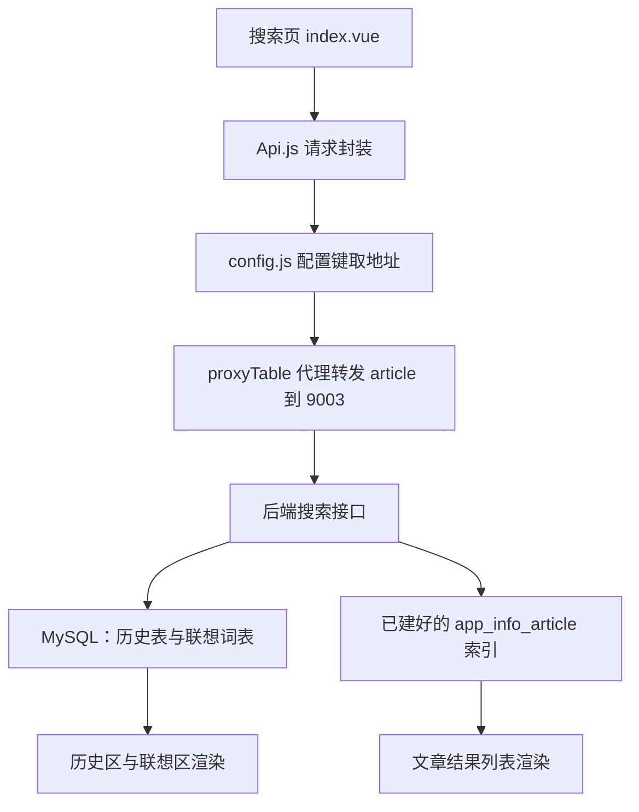
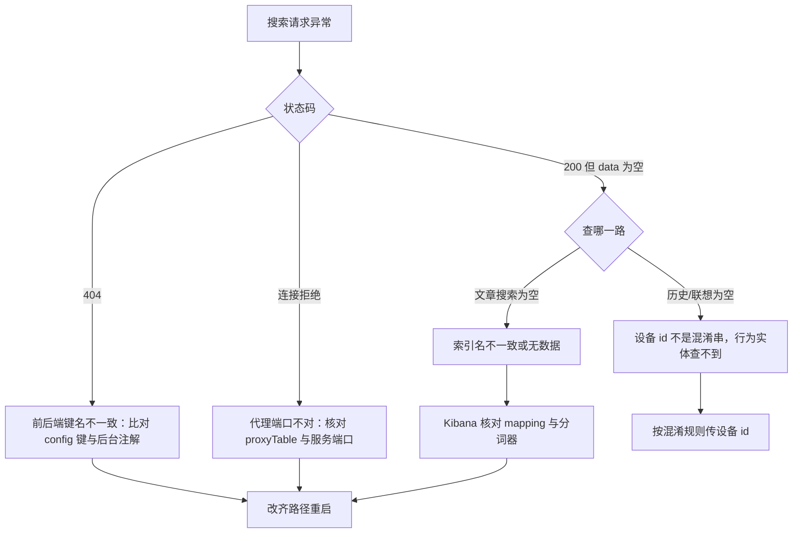

# 搜索页三路会师：历史、联想与文章搜索的前后端联调

> 🔒 安全提示：文中示例的口令/密钥均为课程教学环境演示口径，生产环境的安全要求见《安全与合规须知》。

单板测试各自为绿，不代表全链路能用。这一课把后端四个微服务与前端工程一次拉起，从登录走到搜索页，把历史、热词、联想、文章搜索四条数据通路逐一按流程核对：前端看效果，配置看转发，数据库与索引看落点。过程中前端工程的搜索页结构与请求封装也顺带读完，要求不高，能看懂流程即可。

## 先给结论

- 启动阵容是 article、behavior、login、user 四个后端服务加前端 dev server；搜索代码集中在 leadnews-search 模块随文章服务发布，前端代理把 article 规则下的请求转发到 9003。
- 搜索页是组件化拼装：搜索框 TopBar、历史单元 SearchHistory、热词单元 HotCell、联想提示 SearchTip，页面数据全部来自后端。
- 进页面先并行加载历史与热词，输入框按键触发联想，点历史词或热词发起文章搜索，四组请求覆盖四块功能。
- 删除历史传的是记录 id，带确认弹窗与 toast 提示，删完重载历史区。
- 排查三板斧：路径对键名、查询对 mapping 与分词、转发对 proxyTable 端口。

## 启动、登录与页面骨架

四个服务照端口表启动，前端 dev server 殿后，test 账号登录后点开顶栏搜索框进入搜索页。页面骨架在搜索页的 `index.vue` 里，一屏内容靠组件拼出（day04 资料包为空，代码按画面线抄录整理）：

```javascript
import TopBar from '@/components/bars/search_top';
import SearchHistory from '@/components/cells/search_0';
import SearchTip from '@/components/cells/search_tip';
import HotCell from '@/components/cells/search_cell';
import Title from '@/components/titles/title';
import Api from '@/apis/search/api';
import { Modal } from 'weex-ui';
```

请求封装集中在一个 Api 类里，方法与配置键一一对应：

```javascript
load_search_history: function() {
  let url = this.vue.$config.urls.get('load_search_history');
  return this.vue.$request.postBy(url);
},
del_search: function(id) {
  let url = this.vue.$config.urls.get('del_search');
  return this.vue.$request.postBy(url);
},
associate_search: function(search) {
  let url = this.vue.$config.urls.get('associate_search');
  return this.vue.$request.postBy(url);
},
load_hot_keywords: function() {
  let url = this.vue.$config.urls.get('load_hot_keywords');
  return this.vue.$request.postBy(url);
}
```

配置键最终在公共的 `config.js` 里落成完整地址，请求发出后被前端代理拦截转发。article 规则把目标指向 9003，搜索一族请求走的就是这条通道（端口以 common 统一清单与 proxyTable 为准）：

```javascript
'article': {
  target: 'http://api1:9003/',
  changeOrigin: true,
  pathRewrite: {
    '^/article': ''
  }
}
```

整条链路画出来，四条数据通路谁接谁一目了然：



关键路径在代理那一跳：前端发出去的是带配置键的短地址，代理补齐目标与端口，后端收到的才是完整契约路径，任何一跳键名对不上，请求就死在半路。

## 历史路：进页渲染与单条删除

进页面即调 `load_search_history`，返回的历史数组直接赋给页面模型，历史区逐条渲染。每条历史两个动作：点词发起搜索，点删除图标删单条。删除的定位键是记录 id，历史列表里每条数据把 id 一并带了回来，删除请求按 id 精确命中一行：

```javascript
onDeleteHistory: function(id) {
  let self = this;
  modal.confirm({message: '确认要删除吗？'}, function(button) {
    if (button == 'OK') {
      Api.del_search(id).then(data => {
        if (data.code == 0) {
          modal.toast({message: '删除成功', duration: 3});
          self.load_search_history();
        } else {
          modal.toast({message: data.error_message, duration: 3});
        }
      })
    }
  })
}
```

确认、删除、toast、重载四步一气呵成，删完历史区立刻少一条，数据库里对应行的 status 被置 0，软删语义对账通过。

## 热词路与联想路

热词进页面时与历史并行加载，接口按当天日期返回统计结果，前端不传任何业务参数。返回的词列表在前端两两成行，凑成双列布局：

```javascript
load_hot_keywords: function() {
  Api.load_hot_keywords().then(data => {
    if (data.code == 0) {
      let newData = [];
      let temp = [];
      for (var i = 0; i < data.data.length; i++) {
        if (i % 2 == 0) {
          temp.push(data.data[i]);
        } else {
          temp.push(data.data[i]);
          newData.push(temp);
          temp = [];
        }
      }
      this.data.hot = newData
    } else {
      modal.toast({message: data.error_message, duration: 3});
    }
  }).catch(e => {
    console.log(e)
  })
}
```

页面上热词区渲染出当天统计的两条词，点任意一条即以其为关键字发起文章搜索。联想路挂在输入框的 onInput 上，每敲一个字把关键字交给 `associate_search`，按关键字模糊查询联想词表，候选词以浮层形式点一下即可补全并发起搜索。两路验证的口径一致：接口返回、页面渲染、点下去有后续动作，三样齐了才算通。

## 文章搜索路：点词到列表

点历史词、热词或联想候选，统一走 doSearch 跳到结果路由，关键字随参数带过去，结果页调 `article_search` 查已建好的 `app_info_article` 索引。实测按「面试」搜出一篇标题含关键字的文章，点进结果还能打开详情页，说明返回的文章实体字段完整，回库补全那一跳也在正常工作。四条通路全部对完账：

| 通路 | 前端动作 | 后端落点 | 验证标志 |
|---|---|---|---|
| 历史查询 | 进页面自动加载 | MySQL 历史表 | 历史区有数据 |
| 热词查询 | 进页面并行加载 | MySQL 热词统计 | 热词区显示当天词 |
| 联想 | 输入触发 | MySQL 联想词表 | 输入出现候选 |
| 文章搜索 | 点词或回车 | Elasticsearch 索引 | 结果可点进详情 |

## 失败排查：从现象反推断点

联调翻车大多集中在这条链路的三个断点上。遇到问题时按现象分流：



文章搜索一路的「有索引却搜不到」值得多说一句：索引名对不上，ES 报索引不存在，一眼可查；索引存在但命中为零，多半是分词口径，查询域的分词器与入库时用的一致才有倒排可查，Kibana 里用同样的关键字直接查一遍索引，能快速分辨是数据问题还是查询问题。

## 常见误区

- **把配置键当成接口路径。** Api 类里 `urls.get('load_search_history')` 取的是键，真正路径由 config.js 声明；前后端键名不逐字相同没关系，但映射表必须对齐，404 时先查这里。
- **热词当成静态写死。** 页面上的「大家都在搜」区域是静态占位，真正接后端的是今日热词区；把两块混为一谈，会误以为热词接口没生效。
- **联想结果为空就断定接口挂了。** 联想词来自联想词表，表里没有以该前缀开头的词时返回空数组属于正常业务返回；先看 HTTP 状态与业务码，再看数据本身。
- **删除历史后不重载。** 删除成功只代表库里变了，页面模型不会自动更新，重载历史区是闭环的最后一步，漏掉会让用户以为删除失败。

## 面试可能被问到的问题

1. 面试官追问：「前后端并行的联调怎么安排最省时间？」
   答：契约先行，接口文档冻结后前端用 mock 数据先跑交互，后端用 MockMvc 先过单板，两端各自验证完再拉真实环境做一次全链路对账。联调阶段只解决集成问题，不写新逻辑，发现问题先定位到断点再动代码。
2. 面试官追问：「搜索请求从前端到 ES 经过了哪几跳，每一跳可能出什么问题？」
   答：前端发请求、代理转发、后端接口、Service 查询、ES 执行五跳。前端段常见键名错，代理段常见端口错，后端段常见参数与身份错，ES 段常见索引名与分词错。按状态码与业务码逐跳收窄，比全链乱猜快得多。
3. 面试官追问：「热词按天统计，跨天瞬间数据怎么平滑？」
   答：统计任务按天生成当日窗口数据，查询接口固定取当天日期的窗口；跨天瞬间新窗口若未生成完毕，可先返回上一窗口结果并标记日期，或用定时任务在整点前预生成，避免热点词区出现空档。
4. 面试官追问：「删除历史用记录 id 还是用关键字，为什么？」
   答：按 id 更稳。关键字在历史表里可能因软删重复出现多条，按词删要么误删要么删不全；id 是唯一主键，单条删除精确命中。批量与清空场景再按关键字集合或整体置状态，两者服务不同粒度的操作。
5. 面试官追问：「联调时怎么区分是前端问题还是后端问题？」
   答：以请求为分界。浏览器 Network 里发出的请求参数与预期不符是前端问题；请求正确而响应异常是后端问题，后端再用日志或断点定位到具体层。抓包看请求是联调时最便宜也最准的仲裁手段。

## 配套资料

- 代码：`materials/code/05/头条day04/`。该日资料包解压结果为空（未含源码文件），文中前端组件、Api 封装与代理配置按画面线抄录整理，后端接口片段按既有工程风格补全，包名统一改写为 `com.study.headline`；引用路径截至 `头条dayNN/` 层级，内层目录冠以项目原名，正文统一以「头条类资讯项目」指代。
- 代码：`materials/code/05/头条day01/`，内层资料目录含项目原型与数据库规范设计说明书，搜索页布局与历史表字段可对照核对。
- 环境：课程集群 node01~node03，MySQL root/123456；前端 dev server 与四个后端服务本机或集群内启动，Elasticsearch 索引为已建好的 `app_info_article`。
