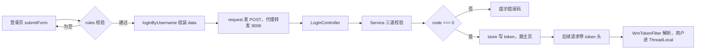

# 自媒体前端接入：wemedia-web 工程导入与登录全链路

> 🔒 安全提示：文中示例的口令/密钥均为课程教学环境演示口径，生产环境的安全要求见《安全与合规须知》。

后台的登录接口已经能返回 token，但接口没有前端可不对：管理端页面从哪来、请求怎么发到 9006、token 回来后放在哪、下一次请求怎么带上它，这些问题不落地，登录就只是 Postman 里的一条绿色记录。这一课把自媒体前端工程导进来，从登录页组件一路走到 token 进本地缓存、进请求头、进 ThreadLocal，把前后端整条链路串起来。

## 先给结论

- 前端是标准 Vue 脚手架工程，Element UI 写页面，与 App 端的 weex 工程是两套体系；导入即用，重点在读懂结构而非搭结构。
- 接口地址全部集中在 constants 里按常量管理，api 目录按模块封装请求函数，页面只调函数不拼 URL。
- 登录回包 `code === 0` 即成功，data 里 token 与 user 两键：token 写入本地缓存（store 封装），user 用于页面展示。
- 后续请求从本地缓存取 token 随请求头带上，common 里 wemedia 端的 WmTokenFilter 解析后把用户绑定 ThreadLocal，素材管理、发布文章都从这取当前用户。
- dev server 的代理配置在 `config/index.js`，请求转发到后端 9006；前后端 URL 对不上时，以前端 constants 的定义为准调整后台映射。

## 工程导入与目录分工

前端工程在 day05 资料的文件夹里，解压后用 WebStorm 打开，是一个标准 Vue 脚手架工程。目录分工一眼扫过去（按画面线整理）：

```text
wemedia-web
├── build / config      // 脚手架配置，代理转发写在 config/index.js
├── node_modules        // 依赖包，由 package.json 声明
├── dist                // 构建产物
└── src                 // 源码
    ├── api             // 各模块的接口定义 js
    ├── assets          // 图片等静态资源
    ├── components      // 公共组件
    ├── constants       // 接口地址常量
    ├── styles / utils  // 样式；request.js、store.js 两个工具
    └── views           // 页面，login/index.vue 是登录页
```

这个结构与 App 端 weex 工程完全不同，是管理端的标准形态。api 目录里已经提供了各模块的接口文件，utils 里 request.js 封装请求、store.js 封装本地缓存，views 是全部页面，路由集中在 router.js 配置。

## 登录页：Element UI 表单与校验

登录页在 `views/login/index.vue`，是一个标准的单文件组件：template 放 Element UI 表单，script 放数据与逻辑，style 放样式。表单核心是两组输入框加一个提交按钮（按画面线节选）：

```html
<el-form-item prop="name">
    <el-input type="text" v-model="ruleForm.name" placeholder="请输入账户名"></el-input>
</el-form-item>
<el-form-item prop="password">
    <el-input type="password" v-model="ruleForm.password" placeholder="请输入密码"></el-input>
</el-form-item>
<el-button type="primary" @click="submitForm('ruleForm')">登录</el-button>
```

`v-model` 是 Vue 的双向绑定指令，输入框的值与 model 里的 name、password 自动同步。校验规则 rules 给两个字段各配了一个校验器，失焦（blur）即触发：

```javascript
var validateName = (rule, value, callback) => {
    if (value === '') {
        callback(new Error('请输入用户名'));
    } else {
        callback();
    }
}
var validatePass = (rule, value, callback) => {
    if (value === '') {
        callback(new Error('请输入密码'));
    } else {
        callback();
    }
}
```

页面里还挂了用户协议勾选框与人机交互验证码组件，登录前的提醒都在前端做掉。点击登录进入 submitForm：字段为空直接提示并中断，非空才发请求，这与后台三道校验的第一道遥相呼应，前端先挡一层，后端再兜一层。

## 登录调用链：api、constants 与 token 落地

页面不自己拼 URL，而是调 api 目录里的 `loginByUsername`：

```javascript
import { API_USERAUTH } from '../constants'

export function loginByUsername(name, password) {
    // ES6 属性简写：{ name, password } 等价于 { name: name, password: password }
    const data = { name, password }
    return request({
        url: API_USERAUTH,
        method: 'post',
        data
    })
}
```

地址常量 API_USERAUTH 来自 constants，全项目的接口地址都集中在这一个文件里按功能命名，素材上传、频道列表、文章列表各有自己的常量：

```javascript
// constants.js：全项目接口地址集中管理，按功能命名取用
export const API_IMAGES_UPLOAD = '/api/v1/media/material/upload_picture'; // 上传图片
export const API_CHANNEL_LIST  = '/api/v1/channel/channels';              // 频道列表
export const API_ARTICLES_LIST = '/api/v1/media/news/list';               // 文章列表
```

联调时出了一个小插曲：后台最初写的映射与前端常量对不上，处理原则是以前端定义为准，回头改后台的 `@RequestMapping`，改完两边一一对上。dev server 的代理配置在 `config/index.js`，请求按代理规则转发到后端 9006，这个端口同样在 common 统一清单里定义，前后端各说各的地址，中间靠代理缝合。

回包处理只有一条主线：`result.code === 0` 即成功，data 里拿 token 与 user（按画面线语义整理）：

```javascript
if (result.code === 0) {
    const data = result.data
    store.set('token', data.token)   // token 写入本地缓存，store 是 localStorage 封装
    // user 用于页面展示昵称
    // 跳转主页
}
```

token 写进本地缓存的意义在后手：之后每次发请求，请求工具从缓存取出 token 随请求头带上，后台才有东西可验。code 非 0 则按错误码提示，账号不存在与密码错误各有各的提示语。

## token 过滤链与 ThreadLocal

token 回到前端只是半程，另半程在后台。带上 token 的请求进入 wemedia 服务后，先落到 common 里 wemedia 端的 WmTokenFilter：过滤器取出请求头里的 token，用 `AppJwtUtils` 解析验签，把解析出的用户信息 set 进当前线程的 ThreadLocal。之后的发布文章、素材管理接口，任何一层都能从 ThreadLocal 里直接拿到「当前登录用户」，参数里不用再传 userId。登录接口本身在过滤器里放行，因为它恰恰是还没有 token 的那一个。



关键路径在 G 节点之后：成功分支干两件事，存 token 与跳主页；跳到的主页路由在 router.js 里定义，打开页面默认重定向到登录页，登录成功才放行进主页，路由层也参与了一次未登录拦截。

## 联调走一遍

两个服务先后启动：后端 9006，前端 dev server。浏览器打开地址，路由重定向到登录页。库里预置了两个明文密码的测试账号，用其中一个在 Service 打断点走一遍：入参 name 与 password 都有值，第一道校验放行；selectByName 按名查回实体；密码比对一致；token 生成放进 map 返回。前端收到 `code === 0`，token 进本地缓存，页面跳到主页。换成错误密码再试，请求止步在第三道校验，页面拿到密码错误的提示，主页进不去。断点走完，登录模块前后端闭环确认。

## 常见误区

- **token 存 localStorage 就高枕无忧。** 本地缓存解决的是「下次请求带什么」，不解决安全；XSS 场景下 localStorage 可被脚本读取，生产环境要配合 HttpOnly Cookie 或短有效期策略，教学工程先建立的是「token 有存放处」这个概念。
- **前端校验替代后端校验。** blur 校验只挡手误，绕过页面直接发请求的人拦不住，后台三道校验一道都不能省，前后端校验是纵深而不是互替。
- **URL 两边各写各的。** 前端常量与后台映射没有对齐机制时最容易漂移，联调报 404 先对 URL 再查代码；对齐原则定成「以前端 constants 为准」，后台跟随，避免两端反复改。
- **代理配置只写 target 不看路径。** 代理按前缀匹配转发，路径规则与后端映射对不上时请求根本到不了服务，表现为页面报网络错误而后台毫无日志。

## 面试可能被问到的问题

1. 面试官追问：「token 放 localStorage、Cookie、Vuex 各有什么差别？」
   答：localStorage 持久且跨页面可用，但 XSS 可读；Cookie 可配 HttpOnly 防脚本读取，但要处理跨域与 CSRF；Vuex 只在内存里，刷新即失，通常作为本地缓存的运行时镜像。课程工程用 store 封装 localStorage，取的是持久与简单的平衡。
2. 面试官追问：「路由守卫和后端过滤器的拦截重复吗？」
   答：不重复，各管一层。路由守卫挡的是页面访问，让未登录用户直接落在登录页；后端过滤器挡的是接口访问，防止绕过页面直接调 API。前端拦截是体验优化，后端拦截才是安全边界，少了后端那层就是裸奔。
3. 面试官追问：「dev server 的代理是干什么的，生产环境还需要吗？」
   答：开发期浏览器与后端端口不同源，代理把接口请求转发到后端 9006，绕开浏览器同源策略，也顺带统一了地址。生产环境由 nginx 承担同样的转发职责，代理配置退役，前后端各自独立部署。
4. 面试官追问：「接口地址为什么抽成常量统一管理？」
   答：一处定义多处引用，路径调整只改一个文件；常量名即文档，review 时一眼看出请求归属；也避免字符串散落各页导致的拼写漂移，联调对 URL 时成本最低。
5. 面试官追问：「ThreadLocal 里的用户信息什么时候会出问题？」
   答：线程复用时忘清理会把上一个请求的用户带给下一个，这在线程池场景是真实事故源。过滤器链出口必须有移除动作，登录绑定与请求结束清理成对出现，异步场景还要显式传递上下文。

## 配套资料

- 代码：`materials/code/05/头条day05/`。该日资料包解压结果为空（未含源码文件），前端工程未随包留档，文中目录结构、登录页组件、api 与 constants 片段按画面线抄录节选；画面线常量清单存在重复抄录段落，只保留了与后续课程能对上的条目，token 落地片段按画面线语义整理为可读版本。包名统一改写为 `com.study.headline`；引用路径截至 `头条dayNN/` 层级，内层目录冠以项目原名，正文统一以「头条类资讯项目」指代。
- 代码：`materials/code/05/头条day02/`，内层资料含 App 端 weex 前端的组件代码，可与管理端 Vue 工程对照，看同一项目里两套前端体系的分工。
- 环境：课程集群 node01~node03，MySQL root/123456；前端 dev server 与后端 9006 同机联调。
