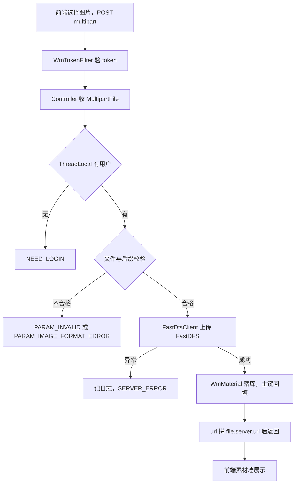

# 自媒体素材上传：MultipartFile 接参、FastDFS 上传与素材落库

> 🔒 安全提示：文中示例的口令/密钥均为课程教学环境演示口径，生产环境的安全要求见《安全与合规须知》。

登录通了，素材墙还是空的。发布文章要插图，图得先进素材库，所以素材上传是发布链路的第一块砖。一次图片上传看着简单，实际要过五道关：身份、参数、格式、文件系统、数据库，任何一道松了，要么垃圾文件入库，要么传上去的图前端拿不到。这一课把上传接口从 Controller 写到 Mapper，让页面点完「开始上传」，素材墙立刻有图。

## 先给结论

- 端点为 `POST /api/v1/material/upload_picture`，入参是 Spring MVC 的 `MultipartFile`，前端常量里的 media 前缀由代理剥掉后对齐。
- 请求先验登录：从 ThreadLocal 取当前用户，取不到直接回 `NEED_LOGIN`，再验文件与后缀白名单 gif、png、jpg、jpeg。
- 文件经 FastDfsClient 上传到 FastDFS，返回的相对路径存进 wm_material 表，错误码三件套 `PARAM_INVALID`、`PARAM_IMAGE_FORMAT_ERROR`、`SERVER_ERROR` 各管一段。
- 库里存相对路径（group1/M00/...），返回前端前拼上 `file.server.url` 变成可访问的完整 URL。
- 主键回填要两处同时开：Mapper 的 `useGeneratedKeys` 加 MyCat schema 里该表的 `autoIncrement`，缺一处拿不到生成的主键。

## 接口定义与 wm_material 表

接口按课件口径定义：名称对应素材上传，请求 DTO 是 `MultipartFile`，响应 DTO 是 `WmMaterial`。`MultipartFile` 是 Spring MVC 对上传文件的抽象，前端表单以 multipart/form-data 编码提交，Spring 自动把文件部分绑成这个对象，业务代码拿字节流、原始文件名都从它出发。错误码沿用统一枚举：无效参数 501、图片格式有误 502、服务器内部错误 503，三个码正好覆盖本接口三类失败。

落库表是 wm_material，素材的家（字段按口播与画面线整理）：

```text
id            主键，MyCat 全局自增
user_id       所属自媒体用户
url           图片相对路径（FastDFS 返回的 fullPath）
type          类型：0 图片，1 视频
collection    是否收藏：0 未收藏，1 收藏
created_time  创建时间
```

上传动作要写两个地方：文件进 FastDFS，元数据进这张表，缺了后者素材墙就无从查询。MyCat 路由里该表落在 DNWM_0 单节点，主键声明为全局自增，这与后面 Mapper 的主键回填直接相关。

## Mapper：insert 与主键回填

Mapper 接口只有一个 insert（接口与 XML 落在 model 工程的 wemedia 包下，与登录的 WmUserMapper 同居一处）：

```java
public interface WmMaterialMapper {

    /** 保存素材，主键回填到实体 */
    int insert(WmMaterial record);
}
```

XML 从模板拷来改命名空间与语句，重点是 insert 标签上的两个属性：

```xml
<insert id="insert"
        parameterType="com.study.headline.model.media.pojos.WmMaterial"
        useGeneratedKeys="true" keyProperty="id">
    insert into wm_material (user_id, url, type, collection, created_time)
    values (#{userId}, #{url}, #{type}, #{collection}, #{createdTime})
</insert>
```

`useGeneratedKeys` 加 `keyProperty` 让 MyBatis 把数据库生成的自增主键回填进实体。分库分表后主键由 MyCat 全局序列生成，回填要两处同时开：XML 里这份，加上 MyCat schema.xml 里 wm_material 表声明上的 `autoIncrement="true"`。任何一侧漏配，插入不报错但实体里的 id 是空，后续按主键查素材、维护文章与素材关系时全会踩空，这也是口播里反复强调「两个都要设」的原因。

## Service：五步走完一次上传

接口契约是 `ResponseResult uploadPicture(MultipartFile multipartFile)`，实现类按五步推进（按画面线整理）：

```java
@Service
@SuppressWarnings("all")
@Slf4j
public class WmMaterialServiceImpl implements WmMaterialService {

    @Autowired
    private WmMaterialMapper wmMaterialMapper;

    @Autowired
    private FastDfsClient fastDfsClient;

    // 图片服务器对外访问地址，来自配置文件
    @Value("${file.server.url}")
    private String fileServerUrl;

    @Override
    public ResponseResult uploadPicture(MultipartFile multipartFile) {
        //1. 登录校验：ThreadLocal 里没有用户即未登录
        WmUser user = WmThreadLocalUtils.getUser();
        if (user == null) {
            return ResponseResult.errorResult(AppHttpCodeEnum.NEED_LOGIN, "需要登录才能操作");
        }
        //2. 参数校验
        if (multipartFile == null) {
            return ResponseResult.errorResult(AppHttpCodeEnum.PARAM_INVALID);
        }
        //3. 截取扩展名：取原始文件名最后一个点之后的字符串
        String name = multipartFile.getOriginalFilename();
        String extName = name.substring(name.lastIndexOf(".") + 1);
        //4. 格式白名单：四种图片类型之外一律拒收
        if (!extName.matches("gif|png|jpg|jpeg")) {
            return ResponseResult.errorResult(AppHttpCodeEnum.PARAM_IMAGE_FORMAT_ERROR, "图片格式有误");
        }
        //5. 上传 FastDFS，失败记日志并统一兜底
        String fileId;
        try {
            fileId = fastDfsClient.uploadFile(multipartFile.getBytes(), extName);
        } catch (Exception e) {
            log.error("user:{} 上传图片失败 fileName:{} err:{}",
                    user.getId(), name, e.getMessage());
            return ResponseResult.errorResult(AppHttpCodeEnum.SERVER_ERROR, "服务器异常");
        }
        //6. 组装素材实体并落库
        WmMaterial wmMaterial = new WmMaterial();
        wmMaterial.setUserId(user.getId());
        wmMaterial.setUrl(fileId);           // 库里存相对路径
        wmMaterial.setType((short) 0);       // 0 图片，1 视频
        wmMaterial.setCollection((short) 0); // 默认未收藏
        wmMaterial.setCreatedTime(new Date());
        wmMaterialMapper.insert(wmMaterial);
        //7. 返回前端前拼上图片服务器地址
        wmMaterial.setUrl(fileServerUrl + fileId);
        return ResponseResult.okResult(wmMaterial);
    }
}
```

几处细节值得停下来看。**登录校验排第一。** ThreadLocal 里的用户是 WmTokenFilter 绑进去的，登录课埋的线在这里收网；没登录的请求第一关就回去，后面的校验与上传都不必发生。**扩展名从原始文件名截取。** `lastIndexOf(".")` 找最后一个点，加一跳过点号，得到 jpg 这类裸后缀，喂给上一课封装的 uploadFile 正合适。**格式校验用白名单正则。** 四种类型之外的文件直接回「图片格式有误」，接口此刻只服务图片素材，视频素材另有通道。**异常兜底统一 SERVER_ERROR。** 上传失败可能是 FastDFS 挂了、网络抖了或文件本身有问题，服务端无法确诊时统一报服务器异常，但日志里带上用户 id、文件名与错误信息，排障的原料先存下来。

## 返回的 URL 为什么拼地址

库里存的是 FastDFS 给的相对路径，前端拿到这个字符串贴进 img 标签是显示不出来的，图片在 storage 节点上，浏览器需要一个能直达的对外地址。对外地址放进配置，环境一换只改一行：

```properties
# 图片服务器对外访问地址，按环境填写（课程集群写 node01 对应地址）
file.server.url=http://192.168.25.133/
```

`@Value` 注入进来，返回前拼在相对路径前面，前端拿到的就是一个可直接访问的完整 URL。存相对路径还有一层好处：域名迁移、加 CDN、换图片服务器时，改的是配置与拼接逻辑，落库数据一个字节都不用动。控制器把这串逻辑挂到端点上：

```java
@RestController
@RequestMapping("/api/v1/material")
public class WmMaterialController implements WmMaterialControllerApi {

    @Autowired
    private WmMaterialService wmMaterialService;

    @PostMapping("/upload_picture")
    @Override
    public ResponseResult uploadPicture(MultipartFile multipartFile) {
        return wmMaterialService.uploadPicture(multipartFile);
    }
}
```

前端 constants 里这条接口的地址带着 media 段，代理转发时剥掉服务前缀，落到服务端的正是 `/api/v1/material/upload_picture`，与 App 端前端课「服务名前缀拼在 url 前、代理剥前缀」的机制一脉相承。整条上传链路连起来：



关键路径在 H 到 J：文件先落 FastDFS 拿相对路径，元数据再落 MySQL，返回时才拼对外地址，三段各司其职，前端展示、后续查询、运维迁移互不牵连。

## 常见误区

- **把带域名的完整 URL 存库。** 看似省事，实则把存储与访问地址焊死，换域名或上 CDN 要刷全表；正确姿势是库存相对路径，出口处统一拼接。
- **信前端校验不设白名单。** 页面限制了可选文件不代表请求受限，绕过页面直接发 multipart 的请求什么都可能来，服务端必须按后缀白名单拒收，防止伪装成图片的可执行文件入库。
- **上传成功但落库失败的孤儿文件。** 两步写入没有事务可包，库插入失败时 FastDFS 里已经多了一个文件；补齐做法是在 catch 里反删刚上传的文件，或后台定期对账清理。
- **忽略 multipart 大小限制。** Spring Boot 默认单文件 1MB，传大图直接报超限异常，看起来像接口 bug；按业务调 `spring.servlet.multipart.max-file-size` 与总量配置，并在前端给出友好提示。

## 面试可能被问到的问题

1. 面试官追问：「MultipartFile 接到的文件在服务端是什么形态？」
   答：Spring 先把 multipart 请求解析出来，小文件驻内存、大文件落到临时目录，之后业务通过 getBytes、getInputStream 或 transferTo 消费；请求结束临时文件即清理。消费时避免整个大文件读进内存，图片类小文件用 getBytes 足够。
2. 面试官追问：「素材表为什么存相对路径而不是完整 URL？」
   答：相对路径是 FastDFS 的稳定标识，域名、端口、CDN 都属于访问层的可变项；存相对路径后换域名、加缓存、迁移存储只改拼接配置，不动数据。完整 URL 存库等于把部署细节写死在数据里，改一次刷一次全表。
3. 面试官追问：「图片格式校验只看扩展名安全吗？」
   答：不够。扩展名与 Content-Type 都是请求方可控的，安全要求高的场景要读文件头魔数做真类型校验，再叠加大小限制、重命名与独立域名隔离。课程的白名单校验挡住了绝大多数随手上传，生产还要按威胁模型加码。
4. 面试官追问：「FastDFS 上传与 MySQL 落库的一致性怎么处理？」
   答：跨系统没有分布式事务可白拿，按「先传文件后写库、失败有补偿」的次序做：写库失败反删已传文件，或以对账任务定期比对存储与库的差异清理孤儿；反过来先写库再传文件，库存空路径的问题更难看，所以先文件后库是主流次序。
5. 面试官追问：「MyCat 环境下主键回填为什么要配置两处？」
   答：useGeneratedKeys 让 MyBatis 请求回填，但全局序列的产生在 MyCat 侧，schema.xml 里该表的 autoIncrement 声明决定 MyCat 是否为主键取全局序列。只开 MyCat，库能插但实体拿不到 id；只开 MyBatis，MyCat 不生成序列，插入直接失败，两处是一个开关的两半。

## 配套资料

- 代码：`materials/code/05/头条day05/`。该日资料包解压结果为空（未含源码文件），文中 Mapper 接口与 XML、Service、Controller、`file.server.url` 配置均按画面线抄录并按本课写法补全为可运行版本；wm_material 字段清单按口播与画面线整理（画面线的字段表存在重复抄录段落，已按六字段口径收敛）。包名统一改写为 `com.study.headline`；引用路径截至 `头条dayNN/` 层级，内层目录冠以项目原名，正文统一以「头条类资讯项目」指代。
- 代码：`materials/code/05/头条day02/`，内层 mycat 相关配置中可见 wm_material 表的 `autoIncrement="true" primaryKey="id"` 真实声明，与文中主键回填双配置口径对应。
- 代码：`materials/code/05/头条day01/`，内层资料目录含数据库规范设计说明书，建表规约与字段注释要求可对照。
- 环境：课程集群 node01~node03，MySQL root/123456；图片对外访问地址 `file.server.url` 按环境填写。
