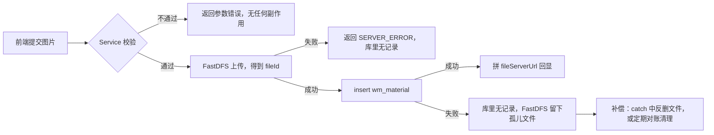

# 素材管理收尾：图片上传的 URL 回显、两阶段失败与前端对接

> 🔒 安全提示：文中示例的口令/密钥均为课程教学环境演示口径，生产环境的安全要求见《安全与合规须知》。

上传接口的 Service 主体在上一节已经铺完，距离「前端点一下按钮、图片真的出现在素材列表里」还差三件事：Controller 怎么接文件、返回给前端的 URL 怎么拼、文件服务器与数据库这两个互不知情的存储如何兜底。联调现场最典型的现象是「上传成功的提示弹了，页面上的图片却裂了」，根源十有八九出在 URL 回显这一步。

## 先给结论

- Controller 接文件用 `MultipartFile`，不要加 `@RequestBody`：上传请求是 `multipart/form-data`，不是 JSON。
- `wm_material` 库里只存 FastDFS 的 fileId，返回给前端之前才拼上文件服务器地址，存储与展示的职责分开。
- FastDFS 与 MySQL 是两套互不回滚的存储，上传顺序取「先文件后记录」，库插入失败时只会留下孤儿文件，靠补偿删除或定期对账兜底。
- 前端 `FormData` 的字段名必须与后端 `MultipartFile` 参数同名，否则后端拿到的 file 直接是 null。
- 页面回显绑定的是响应对象里拼好的完整 URL，少这一步 `` 的 src 指向相对 fileId，图片必裂。

## Controller：接文件的 POST 不需要 @RequestBody

接口先定义在 api 层，路径落在素材管理这个家族里，方法名 `uploadPicture` 一眼可读。Controller 实现它，类上挂统一前缀，方法上挂子路径：

```java
public interface MaterialManageControllerApi {

    /** 上传图片 */
    @PostMapping("/upload_picture")
    ResponseResult uploadPicture(MultipartFile file);
}
```

```java
@RestController
@RequestMapping("/api/v1/material")
public class MaterialManageController implements MaterialManageControllerApi {

    @Autowired
    private MaterialService materialService;

    @Override
    @PostMapping("/upload_picture")
    public ResponseResult uploadPicture(MultipartFile file) {
        return materialService.uploadPicture(file);
    }
}
```

**第一，为什么这里坚决不加 `@RequestBody`。** 上传请求体是 `multipart/form-data` 的二进制分片，`@RequestBody` 的语义是把请求体交给 HttpMessageConverter 反序列化成对象，走的是 JSON 那一套；Spring MVC 看到 `MultipartFile` 类型参数会自动从 multipart 解析器里取文件部件，两者叠加轻则解析不到参数，重则直接返回 415。文件入参本来就是框架特殊处理的场景，保持裸参数即可。

**第二，参数名 `file` 就是前后端契约。** 前端在 `FormData` 里 append 的字段名是什么，后端参数就得叫什么，改名可以，但两边必须同步改。这个契约还隐含了一层：请求是 POST。上传动作改变服务端资源状态，语义上就该用 POST，而不是把二进制塞进查询串。

## Service 收尾：库里存 fileId，返回时才拼域名

Service 里补两样东西：封装好的 FastDFS 客户端组件，以及文件服务器的访问前缀。校验链按「登录态、非空、扩展名白名单」的顺序走，全部通过后才真正把字节推给 FastDFS：

```java
@Value("${fastdfs.file-server-url}")
private String fileServerUrl;

@Autowired
private FastDfsClient fastDfsClient;

@Override
public ResponseResult uploadPicture(MultipartFile multipartFile) {
    // 1. 登录态与参数校验
    WmUser user = WmThreadLocalUtils.getUser();
    if (user == null) {
        return ResponseResult.errorResult(AppHttpCodeEnum.NEED_LOGIN);
    }
    if (multipartFile == null || multipartFile.getSize() == 0) {
        return ResponseResult.errorResult(AppHttpCodeEnum.PARAM_INVALID);
    }
    // 2. 扩展名白名单：只收图片
    String originalFilename = multipartFile.getOriginalFilename();
    if (originalFilename == null
            || !originalFilename.matches(".*\\.(gif|jpg|jpeg|png)$")) {
        return ResponseResult.errorResult(AppHttpCodeEnum.PARAM_IMAGE_FORMAT_ERROR);
    }
    String extName = originalFilename.substring(originalFilename.lastIndexOf(".") + 1);
    // 3. 真正上传到 FastDFS，得到 fileId，形如 group1/M00/00/00/xxx.png
    String fileId;
    try {
        fileId = fastDfsClient.uploadFile(multipartFile.getBytes(), extName);
    } catch (Exception e) {
        log.error("user {} upload file {} error, {}", user.getId(), originalFilename, e.getMessage());
        return ResponseResult.errorResult(AppHttpCodeEnum.SERVER_ERROR);
    }
    // 4. 上传成功，保存一条 wm_material 记录，库里只存 fileId
    WmMaterial wmMaterial = new WmMaterial();
    wmMaterial.setUserId(user.getId());
    wmMaterial.setType((short) 0);
    wmMaterial.setIsCollection((short) 0);
    wmMaterial.setUrl(fileId);
    wmMaterial.setCreatedTime(new Date());
    wmMaterialMapper.insert(wmMaterial);
    // 5. 回显：返回给前端的对象拼上文件服务器地址
    wmMaterial.setUrl(fileServerUrl + fileId);
    return ResponseResult.okResult(wmMaterial);
}
```

文件服务器地址配在 `application.yml` 里，环境迁移时只动配置不动代码：

```yaml
fastdfs:
  tracker-server: node01:22122
  file-server-url: http://node01/
```

**库里只存 fileId 有一个很实际的好处。** fileId 是 FastDFS 内部的相对路径（组名加磁盘路径加文件名），不带域名。哪天文件服务器换域名、迁机房，改一行配置就能整体切换；如果当初把 `http://node01/group1/...` 这种完整地址写进库，换域名就得全表刷数据，属于自找的运维债。回显动作只影响当次响应对象，insert 在前、`setUrl` 在后的顺序并不矛盾：入参对象兼作返回体，最后一步把给前端看的地址盖上去，库里落下的仍是 fileId。

## 上传的两阶段坑：文件服务器不会跟着事务回滚

这条链路横跨两个存储：FastDFS 管文件，MySQL 管记录。`@Transactional` 的边界只有数据库连接，FastDFS 是一次远程副作用，事务回滚对它毫无作用。把每一步失败画出来，状态就清楚了：



关键路径在 F 到 H 这一分支。本课的顺序是先传文件后插记录，于是 FastDFS 失败时直接报错，库里什么都没写，状态干净；而 insert 失败时，文件已经躺在存储上了，记录却没有，这就是孤儿文件。反过来先插记录后传文件，问题会换方向：传文件失败要靠抛异常触发数据库回滚，一旦回滚没生效（比如方法内 `try-catch` 吞了异常），库里就多出一条指向不存在文件的死记录，比孤儿文件更难排查。

工程上的兜底是两层：insert 包在 `try-catch` 里，失败时调用 `fastDfsClient.deleteFile(fileId)` 反删，做同步补偿；再留一个定期对账脚本，扫描库里没有记录对应的文件做清理。量级上去之后才考虑本地消息表这类最终一致方案，教学项目里同步补偿加对账已经够用。

## 前端 el-upload 对接与联调

素材页本身不写上传逻辑，上传是独立组件，弹窗里按需引用。请求封装在 api 模块里，用 `FormData` 装文件，字段名与后端对齐：

```javascript
// src/api/publish.js
import http from '@/utils/request'

export function uploadImage (file) {
  const fd = new FormData()
  // 字段名必须是 file，与后端 Controller 的 MultipartFile 参数同名
  fd.append('file', file, file.name)
  return http({
    url: '/api/v1/material/upload_picture',
    method: 'POST',
    data: fd
  })
}
```

```html
<template>
  <div class="upload_pic">
    
    <el-upload ref="myUpload" action="" :auto-upload="false">
      <el-button size="small" type="primary">点击选择图片</el-button>
    </el-upload>
    <el-button type="primary" size="small" @click="onUpload">开始上传</el-button>
  </div>
</template>

<script>
import { uploadImage } from '@/api/publish'

export default {
  name: 'upload-pic',
  data () {
    return { uploadImgUrl: require('@/assets/pic_bg.png') }
  },
  methods: {
    async onUpload () {
      const files = document.querySelector('.el-upload .el-upload__input').files
      if (!files.length) return
      const result = await uploadImage(files[0])
      if (result.data.code === 0) {
        this.$message.success('上传成功')
        // result.data.data.url 是后端拼好的完整地址，直接给 :src 回显
        this.uploadImgUrl = result.data.data.url
        this.$emit('img-change')
      }
    }
  }
}
</script>
```

`el-upload` 上 `action` 置空并关掉 `auto-upload`，选择文件与真正上传拆成两步，用户可以先选后传，确认动作落在「开始上传」按钮上。上传成功后从响应里取出 `data.url` 赋给展示变量，模板里 `:src` 一绑，刚传的图立刻出现在弹窗中央；再向父组件发一个 `img-change` 事件，通知素材列表之后要刷新。

联调断点按链路从头打一遍最直观：登录进入内容管理，打开素材管理弹窗，选一张 `jpg` 点上传。后端依次命中登录上下文取到当前用户、扩展名校验放行、FastDFS 返回 fileId、`insert` 落库，响应体里带着拼好的完整 URL；前端拿到 URL 渲染。任一环节断开，现象各不相同：字段名不一致表现为 file 恒为 null 走参数错误；扩展名不在白名单直接收到图片格式有误；FastDFS 连不上则收到服务器内部错误，同时后端日志能看到 fileId 缺失。

## 常见误区

- **给上传接口挂 `@RequestBody`。** 文件传输走 `multipart/form-data`，`@RequestBody` 是为 JSON 反序列化设计的，两者叠加会报 415 或拿不到参数。接文件只声明 `MultipartFile` 参数即可。
- **把完整 URL 存进库。** `fileServerUrl + fileId` 是回显专用，落库的只能是 fileId；完整地址写进库，换域名就是一次全表更新。
- **以为 `@Transactional` 能撤回已上传的文件。** 事务只管数据库，FastDFS 上传是远程副作用，库失败后留下的孤儿文件要靠补偿删除或对账脚本处理。
- **前端字段名随手起。** `FormData` 里 append 成 `img`、`image`，后端 `MultipartFile file` 接到的就是 null，报「无效参数」还以为是校验逻辑写错了。

## 面试可能被问到的问题

1. 面试官追问：「上传接口为什么不能用 @RequestBody 接收参数？」
   答：`@RequestBody` 走 HttpMessageConverter，把请求体反序列化成对象，对应 JSON 这类结构化内容；文件上传的请求体是 multipart 分片，Spring MVC 对 `MultipartFile` 参数有专门的 multipart 解析器处理。两套机制叠加会解析失败，典型报错就是 415。
2. 面试官追问：「图片上传链路里每一步失败，系统分别处于什么状态？」
   答：校验失败无任何副作用；FastDFS 失败返回错误，库里无记录；insert 失败则文件已在存储上、库中无记录，留下孤儿文件。因为存储之间互不回滚，顺序决定了失败残留的形态，本项目选先文件后记录，残留只有孤儿文件一种，补偿和清理都好做。
3. 面试官追问：「wm_material 里存 fileId 还是完整 URL，怎么权衡？」
   答：存 fileId。完整 URL 把文件服务器域名固化进数据，换域名、迁存储都要刷库；fileId 只是存储内部相对路径，域名作为配置在响应时动态拼接，存储迁移的成本从数据订正降到改配置。
4. 面试官追问：「如何保证文件存储与数据库的最终一致？」
   答：同步补偿加异步对账。insert 失败时在 catch 里反删文件；再跑一个定期对账任务，以库为权威扫出无记录文件做清理。强一致在这个场景性价比极低，最终一致即可。
5. 面试官追问：「前端上传组件为什么要关掉 auto-upload？」
   答：关掉后选择文件与上传动作分离，用户可以先选图再确认，交互上多一步反悔的机会；同时上传时机收拢到统一入口，便于在提交前做格式与大小校验，避免选完文件立刻发出请求、错了再回滚体验的尴尬。

## 配套资料

- 代码：`materials/code/05/头条day05/`。该日资料包解压结果为空（未含源码文件），文中代码按画面线抄录整理，并按本课写法补全为可编译版本，包名统一改写为 `com.study.headline`；引用路径截至 `头条dayNN/` 层级，内层目录冠以项目原名，正文统一以「头条类资讯项目」指代。
- 代码：`materials/code/05/头条day01/`，内层资料含数据库规范设计说明书，`is_xxx` 命名与字段 comment 规约可对照 `wm_material` 建表口径（`is_collection` 即按该规约命名）。
- 环境：课程集群 node01~node03，MySQL root/123456；FastDFS 文件服务由 nginx 在 node01 对外提供访问域名，对应 `fastdfs.file-server-url` 配置项。
