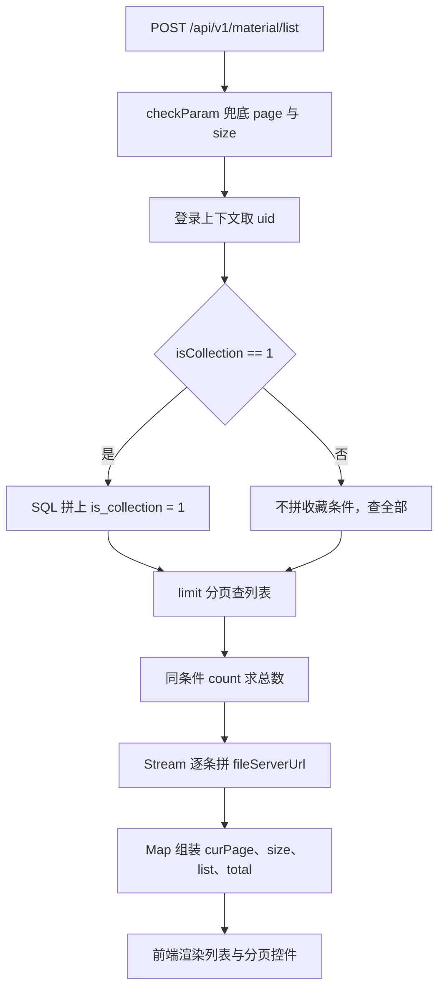

# 素材列表接口：手写 limit 分页与收藏状态筛选

> 🔒 安全提示：文中示例的口令/密钥均为课程教学环境演示口径，生产环境的安全要求见《安全与合规须知》。

素材管理页的默认视图就是列表：上传过的图要按时间倒序铺出来，能翻页，还能按「收藏」一键过滤。这个接口最容易翻车的地方不在查询本身，而在两个细节：offset 拼错导致第一页永远少一条，以及列表与总数用的不是同一套条件，分页控件显示的总页数和实际数据对不上。写之前把这两处想透，剩下的就是常规的分层编码。

## 先给结论

- 请求 DTO 继承通用分页基类 `RequestDto`，page 与 size 在 `checkParam` 里服务端兜底，业务参数只有一个 `isCollection`。
- SQL 手写 `limit`，offset 按 `(page - 1) * size` 计算，另配一条完全同条件的 count，列表与总数必须同一口径。
- 收藏筛选的语义：传 1 只查收藏，传 0 或不传查全部，靠动态 SQL 的 `<if>` 拼条件实现两种模式的合并。
- 返回前用 Stream 把每条记录的 url 拼上文件服务器前缀，与上传接口的回显口径保持一致。
- 响应体组装 `curPage`、`size`、`list`、`total` 四个键；更工程化的做法是沉淀统一的分页响应对象。

## 请求 DTO：分页参数在基类里兜底

分页参数的结构在前几天的通用模型里就有定义：请求 DTO 继承 `RequestDto`，基类带 page、size 与一个 `checkParam` 方法，只是之前一直没派上用场，今天列表接口正好用它：

```java
@Data
public class RequestDto implements Serializable {

    /** 当前页，从 1 起 */
    protected Integer page;

    /** 每页条数 */
    protected Integer size;

    /** 分页参数兜底：不合法的值一律归位默认值 */
    public void checkParam() {
        if (this.page == null || this.page < 1) {
            this.page = 1;
        }
        if (this.size == null || this.size < 1 || this.size > 100) {
            this.size = 10;
        }
    }
}
```

```java
@Data
@EqualsAndHashCode(callSuper = true)
public class WmMaterialListDto extends RequestDto {

    /** 是否收藏：1 只查收藏，0 或 null 查全部 */
    private Short isCollection;
}
```

`checkParam` 的规则对应画面线：page 等于 0、小于 0 或为 null 时归位 1；size 等于 0、小于 0 或大于 100 时归位 10。这条兜底的价值在于不信任前端：翻页控件传上来的任何怪值（负数、0、超大条数）都在服务端被驯服成合法范围，SQL 拿到的 page 与 size 永远是可以参与 offset 计算的整数。size 的上限 100 同时挡住了「一次拉全表」的滥用，这是分页接口最基本的自我保护。

## Mapper：动态 SQL 拼条件与手写 limit

Mapper 两个方法成对出现，一个查列表一个查总数，条件完全一致：

```java
public interface WmMaterialMapper {

    int insert(WmMaterial record);

    WmMaterial selectByPrimaryKey(Integer id);

    int deleteByPrimaryKey(Integer id);

    /** 分页查当前用户的素材列表，isCollection 为 1 时只查收藏 */
    List<WmMaterial> findListByUidAndStatus(@Param("dto") WmMaterialListDto dto,
                                            @Param("uid") Integer uid);

    /** 同条件 count，供分页控件算总页数 */
    int countListByUidAndStatus(@Param("dto") WmMaterialListDto dto,
                                @Param("uid") Integer uid);
}
```

```xml
<mapper namespace="com.study.headline.model.mappers.wemedia.WmMaterialMapper">

    <select id="findListByUidAndStatus" resultType="com.study.headline.model.media.pojos.WmMaterial">
        select * from wm_material
        where user_id = #{uid}
        <if test="dto.isCollection != null and dto.isCollection == 1">
            and is_collection = #{dto.isCollection}
        </if>
        order by created_time desc
        <!-- offset = (page-1)*size，checkParam 已保证 page 从 1 起、size 在 1~100 -->
        limit ${(dto.page - 1) * dto.size}, #{dto.size}
    </select>

    <select id="countListByUidAndStatus" resultType="int">
        select count(*) from wm_material
        where user_id = #{uid}
        <if test="dto.isCollection != null and dto.isCollection == 1">
            and is_collection = #{dto.isCollection}
        </if>
    </select>
</mapper>
```

收藏筛选的语义藏在那段 `<if>` 里：`isCollection` 为 1 时拼上 `and is_collection = 1`，只出收藏的图；为 0 或不传时条件整段不拼，查出全部。两种模式共用一条 SQL，而不是写成两个方法，好处是排序、分页这些公共部分只有一份，改一处不会漏另一处。

`limit` 的第一个参数是 offset，也就是「从第几条开始」，必须按 `(page - 1) * size` 计算：第 1 页从第 0 条起，第 2 页从第 size 条起。直接把 page 当 offset 写进 SQL 是高频事故，表现为第一页永远缺最旧或最新的一条，数据一多很难察觉。这条 SQL 跑在自媒体库的分片环境里，`wm_material` 整表落在单个数据节点上，单节点 limit 没有额外成本；真正要警惕的是跨分片表的深分页，那种场景下 offset 会被下推到每个分片再归并，页码越深越慢，通常要靠游标或二次查询改写，素材表这种体量用不上。

## Service：查询、补 URL、装分页 Map

Service 的步骤清晰：兜底参数、取登录上下文、成对查询、补 URL、组装返回：

```java
@Override
public ResponseResult findList(WmMaterialListDto dto) {
    // 1. 参数兜底：page/size 在基类 checkParam 里归位
    if (dto == null) {
        dto = new WmMaterialListDto();
    }
    dto.checkParam();
    // 2. 登录态：列表永远只查当前用户自己的素材
    WmUser user = WmThreadLocalUtils.getUser();
    if (user == null) {
        return ResponseResult.errorResult(AppHttpCodeEnum.NEED_LOGIN);
    }
    // 3. 分页查列表 + 同条件 count
    List<WmMaterial> datas = wmMaterialMapper.findListByUidAndStatus(dto, user.getId());
    Integer total = wmMaterialMapper.countListByUidAndStatus(dto, user.getId());
    // 4. 回显口径与上传接口一致：给前端看的 url 拼上文件服务器前缀
    datas = datas.stream()
            .map(item -> {
                item.setUrl(fileServerUrl + item.getUrl());
                return item;
            })
            .collect(Collectors.toList());
    // 5. 组装分页返回
    Map<String, Object> resData = new HashMap<>();
    resData.put("curPage", dto.getPage());
    resData.put("size", dto.getSize());
    resData.put("list", datas);
    resData.put("total", total);
    return ResponseResult.okResult(resData);
}
```

**返回前必须补 URL，这一步不能省也不能挪。** 库里存的是 fileId，浏览器认不了这种相对路径，直接渲染全是裂图；拼接动作统一放在 Service 出口，与上传接口「返回对象拼完整地址」是同一个口径，前端不需要感知文件服务器的存在，也不需要自己拼域名。Stream 的 map 逐条重设 url 再收集成新列表，比手写 for 循环少一个临时变量，语义也更贴近「转换」本身。

**列表与总数必须是同一套条件。** 两个查询共享 user_id 与收藏 `<if>`，一旦有人只改了列表忘了改 count，或反过来，total 与 list 立刻脱节：收藏筛选后 total 仍是全量值，分页控件按错误的总页数渲染，用户能点到一页空数据。成对出现的两个方法加同一段条件复制，最有效的防错手段是把条件抽成 `<sql>` 片段复用，工程化项目值得这么做。

Controller 一层保持薄，接口定义落在 api 里，实现直接透传：

```java
@Override
@PostMapping("/list")
public ResponseResult list(@RequestBody WmMaterialListDto dto) {
    return materialService.findList(dto);
}
```

整条链画出来是这样的：



## 返回结构：Map 够用，统一封装更好

课程实现用 `Map<String, Object>` 组装分页数据，键名即契约，前端按 `data.list` 与 `data.total` 取值。能用，但键名散落在字符串里，拼写错误编译期发现不了，接口文档也只能靠注释描述。工程上更常见的是沉淀一个统一分页响应对象，把页码、条数、总数与数据列表变成字段：

```java
public class PageResponseResult extends ResponseResult {

    private Integer currentPage;
    private Integer size;
    private Integer total;

    public PageResponseResult(Integer currentPage, Integer size,
                              Integer total, List<?> datas) {
        this.currentPage = currentPage;
        this.size = size;
        this.total = total;
        setData(datas);
    }
}
```

（该类为工程化建议的示例，按本课写法补全。）统一封装的收益在接口多了以后才显现：所有分页接口的响应结构一致，前端可以写一个通用的表格分页组件，Swagger 文档也能把每个字段标注清楚。本课用 Map 是为了把注意力留在分页语义本身，理解了 Map 里每个键的来龙去脉，换成封装类只是搬字段。

## 常见误区

- **offset 直接写 page。** `limit page, size` 从第 page 条开始取，第一页就会丢掉第 0 条；正确写法是 `limit ${(page - 1) * size}, #{size}`，page 从 1 起算。
- **count 与列表条件不一致。** 收藏条件、时间条件只加在一侧，total 与 list 脱节，分页控件出现可点的空页；两个查询的条件必须同源维护。
- **列表返回忘拼文件服务器前缀。** 库里是 fileId，前端拿到直接绑 `` 全部裂图；拼接统一放在 Service 出口，与上传回显共用一个口径。
- **分页参数不设上限。** size 放任前端传 10 万，一条 SQL 把表拉穿；`checkParam` 的上限 100 就是给这准备的。

## 面试可能被问到的问题

1. 面试官追问：「手写 limit 分页，offset 为什么是 (page-1)*size？」
   答：limit 的第一个参数表示跳过多少条，第 n 页的数据起点是前面 n-1 页的总和，即 (n-1)*size。page 从 1 起，第 1 页跳过 0 条，第 2 页跳过 size 条；直接把 page 当 offset 会从第 2 条开始取，首条数据丢失。
2. 面试官追问：「分页接口里 count 与列表 SQL 的条件为什么要完全一致？」
   答：total 决定分页控件的总页数，list 决定每页内容，两者描述的是同一批数据在不同维度上的投影。条件不一致时 total 反映的是另一个数据集，用户会看到可点击但为空的页码，或明明有数据却没有下一页。
3. 面试官追问：「MyCat 分片环境下 limit 分页有什么坑？」
   答：单分片表 limit 就是普通 MySQL 行为，没有额外代价；跨分片查询时 limit 会被改写下发到每个分片取数再归并，深页码要全量扫过前面所有页的数据，性能随 offset 线性恶化。常见对策是限制最大页数、改用连续翻页的游标方式，或按分片键路由避免归并。
4. 面试官追问：「分页参数为什么必须在服务端兜底？」
   答：前端参数是可篡改输入，page 传 0 会算出负 offset 直接 SQL 报错，size 传超大值等于变相全表查询。服务端 checkParam 把非法值归位默认值并设上限，SQL 拿到的永远是安全整数，这也是纵深防御的一层。
5. 面试官追问：「URL 拼接放在后端出口还是让前端自己拼？」
   答：放后端出口。文件服务器地址属于后端部署细节，前端感知域名等于把部署信息泄漏给客户端，且多端（Web、App、小程序）接入时每端都要重复拼一遍，口径容易漂移；后端统一拼好，前端只管渲染。

## 配套资料

- 代码：`materials/code/05/头条day05/`。该日资料包解压结果为空（未含源码文件），文中代码按画面线抄录整理，并按本课写法补全为可编译版本，包名统一改写为 `com.study.headline`；`PageResponseResult` 为工程化建议示例，已在文中注明；引用路径截至 `头条dayNN/` 层级，内层目录冠以项目原名，正文统一以「头条类资讯项目」指代。
- 代码：`materials/code/05/头条day01/`，内层资料含数据库规范设计说明书与项目原型，素材列表页交互与 `wm_material` 字段口径可对照核对。
- 代码：`materials/code/05/头条day02/`，MyCat 分片配置可对照 `wm_material` 落在单一数据节点的路由口径。
- 环境：课程集群 node01~node03，MySQL root/123456。
