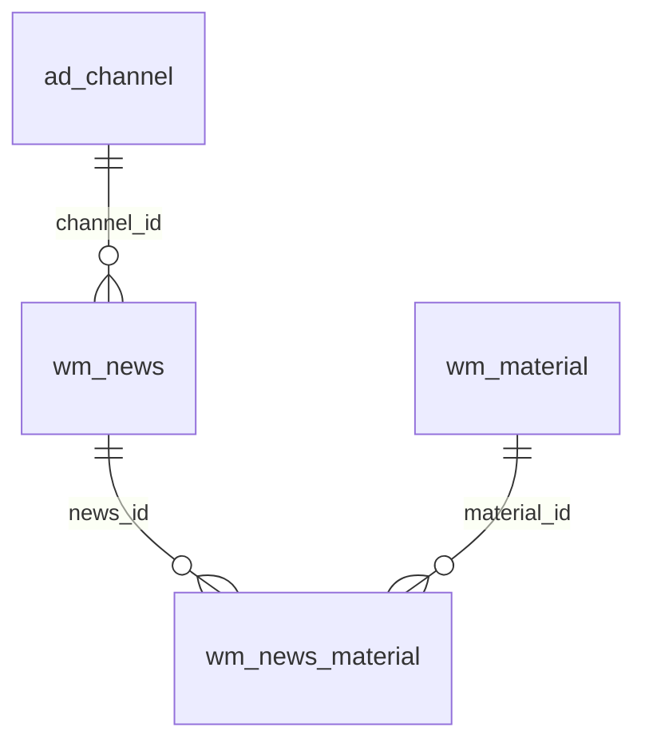
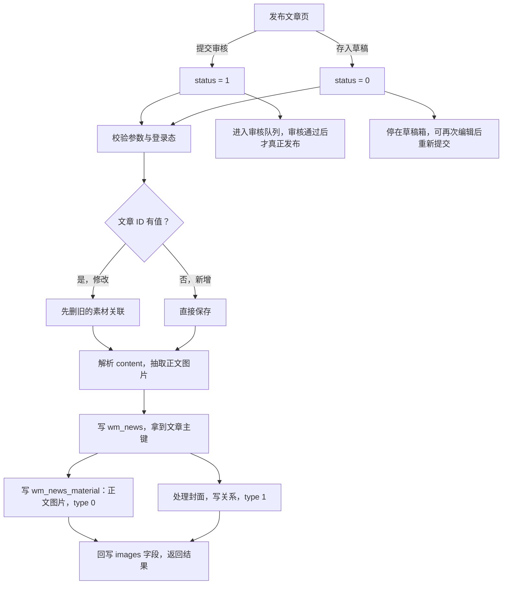
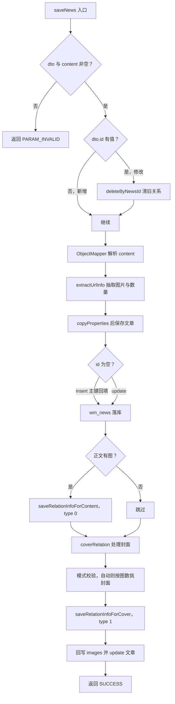
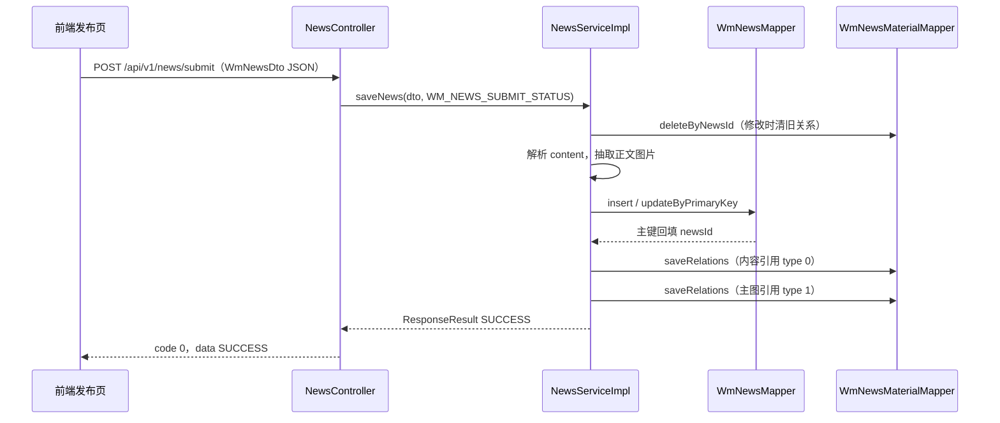
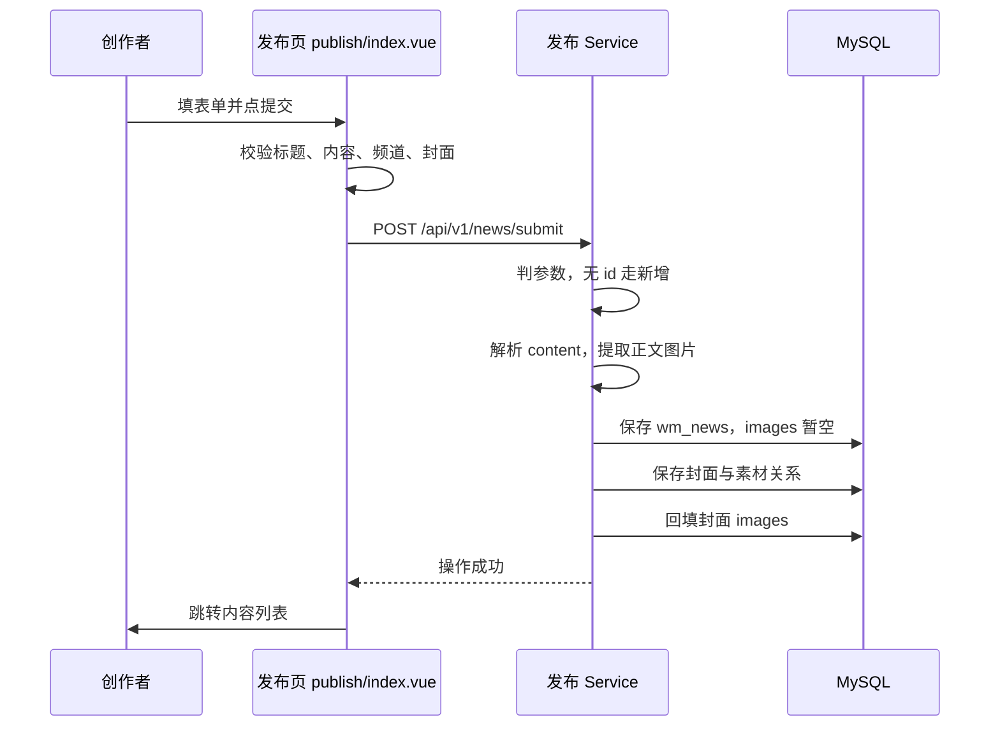

# 自媒体文章管理之发布文章：需求分析、Mapper 与业务层实现、前后端联调

> 🔒 安全提示：文中示例的口令/密钥均为课程教学环境演示口径，生产环境的安全要求见《安全与合规须知》。

## 先给结论

- 四篇内容覆盖发布文章功能全链路：需求分析、mapper 定义、业务层代码编写、前后端联调测试。
- 发布与存草稿是同一链路的两个入口，数据落 `wm_news` 一张表，差异只在 status 字段：草稿 0，提交审核 1。
- 正文 content 是 JSON 数组字符串，节点只有 text 与 image 两类；文章与素材经 `wm_news_material` 关联表维系，引用类型区分内容引用与主图引用。
- 数据访问层四个 Mapper 各司其职，文章 insert 必须配 `useGeneratedKeys` 与 `keyProperty` 回填自增主键，关联表的每一行才拿得到 news_id。
- 主流程 saveNews 串起类型推导、公共字段、正文图片关系、封面关系；关系落库前按当前用户与文件 ID 反查素材主键，对不上就返回引用图片失效。
- 封面自动模式按正文图片数推导 0、1、3，手动模式校验图文匹配；Service 私有方法约定返回 null 即成功、非 null 即错误，层层判空短路。
- 提交审核与存草稿两个端点只差一个状态常量，契约收敛在 api 模块；两表写入绑在同一个 `@Transactional` 里同生共死。
- 联调按「频道下拉、表单提交、断点核对、images 字段修复」推进，前端怎么存、后端怎么解析、App 端怎么渲染认的是同一份 JSON 格式。

## 第1部分：发布文章需求分析：图文内容结构与素材关联的三张表

素材管理收官之后，进入文章发布。发布页面上是一个再普通不过的表单：标题、频道、定时时间、正文、封面，外加「提交审核」与「存入草稿」两个按钮。真正让后端费脑筋的藏在表单背后：正文不是纯文本而是一段带图片节点的结构化内容，封面有四种选择模式，文章和它引用的每一张图之间还要建立一张可查询的关系表。写代码之前把这几件事拆清楚，后面几节的长方法才不会看晕。

### 发布表单拆开看：参数比看到的多

页面上的表单字段一眼能数清，但接口入参 DTO 是按库表口径组织的，多出的字段各有用途。请求 DTO 定义如下：

```java
@Data
public class WmNewsDto {

    /** 文章 ID：为空是新增，有值是修改 */
    private Integer id;

    /** 标题 */
    private String title;

    /** 频道 ID，前端传的是加密串，由统一注解解密 */
    @IdEncrypt
    private Integer channelId;

    /** 标签，逗号分隔 */
    private String labels;

    /** 定时发布时间 */
    private Date publishTime;

    /** 图文内容：JSON 数组字符串 */
    private String content;

    /** 封面模式：-1 自动、0 无图、1 单图、3 多图 */
    private Short type;

    /** 状态：请求里可带，服务端以端点常量为准 */
    private Short status;

    /** 保留字段：审核拒绝理由，发布侧不填 */
    private String reason;

    /** 封面图地址列表 */
    private List<String> images;
}
```

几个字段值得单独说。`type` 是封面模式，页面上那组「无图、单图、三图、自动」的单选就对应它的 0、1、3、-1 四个值，自动模式意味着封面从正文图片里挑，前端不传 `images`。`reason` 是审核环节往回写的拒绝理由，发布侧永远只读不写，DTO 里保留它是因为修改文章时要回显。`channelId` 挂了 `@IdEncrypt` 注解，这是工程里统一的 id 加解密机制，防止主键被猜测遍历。`images` 只在手动选封面时有值，装的是封面图的完整地址列表。

频道来自 `ad_channel` 表。这张表在 admin 侧由运营维护，自媒体端只读：页面初始化时调一次查询接口，把频道列表灌进下拉框，用户选完把选中项的 id 随表单提交。让用户手输频道名是错误设计，频道必须挂在统一维护的维度表上，后面文章检索、推荐分发都依赖它。

### content 的结构：一串 JSON，两种节点

content 在页面上是富文本编辑器，落到接口里是一段 JSON 数组字符串。数组的每个元素是一个节点，节点靠 `type` 区分形态，文本节点装文字，图片节点装地址：

```json
[
  { "type": "text", "text": "这是第一段文字" },
  { "type": "image", "value": "http://file-server/group1/M00/00/01/a.png" },
  { "type": "text", "text": "这是第二段文字" },
  { "type": "image", "value": "http://file-server/group1/M00/00/02/b.png" }
]
```

这个结构直接决定了后面的开发方式：整段 content 原样入库，发布时再把数组解析出来，遍历节点把图片地址收集走。它也解释了为什么图片要分两处管理：`images` 是用户手动勾选的封面，content 里的 image 节点是正文配图，两处的图都要和文章建立关系，而且关系类型不同，后续渲染和审核都要能区分「这张图是封面」还是「这张图在正文里」。

### 三张表的分工

数据模型是三张表加一张频道维度表。`wm_news` 存文章本体，`wm_material` 存素材，`wm_news_material` 只存「谁引用了谁、以什么方式引用」：



文章表的字段与 DTO 高度对应，核心列如下（按画面线与代码用到的口径整理）：

```sql
CREATE TABLE `wm_news` (
  `id` int(11) NOT NULL AUTO_INCREMENT COMMENT '主键',
  `user_id` int(11) unsigned DEFAULT NULL COMMENT '自媒体用户id',
  `channel_id` int(11) unsigned DEFAULT NULL COMMENT '频道id',
  `title` varchar(255) DEFAULT NULL COMMENT '标题',
  `type` tinyint(4) unsigned DEFAULT NULL COMMENT '文章类型 -1 自动 0 无图 1 单图 3 多图',
  `labels` varchar(255) DEFAULT NULL COMMENT '标签',
  `content` longtext COMMENT '文章内容 JSON 数组字符串',
  `images` varchar(512) DEFAULT NULL COMMENT '封面图片，逗号分隔',
  `status` tinyint(4) unsigned DEFAULT NULL COMMENT '状态 0 草稿 1 提交审核，后续还有审核与发布状态',
  `enable` tinyint(1) unsigned DEFAULT NULL COMMENT '是否有效',
  `submited_time` datetime DEFAULT NULL COMMENT '提交时间',
  `created_time` datetime DEFAULT NULL COMMENT '创建时间',
  `updated_time` datetime DEFAULT NULL COMMENT '更新时间',
  `published_time` datetime DEFAULT NULL COMMENT '发布时间',
  `reason` varchar(255) DEFAULT NULL COMMENT '拒绝原因',
  PRIMARY KEY (`id`),
  KEY `idx_user_id` (`user_id`),
  KEY `idx_status` (`status`)
) ENGINE=InnoDB DEFAULT CHARSET=utf8mb4 COMMENT='自媒体图文内容信息表';
```

关联表则是纯粹的引用记录，素材主键、文章主键、引用类型，外加一个排序号：

```sql
CREATE TABLE `wm_news_material` (
  `id` int(11) NOT NULL AUTO_INCREMENT COMMENT '主键',
  `material_id` int(11) unsigned DEFAULT NULL COMMENT '素材ID',
  `news_id` int(11) unsigned DEFAULT NULL COMMENT '文章ID',
  `type` tinyint(1) unsigned DEFAULT NULL COMMENT '引用类型 0 内容引用 1 主图引用',
  `order` tinyint(1) unsigned DEFAULT NULL COMMENT '排序号',
  `created_time` datetime DEFAULT NULL COMMENT '创建时间',
  `updated_time` datetime DEFAULT NULL COMMENT '更新时间',
  PRIMARY KEY (`id`),
  KEY `idx_material_id` (`material_id`),
  KEY `idx_news_id` (`news_id`)
) ENGINE=InnoDB DEFAULT CHARSET=utf8mb4 COMMENT='文章素材关联表';
```

为什么非要这张关联表，而不是在文章表里塞一列图片 id？因为引用关系需要被独立查询：删除素材前要统计 `material_id` 的引用次数，一篇文章的封面图和内容图要按 type 分开取，审核侧要按文章找全部引用图。列表字段撑不起这些查询，独立的关联表可以。前面删除素材接口里那条 `select count(0) from wm_news_material where material_id = ?` 就是这张表在引用计数上的第一次亮相。

### 两条保存路径与一个流程

提交审核与存入草稿在数据上的差别只有一个 status 值，业务步骤完全一致。把整体流程画出来：



整个流程有几个关键节点要提前想明白。**第一，修改先删关系。** 文章被再次编辑时，正文图片可能增删、封面可能更换，逐条比对旧关系做差量更新既复杂又容易漏，统一做法是把该文章在关联表里的旧记录按 `news_id` 清掉，然后按最新内容全量重建。**第二，先保存文章拿主键。** 关联表的每一行都要带 `news_id`，所以文章必须先落库并回填自增主键，Mapper 的 insert 要配置主键回填，这一点在实现篇展开。**第三，两条关系分开写。** 正文图片的引用记 type 0，封面的引用记 type 1，即使同一张图既出现在正文又当选了封面，关联表里也是两条记录，语义各自独立。**第四，status=1 的文章是审核侧的输入。** 发布动作到这里并没有真正发生，文章进入待审核状态，审核通过、人工复核这些后续状态会在审核环节继续推进，发布侧只负责把文章安全地送进队列。

把这些步骤想清楚之后，实现篇的任务清单也就列出来了：四个 Mapper 接口与 XML、一段 content 解析与图片抽取逻辑、一个贯穿主流程的 Service 方法。下一篇按这个清单逐个落地。

## 第2部分：发布文章的后端实现：四个 Mapper、content 解析与两表写入

需求分析把发布文章的链路拆成了清晰的步骤，实现阶段就是把这些步骤翻译成代码。翻译的工作量集中在两处：一处是数据访问层，文章、素材、关联、频道四张表各要补齐 Mapper；另一处是 Service 主流程，一段 JSON 解析、一次主键回填、两批关系写入，环环相扣，任何一环掉链子都会留下半成品数据。把这条链从头走到尾，是自媒体侧到目前为止最重的一段业务代码，值得逐段拆开看。

### 先备齐四张表的 Mapper

Mapper 的活儿不复杂，难在方法签名要一次设计对：参数、返回值决定后面 Service 怎么调，改一次签名就要连改 XML 和调用点。四个 Mapper 按表逐个过。

#### WmMaterialMapper：按用户与文件 ID 反查素材

正文里的图片只有文件 ID（形如 `group1/M00/...` 的相对路径），而关联表要写的是素材主键。从文件 ID 到主键的桥梁就是这个查询，参数是用户 ID 和一组 URL，因为一次发布可能引用多张图：

```java
public interface WmMaterialMapper {

    int insert(WmMaterial record);

    WmMaterial selectByPrimaryKey(Integer id);

    int deleteByPrimaryKey(Integer id);

    List<WmMaterial> findListByUidAndStatus(@Param("dto") WmMaterialListDto dto,
                                            @Param("uid") Integer uid);

    int countListByUidAndStatus(@Param("dto") WmMaterialListDto dto,
                                @Param("uid") Integer uid);

    /** 按用户与一组文件 ID 反查素材，发布文章时把 url 换成素材主键 */
    List<WmMaterial> findMaterialByIdAndImgUrls(@Param("userId") Integer userId,
                                                @Param("urls") List<String> urls);
}
```

```xml
<select id="findMaterialByIdAndImgUrls" resultType="com.study.headline.model.media.pojos.WmMaterial">
    select * from wm_material
    where user_id = #{userId}
    and url in
    <foreach collection="urls" item="url" open="(" separator="," close=")">
        #{url}
    </foreach>
</select>
```

`user_id` 条件照旧不能省：反查只在自己上传过的素材里找，别家同名的文件 ID 不该命中。`in` 后面接 `<foreach>`，MyBatis 把集合展开成占位符列表，一条 SQL 查回全部素材，比循环单查少 N-1 次往返。接口上有两个 `@Param` 注解，这是多参数方法的标配：不加的话 MyBatis 只能用 `param1`、`param2` 这种没有语义的名字引用参数，XML 里的 `#{userId}` 会直接报找不到参数。命名与 XML 里的占位符严格一致，是这类手写 Mapper 的固定默契。

#### WmNewsMaterialMapper：删旧与批量建关系

关联表的操作只有三个：按素材主键统计引用次数（删除素材的校验早已在用）、按文章 ID 清空关系（修改场景）、批量插入关系（发布场景）：

```java
public interface WmNewsMaterialMapper {

    /** 按素材主键统计被文章引用的次数，删除素材前的校验用 */
    int countByMid(@Param("mid") Integer mid);

    /** 修改文章时按文章 ID 清掉旧关系，稍后全量重建 */
    int deleteByNewsId(@Param("newsId") Integer newsId);

    /** 批量保存文章与素材的引用关系，key 为素材主键，value 为排序号 */
    int saveRelations(@Param("materials") Map<String, Integer> materials,
                      @Param("newsId") Integer newsId,
                      @Param("type") Short type);
}
```

```xml
<mapper namespace="com.study.headline.model.mappers.wemedia.WmNewsMaterialMapper">

    <select id="countByMid" resultType="java.lang.Integer">
        select count(0)
        from wm_news_material
        where material_id = #{mid}
    </select>

    <delete id="deleteByNewsId">
        delete from wm_news_material
        where news_id = #{newsId}
    </delete>

    <insert id="saveRelations">
        insert into wm_news_material
            (material_id, news_id, type, `order`, created_time, updated_time)
        values
        <foreach collection="materials" index="key" item="value" separator=",">
            (#{key}, #{newsId}, #{type}, #{value}, now(), now())
        </foreach>
    </insert>
</mapper>
```

`saveRelations` 的 foreach 直接遍历 Map：`index` 拿键、`item` 拿值，一批关系拼成一条多 values 的 insert，一次往返落库。注意 `order` 是 MySQL 保留字，列名必须包反引号，否则 SQL 直接语法报错。`type` 参数在这里落列，0 记内容引用、1 记主图引用，两张关系在一张表里靠它分开。

#### WmNewsMapper：保存与修改文章

文章表的操作一对就够，新增走 insert，修改按主键 update：

```java
public interface WmNewsMapper {

    int insert(WmNews record);

    int updateByPrimaryKey(WmNews record);
}
```

```xml
<mapper namespace="com.study.headline.model.mappers.wemedia.WmNewsMapper">

    <insert id="insert" useGeneratedKeys="true" keyProperty="id">
        insert into wm_news
            (user_id, channel_id, title, type, labels, content,
             status, enable, submited_time, created_time)
        values
            (#{userId}, #{channelId}, #{title}, #{type}, #{labels}, #{content},
             #{status}, #{enable}, #{submitedTime}, #{createdTime})
    </insert>

    <update id="updateByPrimaryKey">
        update wm_news
        set user_id = #{userId}, channel_id = #{channelId}, title = #{title},
            type = #{type}, labels = #{labels}, content = #{content},
            status = #{status}, images = #{images}, updated_time = now()
        where id = #{id}
    </update>
</mapper>
```

insert 上那两个属性是这一节的关键：`useGeneratedKeys="true"` 告诉 MyBatis 取回数据库生成的自增主键，`keyProperty="id"` 指明回填到入参对象的 id 字段。执行完 `wmNewsMapper.insert(wmNews)` 之后，`wmNews.getId()` 就有值了，后续所有关系写入都吃这个值。漏配这两个属性不会报错，只是 id 一直是 null，关联表里 `news_id` 全部写空，问题要到渲染或审核时才爆出来，属于那种最难查的静默故障。

#### AdChannelMapper：频道下拉的数据源

频道表在 admin 侧维护，发布页只需要一个全量查询。这个 Mapper 要放到 admin 目录下，与 `wm_*` 的 Mapper 分开管理：

```java
public interface AdChannelMapper {

    List<AdChannel> selectAll();
}
```

```xml
<select id="selectAll" resultType="com.study.headline.model.admin.pojos.AdChannel">
    select id, name, description, status
    from ad_channel
</select>
```

包路径的区分不是洁癖：`ad_channel` 属于 admin 维度，`wm_*` 属于自媒体维度，两边的 XML 放错目录，namespace 扫描不到就是 BindingException，报错信息还不会直接告诉你是目录放错了。

### WmNewsDto 与 content 的解析

DTO 在需求分析篇已经给出，Service 侧还要注入几个依赖：三个 Mapper、一个 `ObjectMapper`，以及文件服务器前缀。`ObjectMapper` 是 Jackson 提供的 JSON 引擎，Spring Boot 的 web 场景下容器里就有一个现成的，直接注入即可，不必自己 new：

```java
@Service
public class NewsServiceImpl implements NewsService {

    @Autowired
    private WmNewsMapper wmNewsMapper;

    @Autowired
    private WmNewsMaterialMapper wmNewsMaterialMapper;

    @Autowired
    private WmMaterialMapper wmMaterialMapper;

    @Autowired
    private ObjectMapper objectMapper;

    /** 文件服务器前缀，地址与相对文件 ID 之间的分界 */
    @Value("${file.server.url}")
    private String fileServerUrl;
}
```

解析动作本身一行：`objectMapper.readValue(content, List.class)`。content 的最外层是 JSON 数组，读成 `List`，每个元素是一个 `Map`，文本节点的键是 `type` 与 `text`，图片节点的键是 `type` 与 `value`。真正的逻辑在抽取方法里，它要产出两样东西：图片的文件 ID 到出现顺序的映射，以及图片总数：

```java
private Map<String, Object> extractUrlInfo(List<Map> list) {
    // key 为文件 ID，value 为该图在正文中的出现顺序
    Map<String, Integer> materials = new HashMap<>();
    int order = 0;
    int countImageNum = 0;
    for (Map map : list) {
        if ("image".equals(map.get("type"))) {
            String url = String.valueOf(map.get("value"));
            if ("null".equals(url)) {
                continue;
            }
            // 编辑器回传的是完整地址，落库口径统一剥成文件 ID
            if (url.startsWith(fileServerUrl)) {
                url = url.replace(fileServerUrl, "");
            }
            materials.put(url, order++);
            countImageNum++;
        }
    }
    Map<String, Object> res = new HashMap<>();
    res.put("materials", materials);
    res.put("countImageNum", countImageNum);
    return res;
}
```

顺序号 `order` 不是摆设：正文图片在渲染时要求按原文位置排列，自动封面挑图也按这个顺序取。前缀剥离是口径问题，编辑器里展示给用户的是完整地址，而 `wm_material.url` 存的是文件 ID，两套口径要在入库前对齐，这与素材列表接口「出库时拼前缀」恰好是一对互逆操作。方法返回一个外层 Map 装两个结果，是因为 Java 方法只能有一个返回值，把「图片映射」和「数量」打包带走，调用方按键各取所需。

`readValue(content, List.class)` 这个写法还有一层可说的：第二个参数传的是裸的 `List.class`，因为泛型在运行期被擦除，Jackson 只能按最宽的类型装，元素实际是 `LinkedHashMap`。遍历时 text 节点被 `"image".equals(map.get("type"))` 这一判自然跳过，`equals` 的常量在前写法顺带防了空指针。风险也要认清：节点字段名拼错不会在编译期暴露，只会在运行期默默取到 null，所以那行 `"null".equals(url)` 的防御判断不是多余的，编辑器端漏传 value 的脏节点会被它滤掉。

### 主流程 saveNews：把步骤串起来

Service 对外只有一个方法，接口定义同样从简：

```java
public interface NewsService {

    /** 保存或修改文章：status 为 1 提交审核，为 0 存草稿 */
    ResponseResult saveNews(WmNewsDto dto, Short status);
}
```

参数里的 `status` 是保存路径：1 提交审核、0 存草稿（课程代码里这个参数名为 type，为了避免与封面模式 `dto.getType()` 混淆，按语义整理为 status，对应 `wm_news.status` 列）。主流程与需求分析篇的流程图一一对应：



```java
@Override
public ResponseResult saveNews(WmNewsDto dto, Short status) {
    // 文章内容是必填项，dto 与 content 任一为空都算无效参数
    if (dto == null || StringUtils.isEmpty(dto.getContent())) {
        return ResponseResult.errorResult(AppHttpCodeEnum.PARAM_INVALID);
    }
    // 修改操作：先清掉旧的素材关系，稍后按最新内容重建
    if (dto.getId() != null) {
        wmNewsMaterialMapper.deleteByNewsId(dto.getId());
    }
    try {
        // content 是 JSON 数组字符串，解析为 List<Map>
        List<Map> list = objectMapper.readValue(dto.getContent(), List.class);
        // 抽取正文图片：文件 ID 到顺序的映射，以及图片总数
        Map<String, Object> extractInfo = extractUrlInfo(list);
        Map<String, Integer> materials = (Map<String, Integer>) extractInfo.get("materials");
        int countImageNum = (int) extractInfo.get("countImageNum");
        // 保存或修改文章本体，insert 后主键回填到 wmNews
        WmNews wmNews = new WmNews();
        BeanUtils.copyProperties(dto, wmNews);
        ResponseResult saveResult = saveOnlyNews(wmNews, dto, countImageNum, status);
        if (saveResult != null) {
            return saveResult;
        }
        // 正文图片关系：type 0 内容引用
        if (materials != null && materials.size() != 0) {
            ResponseResult contentResult = saveRelationInfoForContent(materials, wmNews.getId());
            if (contentResult != null) {
                return contentResult;
            }
        }
        // 封面：模式校验、自动挑图、关系落库、回写 images
        ResponseResult coverResult = coverRelation(dto, materials, wmNews, countImageNum);
        if (coverResult != null) {
            return coverResult;
        }
        return ResponseResult.okResult(AppHttpCodeEnum.SUCCESS);
    } catch (IOException e) {
        e.printStackTrace();
        return ResponseResult.errorResult(AppHttpCodeEnum.SERVER_ERROR);
    }
}
```

几个写法上的决策值得展开。**判空放在最前。** dto 为 null 或 content 为空串，后面所有步骤都无从谈起，第一行就拦下，错误码用 `PARAM_INVALID`。**修改先删关系。** `dto.getId()` 有值就是修改，旧关系立刻清掉；此时就算后续步骤失败，留下的也只是「文章在、关系空」的一致状态，比「关系半新半旧」好排查得多。**解析包在 try-catch 里。** `readValue` 抛的是受检异常 `IOException`，content 若不是合法 JSON 直接落进 catch，返回 `SERVER_ERROR`，绝不能让异常裸奔到 Controller。**判空短路贯穿始终。** 私有方法用「null 即成功」的约定，主流程每调一个就判一次，出错立即返回，写库动作停在半路也停得明明白白。

### 保存文章本体：类型推导与公共字段

文章本体的落库被抽成私有方法 `saveOnlyNews`，它要做的是把 DTO 拷不出来的字段补齐。`BeanUtils.copyProperties(dto, wmNews)` 是 Spring 的属性拷贝，同名同类型的字段一次到位，id、title、labels、content、channelId 都在其中；封面模式与状态、作者、时间这些要么需要推导、要么来自上下文，得手工设置：

```java
private ResponseResult saveOnlyNews(WmNews wmNews, WmNewsDto dto,
                                    int countImageNum, Short status) {
    // 自动模式：封面类型由正文图片数量推导
    if (WmMediaConstants.WM_NEWS_TYPE_AUTO.equals(dto.getType())) {
        if (countImageNum == WmMediaConstants.WM_NEWS_SINGLE_IMAGE) {
            wmNews.setType(WmMediaConstants.WM_NEWS_SINGLE_IMAGE);
        } else if (countImageNum >= WmMediaConstants.WM_NEWS_MANY_IMAGE) {
            wmNews.setType(WmMediaConstants.WM_NEWS_MANY_IMAGE);
        } else {
            wmNews.setType(WmMediaConstants.WM_NEWS_NO_IMAGE);
        }
    }
    // 状态由端点决定：1 提交审核，0 存草稿
    wmNews.setStatus(status);
    // 作者与时间取登录上下文与当前时间
    WmUser user = WmThreadLocalUtils.getUser();
    wmNews.setUserId(user.getId());
    wmNews.setCreatedTime(new Date());
    wmNews.setSubmitedTime(new Date());
    // 有效标记默认 1
    wmNews.setEnable((short) 1);
    if (wmNews.getId() == null) {
        wmNewsMapper.insert(wmNews);
    } else {
        wmNewsMapper.updateByPrimaryKey(wmNews);
    }
    return null;
}
```

自动模式的推导规则落在这里：一张图是单图，三张及以上是多图，没有图就是无图。`>=` 而不是 `==` 是因为正文可能有十张图，那也是多图，取三张做封面而已。手动模式什么都不做，`copyProperties` 已经把 `dto.getType()` 的 0、1、3 原样带过来了。

几个手工字段的语义值得分别交代。`submitedTime` 记的是提交动作发生的时间，它与 `publishedTime` 是两个时间轴：前者是自媒体侧「什么时候送审」的凭证，后者要等审核与发布链路走完才写，发布侧只填前者。`enable` 是有效标记，默认 1，配合后续文章管理里的删除能力使用，删除走「置 0」的逻辑删除而不是物理删行，关联表里的历史引用也因此可以追溯。`userId` 从线程上下文取而不从 DTO 取，是因为作者身份必须由服务端裁定，前端传什么都不能信。常量集中在 `WmMediaConstants`：

```java
public class WmMediaConstants {

    /** 封面模式：自动 */
    public static final Short WM_NEWS_TYPE_AUTO = -1;
    public static final Short WM_NEWS_NO_IMAGE = 0;
    public static final Short WM_NEWS_SINGLE_IMAGE = 1;
    public static final Short WM_NEWS_MANY_IMAGE = 3;

    /** 素材引用类型：0 内容引用，1 主图引用 */
    public static final Short WM_NEWS_MATERIAL_TYPE_CONTENT = 0;
    public static final Short WM_NEWS_MATERIAL_TYPE_IMAGE = 1;

    /** 保存路径：1 提交审核，0 存草稿 */
    public static final Short WM_NEWS_SUBMIT_STATUS = 1;
    public static final Short WM_NEWS_DRAFT_STATUS = 0;
}
```

方法结尾 `return null` 顺着主流程的约定：走到最后一行说明一切正常，返回 null，调用方继续往下走。这个约定读起来别扭但胜在统一，主流程的每一层判空都是同一个姿势。

### 正文图片关系：从文件 ID 到素材主键

正文关系的写入抽了两个方法，外层薄、内层厚。外层只负责把引用类型定死为内容引用：

```java
private ResponseResult saveRelationInfoForContent(Map<String, Integer> materials,
                                                  Integer newsId) {
    // 正文图片统一记为内容引用 type 0
    return saveRelationInfo(materials, newsId, WmMediaConstants.WM_NEWS_MATERIAL_TYPE_CONTENT);
}
```

内层 `saveRelationInfo` 是封面与正文共用的核心，它解决「手里只有文件 ID，表里要写素材主键」的问题：

```java
private ResponseResult saveRelationInfo(Map<String, Integer> materials,
                                        Integer newsId, Short type) {
    if (materials == null || materials.size() == 0) {
        return null;
    }
    // 素材按用户隔离，反查只查当前登录用户自己的素材
    WmUser user = WmThreadLocalUtils.getUser();
    List<WmMaterial> dbMaterials = wmMaterialMapper
            .findMaterialByIdAndImgUrls(user.getId(), new ArrayList<>(materials.keySet()));
    // url 到素材主键的映射，遇到重复 url 保留先查到的
    Map<String, Integer> idMap = dbMaterials.stream()
            .collect(Collectors.toMap(WmMaterial::getUrl, WmMaterial::getId, (a, b) -> a));
    // 用素材主键替换文件 ID，顺序号原样保留
    Map<String, Integer> relations = new HashMap<>();
    for (Map.Entry<String, Integer> entry : materials.entrySet()) {
        Integer materialId = idMap.get(entry.getKey());
        if (materialId == null) {
            // 引用的图片不在自己的素材库中，判定为失效
            return ResponseResult.errorResult(AppHttpCodeEnum.PARAM_INVALID, "引用图片失效");
        }
        relations.put(String.valueOf(materialId), entry.getValue());
    }
    wmNewsMaterialMapper.saveRelations(relations, newsId, type);
    return null;
}
```

这段代码有三处细节。**第一，Stream 的 `toMap` 组建 url 到主键的映射。** 一次反查拿回全部素材，`Collectors.toMap(WmMaterial::getUrl, WmMaterial::getId, (a, b) -> a)` 把键值对收进 Map，第三个参数是合并函数，防的是同 url 多条记录时 `toMap` 抛 `IllegalStateException`。**第二，失效校验挡在写库前。** 拿不到主键只有几种可能：图片不是自己上传的、前缀没剥干净、素材已被删除。无论哪种，都不该往关联表里塞一行 `material_id` 为 null 的死数据，直接返回错误让前端提示「引用图片失效」。**第三，替换而非追加。** 遍历原 Map，键换成素材主键，值（出现顺序）原样搬运，最后一次性批量插入。

顺带回答一个容易冒出来的疑问：素材主键为什么不让前端直接传，非要服务端反查一遍？因为前端手里的只有图片地址，地址属于展示信息，可以随意构造；主键与引用关系的可信度必须建立在「这张图确实存在于当前用户的素材库」这个服务端事实之上。反查一步把展示标识翻译成可信标识，这一步省不得。

### 封面关系：模式匹配与自动挑图

封面是整条链路里分支最多的一段。`coverRelation` 接收 DTO、正文图片映射、已落库的文章对象与图片数量，处理完两件事：决定封面是哪些图，以及把这些图与文章建好主图引用关系：

```java
private ResponseResult coverRelation(WmNewsDto dto, Map<String, Integer> materials,
                                     WmNews wmNews, int countImageNum) {
    List<String> images = dto.getImages();
    // 手动模式校验：单图传 1 张、多图传 3 张、无图传 0 张，数量对不上就是图文模式不匹配
    if (!WmMediaConstants.WM_NEWS_TYPE_AUTO.equals(dto.getType())
            && dto.getType() != images.size()) {
        return ResponseResult.errorResult(AppHttpCodeEnum.PARAM_INVALID, "图文模式不匹配");
    }
    // 自动模式：封面从正文图片里挑
    if (WmMediaConstants.WM_NEWS_TYPE_AUTO.equals(dto.getType())) {
        images = new ArrayList<>();
        if (countImageNum == WmMediaConstants.WM_NEWS_SINGLE_IMAGE) {
            // 一张图：直接取正文里那张
            for (String url : materials.keySet()) {
                images.add(url);
                break;
            }
        } else if (countImageNum >= WmMediaConstants.WM_NEWS_MANY_IMAGE) {
            // 多张图：按正文出现顺序取前三张
            materials.entrySet().stream()
                    .sorted(Map.Entry.comparingByValue())
                    .limit(WmMediaConstants.WM_NEWS_MANY_IMAGE)
                    .forEach(entry -> images.add(entry.getKey()));
        }
    }
    if (images != null && images.size() != 0) {
        // 封面关系落库：type 1 主图引用
        ResponseResult result = saveRelationInfoForCover(images, wmNews.getId());
        if (result != null) {
            return result;
        }
        // 回写文章的封面字段：剥掉服务器前缀后逗号拼接
        String joinImages = images.stream()
                .map(s -> s.replace(fileServerUrl, ""))
                .collect(Collectors.joining(","));
        wmNews.setImages(joinImages);
        wmNewsMapper.updateByPrimaryKey(wmNews);
    }
    return null;
}

private ResponseResult saveRelationInfoForCover(List<String> images, Integer newsId) {
    Map<String, Integer> materials = new HashMap<>();
    for (int i = 0; i < images.size(); i++) {
        // 封面图可能带服务器前缀，入库口径统一剥成文件 ID，value 为封面位次
        materials.put(images.get(i).replace(fileServerUrl, ""), i);
    }
    return saveRelationInfo(materials, newsId, WmMediaConstants.WM_NEWS_MATERIAL_TYPE_IMAGE);
}
```

模式校验的规则值得背下来：手动单图必须恰好传 1 张图，手动多图必须恰好传 3 张，手动无图必须不传。数量对不上说明前端状态错乱或有人绕过页面直接调接口，返回「图文模式不匹配」比静默纠正更安全。自动模式的挑图逻辑与文章类型的推导共用同一套数量判断：一张取那张，三张以上按出现顺序取前三，一张都没有就什么都不做，封面字段保持 null。最后一步的 `images` 回写是把封面文件 ID 用逗号拼进 `wm_news.images`，列表页展示封面时直接读这个字段，不用再回关联表查一遍。这个回写之所以放在关系落库之后单独 update 一次，是因为 insert 文章那一刻封面还没定：自动模式要看正文解析结果，手动模式要等模式校验通过，等所有封面信息尘埃落定再补写文章表，时序才立得住。

到这里整个 Service 就算完工了。回头看这条链路：一段 JSON 进来，经过解析、推导、两次关系落库、一次字段回写，两个表各司其职，任何一步失败都有明确的错误码与短路出口。内容多但结构不乱，关键是每一段方法只回答一个问题。

## 第3部分：发布文章收尾：Controller 端点、频道下拉与事务一致性

Service 主流程写完，发布文章还差最后一层：HTTP 入口。这一层要做三件事，把提交审核与存草稿两个端点暴露出去、给发布页提供频道下拉的数据源、并且给两表写入上一道事务保险。层很薄，但端点怎么拆、常量怎么传、事务加在哪，每一个都是可以聊出深度的决策点。

### 频道查询：补一个跨包的 Service

发布页初始化时要把频道列表灌进下拉框，频道数据在 admin 侧的 `ad_channel` 表里维护，自媒体端只读。新建一个专门的 Service，方法只有一个：

```java
public interface AdChannelService {

    /** 查询全部频道，供发布页下拉框使用 */
    List<AdChannel> selectAll();
}
```

```java
@Service
public class AdChannelServiceImpl implements AdChannelService {

    @Autowired
    private AdChannelMapper adChannelMapper;

    @Override
    public List<AdChannel> selectAll() {
        return adChannelMapper.selectAll();
    }
}
```

实现没有任何花活，注入 Mapper 直接透传。要注意的还是那个包归属问题：`AdChannelMapper` 放在 admin 目录下，与 `wm_*` 的 Mapper 分开，这个 Service 引用的是「admin 维度的模型」，别图省事把 `AdChannel` 挪进 media 包，模型跟着业务域走，跨域引用靠的是包名上的清醒。将来频道多了、要加启用筛选，改这一个方法就够，Controller 与前端都不用动。

### api 模块：把接口契约独立出来

两个 Controller 的方法签名先定义在 api 模块的接口里，实现类再去实现它：

```java
public interface NewsControllerApi {

    /** 提交文章（进入审核） */
    ResponseResult submitNews(WmNewsDto dto);

    /** 保存草稿 */
    ResponseResult saveDraftNews(WmNewsDto dto);
}

public interface AdChannelControllerApi {

    /** 查询全部频道 */
    ResponseResult selectAll();
}
```

接口先行的好处是契约显性化：一个模块对外暴露哪些端点、每个端点收什么类型，打开接口文件就知道，不用翻实现类找注解。另一个收益是测试与文档可以对着接口写，Swagger 之类的工具扫描实现类时，接口上的注释直接成为文档描述。工程再往前走一步，同一份契约还可以支撑网关聚合或契约测试，课程里把它当成一种分层纪律来训练。

### NewsController：两个端点只差一个常量

Controller 层保持极薄，注解声明路径，方法体一行转发：

```java
@RestController
@RequestMapping("/api/v1/news")
public class NewsController implements NewsControllerApi {

    @Autowired
    private NewsService newsService;

    @Override
    @PostMapping("/submit")
    public ResponseResult submitNews(@RequestBody WmNewsDto dto) {
        // 提交审核：status 置 1
        return newsService.saveNews(dto, WmMediaConstants.WM_NEWS_SUBMIT_STATUS);
    }

    @Override
    @PostMapping("/draft")
    public ResponseResult saveDraftNews(@RequestBody WmNewsDto dto) {
        // 存入草稿：status 置 0
        return newsService.saveNews(dto, WmMediaConstants.WM_NEWS_DRAFT_STATUS);
    }
}
```

两个端点唯一的差别是传给 Service 的常量：`WM_NEWS_SUBMIT_STATUS` 为 1、`WM_NEWS_DRAFT_STATUS` 为 0，最终都落在 `wm_news.status` 列上。这就是需求分析篇那句「同一条链路、两种保存路径」的最终形态：业务代码一份，状态由入口决定。`@RequestBody` 两个端点都必须挂，前端发的 JSON 才会绑定到 DTO；漏掉之后 Spring 不会报错，而是把 DTO 的每个字段都留成 null，请求一路走到判空逻辑才被拦下，排查时容易误判成前端没传参。

参数校验在主流程判空之外还能再收紧一层。content 为空已经拦了，标题与频道这两个必填项值得补上（按本课写法补全的示例）：

```java
// 主流程判空之后可补充的必填校验
if (StringUtils.isEmpty(dto.getTitle())) {
    return ResponseResult.errorResult(AppHttpCodeEnum.PARAM_REQUIRE, "标题不能为空");
}
if (dto.getChannelId() == null) {
    return ResponseResult.errorResult(AppHttpCodeEnum.PARAM_REQUIRE, "频道不能为空");
}
```

缺参用 `PARAM_REQUIRE`，参数值非法用 `PARAM_INVALID`，两种失败语义分开，前端能给出不同的提示文案，后端排查时也能立刻分辨是「没传」还是「传错了」。

### 频道端点与返回封装

频道查询的 Controller 同样薄，唯一的新东西是把集合装进统一响应体：

```java
@RestController
@RequestMapping("/api/v1/channel")
public class AdChannelController implements AdChannelControllerApi {

    @Autowired
    private AdChannelService adChannelService;

    @Override
    @PostMapping("/channels")
    public ResponseResult selectAll() {
        // 频道列表包装进统一响应体返回
        return ResponseResult.okResult(adChannelService.selectAll());
    }
}
```

`selectAll` 的业务返回是 `List<AdChannel>`，Controller 不把 List 裸露出去，而是用 `okResult` 包成标准结构，前端拿到的永远是 `code`、`error_message`、`data` 三件套，`data` 里是数组还是对象由接口自解释。发布文章链路上的错误码整理成一张表：

| 错误码 | 含义 | 触发场景 |
|---|---|---|
| `SUCCESS` 0 | 操作成功 | 保存链路全部走完，data 为 SUCCESS |
| `PARAM_REQUIRE` 500 | 缺少参数 | 标题、频道等必填项缺失 |
| `PARAM_INVALID` 501 | 无效参数 | content 为空、图文模式不匹配、引用图片失效 |
| `SERVER_ERROR` 503 | 服务器内部错误 | content 解析失败等未预期异常 |
| `NEED_LOGIN` 401 | 需要登录 | 登录上下文缺失 |

### 两表写入的事务收口

现在的 `saveNews` 链路里藏着一致性风险：文章 insert 成功后，还要写内容引用关系、封面引用关系，再 update 回写封面字段。任何一步失败，方法短路返回错误，但已经落库的文章不会自己回滚，留下一条没有图片关系的文章。下次编辑再提交倒是能补救（修改流程会先删关系再重建），可只要没人再编辑，脏状态就一直挂在库里。Spring 事务注解是标准解法，把两表写入绑成一个原子操作：

```java
@Override
@Transactional(rollbackFor = Exception.class)
public ResponseResult saveNews(WmNewsDto dto, Short status) {
    // 方法体与之前完全一致；注解保证 insert 文章与两次关系写入同生共死
    ...
}
```

（事务注解为工程化补全建议，课程画面未展示该注解。）`rollbackFor = Exception.class` 这一段不能省：Spring 事务默认只对 `RuntimeException` 与 `Error` 回滚，业务代码里抛出的受检异常默认不触发回滚，明确声明之后所有异常统一回滚。注解还有一个经典陷阱要躲开：它基于代理实现，只有从外部调用经过代理的方法才生效。现在 `saveNews` 是对外入口、内部调私有方法，没有问题；但如果把流程拆成多个 public 方法互相调用，自调用绕过代理，事务就静默失效了，注解必须贴在真正对外的方法上。

提交审核的完整时序画出来如下：



照着时序走一遍联调：启动自媒体服务，登录进入发布页，频道下拉应有数据（先验证频道端点）；填标题、选频道、贴正文并插图，点提交审核，提示操作成功后查库，`wm_news` 里多一条 status 为 1 的记录，`wm_news_material` 里能看到 type 0 与 type 1 两组关系；同一篇改几个字再提交，旧关系被清空后重建，行数不变。到这里发布文章的后端链路全部打通，下一步就是接前端联调与文章列表管理。

## 第4部分：发布文章联调：前端表单、内容 JSON 与 wm_news 落库的逐站核对

发布文章的后端代码写完，只代表接口在断点里能跑通；创作者真正使用的是前端发文页，从标题、频道、富文本到封面一路填下来，提交的数据形态与后端的预期是否一致，只有联调才能暴露。这一轮联调还顺手抓出一个典型 bug：封面图片字段入库时存了对象而不是地址字符串。跟着这条联调路径走一遍，既能看到发布全流程的数据流转，也能看到结合部的问题怎么定位与修复。

### 联调路径与第一眼验证

后端微服务先起，前端工程随后，用自媒体用户登录进入内容管理。发布文章页打开后第一眼看的不是表单本身，而是频道下拉有没有数据：频道列表是页面初始化时向后端拿的，下拉能出来说明频道接口已经就位，这是发布页的第一个依赖点。

表单从上到下过一遍：标题与标签随手填，定时发布用时间插件选一个当前时间，内容区是重头。内容区嵌的是跨终端富文本编辑器，对创作者只暴露两个核心能力：输入文本，插入图片。点插入图片会拉起素材选择，素材按全部与收藏两个维度筛选，选中一张就嵌入到当前位置，不要了可以再删，文字块也能继续追加，文章内容就是这样一块块拼出来的。

### 封面类型与内容格式

封面类型是四个 radio：单图、三图、无图、自动。无图不用选封面，自动由后端从内容里把图片抓出来当封面，单图与三图才需要从素材库里挑。挑封面走的还是素材选择弹窗，单图取一张，三图取三张，数量与类型必须匹配，这道校验在后端做。

内容字段值得单独说。编辑器产出的是结构化 JSON 数组，文本与图片是两种 type，落库就存这份 JSON：

```json
[
  { "type": "text", "value": "这是一段正文文字" },
  { "type": "image", "value": "http://192.168.200.130/group1/M00/00/01/wKjAbGa.jpg" }
]
```

选 JSON 而不是整段 HTML，是因为内容要在 App 端重新排版渲染，端上拿到数组逐个元素解析：文本按样式画，图片按布局放，同一份内容在 Web 端与 App 端各自渲染。图片的 value 是完整地址，后端解析时会统一把文件服务器前缀剥掉再入库，回显时再拼回来，与素材管理的图片回显口径保持一致。

### 提交之后：断点里看发布流程

第一篇提交后查库，`wm_news` 里文章来了，标题与创建时间都在，status 是 1，也就是待审核，说明提交审核这条入口走对了。但 images 字段不对劲，里面存的不是图片地址字符串。这类问题在断点里看最直观，于是在发布文章的 Service 实现里打好断点，再发一篇，跟着请求走进去：



断点里逐站核对：参数校验通过，当前没有 id，走的是新增而不是修改；往下是拿到 content，它的结构就是上面那份 JSON，文本 text、图片 image；再往后提取内容中的图片信息，这一篇只有一张图，数量就是 1；然后保存文章，此时看实体对象，images 还没有值。images 的赋值发生在更后面：保存完封面与素材的关系之后，再更新一次文章，把封面图片地址写进 images 字段，问题就出在这个更新上。

### images 字段的修复现场

更新的意图很清楚：把封面图片地址存进 images。但代码里把对象列表直接拼成了字符串，库里落进去的是一串对象的字面量，而不是地址。修复思路也直白：每个封面元素是个对象，地址在对象的 value 里，逐个取出来再拼。

```java
// 修复前：对象列表直接 join，入库的是 {url=http://...} 这样的字面量
wmNews.setImages(StringUtils.join(dto.getImages(), ","));

// 修复后：从每个对象里取出图片地址，再拼成逗号分隔的字符串
List<String> urls = new ArrayList<>();
for (Map<String, Object> image : dto.getImages()) {
    urls.add(String.valueOf(image.get("url")));
}
wmNews.setImages(String.join(",", urls));
```

重启服务复测，重新提交一篇，查库看最后一条记录，images 已经是干净的图片地址字符串。到这里发布链路才算真正闭环：表单收数据，JSON 内容入库，封面关系挂上，images 回填正确。

### 前端代码怎么读

发布页的代码分几块，能看懂流程即可。页面在 views/publish/index.vue，上面的表单收标题、标签、频道与定时时间；频道列表是页面初始化时调频道接口拿来的，下拉展示频道名，提交只传频道 id。请求统一收在 api/publish.js 里：

```javascript
// src/api/publish.js
import http from '@/utils/request'

// 获取所有频道：发布页下拉数据源
export function getChannels () {
  return http({
    url: '/api/v1/channel/channels',
    method: 'POST'
  })
}

// 发布文章：提交审核入口
export function publishArticles (data) {
  return http({
    url: '/api/v1/news/submit',
    method: 'POST',
    data
  })
}
```

提交方法先做一轮校验，标题长度、内容非空、频道必选、封面已设置，都过了才发请求：

```javascript
// views/publish/index.vue：发布前统一校验（按画面线整理）
async submitNews () {
  if (this.formData.title.length < 5 || this.formData.title.length > 32) {
    this.$message.error('标题长度需在 5 到 32 个字符之间')
    return
  }
  if (!this.content.length || !this.formData.channelId) {
    this.$message.error('内容与频道不能为空')
    return
  }
  if (!this.formData.type) {
    this.$message.error('请设置封面')
    return
  }
  await publishArticles({
    title: this.formData.title,
    channelId: this.formData.channelId,
    type: this.formData.type,
    publishTime: this.formData.publishTime,
    content: this.editor.getContent()
  })
  this.$message.success('提交成功')
}
```

选封面的素材弹窗是独立组件，内部还是调素材列表接口，带上分页与收藏筛选条件，单图与三图各有一套处理逻辑。编辑器本身也是自定义组件，对内维护文本与图片两类内容块，getContent 时把所有块转成 JSON 数组交给表单，App 端解析就认这份格式。后端还有一条存草稿入口，与提交审核共用一套保存逻辑，只是目标状态不同，前端目前只接了提交审核，草稿按钮的接入方式与它相同。

## 常见误区

- **把封面图和正文图混为一谈。** 错例是只存 `images` 字段就认为图片关系建完了，正文里的配图没有任何记录。正解是两处图片来源分别建关系，靠关联表的 type 字段区分主图引用与内容引用。
- **以为草稿和提交是两套逻辑。** 错例是写两个几乎相同的 Service 方法，只在开头注解里差一个状态值。正解是同一条链路同一个方法，status 由端点常量决定，草稿与提交的差异就是那一个字段。
- **修改文章不做关系重建。** 错例是只更新 `wm_news` 本体，旧图片关系原样留着，删掉的图仍显示为被引用，新增的图查不到关系。正解是修改时先按 `news_id` 删旧关系再全量重建。
- **封面自动模式当成前端的事。** 错例是让前端自己数正文图片再传封面。正解是自动模式下封面由服务端按正文图片数量推导，前端只传 type 为 -1，服务端统一裁决，规则才不会前后端各说各话。
- **insert 忘配主键回填。** 错例是 `<insert id="insert">` 裸写 SQL，保存成功但 `wmNews.getId()` 永远是 null，关联表里 `news_id` 全空。正解是 `useGeneratedKeys="true"` 加 `keyProperty="id"`，一个属性都不能少。
- **图片地址没剥前缀就去反查素材。** 错例是拿 `http://file-server/group1/...` 直接进 `in` 查询，库里存的是 `group1/...`，一行都查不到，全部报「引用图片失效」。正解是抽取与建关系两处都统一 `replace(fileServerUrl, "")`，与素材列表出库时拼前缀互为逆操作。
- **`order` 列名不加反引号。** 错例是 insert 里直接写 `order`，MySQL 把它当保留字解析，SQL 语法报错且报错位置让人摸不着头脑。正解是列名包反引号，或者建表时就避开保留字。
- **以为 copyProperties 之后字段都齐了。** 错例是拷贝完直接 insert，结果 status、userId、时间、enable 全是 null。正解是拷贝只覆盖同名同类型字段，推导字段、上下文字段必须手工补齐。
- **私有方法返回 null 表示成功却不判空。** 错例是调用后直接往下走，出错时错误被吞掉，脏数据继续写。正解是主流程每个私有方法调用后都判空短路，约定要全组统一才有意义。
- **两个端点各写一套保存逻辑。** 错例是草稿方法里复制一遍校验、解析、保存，两份代码必然漂移。正解是端点只差状态常量，业务收敛在同一个 `saveNews`。
- **端点漏挂 `@RequestBody`。** 错例是方法参数裸写 DTO，Spring 按查询参数绑定，JSON 请求体被无视，字段全 null。正解是每个收 JSON 的方法都挂注解，配合判空校验快速暴露问题。
- **Channel 接口把 List 直接 return。** 错例是方法签名写 `List<AdChannel>` 却被接口契约要求返回 `ResponseResult`，编译报错或返回结构破约定。正解是集合统一 `okResult` 包装，响应三件套的契约不破。
- **事务注解贴错位置。** 错例是把 `@Transactional` 加在同类内部被自调用的小方法上，代理绕过，事务不生效。正解是注解贴在对外入口方法，`rollbackFor` 显式声明，别依赖默认回滚规则。
- **把 status 1 当发布态。** 状态机口径是 0 草稿、1 待审核、2 通过、3 失败，提交审核落的是 1；把 1 说成已发布，审核环节就被架空了。
- **封面字段直接 join 对象列表。** images 是字符串列，装对象字面量之后前端无法回显封面；入库前必须从对象里取出地址再拼串。
- **前端校验当安全边界。** 标题 5 到 32 字符、频道必填这些校验只是体验优化，绕过页面直接打接口的数据照样能进来，后端参数校验一道都不能省。
- **内容里存整段 HTML。** 编辑器产出的是结构化 JSON，落库也要是 JSON；混存 HTML 会让 App 端解析失效，两种格式必须二选一并贯穿全链路。

## 面试可能被问到的问题

1. 面试官追问：「文章和素材为什么要用关联表，而不是在文章表里存一个图片 id 列表？」
   答：引用关系需要被独立、多方向地查询。删除素材前要按素材 id 反查引用次数，渲染时要按文章加引用类型取图，这些用列表字段只能全表扫描或内存过滤。独立的关联表让两个方向都有索引可走，还能携带引用类型、排序号这类关系自身的属性。

2. 面试官追问：「content 为什么存 JSON 数组字符串，而不是转成 HTML 存库？」
   答：这是编辑器的原生数据结构，text 与 image 节点类型明确，服务端发布时能精准抽出图片节点去建关系，审核和后续渲染也按结构处理。存 HTML 会把结构信息抹平，抽图只能靠正则匹配标签，脆弱且难维护。存储与展示分层，JSON 负责结构，渲染层负责把它变成页面。

3. 面试官追问：「自动封面模式的规则应该定在哪一侧？」
   答：定在服务端。前端只声明 type 为 -1，服务端按解析出的正文图片数量推导最终封面类型：一张取单图，三张及以上取多图，没有图就是无图。规则集中在服务端的好处是前后端口径唯一，改规则不用发前端。

4. 面试官追问：「草稿和已提交的文章在数据上如何区分，会有并发的状态错乱吗？」
   答：同一张表用 status 区分，0 是草稿、1 是待审核，两个入口走同一套保存代码，只是写入的状态常量不同。状态迁移是单方向的、由明确的用户动作触发，不存在两个入口同时改同一篇草稿状态的竞争；编辑中的文章再次提交时按修改流程先删关系再重建，不会留下中间态。

5. 面试官追问：「修改文章时为什么选择删掉关系再重建，而不是增量更新？」
   答：图片关系的变更可能是增、删、换位置混在一起，增量更新要先把旧关系查出来和最新内容做集合比对，逻辑复杂、边界多，还容易在部分失败时留下脏关系。全量重建只有删除加插入两步，配合事务要么全成功要么全回滚，正确性更容易证明，性能代价在单篇文章的关系量级上可以忽略。

6. 面试官追问：「保存文章后是怎么拿到自增主键的？」
   答：MyBatis 的 useGeneratedKeys 机制。insert 语句配置 `useGeneratedKeys="true"` 与 `keyProperty="id"`，JDBC 通过 `getGeneratedKeys()` 取回数据库生成的自增值，回填到入参对象的 id 字段。执行完 insert 后业务代码直接读 `wmNews.getId()`，不需要再发一次查询。批量插入同样支持，但要注意部分驱动只回填最后一批。

7. 面试官追问：「关联表里存素材主键而不是文件 ID，好处是什么？」
   答：素材主键是稳定且不可变的标识，文件 ID 本质是存储路径，理论上可能因迁移、换存储而变化。主键关联让引用计数、按文章取图这类查询都走整数索引，效率高；同时素材表的元数据变更不需要级联改关联表。文件 ID 到主键的翻译集中在反查一步完成，口径也只维护一处。

8. 面试官追问：「把 content 解析成 List<Map> 有什么隐患？」
   答：反序列化目标是裸 Map，字段名拼错编译期发现不了，类型也是 Object，取值全靠强转，泛型检查形同虚设。更大的隐患是非法 JSON 会抛 IOException，必须在入口拦截。工程上更好的做法是为 content 定义类型安全的节点类，配合校验注解做入参约束；课程用 Map 是为了把注意力留在结构解析本身。

9. 面试官追问：「引用图片失效是怎么发生的，为什么要拦截？」
   答：文件 ID 反查不到素材，通常是引用了别人的素材、地址前缀没剥干净、或素材已被删除。不拦截的话关联表会写入 material_id 为 null 或错主的记录，删除校验、封面渲染、审核取图全都会被这行脏数据绊倒。把校验放在写库前，配合返回明确错误码，问题在入口就暴露。

10. 面试官追问：「自动封面和手动封面在数据上怎么统一？」
   答：两者最终都落到同一套动作：挑出封面图列表、写主图引用关系、回写 images 字段。差别只在图从哪来，手动模式用前端传的 images，自动模式按正文图片数量推导，一张取一张、三张以上取前三。推导完的 type 也会写回文章表，后续渲染与审核看到的都是统一的最终值，不再关心当初是自动还是手动。

11. 面试官追问：「saveRelations 用 foreach 批量插入，和循环单条插入差在哪？」
   答：foreach 拼成一条多 values 的 insert，一次网络往返、一次解析执行，N 张图就是一次开销；循环单条是 N 次往返，事务持锁时间也随次数拉长。注意 foreach 里引用的 Map 参数用 index 取键、item 取值，`order` 这类保留字列名要加反引号。数据量极大时单条 SQL 有长度上限，可按批次分段，素材关系的量级远用不到。

12. 面试官追问：「submit 和 draft 两个端点为什么指向同一个 Service 方法？」
   答：两者在数据上的差异只有 status 一个字段，业务链路完全一致。收敛到一个方法后，校验、解析、关系维护的改动只需要做一次，两个入口永远不会行为漂移。如果未来草稿和正式发布真的长出不同逻辑，再拆也不迟，过早拆分只会制造重复。

13. 面试官追问：「两表写入为什么必须加事务？不加会出现什么数据？」
   答：文章 insert 与关联关系 insert 是两个原子操作，中间任何一步失败都会留下半套数据：文章在而关系缺失，或者关系只写了一半。下游的删除校验、封面渲染、审核取图都会被这种不一致绊倒。`@Transactional` 把它们绑成同一原子操作，任一步抛异常整体回滚，库里不会出现中间态。

14. 面试官追问：「`@Transactional` 的 rollbackFor 为什么要显式写 Exception？」
   答：Spring 默认只回滚 RuntimeException 和 Error，受检异常默认提交。业务代码里受检异常很常见，比如 JSON 解析的 IOException，不声明的话异常被 catch 吞掉或抛出后事务照样提交，一致性被破坏。显式声明 `rollbackFor = Exception.class` 把回滚规则拉平，避免依赖每个开发者对默认行为的记忆。

15. 面试官追问：「事务在什么情况下会静默失效？」
   答：最典型的是自调用，同类里 this 调用标注了事务的方法，绕过了代理，注解形同虚设。其次是方法不是 public、异常被方法内部 catch 掉没有抛出、数据库引擎不支持事务比如 MyISAM。排查思路是先确认调用链上有代理，再看异常是否真的抛到了事务边界。

16. 面试官追问：「错误码为什么要区分缺参数和参数非法？」
   答：两者对应不同的修复动作。缺参数说明调用方漏传，前端要检查表单校验逻辑；参数非法说明传了但格式或值不对，要检查取值范围与业务规则。错误码分开后，日志能直接过滤出两类问题，接口文档也能给前端明确的提示文案映射，排查效率完全不同。

17. 面试官追问：「频道下拉为什么要单独一个接口，而不是发布接口顺带返回？」
   答：频道列表是页面初始化就要的数据，发布接口是提交动作才调的，两者时机不同。独立端点让频道数据可以被多个页面复用，缓存与权限控制也能独立配置；塞进发布接口会让一个读操作绑定在写接口上，语义混乱且无法单独缓存。

18. 面试官追问：「富文本内容为什么存 JSON 数组而不是 HTML？」
   答：内容要在多端渲染，App 端需要按自己的排版规则重画内容。JSON 数组把内容拆成文本与图片两类元素，端上逐个解析，布局可控；HTML 把样式绑死在标签里，跨端复用性差。存 JSON 还有内容净化容易做的优点，元素白名单一眼可见。

19. 面试官追问：「自动封面是怎么实现的？」
   答：提交时封面类型为自动，后端解析 content，遍历出 type 为 image 的元素，按顺序取出来作为封面并校验数量；内容里没有图片时返回明确错误，让作者改为手动设置。核心在于内容格式结构化之后，提取才有抓手。

20. 面试官追问：「images 字段与文章素材关系表是不是冗余？」
   答：是冗余但值得。关系表描述文章与素材的多对多引用，负责管理侧的精确追溯；images 字符串是封面回显的快速通道，列表与详情页不必再查关系表拼封面。冗余数据只在发布与修改时写入，读取路径收益大。

21. 面试官追问：「联调时怎么定位这类数据形态问题？」
   答：先看现象层：接口返回成功但库里字段形态不对，问题多半在后端写入路径。在 Service 关键节点打断点，跟着真实请求逐站看对象状态，找到值发生形变的那一行。断点比日志快，因为它能看到赋值前后的完整上下文。

22. 面试官追问：「存草稿与提交审核共用一套保存逻辑，怎么区分目标状态？」
   答：入口分开，逻辑收敛。Controller 层两个接口分别对应草稿与提审，Service 的保存方法多收一个目标状态参数，写库时赋给 status。校验、内容解析、关系维护这些公共动作只写一份，差异点收敛到一个参数，改动面最小。

## 配套资料

- 代码：`materials/code/05/头条day05/`。该日资料包解压结果为空（未含源码文件），文中 DTO、建表语句按画面线抄录整理，字段口径以代码实际使用为准补全，包名统一改写为 `com.study.headline`；引用路径截至 `头条dayNN/` 层级，内层目录冠以项目原名，正文统一以「头条类资讯项目」指代。
- 代码：`materials/code/05/头条day01/`，内层资料含项目原型与数据库规范设计说明书，发布文章页的表单交互、封面选择模式可对照原型核对，建表规约可对照字段命名口径。
- 环境：课程集群 node01~node03，MySQL root/123456。
- 代码：`materials/code/05/头条day05/`。该日资料包解压结果为空（未含源码文件），文中 Mapper、XML 与 Service 代码按画面线抄录整理，并按本课写法补全为可编译示例，包名统一改写为 `com.study.headline`；`order` 列与部分方法命名按代码实际语义整理；引用路径截至 `头条dayNN/` 层级，内层目录冠以项目原名，正文统一以「头条类资讯项目」指代。
- 代码：`materials/code/05/头条day01/`，内层资料含项目原型与数据库规范设计说明书，发布文章页的封面交互可对照原型核对，建表规约可对照 `wm_news`、`wm_news_material` 的字段口径。
- 代码：`materials/code/05/头条day05/`。该日资料包解压结果为空（未含源码文件），文中 Controller、Service 代码按画面线抄录整理，并按本课写法补全为可编译示例，包名统一改写为 `com.study.headline`；`@Transactional` 与必填参数校验为工程化补全建议，已在文中注明；引用路径截至 `头条dayNN/` 层级，内层目录冠以项目原名，正文统一以「头条类资讯项目」指代。
- 代码：`materials/code/05/头条day01/`，内层资料含项目原型，发布页的频道下拉与提交按钮交互可对照原型核对。
- 代码：`materials/code/05/头条day05/`。该日资料包解压结果为空（未含源码文件），文中前后端片段按画面线抄录整理并按本课写法补全，包名统一改写为 `com.study.headline`；引用路径截至 `头条dayNN/` 层级，内层目录冠以项目原名，正文统一以「头条类资讯项目」指代。
- 代码：`materials/code/05/头条day01/`，内层资料目录含项目原型，发布文章页的表单布局、封面选择与素材弹窗交互可对照原型核对。
- 环境：课程集群 node01~node03，MySQL root/123456；联调时前端工程以本地代理指向自媒体微服务。
