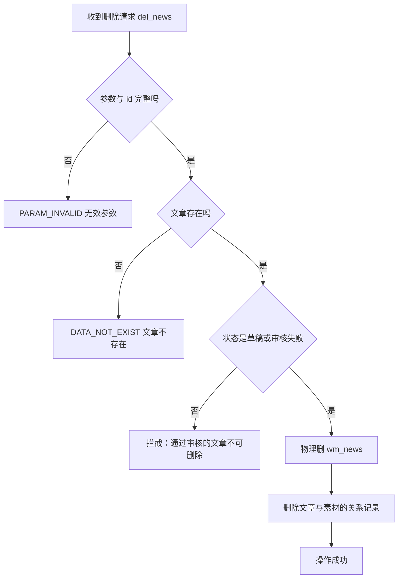
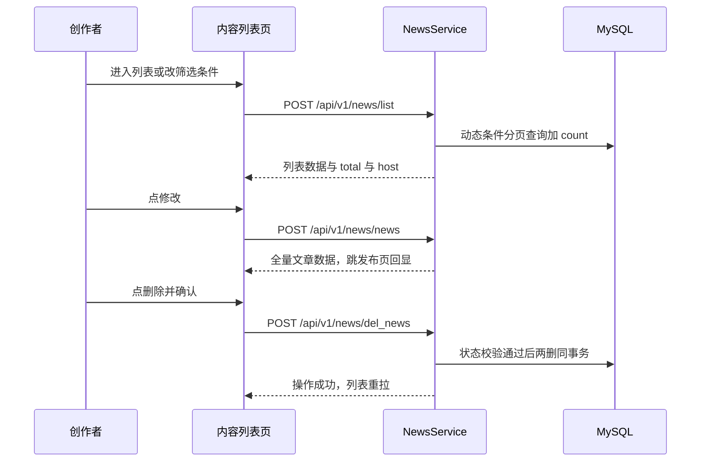

# 文章管理三接口：分页列表、详情回显与带状态闸门的删除

> 🔒 安全提示：文中示例的口令/密钥均为课程教学环境演示口径，生产环境的安全要求见《安全与合规须知》。

发布链路闭环之后，创作者与自己稿件的关系还没有收尾：文章提交了，在哪找、怎么回看、不要了怎么删，这三个动作凑齐了，内容列表页才算立起来。三个接口单看都不复杂，但每个都有自己的纪律：列表的分页参数要在 Service 兜底换算，详情要为修改页回显全量数据，删除要在动手前过一道状态闸门。day05 资料包为空，这些代码按画面线抄录整理并按主流写法补全，包名统一落在 `com.study.headline`。

## 先给结论

- 三个接口都挂在 `/api/v1/news` 下：`/list` 分页列表、`/news` 详情、`/del_news` 删除，入参统一走 `@RequestBody`。
- 列表是手写 limit 的分页风格：条件 DTO 继承 `PageRequestDto`，`checkParam` 兜底页码与条数，SQL 里手写 `limit 偏移量, 条数`。
- 列表查询与 count 共用同一组动态条件，条件写两份必然漂移，可点但为空的页码就是这么来的。
- 详情接口按主键查全量字段，响应里回填文件服务器前缀 host，前端拿到裸路径自己拼完整地址。
- 删除只放行草稿与审核失败两种状态，物理删主表的同时清理文章与素材的关系表，两个删除动作包在一个事务里。

## 需求与接口定义

内容列表页的管理要素从需求图上读下来有五样：状态筛选，覆盖全部、草稿、待审核、审核通过、审核失败；频道筛选，从频道下拉选；时间范围，开始与结束两个日期；分页，页码与每页条数；行内操作，修改与删除。参数里另外留了一个标题关键词字段，列表页的搜索框暂时没接，字段先占位，后期要加搜索时 DTO 与 SQL 都不用动。

接口定义三句话：列表按条件分页查当前用户的文章；详情按主键查一篇文章；删除按主键删一篇文章。条件 DTO 与接口长这样：

```java
// 分页条件 DTO：继承 PageRequestDto 拿到 page/size 与 checkParam 兜底
public class WmNewsPageRequestDto extends PageRequestDto {
    private Short status;        // 文章状态：0 草稿 1 待审核 2 通过 3 失败
    private Integer channelId;   // 频道
    private String keyword;      // 标题关键词，搜索框暂未接入，字段先占位
    private Date beginPubDate;   // 时间范围起
    private Date endPubDate;     // 时间范围止
}

public interface NewsControllerApi {

    /** 按状态、频道、时间分页查询当前用户的文章列表 */
    ResponseResult listByUser(WmNewsPageRequestDto dto);

    /** 按主键查询文章详情，回显给修改页 */
    ResponseResult findNewsById(WmNewsDto dto);

    /** 删除文章：仅草稿与审核失败态允许 */
    ResponseResult delNews(WmNewsDto dto);
}
```

`PageRequestDto` 是通用层早有的类，装 page 与 size，`checkParam` 做兜底：page 为空或小于 1 时设为 1，size 为空、非法或过大时设回默认 10。素材列表接口的分页参数口径与它一致，文章列表直接沿用。

响应走通用结构四件套：host、code、errorMessage、data，操作成功 code 为 0，参数问题、数据不存在各对应 `AppHttpCodeEnum` 里的固定错误码，前端按 code 分支提示，不解析文案。三个接口全部用 POST 加 JSON 请求体，哪怕条件只有一个 id 也保持这个形态，理由与素材接口的决策一致：入参结构统一，前端封装层与后端解析层都只写一份，后续加条件也不动请求形态。列表查询天然带着当前用户这个隐藏条件，它不从入参来，从登录态来，这个点在 Service 一节展开。

筛选条件还有一层语义约定要先说清。状态筛选里的「全部」不是一个真实状态，前端把「全部」映射成 null 传上来，SQL 里的 `<if>` 对 null 不拼条件，查的就是跨状态全集；草稿、待审核、审核通过、审核失败才对应真实的状态值。频道同理，「全部频道」传 null。时间范围要么成对传，要么都不传。这套 null 语义的关键在后端：动态 SQL 必须把 null 当作「没有这个条件」而不是「条件值为 null」，否则拼出来的 `status = null` 永远查不到东西，这也是所有带筛选的列表接口都要遵守的约定。

## 列表接口：动态 SQL 与手写 limit

**第一，Mapper 层两个方法成对出现。** 查列表与查总数是同一次请求的两半，前端要的不只是当前页数据，还有总条数与总页数，两个方法的入参完全一样：条件 DTO 加用户 id。详情与删除都要先按主键查文章，把查询与删除的方法也一起定义在同一个 Mapper 里。为什么两个方法必须成对：只返回数据不算完，分页控件要靠 total 算总页数，total 缺席前端就只能瞎猜，翻页立刻失真；而列表与 count 的入参保持同构，动态条件才能收敛到同一个片段里共用，这是下一节的主题。

```java
public interface WmNewsMapper {

    /** 按条件分页查询当前用户的文章 */
    List<WmNews> selectBySelective(@Param("dto") WmNewsPageRequestDto dto,
                                   @Param("uid") Integer uid);

    /** 同条件统计总条数，与列表共用一组动态条件 */
    int countSelectBySelective(@Param("dto") WmNewsPageRequestDto dto,
                               @Param("uid") Integer uid);

    /** 按主键查详情，详情接口与删除流程共用 */
    WmNews selectNewsDetailByPrimarykey(@Param("id") Integer id);

    /** 按主键物理删除 */
    int deleteNewsById(@Param("id") Integer id);
}
```

**第二，动态条件只写一份。** 筛选条件都可能为空：状态不选就是全部，频道不选就是跨频道，时间不选就不限。MyBatis 的 `<if>` 动态拼接负责按需生效，列表与 count 引用同一个 `<sql>` 片段，条件永远同步：

```xml
<!-- 列表与 count 共用的动态条件，避免两处口径漂移 -->
<sql id="news_query_condition">
    <where>
        user_id = #{uid}
        <if test="dto.status != null">
            and status = #{dto.status}
        </if>
        <if test="dto.channelId != null">
            and channel_id = #{dto.channelId}
        </if>
        <if test="dto.keyword != null and dto.keyword != ''">
            and title like concat('%', #{dto.keyword}, '%')
        </if>
        <if test="dto.beginPubDate != null and dto.endPubDate != null">
            and publish_time between #{dto.beginPubDate} and #{dto.endPubDate}
        </if>
    </where>
</sql>

<select id="selectBySelective"
        resultType="com.study.headline.model.wemedia.pojos.WmNews">
    select <include refid="Base_Column_List"/>
    from wm_news
    <include refid="news_query_condition"/>
    order by created_time desc
    <!-- 手写 limit：page 在 Service 已换算成偏移量 -->
    limit #{dto.page}, #{dto.size}
</select>

<select id="countSelectBySelective" resultType="java.lang.Integer">
    select count(1)
    from wm_news
    <include refid="news_query_condition"/>
</select>
```

**第三，limit 的第一个参数是偏移量不是页码。** SQL 的 `limit offset, size` 里 offset 从 0 数，页码从 1 数，换算动作放在 Service：先兜底校验，再用原始页码换算，换算结果写回 DTO 供 SQL 使用，响应封装时用的仍是原始页码：

```java
@Override
public ResponseResult listByUser(WmNewsPageRequestDto dto) {
    // 1. 参数检查：dto 与分页参数双重兜底
    if (dto == null) {
        return ResponseResult.errorResult(AppHttpCodeEnum.PARAM_INVALID);
    }
    dto.checkParam();

    // 2. 页码换算成偏移量，供手写 limit 使用
    int page = dto.getPage();
    int size = dto.getSize();
    dto.setPage((page - 1) * size);

    // 3. 登录态来自 ThreadLocal，列表只看自己的文章
    Integer uid = WmThreadLocalUtils.getUser().getId();
    List<WmNews> datas = wmNewsMapper.selectBySelective(dto, uid);
    int total = wmNewsMapper.countSelectBySelective(dto, uid);

    // 4. 封装分页结果，回填文件服务器前缀
    PageResponseResult result = new PageResponseResult(page, size, total);
    result.setHost(fileServerUrl);
    result.setData(datas);
    return result;
}
```

`PageResponseResult` 继承自通用响应类，比普通响应多 page、size、total 三个分页字段，再加一个 host。host 是文件服务器的前缀：库里存的图片地址都是剥掉前缀的裸路径，回显前缀统一由后端在出口处补上，前端拿到后拼完整地址渲染。

这段 XML 还有几个细节值得停下来看。`<where>` 标签会自动吃掉第一个多余的 and，所以每个 `<if>` 里都放心地以 and 开头，条件谁先谁后都不出错；时间范围用的是 between，两个日期都传才生效，只传一端就整体不生效，避免「只填开始时间就查到天荒地老」的歧义。`order by created_time desc` 让最新的稿子排最前，创作者打开列表第一眼看到的是自己最近写的东西。关键词的 like 用 `concat('%', ?, '%')` 前后都加通配符，命中率最宽但走不了索引，数据量上来后要么改成前缀匹配，要么交给检索服务，这条口子先留在这里。limit 深分页的代价同样存在，管理台一页 10 条、翻页几十层是常态，`limit 5000, 10` 会先扫过前 5000 行，量级更大的场景要换成游标式分页，那是后话。

Controller 层只剩转发，三个接口的入口一起放进来：

```java
@RestController
@RequestMapping("/api/v1/news")
public class NewsController {

    @Autowired
    private NewsService newsService;

    /** 分页查询当前用户的文章列表 */
    @PostMapping("/list")
    public ResponseResult listByUser(@RequestBody WmNewsPageRequestDto dto) {
        return newsService.listByUser(dto);
    }

    /** 查询文章详情，供修改页回显 */
    @PostMapping("/news")
    public ResponseResult findNewsById(@RequestBody WmNewsDto dto) {
        return newsService.findNewsById(dto);
    }

    /** 删除文章：仅草稿与审核失败态 */
    @PostMapping("/del_news")
    public ResponseResult delNews(@RequestBody WmNewsDto dto) {
        return newsService.delNews(dto);
    }
}
```

## 详情接口：为修改页服务

列表上点修改，跳到的是发布页的修改态，发布页要带着整篇文章的数据把表单填回去：标题、标签、频道、定时时间、内容 JSON、封面类型与封面图。所以详情接口的条件只有一个主键 id，返回的是全量字段。

Service 的写法是标准的校验返回链：参数判空，id 必须有；按主键查询；查不到返回数据不存在；查到就封装响应并回填 host。host 在这里不是可选项，content JSON 里图片的 value 与 images 封面字段存的都是裸路径，不给前缀，修改页的封面与插图全部裂图：

```java
@Override
public ResponseResult findNewsById(WmNewsDto dto) {
    // 1. 参数检查：文章 id 不可缺少
    if (dto == null || dto.getId() == null) {
        return ResponseResult.errorResult(AppHttpCodeEnum.PARAM_INVALID, "文章ID不可缺少");
    }

    // 2. 按主键查询
    WmNews wmNews = wmNewsMapper.selectNewsDetailByPrimarykey(dto.getId());
    if (wmNews == null) {
        // 3. 数据不存在
        return ResponseResult.errorResult(AppHttpCodeEnum.DATA_NOT_EXIST, "文章不存在");
    }

    // 4. 封装响应，回填文件服务器前缀供前端拼图
    ResponseResult result = new ResponseResult();
    result.setData(wmNews);
    result.setHost(fileServerUrl);
    return result;
}
```

Mapper 层的 `selectNewsDetailByPrimarykey` 就是一条按 id 的全列查询，删除流程也要先查文章，直接复用它，不另写一条。

前端拿到响应后的回填是有讲究的。host 存进页面状态，列表与详情共用；content 的 JSON 数组反着喂给富文本编辑器，文本块与图片块逐个还原成编辑器的内容节点；type 的 radio 按 1、3、0、-1 四个值选中对应封面形态，images 拿裸路径拼上 host 画出封面预览；频道下拉要先把频道列表接口的选项拉齐，再用 channelId 选中所属频道。任何一步缺数据，修改页就会出现半填充状态，这也是详情接口必须回全量字段的原因：修改页不依赖列表行的残缺信息，它只信详情接口。

## 删除接口：先过状态闸门再动手

**第一，删除有资格线。** 状态机把文章分成四态：0 草稿、1 待审核、2 通过、3 失败。能删的只有两端：草稿是作者自己留的底稿，失败是审核退回的稿子，都不曾被读者看见；待审核的文章正在流程里，通过的文章已经进了 App 端主库，读者随时可能刷到，这类数据从管理侧直接蒸发，App 端的引用就成了悬空。闸门的完整判定路径画出来是：



**第二，常量收敛状态值。** 状态值散落在业务代码里迟早出事，常量类把四态钉死，闸门判断与发布赋值都从常量取：

```java
// wm_news 状态常量：业务代码禁止裸写数字
public class WmNewsConstants {
    public static final short STATUS_DRAFT = 0;   // 草稿
    public static final short STATUS_SUBMIT = 1;  // 待审核，提交审核入口落这个值
    public static final short STATUS_PASSED = 2;  // 审核通过
    public static final short STATUS_FAIL = 3;    // 审核失败
}
```

**第三，删除是两个动作，必须同生共死。** 主表记录删掉的同时，文章与素材的关系表也要按文章 id 清掉，否则关系表里留下一堆指向已删除文章的引用，素材的被引用判断从此失真，素材管理侧的删除拦截会一直误报。两个 delete 包在一个事务方法里，任何一半失败整体回滚：

```java
@Transactional
@Override
public ResponseResult delNews(WmNewsDto dto) {
    // 1. 参数检查
    if (dto == null || dto.getId() == null) {
        return ResponseResult.errorResult(AppHttpCodeEnum.PARAM_INVALID);
    }

    // 2. 文章必须存在
    WmNews wmNews = wmNewsMapper.selectNewsDetailByPrimarykey(dto.getId());
    if (wmNews == null) {
        return ResponseResult.errorResult(AppHttpCodeEnum.DATA_NOT_EXIST, "文章不存在");
    }

    // 3. 状态闸门：只放行草稿与审核失败
    short status = wmNews.getStatus();
    if (status != WmNewsConstants.STATUS_DRAFT
            && status != WmNewsConstants.STATUS_FAIL) {
        return ResponseResult.errorResult(AppHttpCodeEnum.PARAM_INVALID,
                "当前文章通过审核不可删除");
    }

    // 4. 物理删主表并清理素材关系，事务保证两个动作同生共死
    wmNewsMapper.deleteNewsById(wmNews.getId());
    wmNewsMaterialMapper.deleteByNewsId(wmNews.getId());
    return ResponseResult.okResult();
}
```

删除用的是物理删：记录真的从表里消失。选择物理删是因为自媒体稿件没有审计留痕的诉求，草稿与失败稿本来就是被抛弃的内容；真有合规要求的产品会换成逻辑删加回收站，那是另一套口径，这里不混用。

有两道防线值得点透。前端那道是确认框，破坏性操作点击后先弹确认，用户点头才发请求，防的是手滑；后端那道是状态闸门，就算请求绕过页面直接打进来，闸门也把不可删的状态挡回去，防的是恶意。前端确认框是体验，后端闸门是安全，两者不能互相替代。闸门与页面还有一层配合：前端渲染列表行时按状态决定操作按钮的显隐，不可删的状态干脆不露删除按钮，用户少一次注定失败的点击；但按钮隐藏只是界面引导，真正的约束仍在闸门，接口层面永远不能依赖「前端不会发这种请求」这个假设。另外注意删除的边界：删的是文章记录与关系记录，素材本体与 FastDFS 里的文件都不动，图片可能还被其他文章引用，只有素材管理里显式删素材时才连带清理文件，职责边界划清了，互相才不会踩。还有 `@Transactional` 的生效条件：事务由 Spring 代理触发，必须走接口调用进入方法，同类内部直接 `this.delNews()` 之类的事务方法互调会绕过代理，注解形同虚设，这是使用事务方法时最常见的暗坑。

## 三个接口一起收口

把三接口的口径摆到一张表里对照，共性一目了然：

| 接口 | 入参 | 出参 | 关键纪律 |
|---|---|---|---|
| POST /api/v1/news/list | 条件 DTO（状态、频道、时间、关键词、分页） | PageResponseResult（数据加 total 加 host） | 条件片段共用，limit 先换算 |
| POST /api/v1/news/news | 只含 id 的 DTO | 全量文章数据加 host | 查不到走 DATA_NOT_EXIST |
| POST /api/v1/news/del_news | 只含 id 的 DTO | 操作成功 | 状态闸门前置，两删同事务 |

共性有三条。其一，用户身份都不从入参拿，`WmThreadLocalUtils` 里的登录态是唯一来源，接口参数里塞 userId 就是给越权留门。其二，出参里的图片一律由后端回填 host 前缀，裸路径不出后端。其三，错误码统一走 `AppHttpCodeEnum`，无效参数、数据不存在、操作成功各归各位，前端按 code 分支提示。

动手写这三个接口前还有一个绕不开的问题：为什么要按接口定义先行的节奏走。需求图给的是页面要素，接口定义把它翻译成前后端都能认的契约，DTO 里有哪些字段、错误码有哪些档位，写代码前全部落定，前端与后端才能并行开工，联调时也才有据可依。day01 的接口开发规范篇立过这套规矩，文章管理三接口是规矩的一次完整落地：先定义，再 Mapper，再 Service，最后 Controller，四步走完一个接口，三个接口就是三遍重复，写到第三个时套路已经完全在手。

三条链路拼在一张时序图上，前端内容列表页的每一步动作都能对上号：



## 常见误区

- **limit 直接写页码。** `limit #{page}, #{size}` 在 page 等于 2 时会跳过前 size 条再多翻一页，正确做法是先换算 `(page - 1) * size` 再进 SQL；换算放 Service，SQL 保持纯参数。
- **count 与列表条件各写一份。** 两份 `<if>` 迟早改漏一处，筛选条件变化时列表与总数对不上，分页控件允许跳进不存在的页；条件必须收敛到一个 `<sql>` 片段被两边引用。
- **删除只删主表。** 关系表里的引用不清，素材侧的被引用判断永远为真，素材删不掉；反过来删素材也可能把文章封面弄悬空。删文章必须连关系一起清。
- **详情响应不带 host。** 库里图片是裸路径，前端不认识，也不该认识前缀从哪来；出口统一回填是既定口径，详情接口漏了，修改页整页裂图。

## 面试可能被问到的问题

1. 面试官追问：「分页为什么手写 limit，不用 PageHelper 这类分页插件？」
   答：项目统一口径是不引入分页插件，limit 写进 SQL，分页参数在 Service 兜底换算。好处是每条 SQL 的分页行为显式可见，调优与改写空间都在自己手里，count 什么时候查、要不要查也由业务决定；插件的优点是省代码，但拦截器改写 SQL 的黑盒在复杂查询里偶尔出问题。两派都能选，全项目统一即可。
2. 面试官追问：「列表接口为什么要查 count，能不能省？」
   答：前端分页控件要显示总条数与总页数，没有 count 就画不出来。要省只能改成滚动加载或只有下一页的翻页形态，牺牲跳页能力换掉这次 count 查询；数据量大的表 count 本身也要优化，比如缓存总数或按 id 区间估算。
3. 面试官追问：「删除为什么只放行草稿与审核失败态？」
   答：状态闸门保护的是读者可见性契约。待审核在流程中，审核通过已同步进 App 端主库与检索索引，管理侧直接物理删会让读者端悬空引用；草稿与失败稿从未发布，删除零波及。发布态文章要下架得走下架流程，不是管理台一键删的事。
4. 面试官追问：「物理删和逻辑删怎么选？」
   答：看数据是否有留痕与追溯诉求。自媒体草稿没有审计要求，物理删简单干净，表不膨胀；订单、账务这类数据必须逻辑删加状态位，配合归档。混用是灾难：逻辑删的表每个查询都要带删除标记条件，漏一处就脏读，口径要按表定死。
5. 面试官追问：「删除文章与清理素材关系，为什么不放在两个接口里由前端串行调？」
   答：两个动作是一致性单元，拆给前端编排，任何一步失败都会留下半删状态，前端还要做补偿。事务是数据库层的同生共死保证，Service 一个方法两条 delete 加 `@Transactional`，失败整体回滚，调用方只面对成功或失败两态。
6. 面试官追问：「列表的用户过滤为什么用 ThreadLocal 取，不让前端传 userId？」
   答：前端传的身份可伪造，抓包改个 userId 就能翻别人的稿件列表。登录校验成功后把用户写进 ThreadLocal，本次请求内所有业务从 ThreadLocal 取身份，参数面彻底没有 userId，越权路径从源头封死；请求结束记得清理，防线程复用串号。

## 配套资料

- 代码：`materials/code/05/头条day05/`。该日资料包解压结果为空（未含源码文件），文中 Mapper、Service、Controller 与 XML 片段按画面线抄录整理并按本课写法补全，包名统一改写为 `com.study.headline`；引用路径截至 `头条dayNN/` 层级，内层目录冠以项目原名，正文统一以「头条类资讯项目」指代。
- 代码：`materials/code/05/头条day01/`，内层资料目录含数据库规范设计说明书与项目原型，wm_news 字段口径与内容列表页的筛选交互可对照核对。
- 环境：课程集群 node01~node03，MySQL root/123456；接口自测可用 Postman 直接打 `/api/v1/news/*`，请求头带登录 token。
