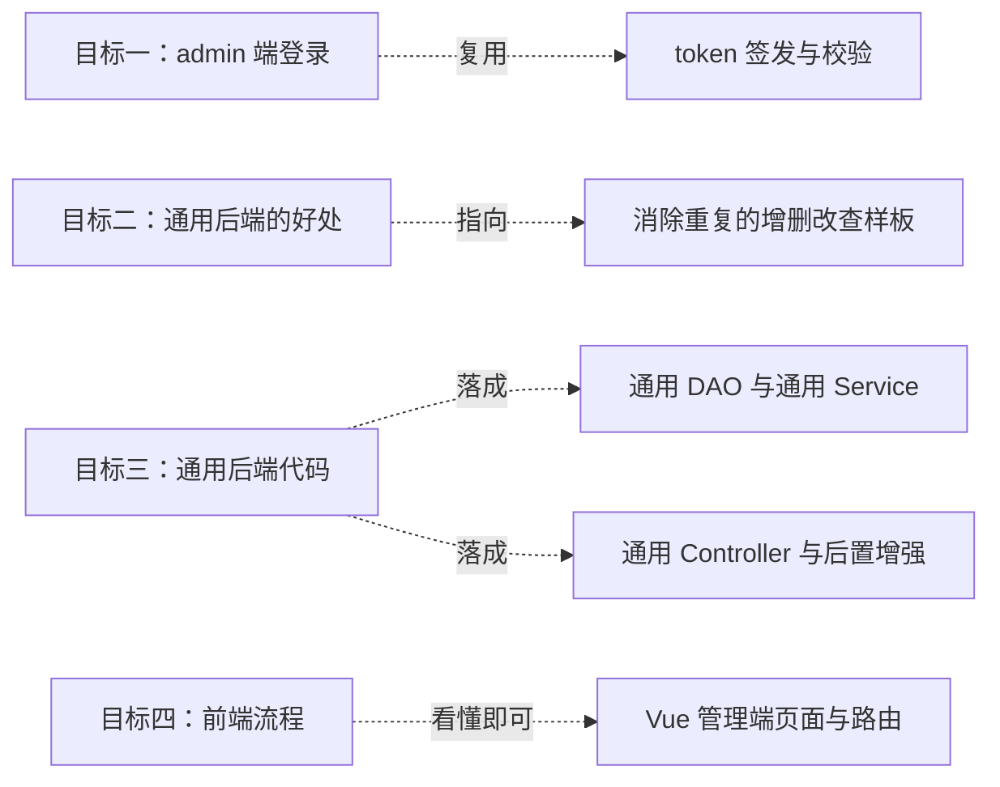

# day06 任务书：admin 端登录与通用后端封装

> 🔒 安全提示：文中示例的口令/密钥均为课程教学环境演示口径，生产环境的安全要求见《安全与合规须知》。

day05 收官时，自媒体端的内容生产链路已经闭环，代价也看得见：每个功能都要手写一套 Controller、Service、Mapper 与 XML，接口写起来没有太多技术含量，但一个都少不了。day06 正面回应这件事，课件标题就是「admin 端功能开发与通用后端封装」：一边用半天把 admin 端的登录做掉，一边把增删改查的样板代码收进通用层，后台代码量大幅下降。开工前把四个目标与技术点的映射捋清楚。

## 先给结论

- day06 四个目标：完成 admin 端的登录功能、清楚通用后端的好处、完成通用后端的代码开发、熟悉前端的开发流程。
- 登录是套路复用：与自媒体端登录同构，token 的签发与校验是一套口径，课件安排快速过。
- 通用封装是全天重头：把每个接口都在写的增删改查样板抽成通用层，理解封装思想并能自己走通代码是硬要求。
- admin 模块起步三件事：父工程下新建模块、拷贝多环境配置文件、从既有微服务拷贝 config 公共依赖。
- 前端目标定位在能看懂流程，不做手写要求。

## 四个目标怎么映射到技术点

目标与支撑技术不是一对一，登录、封装、前端流程各有一条自己的线索：



关键路径在目标三：通用 DAO 承接单表数据访问，通用 Service 承接查询、新增、修改、删除的业务编排，通用 Controller 承接路由转发，后置增强接口给通用流程留出业务定制的口子。目标二是它的思想铺垫，先看清楚重复在哪，才知道封装抽什么；目标一与目标四分别是后端与前端的配套动作。

## 登录为什么可以快

admin 端登录与自媒体端登录是同构问题：账号密码换 token，前端把 token 存起来随请求带回，后端拦截校验。这套机制在自媒体登录时已经完整写过一遍，签发、校验、登录态写入 ThreadLocal 全部现成，admin 端换的只是用户数据与路由入口。快速过一遍的意义不在学新东西，而在验证套路的可迁移性：换一个端，登录从需求到落地的路径不变，变的只有表与权限边界。这类「同构功能二次落地」是项目课的重要训练，第一遍学写法，第二遍学迁移。

## 通用封装要解决的痛点

回看 day05 手写的接口，重复的模式已经反复出现：Controller 收 DTO 转发 Service，Service 判参数、调 Mapper、封装响应，Mapper 写一条 SQL，XML 配一份映射。增删改查四个动作乘以每一张表，就是四层样板乘以表数的体量，文章管理与素材管理已经各写了一遍，后面还有更多表排着队。

通用封装的思路是把这套样板一次写好、处处复用：单表的增删改查交给通用层承接，业务代码只写真正有业务逻辑的部分，比如文章的状态闸门、素材的文件清理。封装完成后收益立竿见影，后台代码大量减少，新表接入的速度也不再线性增长。day06 后续小节会依次落这些部件：通用封装的需求分析与思路、类图关系、通用 DTO 的详细设计、后置增强接口、通用 DAO、通用 Service 的查询与增删改方法、通用 Controller，最后功能测试收尾。课件对这部分的要求写得很重：不只是看懂，还要理解封装思想，并且能自己把代码走通。

封装也不是无限上纲。通用层只收编确实重复的样板，业务差异通过后置增强这类扩展点回流，而不是把所有特例硬塞进通用层；判断一个片段该不该进通用层的标准，还是那个老原则：重复三次以上才值得抽，为复用而复用会把简单逻辑藏进深继承树。

## admin 工程怎么起步

新模块起步的流程在多个微服务里已经演练过，admin 端再走一遍。第一步在父工程下创建 admin 模块；第二步拷贝多环境配置文件，开发、测试、生产三套环境属性各就各位；第三步从既有微服务拷贝 config 目录下的公共依赖，通用响应、异常处理、日志这些配置类一次到位：

```xml
<!-- 父工程聚合里新增 admin 模块 -->
<modules>
    <module>leadnews-wemedia</module>
    <module>leadnews-admin</module>
</modules>
```

```bash
# admin 模块起步三件事（示例为按本课写法补全）
# 1. 父工程下新建模块 leadnews-admin
# 2. 拷贝多环境配置文件
cp maven_dev.properties maven_prod.properties maven_test.properties leadnews-admin/
# 3. 从既有微服务拷贝 config 目录下的公共配置类，包名保持 com.study.headline
```

多环境配置是容易漏的一步：dev 与 prod 的数据库地址、注册中心端口都不同，漏拷之后模块能编译却起不来，报错还绕。这套「建模块、拷环境、拷配置」的起手式在项目里会一直用下去，到 admin 这里已经是熟练动作。

## 常见误区

- **把通用封装当银弹。** 通用层收编的是单表增删改查样板，涉及状态机、文件、跨表事务的逻辑仍要走业务代码，硬套通用层会把业务逻辑埋进不可读的泛型里。
- **登录以为要重写一遍。** admin 端登录复用既有 token 机制，重写签发校验不仅浪费时间，还会造出第二套不一致的登录口径。
- **新模块漏拷多环境配置。** 模块编译通过不代表能启动，dev 与 prod 环境属性缺失会在启动或连库时爆雷，起步三件事一件都不能省。
- **前端目标定成手写。** 课件对前端的要求是看懂流程，知道页面、api、路由怎么组织即可，把时间花在通用封装的思想与代码上才是本日重心。

## 面试可能被问到的问题

1. 面试官追问：「通用后端封装能带来多大收益，代价是什么？」
   答：收益是单表增删改查的四层样板只写一次，新表接入从四层代码缩成声明式配置，代码量与出错面同步下降。代价是多一层抽象，新人要理解类图与扩展点才能上手，业务差异靠后置增强回流，封装设计不好反而抬高改造成本。适合表多而业务薄的服务，业务重的核心域要克制。
2. 面试官追问：「同构功能在不同端复用，边界怎么划？」
   答：机制层复用，数据与权限层独立。登录的 token 签发校验、响应封装、异常处理是机制，两端共用一套；用户表、密码策略、权限边界是数据与权限，各端各自维护。复用机制保证口径一致，独立数据保证边界清晰。
3. 面试官追问：「多环境配置在工程里怎么组织？」
   答：按环境拆属性文件，dev、test、prod 各一份，构建时按 profile 注入。数据库地址、注册中心、日志级别这类会随环境变的项全部收进属性文件，代码里不出现环境相关硬编码；新模块起步时先拷齐这三份，是工程纪律。
4. 面试官追问：「抽取通用层之前，怎么判断哪些代码值得抽？」
   答：看重复度与稳定度。同一个模式在三处以上以相同形态出现，且近期没有剧烈变化迹象，才值得抽；抽早了抽象错位，返工成本高于重复成本。判据落在代码上就是：去掉表名与字段名后，剩下的流程是否完全一致。
5. 面试官追问：「通用封装与微服务的边界冲突吗？」
   答：不冲突。微服务解决服务怎么拆，通用封装解决服务内部的代码怎么组织，一个在架构层一个在模块层。每个微服务内部仍然可以用通用 DAO、通用 Service 收编单表样板，跨服务调用、领域边界这些架构问题它一概不管。

## 配套资料

- 代码：`materials/code/05/头条day06/`。该日资料包解压结果为空（未含源码文件），文中目标拆解、模块搭建步骤与封装骨架按画面线抄录整理并按本课写法补全，包名统一改写为 `com.study.headline`；引用路径截至 `头条dayNN/` 层级，内层目录冠以项目原名，正文统一以「头条类资讯项目」指代。
- 代码：`materials/code/05/头条day01/`，内层资料目录含项目原型，admin 端相关页面与后台流程可对照原型核对。
- 环境：课程集群 node01~node03，MySQL root/123456；admin 模块起步时沿用既有微服务的公共配置。
