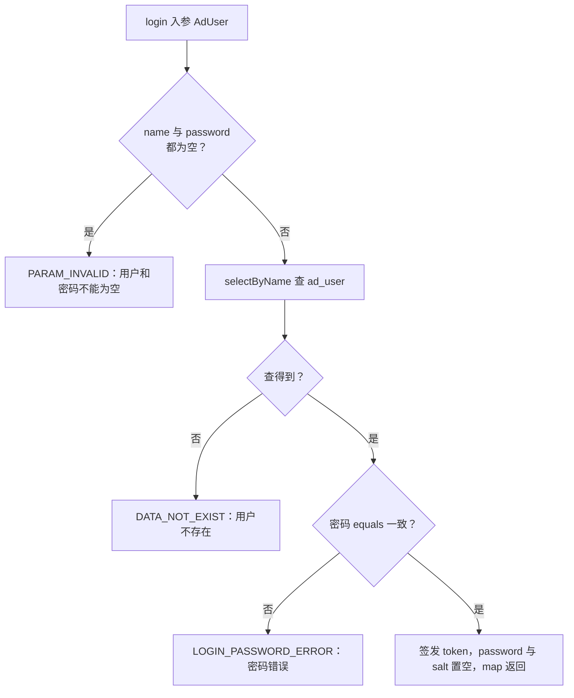

# admin 登录后端落地：ad_user 查询、密码校验与 JWT 签发

> 🔒 安全提示：文中示例的口令/密钥均为课程教学环境演示口径，生产环境的安全要求见《安全与合规须知》。

工程骨架立完，登录接口是 admin 端的第一个功能。这个功能在自媒体端刚完整写过一遍，按名查用户、三道校验、签发 token、返回用户信息，套路完全一致。再走一遍不是重复劳动：第一遍学的是写法，第二遍练的是迁移，换一张表、换一个端、换一套过滤器之后，链路还能不能一次走通，才是对这套样板真正的掌握。这一课把 admin 登录的后端三层写完，Mapper、Service、Controller 一路到底，前端联调与踩坑放进下一课。

## 先给结论

- 接口为 `POST /login/in`，请求 DTO 是管理员实体 AdUser，响应返回 map：token 与 user 两键。
- 三道校验与自媒体登录同构：参数为空、用户不存在、密码错误，错误码共用一份枚举；画面线的参数校验用 `&&` 连接，工程正解是 `||`，细节见常见误区。
- token 由 `AppJwtUtils` 按用户签发；user 返回前把 password 与 salt 都置空，凭据不出服务端。
- 登录之后的请求交给 `AdminTokenFilter` 校验，校验通过的用户身份由 `AdminThreadLocalUtils` 承载，后续业务随时取当前登录人。
- ad_user 表结构与 wm_user 同源而不同表，salt 列照旧为加盐摘要改造预留。

## 接口定义与 ad_user 表

接口沿用通用接口规范来定义：路径 `/login/in`，请求 DTO 为 `com.study.headline.model.admin.pojos.AdUser`，响应 DTO 是一个 map，装 token 与用户信息。返回结构里强调 token，是因为 admin 端所有后续接口都靠它过 AdminTokenFilter 这一关。

管理员落库表是 ad_user，字段按画面线整理如下（索引按工程建表规约补全）：

```sql
create table ad_user (
  id           int(11)      not null auto_increment comment '主键',
  name         varchar(32)  default null comment '登录用户名',
  password     varchar(32)  default null comment '登录密码',
  salt         varchar(32)  default null comment '盐，供摘要校验使用',
  nickname     varchar(255) default null comment '昵称',
  image        varchar(255) default null comment '头像',
  phone        varchar(20)  default null comment '手机号',
  email        varchar(255) default null comment '邮箱',
  status       tinyint(1)   default '1' comment '状态',
  login_time   datetime     default null comment '最近登录时间',
  created_time datetime     default null comment '创建时间',
  primary key (id),
  key idx_user_name (name)
) comment '管理员用户信息表';
```

与自媒体的 wm_user 摆在一起看，差异只有一处有业务含义：ad_user 没有 `ap_author_id`，管理员不关联作者身份，纯粹是后台操作者。登录只关心 name 与 password 两列，name 上建了索引，按名查询走索引不扫全表。

## Mapper：按用户名查询

查询落在 model 工程的 mappers 包下，与 mappers.wemedia 并列新建 admin 包：

```java
package com.study.headline.model.mappers.admin;

import com.study.headline.model.admin.pojos.AdUser;

public interface AdUserMapper {

    /** 按登录用户名查询管理员用户 */
    AdUser selectByName(String name);
}
```

XML 从模板拷来改命名空间，一个 resultMap、一个字段片段、一句查询（按画面线整理）：

```xml
<mapper namespace="com.study.headline.model.mappers.admin.AdUserMapper">

    <resultMap id="BaseResultMap" type="com.study.headline.model.admin.pojos.AdUser">
        <result column="id" property="id"/>
        <result column="name" property="name"/>
        <result column="password" property="password"/>
        <result column="salt" property="salt"/>
        <result column="nickname" property="nickname"/>
        <result column="image" property="image"/>
        <result column="phone" property="phone"/>
        <result column="status" property="status"/>
        <result column="email" property="email"/>
        <result column="login_time" property="loginTime"/>
        <result column="created_time" property="createdTime"/>
    </resultMap>

    <sql id="Base_Column_List">
        id, name, password, salt, nickname, image, phone, status, email, login_time, created_time
    </sql>

    <select id="selectByName" resultMap="BaseResultMap">
        select <include refid="Base_Column_List"/>
        from ad_user where name = #{name} limit 1
    </select>
</mapper>
```

`limit 1` 是给「用户名唯一」上的保险：即便脏数据造出了重名行，查询也只回一条。登录场景没有对 status 做约束，教学期保持最小实现，生产上要把停用账号挡在查回之外。

## Service：三道校验与 token 封装

接口先立：`UserLoginService` 定义 `ResponseResult login(AdUser user)`。实现类是登录的主战场，校验次序与自媒体端逐字同构（按画面线整理）：

```java
@Service
public class UserLoginServiceImpl implements UserLoginService {

    @Autowired
    private AdUserMapper adUserMapper;

    @Override
    public ResponseResult login(AdUser user) {
        //1. 参数校验：两个都为空才拦（画面线原样为 &&，工程建议 ||，见常见误区）
        if (StringUtils.isEmpty(user.getName()) && StringUtils.isEmpty(user.getPassword())) {
            return ResponseResult.errorResult(AppHttpCodeEnum.PARAM_INVALID, "用户和密码不能为空");
        }
        //2. 按用户名查用户，查不到即账号不存在
        AdUser adUser = adUserMapper.selectByName(user.getName());
        if (adUser == null) {
            return ResponseResult.errorResult(AppHttpCodeEnum.DATA_NOT_EXIST, "用户不存在");
        }
        //3. 密码比对：入参密码与库中密码一致才放行
        if (!user.getPassword().equals(adUser.getPassword())) {
            return ResponseResult.errorResult(AppHttpCodeEnum.LOGIN_PASSWORD_ERROR, "密码错误");
        }
        //4. 登录成功：签发 token，user 清空敏感字段后一并返回
        Map<String, Object> result = new HashMap<>();
        result.put("token", AppJwtUtils.getToken(adUser));
        adUser.setPassword(null);
        adUser.setSalt(null);
        result.put("user", adUser);
        return ResponseResult.okResult(result);
    }
}
```

整条决策链画出来是一条三级闸门，每一级对应一个错误码：



关键路径在最后一级：成功分支干三件事。token 按用户签发进 map；password 与 salt 置空，盐虽不是密码本身，却直接参与摘要运算，跟着实体出服务端等于把防御拆掉一半；user 原样返回供前端展示昵称。三道校验的次序不能乱：参数校验在最前，空参进查询毫无意义还可能空指针；账号存在性在密码比对前，否则没有实体可比对。

密码比对是明文 equals，教学口径聚焦链路可以接受，工程化改法与自媒体端登录课一致：注册侧用 MD5（密码 + salt）落库，校验侧把入参密码拼上查回的 salt 再摘要比对，ad_user 的 salt 列就是为这条路预留的。

## Controller：POST /login/in 与登录后的上下文

控制器沿用契约接口惯例，apis 包里先立 `LoginControllerApi`，controller 包里实现：

```java
@RestController
@RequestMapping("/login")
public class LoginController implements LoginControllerApi {

    @Autowired
    private UserLoginService userLoginService;

    @Override
    @PostMapping("/in")
    public ResponseResult login(@RequestBody AdUser user) {
        return userLoginService.login(user);
    }
}
```

类级与方法级注解拼出对外地址 `POST /login/in`，这个路径不只是路由，还是 AdminTokenFilter 的放行依据。`@RequestBody` 在这里不是可选项：前端送来的是 JSON 体，漏了它实体全空，第一道校验就把请求打回，下一课联调的第一枪正打在这上面。

登录成功的后半程在过滤器链上。登录请求本身以 `/login` 开头，AdminTokenFilter 对这类请求免 token 直接放行；其余请求必须携带有效 token，过滤器解析验签通过后，把用户身份 set 进 `AdminThreadLocalUtils`，请求结束再 remove：

```java
// AdminTokenFilter 校验通过后（按画面线语义整理）
AdminThreadLocalUtils.set(adUser);
chain.doFilter(req, res);
AdminThreadLocalUtils.remove();   // 线程池会复用线程，出链必须清理
```

有了这个上下文，后续的频道审核、敏感词管理接口都不用再传 userId，任何一层都能取到「当前登录的管理员」。登录接口、过滤器、ThreadLocal 三件套合起来，才是 admin 端登录的完整后端。

## 常见误区

- **参数校验用 `&&` 连接两个非空判断。** 画面线原样是「两个都为空才拦」，只填密码不填用户名的请求会穿过第一道闸门，`selectByName` 拿到 null 查回空，报出来的却是「用户不存在」，语义错位。工程正解是 `||`：任一为空即拦，自媒体端登录就是这么写的。
- **返回体只清 password 忘了 salt。** salt 参与摘要运算，随实体外发后离线撞库的难度直线下降，两个字段要一起过「能不能给」的审查。
- **Controller 漏 `@RequestBody`。** POST 的 JSON 体绑不上实体，入参全空，前端只会看到「用户和密码不能为空」，与真实的传参问题长得一模一样，联调时最迷惑人。
- **报错语义过于精确。** 「用户不存在」与「密码错误」分开提示方便调试，也让撞库者能批量探测有效账号，生产环境常统一成「用户名或密码错误」，把精确区分留给服务端日志。

## 面试可能被问到的问题

1. 面试官追问：「admin 登录与自媒体登录代码几乎一样，为什么不抽成公共模块？」
   答：机制层相同，数据层不同。三道校验、token 签发的流程骨架可以抽象，但用户表、查询键、过滤器、上下文工具都是端别私有的，抽公共模块要引入大量泛型与回调，复杂度超过收益。项目选择「套路复用、代码各自落地」，第二遍写完本身就验证了套路的可迁移性。
2. 面试官追问：「为什么登录成功要同时返回 token 和 user？」
   答：token 供后续请求做身份凭证，user 供页面立刻渲染昵称与头像，一次登录喂饱两个消费方，省掉一次「登录成功后再查个人信息」的往返。user 返回前必须脱敏，password 与 salt 不能出服务端。
3. 面试官追问：「AdminThreadLocalUtils 的值是谁放进去的，生命周期怎么管？」
   答：AdminTokenFilter 在 token 校验通过后 set，整条过滤链与业务处理共享同一个线程上下文，业务层任意位置可取。线程池会复用线程，值不清理就会串号，所以过滤器出口必须有 remove，set 与 remove 成对出现是硬纪律。
4. 面试官追问：「selectByName 用 limit 1 是权宜之计吗？」
   答：是兜底不是替代。用户名唯一性应由数据库唯一索引保证，重复插入直接失败；limit 1 防的是历史脏数据让查询抛异常或返回多条导致程序崩溃。两层防护各管一段，唯一索引管数据正确，limit 1 管查询健壮。
5. 面试官追问：「明文 equals 比对密码，改造要动哪几处？」
   答：三处。注册或建号侧改成 MD5（密码 + salt）落库；校验侧改为入参密码拼 salt 后摘要，再与库中密文比对，比对逻辑防时序攻击可换 MessageDigest.isEqual；数据迁移要给存量明文密码补一轮加密。salt 列已经在表结构里，改造不需要动表。

## 配套资料

- 代码：`materials/code/05/头条day06/`。该日资料包解压结果为空（未含源码文件），文中 DDL、Mapper 接口与 XML、Service、Controller 均按画面线抄录整理为可运行版本，包名统一改写为 `com.study.headline`；参数校验 `&&` 为画面线原样，文中已标注工程正解；过滤链与 ThreadLocal 片段按画面线语义整理。
- 代码：`materials/code/05/头条day01/`，内层资料目录含数据库规范设计说明书（建表规约、idx_ 索引命名、字段注释要求等条目），ad_user 的 DDL 写法可对照其规约核对。
- 环境：课程集群 node01~node03，MySQL root/123456；admin 服务端口 9009，测试账号见下一课联调。
