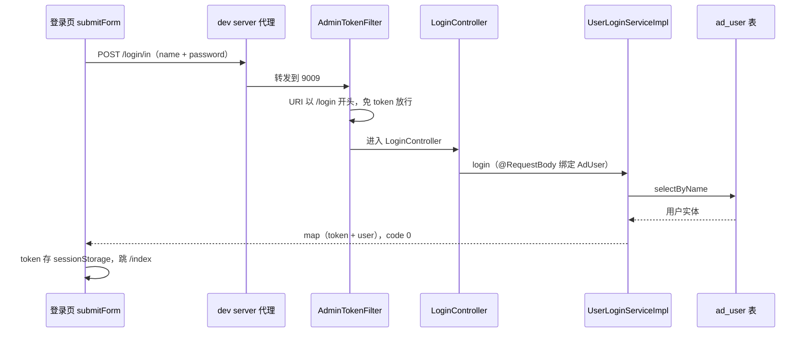

# admin 登录前后端联调：一条 @RequestBody 引出的完整校验链

> 🔒 安全提示：文中示例的口令/密钥均为课程教学环境演示口径，生产环境的安全要求见《安全与合规须知》。

后端三层写完，接口在浏览器里一条都还没验证过。前端工程导进来、两个服务同时启动、输入账号点登录，第一枪就报「用户名和密码不能为空」，账号密码明明都填了。联调的价值就在这里：把「代码能编译」推进到「功能能交付」，中间隔着的往往不是大问题，而是一个漏写的注解、一条对不上的路径。这一课走完 admin 登录的前端接入与两路验证，顺带把过滤器放行规则与路径对齐的纪律立起来。

## 先给结论

- admin-web 前端与自媒体端前端同构，导入即用，dev server 起在 8080，接口请求经代理转发到后端 9009。
- 联调第一坑：Controller 漏写 `@RequestBody`，JSON 体绑不上实体，入参全空，报「用户名和密码不能为空」。
- 登录页主线：表单非空校验 → `loginByUsername` 发请求 → `code == 0` 跳 `/index`，否则弹 `error_message`。
- token 存 sessionStorage，会话级保存，关闭标签页即失效；后续请求统一携带，交给 AdminTokenFilter 校验。
- AdminTokenFilter 的放行规则是「URI 以 `/login` 开头」，Controller 路径多一个前缀都会让 token 校验失败、用户进不了线程上下文。

## 前端工程导入与启动

admin-web 在 day06 资料里，解压后用 IDE 打开，是标准 Vue 脚手架工程，目录分工与自媒体端前端完全一致：api 目录按模块封装请求函数，constants 集中放接口地址常量，views 里 login/index.vue 是登录页，utils 里 request.js 封装请求、store.js 封装本地缓存。两套管理端前端同构是刻意安排，看懂一套，另一套只剩页面差异。

装依赖、起服务，控制台编译完成后应用跑在 8080：

```bash
# admin-web 启动（示例为按本课写法补全）
npm install
npm run dev
```

后端 admin 服务同时以 debug 方式启动，9009 端口待命。开发期浏览器与后端端口不同源，代理把接口请求转发到 9009，转发规则配置在前端工程的 `config/index.js` 里，这条代理线是前后端能说上话的前提。

## 登录页与调用链

登录页 submitForm 是整条链路的起点，先做非空校验再发请求（按画面线语义整理）：

```javascript
async submitForm() {
    const { name, password } = this.ruleForm
    if (!name || !password) {
        this.$message({ message: '用户名和密码不能为空', type: 'warning' })
        return
    }
    const result = await loginByUsername(name, password) // 登录
    if (result.code == 0) {
        this.$router.replace({ path: '/index' })         // 跳转主页
    } else {
        this.$message({ message: result.error_message, type: 'error' })
    }
}
```

页面不自己拼 URL，调 api 目录的 `loginByUsername`，地址常量在 constants 里集中维护：

```javascript
// constants/api.js：接口地址集中管理，登录项与后台 /login/in 完全对应
export const API_USERAUTH = '/login/in' // 管理端登录
```

整条链路从前端表单一路走到线程上下文：



关键路径在回包之后：`code == 0` 走成功分支，token 写进 sessionStorage 供后续请求携带，user 用于页面展示昵称，页面跳到 `/index` 主页。code 非 0 则把 `error_message` 原样弹出，用户不存在与密码错误各有各的提示语。

## 两路验证与第一坑

数据库 ad_user 里预置了测试账号 `wukong`，密码 `123`。成功路很直白：填入账号密码，点登录，页面跳到主界面，布局与自媒体端后台类似，登录模块闭环。

失败路同样要刻意走一遍：清空字段提交，前端非空校验直接拦下；输错密码提交，请求穿过前端抵达后端第三道校验，页面弹「密码错误」。三种报错与根源的对应关系值得记牢：

- 「用户名和密码不能为空」：前端拦截，或后端收到空实体。
- 「用户不存在」：参数到了，但 ad_user 里查不到这个名字。
- 「密码错误」：人查到了，凭据不对。

第一次用 wukong 登录时报的恰恰是第一种，而字段明明填了。在 Controller 打断点看，入参 user 的 name 与 password 全是 null，请求体根本没绑上实体。根源是漏写 `@RequestBody`：前端送的是 JSON 体，没有这个注解 Spring MVC 不会把请求体反序列化到 AdUser，只按表单或查询参数的方式找值，自然一无所获。补上注解，重启服务：

```java
// 修复前：JSON 体绑不上，入参全空
public ResponseResult login(AdUser user) {
    return userLoginService.login(user);
}

// 修复后：请求体反序列化为实体
public ResponseResult login(@RequestBody AdUser user) {
    return userLoginService.login(user);
}
```

再登录一次，页面跳进主界面，联调通过。这个坑的迷惑性在于报错文案：它说的是「参数为空」，看起来像用户没填，实际是服务端没收到，报错语义与真实根源之间隔着一层，断点是最短路径。

## 放行规则与路径对齐

登录能通还有一个前提容易被忽略：登录请求是全网唯一没有 token 的请求，它必须被 AdminTokenFilter 放行。过滤器的放行规则很朴素，URI 以 `/login` 开头即免 token，其余请求一律先验 token（按画面线整理，VLM 抄录有残缺，逻辑已补全）：

```java
@Slf4j
@WebFilter(filterName = "adminTokenFilter", urlPatterns = "/*")
public class AdminTokenFilter extends GenericFilterBean {

    @Override
    public void doFilter(ServletRequest req, ServletResponse res, FilterChain chain)
            throws IOException, ServletException {
        HttpServletRequest request = (HttpServletRequest) req;
        // 以 /login 开头的登录请求免 token，直接放行
        if (request.getRequestURI().startsWith("/login")) {
            chain.doFilter(req, res);
            return;
        }
        // 其余请求校验 token：失败直接写回 JSON，请求到此为止
        ResponseResult result = checkToken(request);
        if (result != null) {
            HttpServletResponse response = (HttpServletResponse) res;
            response.setCharacterEncoding(Contents.CHARSET_NAME);
            response.setContentType("application/json");
            response.getOutputStream().write(JSON.toJSONString(result).getBytes());
            return;
        }
        // 校验通过，用户身份绑定线程上下文，继续往下走
        chain.doFilter(req, res);
    }
}
```

这条规则把三方的路径绑在了一起：前端 constants 里的 `/login/in`、Controller 上的 `@RequestMapping("/login") + @PostMapping("/in")`、过滤器里的 `startsWith("/login")`。任何一方私自改动都会破局，比如 Controller 想加个 `/admin` 前缀变成 `/admin/login/in`，放行规则匹配不上，登录请求被当成未携带 token 的普通请求拦下，直接写回 JSON，后面的 Controller 根本不会执行，用户自然也进不了线程上下文。接口路径不许随手改，要改就前端常量、后台映射、过滤器规则三处一起动，自媒体端「以前端 constants 为准」的对齐原则在这里同样适用。

## 常见误区

- **POST 接口忘写 `@RequestBody`。** 现象是入参全空、报「参数为空」，与前端没传值的表象一致，极易误判。判别办法是在 Controller 入口打断点看实体字段，全是 null 就是绑定问题；JSON 请求体必须配 `@RequestBody`，这是硬规则。
- **路径前缀随手加。** Controller 上加前缀、前端常量不改、过滤器放行规则不知情，三方各说各话。表现为请求被过滤器拦下或 404，而登录业务代码毫无日志。路径是三方契约，改动必须同步。
- **只验证成功路。** 填对账号跳进主页不算联调完成，非空拦截、用户不存在、密码错误三条失败路都要走一遍，错误提示与根源一一对应才敢说闭环。
- **把 sessionStorage 当 localStorage 用。** sessionStorage 会话级，关标签页即失效，多标签页互不可见；localStorage 持久，关浏览器还在。admin 后台选 sessionStorage 换的是更小的泄露窗口，代价是每次新开会话都要重新登录，两者是取舍不是优劣。

## 面试可能被问到的问题

1. 面试官追问：「前端已经做了非空校验，后端三道校验还必要吗？」
   答：必要。前端校验只挡手误，绕过页面直接发请求的人拦不住，curl 一条命令就能送空参。前后端校验是纵深而不是互替，前端管体验，后端管安全边界，任何一层都不能省。
2. 面试官追问：「漏写 @RequestBody，为什么不报 400 而是入参为空？」
   答：Spring MVC 对没有 `@RequestBody` 的实体参数按表单或查询参数方式绑定，找不到值就保持 null，不视为非法请求。JSON 体只是没人解析，请求本身合法，于是请求一路走到业务校验，报出「参数为空」。语义错位是这类问题难排查的根源。
3. 面试官追问：「token 放 sessionStorage 还是 localStorage，怎么选？」
   答：看泄露窗口与登录时长的权衡。sessionStorage 会话级、标签页隔离，XSS 可读但关页即清，适合安全优先的后台系统；localStorage 持久，体验好但暴露面更大。更工程化的方案是 HttpOnly Cookie 加 CSRF 防护，脚本完全读不到。
4. 面试官追问：「过滤器放行规则和 Controller 路径如何避免漂移？」
   答：定单一事实来源。路径常量集中在一处维护，后台映射与放行规则引用同一常量或同一前缀约定，代码评审把路径改动列为必须三方同步的项。再配一条冒烟用例：未带 token 请求登录接口必须放行、请求业务接口必须被拒，漂移在 CI 阶段就能暴露。
5. 面试官追问：「登录请求没到后端，你的排查顺序是什么？」
   答：从前往后。浏览器 Network 面板看请求是否发出、状态码与响应体是什么；再对前端常量与代理配置，确认请求路径与转发目标；后端看过滤器是否放行、Controller 是否命中；最后打断点看实体绑定。每一步都有明确的观测点，比全局乱猜快得多。

## 配套资料

- 代码：`materials/code/05/头条day06/`。该日资料包解压结果为空（未含源码文件），admin-web 前端工程未随包留档，文中目录分工、登录页组件、api 与 constants 片段、过滤器逻辑均按画面线语义整理补全；启动命令为主流写法示例。包名统一改写为 `com.study.headline`；引用路径截至 `头条dayNN/` 层级，内层目录冠以项目原名，正文统一以「头条类资讯项目」指代。
- 代码：`materials/code/05/头条day01/`，内层资料目录含项目原型页面，admin 端登录后的主界面与频道管理、用户管理等页面形态可对照原型核对。
- 环境：课程集群 node01~node03，MySQL root/123456；前端 dev server 8080、后端 9009 同机联调，测试账号 wukong/123 为库中预置数据。
