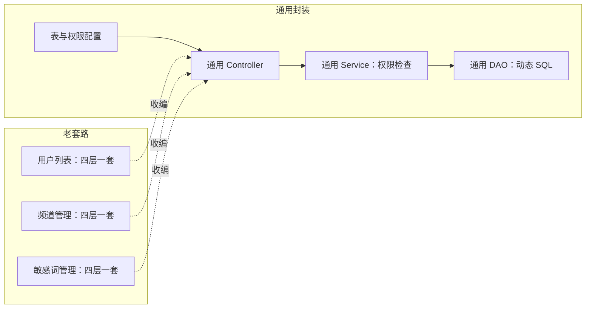
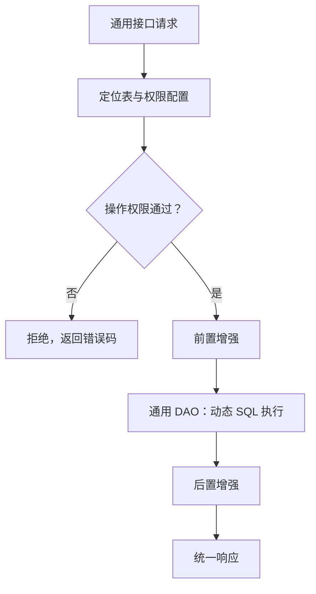

# 后端通用封装需求分析：一张表的增删改查只写一份

> 🔒 安全提示：文中示例的口令/密钥均为课程教学环境演示口径，生产环境的安全要求见《安全与合规须知》。

day05 写文章管理、素材管理时，每个接口都在重复同一套动作：Controller 收参转发，Service 判空调 Mapper，Mapper 声明方法，XML 配一条 SQL。这套四层样板写一遍要一两百行，写两张表还能忍，day06 下午摆上来的是用户列表、频道管理、敏感词管理三个页面，继续老套路就是三套样板，后面还有更多表排着队。后台通用封装要回答的就是这个问题：增删改查能不能一次写好、处处复用。动手写代码之前，先把需求与边界分析清楚。

## 先给结论

- 封装是把通用的东西抽出来变成共用层，核心动机是提高开发效率；后台管理系统大部分功能就是数据增删改查，这正是通用层能收编的领域。
- 用户列表、频道管理、敏感词管理的增删改查，封装后共用一套通用 Controller、Service 与 DAO，写一次就能覆盖所有单表功能。
- 能力清单：通用新增（对授权数据表插入）、指定字段修改、指定条件删除、列表查询（条件查询、分页与不分页、统计）。
- 两个关键点必须前置设计：权限控制（访问、数据、操作三个层面）与信息安全控制（SQL 注入）。
- 实现思路定调：持久层靠动态 SQL 或 SQL 拼接实现通用化，业务层按表定义操作权限，每次操作之前先检查权限。

## 重复的账怎么算

把老套路的账摊开算：一张表的后台管理，至少要写 Controller、Service（接口与实现）、Mapper 接口、XML 映射四层，增删改查四个动作各来一遍。day05 的文章与素材已经各写了一套，本课的用户、频道、敏感词又是三套，样板代码的体量随表数线性增长，而其中真正有业务含量的部分，往往只有状态校验、关联处理那么几行。

通用封装的思路是把无差异的四层收进一套通用层，差异用配置与扩展点表达：



关键路径在配置那一环：表名、字段、允许哪些操作，全部声明在配置里，通用 Controller 按请求定位到对应表的配置，通用 Service 做权限检查，通用 DAO 用动态 SQL 拼出执行语句。新增一张表不再是四层代码，而是一段配置。写一次、多次用，写一次比多次好这件事不需要论证，需要论证的是怎么收才不出乱子。

## 通用层要具备哪些能力

功能需求按四个动作加两个扩展机制归纳。**新增**，能够对授权的数据表插入数据，「授权」两个字是前提，表没在通用层的授权清单里就不许碰。**修改**，能够修改指定字段的数据，一张表十个字段只想更新三个就传三个，按字段级提交而不是整行覆盖。**删除**，能够按指定条件删除数据，条件由请求声明，通用层负责校验与执行。**列表**，能够加载不同数据表的数据，支持一般列表与分页列表两种形态，支持条件查询，还要能做统计。

扩展机制有两个。**前后置增强**解决业务差异的回流：增删改查之外往往还要做别的事，比如删除频道前先检查有没有文章挂着这个频道，这类逻辑不该塞进通用层，而是在通用流程前后留出的增强点里实现。**按表控权**解决操作边界的差异，不同数据表开放的操作权限可以不同，以本课三张表为例（示例为按本课写法补全，表达需求口径）：

```yaml
# 通用层按表授权配置：ops 里没列出的操作一律拒绝
tables:
  user:
    table: user
    ops: [list]                          # 用户列表只放行查询
  channel:
    table: channel
    ops: [insert, update, delete, list]  # 频道管理增删改查全开
  sensitive_word:
    table: sensitive_word
    ops: [insert, update, list]          # 敏感词不允许删除
```

这份配置就是需求的可执行表达：用户表只读，频道表全开，敏感词表禁删。控制粒度落在表与操作两个维度上，谁在什么时候能调，则由访问权限与登录态配合解决。

## 两个前置关键点：权限与注入

**权限控制分三层看。** 访问权限管「这个请求能不能进来」，靠登录态与接口鉴权；数据权限管「能碰哪些表、哪些行」，靠表授权配置约束通用层的活动范围；操作权限管「对这张表能做哪些动作」，就是上一节 ops 清单干的事。三层缺一不可，通用层把所有表的入口收拢到一处，权限检查也顺势收拢到一处，这是坏事变好事：检查点唯一，审计面收敛。

**信息安全的核心是 SQL 注入。** 通用层要拼表名、拼字段、拼条件，动态 SQL 里的占位符分两种：`#{}` 走预编译，值当参数处理，安全；`${}` 是字符串替换，拼什么执行什么，值来自外部请求就是注入通道。通用列表查询的骨架可以这样表达（示例为按本课写法补全）：

```xml
<!-- 通用列表查询：表名与列名来自配置白名单，条件值全部走 #{} 预编译 -->
<select id="genericList" resultType="map">
    select <include refid="${columnList}"/>
    from ${tableName}
    <where>
        <if test="conditions != null">
            <foreach collection="conditions" item="c" separator=" and ">
                ${c.column} = #{c.value}
            </foreach>
        </if>
    </where>
</select>
```

骨架里 `${tableName}` 与 `${c.column}` 是不得不拼的部分，表名与列名无法作为参数进预编译，风险必须由来源堵住：它们只能取自服务端的表授权配置，取值前先过白名单校验，请求里传上来的任何字符串都没有资格进这两个位置；条件值统一走 `#{c.value}`，注入通道从源头关死。

## 实现思路：动态 SQL 加权限检查

需求落成实现思路只有两条主线。持久层，通过动态 SQL 或 SQL 拼接方式实现通用化，一张通用的 Mapper 承接所有授权表的数据访问；业务层，定义操作权限，控制框架对各表的增删改查权限，每次操作之前先检查这道闸门。请求进来之后的完整路径：



关键路径在 CHK 节点：权限检查在任何数据访问发生之前，配置里没放行的操作根本到不了 SQL 那一步。PRE 与 POST 两个增强点是业务差异的回流口，前面讨论的「删除频道前检查关联文章」就挂在 PRE，删除后的缓存清理挂在 POST。day06 后续小节会按这条思路依次落地：通用 DTO 的设计、后置增强接口、通用 DAO、通用 Service 与通用 Controller，最后功能测试收尾，每一件部件都能在这张图上找到位置。

## 常见误区

- **把通用封装当银弹。** 通用层收编的是无差异的单表增删改查样板，涉及状态机、文件操作、跨表事务的逻辑必须走业务代码或增强点，硬塞进通用层会把业务逻辑埋进泛型与配置的迷宫里，读代码的人比写代码的人更痛苦。
- **条件值用 `${}` 拼接。** 表名与列名的拼接靠白名单约束，值必须走 `#{}` 预编译；图省事把用户输入直接 `${}` 进 SQL，等于给每个接口留了一道注入后门，敏感词表、用户表被拖库只差一条构造请求。
- **授权配置只加不审。** 表授权清单会随功能迭代膨胀，新增表时顺手把 delete 也加上的事常有。配置是权限的唯一事实来源，要纳入评审，谁开放了什么操作、为什么开放，得说得出来。
- **增强点当成垃圾桶。** 前后置增强解决的是少量业务差异，如果一个表的增强逻辑比通用流程还长，说明这张表不适合进通用层，老老实实写专属接口反而清晰。

## 面试可能被问到的问题

1. 面试官追问：「通用封装能省多少代码，代价是什么？」
   答：收益是四层样板乘以表数的体量压成一份通用层加每表一段配置，新表接入速度不再随表数线性下降。代价是多一层抽象，类图、配置 schema、增强点约定都要学习；业务差异靠增强回流，设计不好会把复杂度转嫁给使用者。适合表多、操作薄的后台管理域。
2. 面试官追问：「动态 SQL 里表名和列名为什么不能用 #{}？」
   答：预编译占位符只对值生效，表名与列名是 SQL 结构的一部分，数据库在解析阶段就要确定，参数化不了，只能字符串拼接。拼接的注入口子必须靠来源堵：只允许来自服务端配置白名单，请求传入的字符串一律拒绝，值再走 `#{}` 预编译。
3. 面试官追问：「按表控权在什么时机检查，漏检会怎样？」
   答：在业务编排最前端、任何数据访问发生之前检查，权限不通过直接拒绝，SQL 都不该生成。漏检的后果是授权配置形同虚设，只读表被删、禁删表被清，而且因为入口统一，一次漏检可能对所有表生效，检查必须收在通用层内部而不是调用方自觉。
4. 面试官追问：「前后置增强与 AOP 是什么关系？」
   答：思路同源，都是把附加逻辑从主流程剥离，但落点不同。AOP 按切面横向织入，作用于方法签名；通用层的增强点是显式定义的扩展接口，由业务方实现、通用流程回调，作用域是单次增删改查的业务语义，比如删除前的关联检查。增强点比 AOP 更显式，更容易看清谁在什么环节插了逻辑。
5. 面试官追问：「什么样的表不适合进通用层？」
   答：三类。操作语义特殊的，如文章这种带状态机与跨表一致性的；数据量与访问模式特殊的，如需要专门索引与查询优化的热表；权限要求严到配置表达不了的。判断标准是看增删改查之外还剩多少业务，剩得越多越不该收编。

## 配套资料

- 代码：`materials/code/05/头条day06/`。该日资料包解压结果为空（未含源码文件），本课为需求分析，画面仅 PPT 与管理端页面；文中按表授权配置与通用列表查询的 XML 骨架为按本课写法补全的示例，用于表达需求口径，非课程源码。引用路径截至 `头条dayNN/` 层级，内层目录冠以项目原名，正文统一以「头条类资讯项目」指代。
- 代码：`materials/code/05/头条day01/`，内层资料目录含项目原型页面，用户列表、频道管理、敏感词管理三个页面的形态可对照原型核对。
- 环境：课程集群 node01~node03，MySQL root/123456；通用封装的代码实现与功能测试在 day06 后续课程完成。
