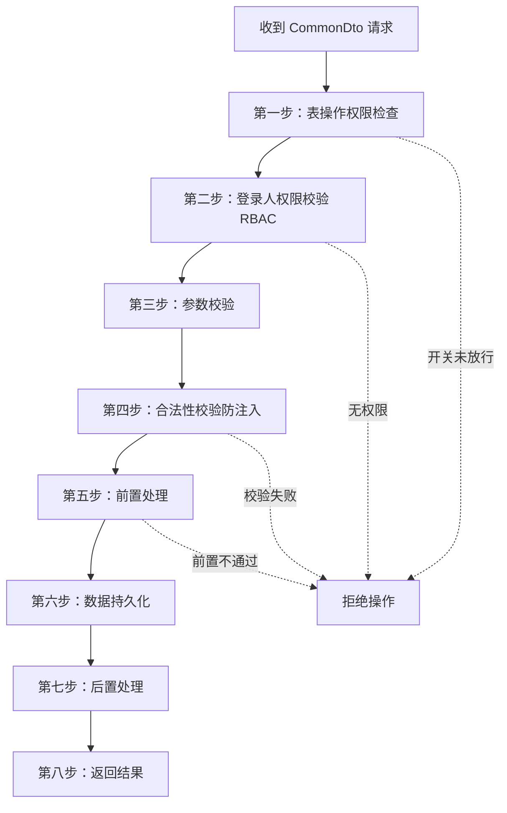

# 通用后端封装的实现思路与接口定义：表名参数化与八步流水线

后台接口写多了，重复感会压过成就感：文章管理一套 Controller、Service、Mapper，素材管理再抄一套，敏感词管理还得来一套。四层代码之间真正变化的只有表名与字段名，流程一模一样。把这套样板收编成通用层之前，有两个设计问题必须先想清楚：持久层怎么做到一套代码服务所有表，业务层怎么保证每个请求都走同一条安全的流水线。这一节给出实现思路与对外接口的定义，后面的小节再逐个类落地。

## 先给结论

- 通用封装分两块：持久层靠动态 SQL 加 SQL 拼接，把表名也变成参数；业务层是一条固定的八步流水线。
- 表名参数化之后，写一个通用 DAO 就能承接所有表的操作，传什么表就操作什么表。
- 对外只定义三个接口：列表查询、删除、新增和修改；新增与修改合并，靠参数里的 model 区分动作。
- RBAC 登录人权限校验纳入思路但本例不实现；表级操作开关是每次请求的第一道闸。

## 持久层：把表名也变成条件

动态 SQL 是已经熟练的东西：方法参数传一个值，XML 里用 `#{}` 占位接收，MyBatis 负责安全替换。它解决的是值的通用，SQL 的骨架仍然写死，from 后面的表名在映射文件里是常量，一张表就要一份文件。

通用封装把通用化再推一步：表名也允许作为条件传递。操作用户表就传 `AP_USER`，操作频道表就传 `AD_CHANNEL`，持久层拿到什么表就操作什么表。原来查什么列、from 哪张表都固定，现在 from 的对象也由请求决定，一份映射文件服务全部表：

```xml
<!-- 传统写法：一张表一份映射文件，表名写死 -->
<select id="listChannel" resultType="com.study.headline.model.admin.pojos.AdChannel">
    select * from ad_channel order by created_time desc
</select>

<!-- 通用写法：一份映射服务所有表，表名与条件全部来自请求（示意，按画面线补全） -->
<select id="commonList" resultType="java.util.Map">
    select * from ${tableName}
    <where>
        <foreach collection="wheres" item="w" separator="and">
            ${w.filed} #{w.value}
        </foreach>
    </where>
    limit #{offset}, #{size}
</select>
```

代价在标签里已经看得出来：`${tableName}` 与 `${w.filed}` 走的是拼接，不是预编译占位。拼接成分必须收敛在白名单里，值本身仍然走 `#{}`，这份责任由业务层的合法性校验承担，也就是流水线里的第四步。

## 业务层：一条八步流水线

通用层的业务逻辑不散落在各个接口里，而是固定成一条流水线，每个请求按同样的顺序过闸：



这张图在讲通用层每个请求必须经过的八道关口，虚线是四条可以中断请求的路径。关键路径读法：前四步全是校验与权限，任何一步不过都到不了持久化；真正动数据库的只有第六步，第七步之后的逻辑只能影响返回，不能再回滚成拒绝。

**第一步，表操作权限检查。** 定义一个操作权限类，登记哪些表允许通用操作、各自开放增删改查里的哪几个动作，每次操作前先查这张表的开关。举例：用户表只允许查询，新增、修改、删除一律拒绝，这类规则一条枚举配置就能表达。

**第二步，登录人权限校验。** 检查当前登录人是否具备该功能的操作权限，标准做法接 RBAC：按用户查角色，再按角色查操作权限，链路查完再放行。后台系统目前没有做权限分配，这一步本课留白不实现，但思路必须清楚，将来实现的位置就是流水线的这道关口。

**第三步，参数校验。** 不同动作有不同的参数底线，更新时必须携带查询条件，没有定位条件的修改等于全表事故。

**第四步，参数合法性校验。** 表名与字段名走拼接，必须对照白名单校验，防 SQL 注入靠这一步兜底。

**第五步，前置处理。** 持久化之前的业务逻辑，前置结果可以影响程序是否继续执行，比如某个业务条件不满足就直接中断请求。本课把这一步留作练习内容。

**第六步，数据持久化。** 交给通用 DAO 执行真正的 SQL。

**第七步，后置处理。** 持久化之后的业务逻辑，后置结果可以影响返回结果，落地为后置增强接口 BaseCommonFilter，后面单独展开。

**第八步，返回结果。** 统一封装成 `ResponseResult` 交给前端，与其他接口保持同一响应口径。

## 接口定义：三个入口管住增删改查

课件对通用接口的定义是三块。**列表接口**加载数据表的分页数据，并提供字段搜索功能，条件与分页参数一起进请求壳。**删除接口**删除满足条件的某行数据，考虑安全，每次操作只能删除一条数据。**新增和修改接口**负责往数据表写数据，传参里的 model 区分到底走新增还是修改；课件上这一条印成了「修改和删除」，讲解时已经纠正，正确语义是新增和修改，删除是独立接口。

三个入口落到代码上就是一个控制器三个方法，入参统一是请求壳 `CommonDto`：

```java
package com.study.headline.admin.controller.v1;

import com.study.headline.admin.service.CommonService;
import com.study.headline.model.admin.dtos.CommonDto;
import com.study.headline.model.common.dtos.ResponseResult;
import org.springframework.beans.factory.annotation.Autowired;
import org.springframework.web.bind.annotation.PostMapping;
import org.springframework.web.bind.annotation.RequestBody;
import org.springframework.web.bind.annotation.RequestMapping;
import org.springframework.web.bind.annotation.RestController;

/**
 * 通用接口：三个入口覆盖增删改查（骨架按画面线补全，编排见后续小节）
 */
@RestController
@RequestMapping("/api/v1/common")
public class CommonController {

    @Autowired
    private CommonService commonService;

    /** 列表接口：分页数据 + 字段搜索 */
    @PostMapping("/list")
    public ResponseResult list(@RequestBody CommonDto dto) {
        return commonService.list(dto);
    }

    /** 删除接口：每次只允许删除一条数据 */
    @PostMapping("/delete")
    public ResponseResult delete(@RequestBody CommonDto dto) {
        return commonService.delete(dto);
    }

    /** 新增和修改接口：由 dto 里的 model 区分动作 */
    @PostMapping("/save_or_update")
    public ResponseResult saveOrUpdate(@RequestBody CommonDto dto) {
        return commonService.saveOrUpdate(dto);
    }
}
```

接口数量不随表增长，是这套设计最直接的收益：表再多，后台暴露的通用入口也只有这三个，新接一张表只是多一行配置。

## 常见误区

- **把通用层做成裸奔的 SQL 通道。** 前端传什么表名字段名就拼什么，等于把数据库交给调用方任意操作；表与字段必须收敛进枚举白名单，值走 `#{}` 预编译。
- **删除接口顺手做成批量。** 一次只删一条是安全约束，不是能力不足；批量清理这类需求自带业务语义，走专用业务接口才有校验兜底。
- **新增和修改拆成两个接口。** 两者的参数结构完全一致，拆开只会复制一遍代码；用 model 字段区分动作才是通用层的做法。
- **表级开关被跳过。** RBAC 没实现不等于任何权限检查都不做；表操作开关成本极低，是第一道闸，缺了它通用接口就对所有表无差别开放。

## 面试可能被问到的问题

1. 面试官追问：「通用持久层为什么要用 SQL 拼接，纯动态 SQL 不行吗？」
   答：动态 SQL 的 #{} 占位只解决值的通用，表名、字段名这类结构成分无法参数化；通用层要服务所有表，表名必须拼接传入。拼接成分必须经过白名单校验，这正是流水线第四步合法性校验存在的理由。
2. 面试官追问：「表名作为参数传进来，怎么防 SQL 注入？」
   答：表名不收字符串，收枚举。枚举里登记的是允许通用操作的表，枚举之外的值在第一步权限检查就被拒绝；字段名对照枚举与表结构校验，值本身走 #{} 预编译，三层防线各管一段。
3. 面试官追问：「为什么新增和修改合并成一个接口？」
   答：两者的入参结构完全一致，都是目标表加一组修改字段，区别只在是否携带定位行的条件。合并后由 model 参数区分动作，接口数量与样板代码都减半，前端也只需要对接一种参数结构。
4. 面试官追问：「删除接口为什么限制一次只能删一条？」
   答：通用接口面向所有表开放，条件写错时影响面不可控，单条限制把最危险的写操作伤害锁死；批量场景留给有业务语义的专用接口，那里有业务校验兜底。
5. 面试官追问：「八步流水线里哪些步骤可以中断请求？」
   答：表开关检查、登录人权限校验、参数校验、合法性校验、前置处理都可以拒绝请求，其中前置处理被设计为结果可影响程序是否继续执行。持久化之后的后置处理只能影响返回结果，不能再把已经落库的操作变成拒绝。

## 配套资料

- 代码：`materials/code/05/头条day06/`。该日资料包解压结果为空（未含源码文件），文中接口骨架、SQL 片段与流水线步骤按画面线课件与主流写法补全，包名统一改写为 `com.study.headline`；引用路径截至 `头条dayNN/` 层级，内层目录冠以项目原名，正文统一以「头条类资讯项目」指代。
- 代码：`materials/code/05/头条day01/`，内层资料目录含数据库规范设计说明书与项目原型，可对照用户、频道、敏感词等表名与后台页面结构。
