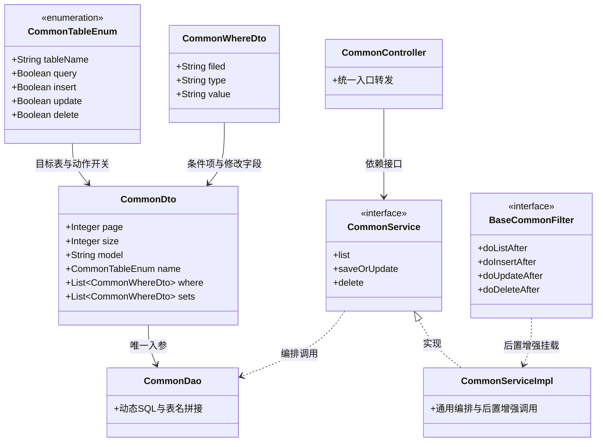

# 通用封装的类图：七个类一条链，职责与连线一次理清

抽通用层最常见的失败不是写不出代码，而是类一多就理不清谁依赖谁：DTO 里装什么、DAO 拼什么、Service 编排什么、Controller 暴露什么，边界一糊，通用层很快退化成谁都不敢动的大杂烩。类图先行，把每个类的职责与连线钉死，再动手写代码，封装才立得住。

## 先给结论

- 主线六个类一条链：CommonTableEnum 与 CommonWhereDto 汇入 CommonDto，CommonDto 作为唯一入参进 CommonDao，CommonDao 被 CommonService 编排，CommonService 由 CommonController 调用。
- CommonTableEnum 是配置中心：定义哪些表支持通用操作，以及每张表开放的 CRUD 动作。
- CommonServiceImpl 的核心方法只有三个：查询、删除、新增和修改（合一）。
- BaseCommonFilter 旁挂在主链上作为后置增强口子，与三层都可能发生交互，但不属于主流程。

## 一张图看懂职责与连线



这张类图在讲通用封装的静态结构：谁组合谁、谁调用谁、增强器挂在哪。关键路径读法：两条输入流在 CommonDto 汇合成唯一入参，随后是一条单向依赖链，Controller 依赖 Service 接口，实现类向下编排 DAO；BaseCommonFilter 从侧面接入实现类，主流程不感知具体增强。

课件类图上这些连线绝大多数表达依赖与调用，唯一的实现关系是 CommonServiceImpl 实现 CommonService 接口。把整张图读成层层继承是常见误读，这套封装是组合加接口实现的骨架，不是继承树。

## 各类的职责边界

**CommonTableEnum，表白名单与动作开关。** 用于定义哪些数据表可支持通用操作，及其开发的 CRUD 功能。用户、频道、敏感词这类要进通用层的表都在这里登记，一张表一行配置，同时声明这张表开放增删改查里的哪几个动作。

**CommonWhereDto，条件项。** 接收前端传入的修改字段或查询条件参数，一个条件项就是字段名、操作方式、值三件套，单表字段级别的最小封装。

**CommonDto，请求壳。** 接收前端传入的接口参数，包括 CRUD 接口的全部参数：分页、动作标记、目标表、条件集合、修改字段集合。前端一次请求只需要构造这一个对象。

**CommonDao，持久层实现。** 持久层动态 SQL 与 SQL 拼接的落地处，拼接的表名从请求壳里拿，CommonDto 的 name 字段指向表枚举，DAO 只负责把名字拼进 SQL。

**CommonServiceImpl，通用编排。** 实现 CRUD 的通用逻辑处理：表开关检查、参数校验、组装 SQL 参数、调后置增强，全在这一层。核心方法三个：查询一个，删除一个，新增和修改合一个，由请求壳里的 model 区分动作。

**CommonController，统一入口。** 实现通用接口的控制层定义，只做转发，不写业务；业务编排留在 Service，控制层保持薄。

**BaseCommonFilter，后置增强接口。** 定义后置处理的接口方法，实现类的 Bean 名与 CommonTableEnum 的名称对应，通用 Service 按表找到对应增强器；查询、持久化、控制层都可能被增强触达，挂载点在通用编排。

## 通用 Service 的三个核心方法

编排层的对外形状收敛到极简，接口只有三个方法：

```java
package com.study.headline.admin.service;

import com.study.headline.model.admin.dtos.CommonDto;
import com.study.headline.model.common.dtos.ResponseResult;

/**
 * 通用 Service：三个核心方法覆盖增删改查（按画面线补全）
 */
public interface CommonService {

    /** 查询：分页 + 条件 */
    ResponseResult list(CommonDto dto);

    /** 新增和修改：由 dto.model 区分动作 */
    ResponseResult saveOrUpdate(CommonDto dto);

    /** 删除：一次只删一条 */
    ResponseResult delete(CommonDto dto);
}
```

实现类里三个方法走同一条编排骨架，以查询为例：

```java
package com.study.headline.admin.service.impl;

/**
 * 通用 ServiceImpl 查询编排骨架（示意，按画面线与主流写法补全）
 */
@Service
public class CommonServiceImpl implements CommonService {

    @Autowired
    private CommonDao commonDao;

    @Override
    public ResponseResult list(CommonDto dto) {
        // 1. 表开关检查：枚举未登记或查询开关关闭，直接拒绝
        // 2. 参数校验与合法性校验：条件、分页、白名单
        // 3. 调通用 DAO 执行拼接 SQL
        List<Map<String, Object>> rows = commonDao.commonList(dto);
        // 4. 后置增强：按表枚举名取 BaseCommonFilter 实现
        // 5. 封装 ResponseResult 返回
        return ResponseResult.okResult(rows);
    }
}
```

读这段骨架的要点在步骤顺序：校验在前，持久化居中，增强在后。三个核心方法共享前两步与后两步，差异只在第三步调 DAO 的哪个方法，这正是样板被收编的证据。

## 接入一张新表要写多少代码

衡量封装质量最直接的问题。答案是一行配置：在 CommonTableEnum 里登记这张表并声明开放的动作，通用 CRUD 立即可用。如果这张表在持久化之后还有业务补充，再注册一个 Bean 名与表枚举同名的 BaseCommonFilter 实现；没有增强需求的表，连这个类都不用写。四层样板乘以表数的增长曲线，到这里被压成一行枚举加一个可选增强类。

## 常见误区

- **把类图连线读成继承。** 课件上的箭头绝大多数是依赖与调用，唯一的实现关系是 CommonServiceImpl 实现 CommonService；套模版方法继承树来理解，会找不到增强器的挂载点。
- **在 Controller 里塞业务。** 通用 Controller 只做转发；编排逻辑进了控制层，Service 就名存实亡，参数校验也会被绕过。
- **用字符串代替表枚举。** CommonDto 的 name 字段类型是 CommonTableEnum，类型约束让非法表名在反序列化阶段就报错；改成 String 等于把白名单拆掉。
- **后置增强被画在图外。** BaseCommonFilter 不进类图，写实现的人就会把因表而异的业务硬编码进编排方法，通用层重新长成大泥球。

## 面试可能被问到的问题

1. 面试官追问：「这套类图和 MyBatis-Plus 的 BaseMapper 思路有什么异同？」
   答：目标一致，都是把单表 CRUD 收进通用层。路径不同：BaseMapper 用泛型加反射按实体定位表与列，这套封装用表枚举加动态 SQL 显式登记，牺牲一些自动化换来白名单式的安全与可控的 SQL 形态。
2. 面试官追问：「CommonDto 为什么把表枚举作为字段类型？」
   答：反序列化时非法表名直接失败，白名单前置到参数层；Service 与 DAO 都能从枚举里拿到表名与动作开关，权限检查与 SQL 拼接共用同一处配置，不会出现两套口径。
3. 面试官追问：「为什么把新增和修改合并成一个方法？」
   答：两者入参结构一致，区别只在是否携带定位行的条件；合并后由 model 区分动作，接口与实现都省一套，前端参数结构也只有一个。
4. 面试官追问：「BaseCommonFilter 为什么旁挂而不写进 CommonServiceImpl？」
   答：业务增强随表而变，硬编码进通用实现会让编排方法按表名无限分支；旁挂接口加 Bean 名约定，表与增强解耦，没有增强的表零成本，通用层一行不改。
5. 面试官追问：「通用 Controller 只有一个入口，接口语义和权限怎么管？」
   答：入口统一不等于语义模糊，请求壳里的 name 与 model 决定语义；接口文档按表枚举展开列出每张表开放的动词；权限由表开关加 RBAC 两级检查，任何请求都要过闸。

## 配套资料

- 代码：`materials/code/05/头条day06/`。该日资料包解压结果为空（未含源码文件），文中类图、接口与编排骨架按画面线课件与主流写法补全，包名统一改写为 `com.study.headline`；引用路径截至 `头条dayNN/` 层级，内层目录冠以项目原名，正文统一以「头条类资讯项目」指代。
- 代码：`materials/code/05/头条day01/`，内层资料目录含数据库规范设计说明书与项目原型，可对照用户、频道、敏感词等表名与后台页面结构。
