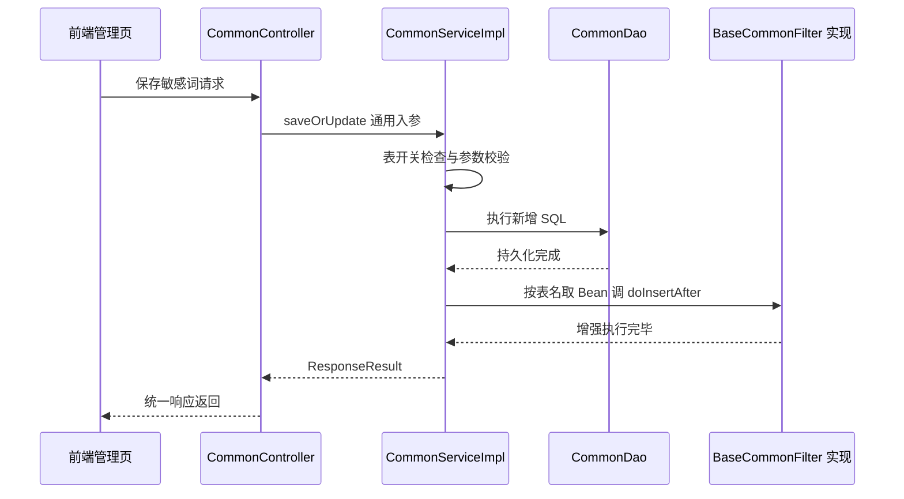

# BaseCommonFilter 后置增强：给通用流程留一个业务回流口

通用层把增删改查收编之后，新的矛盾立刻出现：敏感词新增之后要记审计日志，频道修改之后要刷缓存，这些动作因表而异。硬写进通用 Service，编排方法会变成按表名分支的大泥球；堵死扩展口子，大家就会绕开通用层各写各的。BaseCommonFilter 就是通用层留出来的那个口子：持久化完成之后，业务逻辑可以从这里回流。

## 先给结论

- BaseCommonFilter 是后置增强接口，四个方法对应四个动作的持久化之后：doListAfter、doInsertAfter、doUpdateAfter、doDeleteAfter。
- 方法签名统一两个参数：当前登录人 AdUser 与本次请求的 CommonDto，增强所需的上下文一次给足。
- 接口自带两个 default 方法 findUpdateValue 与 findWhereValue，按字段名从 sets、where 里取条件项，实现类直接调用。
- 挂载约定：实现类注册成 Bean，Bean 名用 CommonTableEnum 的名称；通用 Service 按表名取 Bean，没有实现就跳过。

## 为什么是接口，为什么只有后置

思路篇的八步流水线里，前置与后置各占一步：前置处理的结果可以影响程序是否继续执行，本课留作练习；后置处理的结果可以影响返回结果，落地成 BaseCommonFilter。做成接口的理由是扩展面不可预知：具体业务来了，按不同的表或不同的业务实现这个接口去增强，通用层一行不改。定义成类就不行，单继承会把实现名额占死。

包位置也有讲究：admin 的 service 按表分包之下再加一个 comfilter 包，增强器与业务实现类放在一起，找某个表的后置逻辑时不用全工程翻。落成代码是这样：

```java
package com.study.headline.admin.service.impl.comfilter;

import com.study.headline.model.admin.dtos.CommonDto;
import com.study.headline.model.admin.pojos.AdUser;

/**
 * 通用过滤器：持久化之后的后置增强
 * 实现类注册为 Spring Bean，Bean 名取对应表枚举名
 */
public interface BaseCommonFilter {

    /** 列表查询后置增强 */
    void doListAfter(AdUser user, CommonDto dto);

    /** 新增后置增强 */
    void doInsertAfter(AdUser user, CommonDto dto);

    /** 修改后置增强 */
    void doUpdateAfter(AdUser user, CommonDto dto);

    /** 删除后置增强 */
    void doDeleteAfter(AdUser user, CommonDto dto);
}
```

参数为什么是这两个：增强动作几乎都要两样东西，谁在操作，操作的是什么。登录人装在 AdUser 里，本次请求的完整参数装在 CommonDto 里，条件与修改字段都能从请求壳里翻出来。签名保持稳定，以后加新的增强不用改接口。

## 两个 default 方法：把公共查找抽进接口

写增强逻辑时有两个问题会反复出现：这次修改里某字段的新值是多少？这次请求的定位条件里某字段的值是多少？每个实现类都手写一遍循环，重复得毫无意义。JDK 8 起接口可以有 default 方法，公共实现直接写在接口里，实现类拿来就用：

```java
/**
 * 从修改字段集合里取某字段的值
 */
default CommonWhereDto findUpdateValue(String field, CommonDto dto) {
    if (dto != null) {
        for (CommonWhereDto cw : dto.getSets()) {
            if (field.equals(cw.getFiled())) {
                return cw;
            }
        }
    }
    return null;
}

/**
 * 从查询条件集合里取某字段的值，逻辑与上面一致
 */
default CommonWhereDto findWhereValue(String field, CommonDto dto) {
    if (dto != null) {
        for (CommonWhereDto cw : dto.getWhere()) {
            if (field.equals(cw.getFiled())) {
                return cw;
            }
        }
    }
    return null;
}
```

两个方法只差一个集合来源：findUpdateValue 遍历 sets，findWhereValue 遍历 where。把方法抽进接口而不抽进工具类，好处是实现类天然带着这层能力，语义上「增强器的公共行为」与增强器定义长在一起，不用额外 import 一套静态工具。找不到时返回 null，实现类必须判空。

## 挂载与执行顺序

挂载靠一条命名约定：实现类的 Bean 名与 CommonTableEnum 的枚举名相同。通用 Service 在持久化完成后，从请求壳的 name 里拿枚举名，去 Spring 容器按名取 BaseCommonFilter；取到就调用对应动作的后置方法，取不到说明这张表没有增强需求，直接走返回。整条链的时序如下：



这张时序图在讲后置增强在整条链里的位置：它排在持久化完成之后、统一响应封装之前。关键路径读法：增强拿不到上下文可以查请求壳，但拿不到数据库连接，它不负责再写库；增强执行完毕后由通用 Service 统一封壳返回，前端看到的仍是同一个响应结构。

一个实现示例，敏感词表新增之后记审计日志（示意，按本课写法补全）：

```java
package com.study.headline.admin.service.impl.comfilter;

import com.study.headline.model.admin.dtos.CommonDto;
import com.study.headline.model.admin.dtos.CommonWhereDto;
import com.study.headline.model.admin.pojos.AdUser;
import lombok.extern.slf4j.Slf4j;
import org.springframework.stereotype.Component;

/**
 * 敏感词表的后置增强：Bean 名与表枚举 AD_SENSITIVE 一致
 */
@Slf4j
@Component("AD_SENSITIVE")
public class AdSensitiveFilter implements BaseCommonFilter {

    @Override
    public void doInsertAfter(AdUser user, CommonDto dto) {
        // 取本次新增的敏感词内容，记录审计日志
        CommonWhereDto word = findUpdateValue("sensitives", dto);
        if (word != null) {
            log.info("用户 {} 新增敏感词：{}", user.getId(), word.getValue());
        }
    }

    /** 其余三个动作暂无增强需求，留空即可 */
    @Override
    public void doListAfter(AdUser user, CommonDto dto) { }

    @Override
    public void doUpdateAfter(AdUser user, CommonDto dto) { }

    @Override
    public void doDeleteAfter(AdUser user, CommonDto dto) { }
}
```

这份实现的看点有三个：Bean 名就是表枚举名，容器里按名可寻；只增强新增一个动作，其余留空；取值用接口自带的 findUpdateValue，实现类里没有一行重复的循环代码。

## 常见误区

- **Bean 名随手起。** 约定是 Bean 名等于表枚举名，起个自定义名字通用 Service 就找不到，增强静默失效，而且不报错，只能靠日志发现。
- **在增强里另造响应结构。** 后置结果可以影响返回结果，但响应壳仍由通用 Service 统一封装；增强只提供数据或标记，自己 return 一个新结构会把统一响应口径打破。
- **不判空直接用返回值。** findUpdateValue 与 findWhereValue 找不到就返回 null，空指针是这套钩子里最常见的翻车点。
- **把主业务塞进增强。** 增强做持久化之后的补充动作；核心校验与写库仍在流水线主体，排查问题时先看主链再看钩子，顺序反了会绕远路。

## 面试可能被问到的问题

1. 面试官追问：「后置增强为什么用接口加 Bean 名约定，而不是把回调作为参数传进来？」
   答：回调参数要求每个调用点显式传递，通用 Service 的编排会被业务细节污染。Bean 名约定让增强以配置的姿态存在于容器，表与增强解耦，新增增强不改通用层代码，没有增强的表也不产生任何成本。
2. 面试官追问：「接口 default 方法在这里解决了什么问题？」
   答：接口可以带默认实现，按字段名取条件项这类公共逻辑直接写在接口里，实现类继承使用；既避免了每个实现类复制循环，也不占用类的单继承名额，公共行为与增强器定义长在一起。
3. 面试官追问：「前置增强与后置增强的区别是什么？」
   答：时机与能力都不同。前置发生在持久化之前，结果可以影响程序是否继续执行，相当于闸门；后置发生在持久化之后，结果可以影响返回结果，相当于补充。请求被拒绝只能发生在前置一侧，后置只能改写返回。
4. 面试官追问：「后置增强里抛异常会怎样？」
   答：增强在通用 Service 的编排内执行，异常会打断正常返回流程，最终由全局异常处理器翻译成统一响应。正确姿势是增强内部捕获可预期的失败自行降级，让增强失败不至于放大成接口故障。
5. 面试官追问：「这套钩子机制与 Spring AOP 有什么区别？」
   答：AOP 按切点表达式隐式织入，业务代码看不到拦截发生在哪，灵活性高但可读性差；这套钩子按表显式登记，Bean 名即配置，粒度是表加动作。管理后台的增强需求恰好按表分布，显式约定比切面更直观。

## 配套资料

- 代码：`materials/code/05/头条day06/`。该日资料包解压结果为空（未含源码文件），文中接口方法签名与 default 方法实现按画面线课件抄录整理（修正了画面转写里的参数名笔误），包名统一改写为 `com.study.headline`；实现类示例按本课写法补全；引用路径截至 `头条dayNN/` 层级，内层目录冠以项目原名，正文统一以「头条类资讯项目」指代。
- 代码：`materials/code/05/头条day01/`，内层资料目录含数据库规范设计说明书与项目原型，可对照敏感词表字段与后台管理页面。
