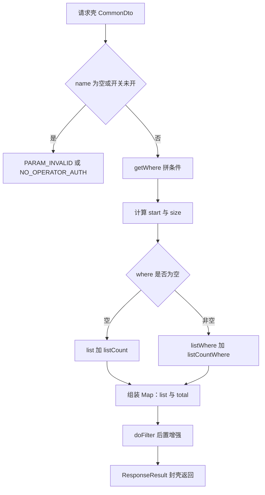
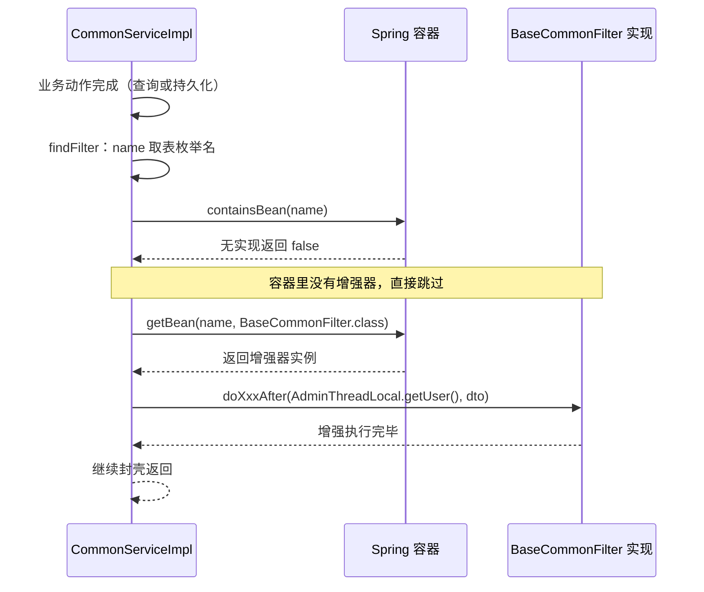
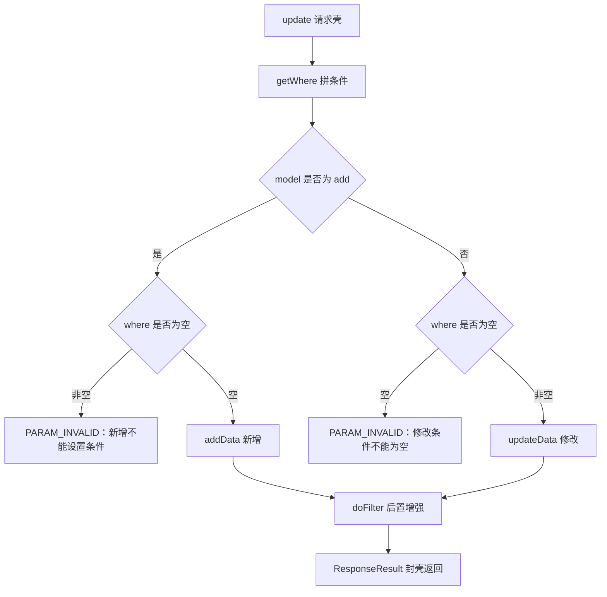

# 后端通用封装之通用 Service：查询编排、后置增强与写操作三件套

## 先给结论

- CommonDao 把 SQL 模板收进接口之后，拆请求壳、看表开关、拼条件、算分页这些活全落在 CommonService：它只写一次，之后每一张表、每一个管理页的增删改查都从这里过。
- 通用 Service 接口只有三个方法：list 查询、update 新增与修改合一、delete 删除；新增与修改由请求壳里的 model 字段区分动作。
- list 的编排骨架五步走：参数与权限校验、getWhere 拼条件、算分页起点、按 where 是否为空路由 DAO、组装 list 与 total 返回并触发后置增强。
- getWhere 是防注入的第一现场：字段与值先过 parseValue 过滤敏感字符，再做字段名校验，最后按 eq、like、between 拼成 and 开头的片段。
- 分页起点 start 算出负数一律归零；统计与列表必须用同一份 where，否则总数对不上当页数据。
- doFilter 是所有方法的公共收尾：按表枚举名去 Spring 容器找 BaseCommonFilter 实现，Bean 名与枚举名逐字一致就是唯一的接线，按 list、insert、update、delete 四个动作分发后置方法，空容器原样跳过。
- 写操作性格更严：update 总闸两条校验方向相反（新增绝不允许 where，修改必须有 where），getInsertSql 与 getSets 出现空值整体拒绝，删除靠条件非空校验加模板尾部 limit 1 锁死误删半径。
- 三个写动作成功后同样走 doFilter，与查询共用一套分发逻辑，事务与增强在写链上串联。

## 第1部分：后端通用封装-通用service-接口定义

CommonDao 把 SQL 模板收进一个接口之后，新问题立刻顶到台前：请求壳 CommonDto 谁来拆？表开关谁来看？条件集合谁拼成 and 片段？分页参数谁来算？这些活全落在 CommonService 一层。这一层是整个通用封装的核心：它只写一次，之后每一张表、每一个管理页的增删改查都从这里过。查询是其中最典型的一条链，把它的接口定义与实现拆透，新增、修改、删除不过是同一条骨架的变体。

判断这层写得好不好，有个很朴素的标尺：再接入一张新表时，这层代码应不应该动一行。答案是不应该，表名、条件、动作全部来自请求壳，Service 只是按壳编排。要守住这条标尺，就得把每个环节的归属想清楚，接口怎么定义、校验怎么排、条件怎么拼、结果怎么装，每个环节都有它的唯一归属地。

### 接口定义：为什么只有三个方法

接口的形状是整条链的骨架，先把它钉死。三个方法，入参全是请求壳 CommonDto，返回统一是 ResponseResult：

```java
package com.study.headline.admin.service;

import com.study.headline.model.admin.dtos.CommonDto;
import com.study.headline.model.common.dtos.ResponseResult;

/**
 * 通用 Service：三个核心方法覆盖增删改查
 */
public interface CommonService {

    /**
     * 通用列表查询
     * 覆盖四种形态：无条件查询、无条件统计、有条件查询、有条件统计
     */
    ResponseResult list(CommonDto dto);

    /**
     * 通用新增与修改
     * 通过 dto.getModel() 区分动作：add 走新增，其余走修改
     */
    ResponseResult update(CommonDto dto);

    /**
     * 通用删除
     */
    ResponseResult delete(CommonDto dto);
}
```

三个方法各有一个值得多想一层的理由。list 一个方法顶四个 DAO 调用形态，前端要么查列表要么查统计，参数怎么传由壳里的 where、page、size 决定，接口面不需要裂变。update 承担新增与修改两个动作，是因为两者的入参结构几乎一致：sets 给字段新值，修改多一个 where 做定位条件，model 一个标记就能分流，没必要为省一个 where 条件把接口拆成两个。delete 单独一个方法，是因为它是这三个动作里破坏半径最大的，必须独立校验、独立设防。

实现类先搭空壳，把依赖注入进去。CommonDao 是干活的，ApplicationContext 是后置增强要用的容器句柄，先埋在这里：

```java
package com.study.headline.admin.service.impl;

import com.study.headline.admin.dao.CommonDao;
import com.study.headline.model.admin.dtos.CommonDto;
import com.study.headline.model.common.dtos.ResponseResult;
import com.study.headline.model.common.enums.AppHttpCodeEnum;
import org.apache.commons.lang3.StringUtils;
import org.springframework.beans.factory.annotation.Autowired;
import org.springframework.context.ApplicationContext;
import org.springframework.stereotype.Service;
import java.util.HashMap;
import java.util.Map;

/**
 * 通用 Service 实现：请求壳的拆解、校验、拼装全部在这里
 */
@Service
public class CommonServiceImpl implements CommonService {

    @Autowired
    private CommonDao commonDao;

    @Autowired
    private ApplicationContext context;

    @Override
    public ResponseResult list(CommonDto dto) {
        return null;
    }

    @Override
    public ResponseResult update(CommonDto dto) {
        return null;
    }

    @Override
    public ResponseResult delete(CommonDto dto) {
        return null;
    }
}
```

三个公开方法之外，实现类还挂着一组私有辅助方法，课件里给它们列过分工，这套分工就是后文逐节展开的目录：

| 辅助方法 | 职责 |
|---|---|
| parseValue | 过滤注入关键字符，字段名与值拼进 SQL 前都要过一遍 |
| getWhere | 把 where 集合拼成以 and 开头的条件子句，支持 eq、like、between |
| getSets | 把 sets 集合拼成 set 子句内容，供修改使用 |
| getInsertSql | 拼出 insert 的字段串与值串，供新增使用 |
| doFilter | 按表名查找 BaseCommonFilter 实现并调用对应的后置方法 |

公开方法的职责边界在课件里同样钉死了：list 负责权限判断、分页计算、条件获取、列表与总条数获取，最后调用后置处理；update 通过 model 判断新增还是修改，检查必要参数后分流到 addData 或 updateData；delete 必须有查询条件，删除成功之后执行 doFilter。私有方法管拼装，公开方法管编排，谁也不越界。

入参与出参还有两条隐性铁律。入参只有 CommonDto 一个类型，往后接口要加参数，加的是壳里的字段而不是方法签名，接口永远不改形，所有调用方零感知。出参只有 ResponseResult，成功也好、权限不足也好、参数非法也好，全部走同一个壳，错误码由 AppHttpCodeEnum 统一编号。这两条约定看似平淡，却是通用层能被前端当成「一个接口」来封装的前提：请求构造器只学一种，响应解析器只写一份。

### list 的编排骨架：五步一条链

```java
@Override
public ResponseResult list(CommonDto dto) {
    // 1. 参数校验：目标表必须指定
    if (dto == null || dto.getName() == null) {
        return ResponseResult.errorResult(AppHttpCodeEnum.PARAM_INVALID);
    }
    // 2. 权限校验：表枚举的查询开关必须打开
    if (!dto.getName().getQuery()) {
        return ResponseResult.errorResult(AppHttpCodeEnum.NO_OPERATOR_AUTH);
    }
    // 3. 拼条件、取表名：枚举常量名转小写即表名
    String where = getWhere(dto);
    String tableName = dto.getName().name().toLowerCase();
    // 4. 计算分页起点：page 从 1 起，start 为负归零
    int page = dto.getPage() == null ? 1 : dto.getPage();
    int size = dto.getSize() == null ? 10 : dto.getSize();
    int start = (page - 1) * size;
    if (start < 0) {
        start = 0;
    }
    // 5. 按是否有条件路由，列表与统计用同一份 where
    List<?> list = null;
    int total = 0;
    if (StringUtils.isEmpty(where)) {
        list = commonDao.list(tableName, start, size);
        total = commonDao.listCount(tableName);
    } else {
        list = commonDao.listWhere(tableName, where, start, size);
        total = commonDao.listCountWhere(tableName, where);
    }
    Map<String, Object> map = new HashMap<>();
    map.put("list", list);
    map.put("total", total);
    // 6. 后置增强：按 list 动作触发，返回前统一调用
    doFilter(dto, "list");
    return ResponseResult.okResult(map);
}
```

这段代码有两个设计点值得逐条说透。

**第一，表枚举既是白名单又是权限表。** name 为空是参数问题，返回 PARAM_INVALID；name 合法但查询开关没开，是权限问题，返回 NO_OPERATOR_AUTH。两道闸一前一后，请求还没碰到 DAO 就先被筛掉。反序列化阶段 CommonTableEnum 已经把非法表名拒之门外，走到这里的 name 必然是登记过的表，再看开关决定这张表是否开放查询。文章表只开查询、文章配置只开查询与修改，这些差异全靠枚举里那几个布尔，Service 一行不改。

**第二，统计与列表必须共享同一份 where。** 分页组件的总页数由 total 算出，当页数据由 list 拿到，两者必须描述同一个数据集。total 用无条件统计而 list 带条件，前端会看到「共 200 条、当前页只有 3 条」这种自相矛盾的分页。同条件还有一层含义：getWhere 只执行一次，拼出来的 where 串同时喂给两个 DAO 方法，连过滤结果都保证一致。

分页起点的计算也有边界要处理：page 从 1 起算，start = (page - 1) * size；前端传 0 或负数时，start 会算出负值，MySQL 的 limit 负数直接报语法错，所以归零兜底。size 不传给默认值，避免 limit 里出现 null 拆箱的空指针。



这张图在讲 list 从入参到返回的完整编排：两道校验闸在最前面，条件与分页居中，按条件有无分流到两对 DAO 方法，最后组装、增强、封壳。关键路径读法：所有分支最终汇到同一个出口，ResponseResult 的壳永远一致；增强动作插在组装之后、封壳之前，查询结果已经成形，增强器只做补充不做改写。

有条件与无条件分成两条路径，而不是让空 where 直接走有条件模板，这个取舍值得说一句。DAO 的条件模板以 `where 1=1` 开头，where 片段为空时拼进去确实无害，语法照样成立，一条 listWhere 理论上能同时服务两种形态。但把路由保留下来有实际的好处：无条件查询的 SQL 更短、执行计划更干净，统计方法也不用背一个多余的恒真条件；更重要的是语义清晰，排查问题时看请求走了哪个方法，立刻知道这次查询带没带条件，日志里不用猜。极致的省与清晰的账，这里选了清晰。

四类查询形态与前端参数、DAO 方法的对应关系，一张表看完：

| 查询形态 | 前端传法 | 走的 DAO 方法 |
|---|---|---|
| 无条件分页查询 | 只传 name、page、size | list + listCount |
| 无条件统计 | 传 name，size 给一个较大值取 total | listCount |
| 有条件分页查询 | name、page、size 加 where 数组 | listWhere + listCountWhere |
| 有条件统计 | 传 name 与 where，不看列表只取 total | listCountWhere |

表里所有形态共用一个 list 方法，路由逻辑全部长在 Service 内部。对前端来说这只有一个好处但足够致命：请求工具学一次，四张管理页的列表与统计全都通了。

### getWhere：条件拼装与防注入的第一现场

where 片段最终会被 `${}` 直接拼进 SQL，这里就是整条链最危险的关口，校验密度也最高：

```java
/**
 * 拼接查询条件：每个片段以 and 开头，模板用 where 1=1 接住
 */
private String getWhere(CommonDto dto) {
    StringBuffer where = new StringBuffer();
    if (dto.getWhere() == null) {
        return null;
    }
    dto.getWhere().stream().forEach(w -> {
        // 字段与值都不能为空
        if (StringUtils.isNotBlank(w.getFiled()) && StringUtils.isNotBlank(w.getValue())) {
            String tmpf = parseValue(w.getFiled());
            String tmpv = parseValue(w.getValue());
            // 两道朴素校验：字段名不能是纯数字，也不能与值相同
            if (!tmpf.matches("[0-9]+") && !tmpf.equals(tmpv)) {
                if ("like".equals(w.getType())) {
                    // 模糊：like '%值%'
                    where.append(" and ").append(tmpf)
                         .append(" like '%").append(tmpv).append("%'");
                } else if ("between".equals(w.getType())) {
                    // 范围：值用逗号分隔，between 值1 and 值2
                    String[] tmp = tmpv.split(",");
                    where.append(" and ").append(tmpf)
                         .append(" between ").append(tmp[0])
                         .append(" and ").append(tmp[1]);
                } else {
                    // 默认 eq：等于 '值'
                    where.append(" and ").append(tmpf)
                         .append(" = '").append(tmpv).append("'");
                }
            }
        }
    });
    return where.toString();
}

/**
 * 过滤 SQL 注入的关键字符：引号、百分号、分号、注释符、星号全部替换为空
 */
private String parseValue(String value) {
    if (StringUtils.isNotEmpty(value)) {
        return value.replaceAll("('|%|;|--|\\*)", "");
    }
    return null;
}
```

这段代码的防线有三层，一层比一层深。**第一层是完备性校验**：字段与值任一为空，这个条件直接丢弃，空串拼进 SQL 就是语法错误。**第二层是字符过滤**：parseValue 把单引号、百分号、分号、双连字符、星号全部剥掉。单引号能闭合字符串逃逸出新的 SQL 子句，百分号能撑开 like 的通配范围，双连字符能把后面的条件注释掉，这四类字符一没，最常见的注入姿势就全部失效。**第三层是字段名交叉校验**：字段名不能是纯数字，不能与值相同，拦的是「字段位置传了奇怪东西」这类更隐蔽的输入。三层合起来不算完美，工程上更稳的做法还有字段名白名单正则，比如只放行 `[a-zA-Z0-9_]+`，但纵深防御的思路是一致的：凡是要被 `${}` 拼进 SQL 的字符，必须先证明自己干净。

三种 type 的拼法各有讲究。eq 是默认分支，值包单引号；like 两侧补百分号，做成两端模糊；between 约定值里用逗号分隔上下界，比如 `1000,2000`，拆开拼成 `between 1000 and 2000`，两个界值不包引号，按数字处理。这也意味着 between 的值必须是数字区间，传字符串会拼坏 SQL，前端约定要写清楚。三种方式的前后端约定集中列出来看：

| type | 前端传值 | 拼出的片段 | 典型场景 |
|---|---|---|---|
| eq | 普通字符串 | and name = '音乐' | 状态、类型这类精确匹配 |
| like | 普通字符串 | and name like '%音乐%' | 名称搜索，两端模糊 |
| between | 逗号分隔两值 | and created_time between 1 and 2 | 数字或日期区间 |

拼装用的容器是 StringBuffer 而不是 StringBuilder，单次请求里这段代码跑在单线程，StringBuilder 本已够用，选 StringBuffer 更像团队防并发条件拼接的习惯性保守。lambda 里对 where 的追加是闭包捕获，变量 effectively final 指向的引用没变，追加内容合法；要是想在 lambda 里给局部变量重新赋值，编译器当场就拦，这也是查询方法里计数类逻辑出现在写操作方法、而条件拼装只管拼的原因之一。

一个真实的请求落到这里的轨迹是这样的。前端传：

```json
{
  "name": "AD_CHANNEL",
  "page": 2,
  "size": 10,
  "where": [
    { "filed": "name", "type": "like", "value": "音乐" }
  ]
}
```

getWhere 拼出 ` and name like '%音乐%'`，分页算出 start = 10，最终进 DAO 的 SQL 就是 `select * from ad_channel where 1=1 and name like '%音乐%' limit 10,10`，同时 total 走 `select count(*) from ad_channel where 1=1 and name like '%音乐%'`。字段名那个历史笔误 filed 在前端、DTO、Service 三处拼写一致，链路照常运转。

换成区间查询，推演过程一样成立。前端在 where 数组里传 `{ "filed": "price", "type": "between", "value": "1000,2000" }`，parseValue 原样放行数字与逗号，getWhere 拆开逗号拼出 ` and price between 1000 and 2000`，价格落在指定区间的行被筛出来。两个条件同时传时，片段按数组顺序依次追加，` and name like '%音乐%' and price between 1000 and 2000`，and 连接词由片段自带，顺序与个数都不影响语法。多条件的组合能力全部来自这个看似朴素的追加循环，前端只需要会往数组里塞三件套。

### 结果映射与返回组装

DAO 的查询方法返回 `List<HashMap>`，一行数据落成一个 Map，列名是 key。MyBatis 拿到 `@ResultType(HashMap.class)` 后按 JDBC 结果集逐列反射填充，不需要任何实体类参与，这就是通用层敢对接任意表的底气：列结构在运行期才揭晓，映射规则退化为「列名即 key」。代价同样明显，取值方拿到的是字符串 key 的 Map，字段拼错要等页面渲染才发现，所以通用查询的对接前端通常就是按列名渲染的表格组件。

这套映射的细节也值得一提。反射填充按结果集元数据拿列名，数据库列名多为小写下划线风格，Map 的 key 就原样保留，前端表格的列配置直接抄数据库字段即可，中间没有驼峰转换这一步；数字列映射成对应包装类型，日期列映射成时间对象或按序列化配置转字符串，列类型完全由数据库说了算。行的容器选 HashMap 而非更窄的泛型声明，是因为注解方式下返回泛型参数在运行期拿不到足够信息，`List<HashMap>` 是这套方案里最省事也最诚实的形状。

返回组装只做一件事：list 与 total 两键装进 Map，交给 ResponseResult.okResult 封壳。前端拿到的结构永远是 code、message、data 三段式，data 里 list 是数组、total 是数字，所有表的通用查询共用这一种返回形状，前端封装一次请求工具就能吃遍所有管理页。`doFilter(dto, "list")` 在返回前被调用，此刻查询已完成、结果已成形，后置增强器拿到的上下文是完整的请求壳，它能做什么、怎么做，留给下一节的 findFilter 与 Bean 名约定。

## 第2部分：后端通用封装-通用service-后处理bean的封装

list、update、delete 三个方法的返回语句前面都挂着同一个调用：doFilter。查询完要记审计日志、新增完要刷缓存、删除完要通知下游，这些因表而异的补充动作不能写死在通用编排里，于是全部汇到这一个调用点。BaseCommonFilter 接口与 Bean 名约定在前文已经立好，这一节把装配这半边填实：增强器从哪里找，找到之后怎么按动作分发。

### 从容器里按名取增强器

增强器是普通的 Spring Bean，查找路径就是容器 API：

```java
/**
 * 按表枚举名查找对应的后置增强器
 * Bean 名约定：实现类的 Bean 名与 CommonTableEnum 枚举名一致
 */
private BaseCommonFilter findFilter(CommonDto dto) {
    String name = dto.getName().name();
    if (context.containsBean(name)) {
        return context.getBean(name, BaseCommonFilter.class);
    }
    return null;
}
```

三行代码各干一件事。name 从请求壳的表枚举上取，枚举常量名本身就是查找键；containsBean 先探一探容器里有没有同名的 BaseCommonFilter 实现，没有就直接返回 null，这条表没有增强需求；有则 getBean 按名按类型取实例，类型参数把取错 Bean 的风险拦在了启动语义之外。注入的 context 是 ApplicationContext，CommonServiceImpl 构造时就把这个容器句柄注入好了，这正是当初埋下它的原因。

这套查找没有动用 BeanPostProcessor 或 @Bean 工厂之类的重机制。逐个注入 `Map<String, BaseCommonFilter>` 也能拿到全量增强器再按 key 挑，功能等价，但 containsBean 与 getBean 的组合把「有没有」和「拿哪一个」两件事用最直白的语义表达了，读代码的人不需要理解 Map 注入的装配规则。通用封装的原则是机制越轻越好，能一句容器 API 说清的，不引入新概念。

### 按动作分发：一个入口四个分支

findFilter 解决「找谁」，doFilter 解决「调它的哪个方法」：

```java
/**
 * 后置增强分发：name 为动作标记 list insert update delete
 */
private void doFilter(CommonDto dto, String name) {
    BaseCommonFilter filter = findFilter(dto);
    if (filter != null) {
        // 登录人上下文：增强器统一签名的前一个参数
        AdUser user = AdminThreadLocal.getUser();
        if ("insert".equals(name)) {
            filter.doInsertAfter(user, dto);
        }
        if ("update".equals(name)) {
            filter.doUpdateAfter(user, dto);
        }
        if ("list".equals(name)) {
            filter.doListAfter(user, dto);
        }
        if ("delete".equals(name)) {
            filter.doDeleteAfter(user, dto);
        }
    }
}
```

分发逻辑刻意写成四个平铺的 if 而不是 switch 或策略 Map，因为动作集合已经被接口的四个方法钉死，扩展面为零，平铺最直观。动作标记由调用方传入：list 方法末尾传 `"list"`，新增成功后传 `"insert"`，修改与删除同理。字符串常量分布在各调用点，拼写错了分发就不进分支，这是后文误区清单里的常客。

整条链的执行时序如下：



这张时序图在讲 doFilter 被触达之后的完整路径：查容器、按名取实例、带上下文调用。关键路径读法：增强器的查找发生在业务动作完成之后，它拿到的请求壳与登录人都是动作发生时的现场；容器里查无此名时链路在 containsBean 处提前收敛，主流程连方法都不会少调一行。

### 约定即配置：Bean 名就是唯一的接线

这套装配里没有 XML、没有注解开关、没有注册中心，唯一的接线方式就是 Bean 名。敏感词表要记审计日志，就写一个实现类，注册时把 Bean 名起成 AD_SENSITIVE：

```java
@Component("AD_SENSITIVE")
public class AdSensitiveFilter implements BaseCommonFilter {

    @Override
    public void doInsertAfter(AdUser user, CommonDto dto) {
        // 敏感词新增后的补充动作
    }

    @Override
    public void doListAfter(AdUser user, CommonDto dto) { }

    @Override
    public void doUpdateAfter(AdUser user, CommonDto dto) { }

    @Override
    public void doDeleteAfter(AdUser user, CommonDto dto) { }
}
```

通用 Service 的代码里找不到任何一张具体表的名字，表与增强器的对应关系完全活在 Bean 名里。要给频道表加增强，注册一个名为 AD_CHANNEL 的实现；要撤掉敏感词的增强，删掉实现类或者改掉 Bean 名，通用层始终一行不改。查找键 name = dto.getName().name() 与注册键 Bean 名共用同一份枚举常量，拼写天然对齐，只要注册时别手滑另起炉灶。

### 空容器时的行为：先装开关后接电器

落地次序上，doFilter 先写好、实现类后补，是完全正常的推进节奏。当前阶段容器里一个 BaseCommonFilter 实现都没有，每次请求走到 doFilter，containsBean 返回 false，findFilter 返回 null，分发直接跳过，接口行为与没有这段代码时完全一致。通用层先把钩子位置留出来并保证空钩子无害，业务增强按需再挂，这正是后置增强设计里「口子常开、不接不响」的含义。反过来说，也因为没有实现类时报错都静默，验证增强是否生效只能靠日志或实际业务效果，写完实现类记得跑一遍真实请求。

## 第3部分：后端通用封装-通用service-新增方法

查询拼错了顶多查不到数据，写操作拼错了就是脏数据甚至丢数据。通用 Service 的写半边因此长成另一种性格：校验更密、方向更严、语义钉得更死。对外它仍然只有三个方法里的两个入口，update 一个方法通过 model 分流新增与修改，delete 单独设防，三个动作共用 getWhere、parseValue 与 doFilter，差异全部压缩在「往 SQL 模板的哪个坑里拼什么」这一件事上。把这三个动作的代码与约束看透，通用封装的持久化半边就齐了，剩下的 controller 转发与整体测试只是把这条链接到 HTTP。

### update 总闸：一个方法两条相反的校验

```java
@Override
public ResponseResult update(CommonDto dto) {
    String model = dto.getModel();
    // 条件只拼一次，两个分支共用
    String where = getWhere(dto);
    String tableName = dto.getName().name().toLowerCase();
    if ("add".equals(model)) {
        // 新增：绝不允许携带定位条件
        if (StringUtils.isNotBlank(where)) {
            return ResponseResult.errorResult(AppHttpCodeEnum.PARAM_INVALID, "新增数据不能设置条件");
        }
        return addData(dto, tableName);
    } else {
        // 修改：必须携带定位条件，否则就是全表更新
        if (StringUtils.isBlank(where)) {
            return ResponseResult.errorResult(AppHttpCodeEnum.PARAM_INVALID, "修改条件不能为空");
        }
        return updateData(dto, tableName, where);
    }
}
```

同一个 where 串，在两个分支里校验方向完全相反，这不是笔误而是两条业务铁律。新增请求里出现 where，说明前端把修改的参数结构错套在了新增上，insert 模板里根本没有 where 的位置，硬拼只会产出语法错误的 SQL，直接拒绝并提示。修改请求里没有 where 才是真危险：DAO 的修改模板是 `where 1=1 ${where}`，空片段拼进去语法完全成立，执行的却是无定位的全表更新，管理后台里这种请求一旦放过，一整张表的数据瞬间被同一个值刷掉。校验宁可挡住正常请求让前端改参数，也不能放过一次全表更新。

model 的分流语义也顺带钉牢：add 是新增的专属标记，edit、update 之类其余动作标记一律进修改分支。分流用 `"add".equals(model)` 的常量前置写法，model 为 null 也不空指针。getWhere 在总闸里只执行一次，条件拼装与过滤的产出两个分支共享，校验密度不因分流而打折。



这张图在讲 update 方法内部的分流结构：条件先拼好，动作标记决定走哪条分支，两条分支各自带着方向相反的条件校验，汇合点在后置增强与统一封壳。关键路径读法：无论新增还是修改，权限校验都压在分支内部的子方法里，总闸只管动作与条件的关系。

### 新增：getInsertSql 的整行语义

新增子方法先过权限闸，再拼参数，最后落库与增强：

```java
/**
 * 新增一条数据
 */
private ResponseResult addData(CommonDto dto, String tableName) {
    // 权限：表枚举的新增开关
    if (!dto.getName().getInsert()) {
        return ResponseResult.errorResult(AppHttpCodeEnum.NO_OPERATOR_AUTH);
    }
    String[] sql = getInsertSql(dto);
    // 有空值时拼装放弃，返回 null
    if (sql == null) {
        return ResponseResult.errorResult(AppHttpCodeEnum.PARAM_INVALID, "传入的参数不能为空");
    }
    int temp = commonDao.insert(tableName, sql[0], sql[1]);
    if (temp > 0) {
        doFilter(dto, "insert");
    }
    return ResponseResult.okResult(temp);
}
```

拼装的重头在 getInsertSql，它一次产出两段内容，字段串与值串：

```java
/**
 * 拼 insert 的字段串与值串，返回 [fields, values]
 * 任一字段或值为空则返回 null，整次新增放弃
 */
private String[] getInsertSql(CommonDto dto) {
    StringBuffer fields = new StringBuffer();
    StringBuffer values = new StringBuffer();
    AtomicInteger count = new AtomicInteger();
    if (dto.getSets() != null) {
        dto.getSets().stream().forEach(w -> {
            if (StringUtils.isBlank(w.getValue())) {
                // 空值计数：新增不允许任何字段缺值
                count.incrementAndGet();
            } else {
                String tmpf = parseValue(w.getFiled());
                String tmpv = parseValue(w.getValue());
                if (!tmpf.matches("[0-9]+") && !tmpf.equals(tmpv)) {
                    // 多字段时用逗号分隔，第一个字段前不加
                    if (fields.length() > 0) {
                        fields.append(",");
                        values.append(",");
                    }
                    fields.append(tmpf);
                    values.append("'").append(tmpv).append("'");
                }
            }
        });
    }
    if (count.get() > 0) {
        return null;
    }
    return new String[]{fields.toString(), values.toString()};
}
```

这段拼装有四个设计点值得逐条琢磨。

**第一，fields 与 values 必须同步推进。** insert 模板是 `insert into ${tableName} (${fields}) values (${values})`，两段内容按同一份 sets 清单顺序生成，第 i 个字段对应第 i 个值，错一位数据就插进别的列。逗号的添加条件是 `fields.length() > 0`，第一个字段前不加，之后每个字段与值各补一个逗号，两个缓冲区的逗号节奏严格一致。

**第二，空值按整行语义处理。** 新增是整行写入，缺一个字段的值就是一条不完整的数据，与其猜前端是忘了传还是想插空值，不如整体拒绝。这里的计数器把所有空值项记下，循环结束只要有计数，getInsertSql 返回 null，addData 转成参数非法错误。与主流 ORM「跳过 null 字段」的部分更新语义相比，这套实现选择了更保守的整行语义，理由在通用层无法区分「不修改」与「明确存空」，保守是唯一安全解。

**第三，lambda 里为什么用 AtomicInteger。** stream 的 forEach 是 lambda，lambda 捕获的局部变量必须 effectively final，普通 int 计数在循环里自增编译不过。AtomicInteger 的引用不变、内容可变，编译合法，顺带把并发安全也送了；在这里它是「让 lambda 能计数」的最顺手解。

**第四，值统一包单引号。** 每个值两侧补单引号，文本与数字都能被 MySQL 接受；值本身已经过了 parseValue，单引号在拼装前就被剥掉，不会再出现引号闭合逃逸。字段名与值的交叉校验和 getWhere 完全同一套，防注入纵深不因写操作而放松。

还有一个隐性问题值得交代：前端没传的字段去哪了。这套拼装是「传什么拼什么」，sets 里没出现的字段不会出现在 insert 的字段清单里，这类列的取值交给数据库，表结构里定义了 DEFAULT 的列由数据库按默认值填充，定义了 `CURRENT_TIMESTAMP` 的时间列由数据库在写入瞬间盖时间戳。通用层刻意不代填创建时间、创建人之类字段，要保持拼装层纯粹，默认值的归属在表结构与调用方两侧，谁都不在中间夹一层魔法。想让每条数据都带上操作人，正确的位置是 BaseCommonFilter 的后置增强或数据库触发器，而不是往 getInsertSql 里塞隐式参数。

一条新增请求落到 SQL 的完整轨迹。前端传：

```json
{
  "name": "AD_SENSITIVE",
  "model": "add",
  "sets": [
    { "filed": "sensitives", "type": "eq", "value": "赌博" }
  ]
}
```

getInsertSql 产出 `sensitives` 与 `'赌博'` 两串，DAO 模板拼成 `insert into ad_sensitive (sensitives) values ('赌博')`，受影响行数为 1，随后 doFilter 以 insert 标记分发，敏感词表的增强器在这里记下审计日志，最后 ResponseResult 携带 1 返回。频道表新增一个「音乐」频道的请求，除了表枚举换成 AD_CHANNEL、字段换成 name，其余路径逐字节相同。

### 修改：getSets 与定位条件的配合

修改的拼装与新增是同一个循环的另一种产出，字段与值合写成一个片段：

```java
/**
 * 修改数据：where 已在总闸校验过非空
 */
private ResponseResult updateData(CommonDto dto, String tableName, String where) {
    // 权限：表枚举的修改开关
    if (!dto.getName().getUpdate()) {
        return ResponseResult.errorResult(AppHttpCodeEnum.NO_OPERATOR_AUTH);
    }
    String sets = getSets(dto);
    if (StringUtils.isEmpty(sets)) {
        return ResponseResult.errorResult(AppHttpCodeEnum.PARAM_INVALID, "修改的参数值不能为空");
    }
    int temp = commonDao.update(tableName, where, sets);
    if (temp > 0) {
        doFilter(dto, "update");
    }
    return ResponseResult.okResult(temp);
}

/**
 * 拼 set 子句内容：字段 = '值'，逗号分隔；有空值返回 null
 */
private String getSets(CommonDto dto) {
    StringBuffer sets = new StringBuffer();
    AtomicInteger count = new AtomicInteger();
    if (dto.getSets() != null) {
        dto.getSets().stream().forEach(w -> {
            if (StringUtils.isBlank(w.getValue())) {
                count.incrementAndGet();
            } else {
                String tmpf = parseValue(w.getFiled());
                String tmpv = parseValue(w.getValue());
                if (!tmpf.matches("[0-9]+") && !tmpf.equals(tmpv)) {
                    if (sets.length() > 0) {
                        sets.append(",");
                    }
                    sets.append(tmpf).append(" = '").append(tmpv).append("'");
                }
            }
        });
    }
    if (count.get() > 0) {
        return null;
    }
    return sets.toString();
}
```

getSets 与 getInsertSql 的骨架完全一致，差别只在拼法：新增把字段与值拆进两个缓冲区，修改合写成一个「字段 = '值'」片段，逗号连接，正好填进 DAO 模板 `update ${tableName} set ${sets} where 1=1 ${where}` 的 set 坑位。空值同样是计数后整体拒绝，修改请求里出现空值项，说明前端不知道这个字段该改成什么，让用户补全比替他猜测安全。

拿主流 ORM 的写法对照一下，「跳过 null 字段」在 MyBatis-Plus 里对应 updateById 的部分更新策略，实体里为 null 的属性不出现在 set 子句，框架默认就是这套行为。这套通用封装没有沿用，原因在参数形态：实体是编译期类型，null 与默认值在字段层面有类型系统托底，通用层拿到的是字符串值，空串、null、没传三种状态在 JSON 里难以可靠区分，与其让模糊状态溜进 set 子句，不如一刀切拒绝。两种选择没有绝对对错，配套的参数约定不同而已，用这套通用接口的前端必须整表提交，不能只传改动项。

修改的定位责任在 where，前端约定按主键传：where 数组里放 `{ "filed": "id", "type": "eq", "value": "3" }`。总闸已经保证 where 非空，但非空不等于精确，如果前端不按 id 传而按某个非唯一字段传，一次修改会波及多行。DAO 模板没有为修改加 limit，MySQL 的 update 加 limit 也确实合法，这里没加是课程的选择；工程上给通用修改的调用约定里写死「where 必须含主键等值条件」，或者在总闸加一条校验，都是值得的加固。

一次修改请求的轨迹。前端传 name 为 AD_CHANNEL、model 为 edit，where 带 `id = 3`，sets 带 `{ "filed": "name", "type": "eq", "value": "音乐频道" }`，getSets 拼出 `name = '音乐频道'`，DAO 拼成 `update ad_channel set name = '音乐频道' where 1=1 and id = '3'`，受影响行数 1，doFilter 以 update 标记分发，频道相关的缓存刷新类增强器在这里被触发。

### 删除：两道保险锁死误删半径

删除是三个动作里代码最短的，能复用的全在前文：

```java
@Override
public ResponseResult delete(CommonDto dto) {
    String where = getWhere(dto);
    String tableName = dto.getName().name().toLowerCase();
    // 权限：表枚举的删除开关
    if (!dto.getName().getDelete()) {
        return ResponseResult.errorResult(AppHttpCodeEnum.NO_OPERATOR_AUTH);
    }
    if (StringUtils.isEmpty(where)) {
        return ResponseResult.errorResult(AppHttpCodeEnum.PARAM_INVALID, "删除条件不合法");
    }
    int temp = commonDao.delete(tableName, where);
    if (temp > 0) {
        doFilter(dto, "delete");
    }
    return ResponseResult.okResult(temp);
}
```

短归短，保险却有两道。第一道在 Service：where 为空直接拒绝，理由与修改缺 where 相同，delete 模板的恒真条件会让空片段变成全表删除，这是通用接口里破坏半径最大的一种错误。第二道在 DAO 模板：`delete from ${tableName} where 1=1 ${where} limit 1`，即使条件拼宽了，limit 1 也把每次删除压到一行。两道保险的前提是调用约定「删除按主键发起」，前端一次请求只删一条，删除按钮逐行触发，这条约定与 limit 1 互为呼应。

删除的开关也是默认最紧的。CommonTableEnum 里文章表的删除开关就是关着的，文章这类核心数据不该从通用接口走物理删除；频道、敏感词这类配置表才开放。这里的删除是物理删除，数据真从表里消失，核心业务数据更合适的做法是逻辑删，加状态字段由专门接口管理；通用层要保持极简，物理删交给配置表，逻辑删留给业务域，两条线分清。

物理删除还有一个不可逆性带来的配套需求：删除前先留痕。通用层本身不做备份，但 doFilter 的删除增强刚好提供了挂点，删除成功后在增强器里把被删行的主键与内容写进审计日志或备份表，误删时至少知道删了什么、谁删的、什么时候删的。删除请求的响应里只有受影响行数一个数字，排查问题全靠这些增强留下的痕迹，这也是删除链上增强器价值最大的场景。

### 事务与增强在写链上的串联

三个写动作的持久化都只有一条 SQL，单条语句在 MySQL 里天然原子，事务边界的压力不大；项目在通用配置里已经做了事务管理，Service 方法落在事务范围内，增强器的执行也在其中。真正的注意点在后置增强与主事务的关系上：doFilter 在持久化语句之后、方法返回之前执行，此刻主事务尚未提交，增强器若去查库，读到的是本事务可见的最新数据，若向外发消息，消息消费方可能在事务提交前就开工。需要强一致场景的增强，正确姿势是把重活交给异步消息，doFilter 里只做投递，这条边界与前文增强器设计的提醒一脉相承。

三个动作共用 doFilter 还有一个容易忽略的收益：增强标记 insert、update、delete 与接口方法一一对应，增强器作者不需要理解 Service 内部分流，只要按表注册 Bean、按动作覆写方法，写操作链对他就是透明的。查询、新增、修改、删除四条链到 doFilter 全部合流，通用层的一千多行代码到这里闭环。

三个动作的差异集中列出来，方便回查：

| 动作 | 走的方法 | 条件要求 | 开关 | 增强标记 | 返回值 |
|---|---|---|---|---|---|
| 新增 | addData | where 必须为空 | insert | insert | 受影响行数 |
| 修改 | updateData | where 必须非空 | update | update | 受影响行数 |
| 删除 | 直接编排 | where 必须非空 | delete | delete | 受影响行数 |

排查写接口问题时，这张表就是路由表：先看 model 进了哪个分支，再对表核对条件方向，最后看开关与增强标记是否对得上，绝大多数报错都能在三层之内定位。

## 常见误区

- **total 用无条件统计。** 列表带条件、统计不带，分页组件的总页数立刻失真；两个 DAO 调用必须传同一份 getWhere 的产物。
- **page 直接参与运算不判空。** 壳里的 page 是 Integer，不传就是 null，`(page - 1)` 拆箱直接空指针；给默认值再算，start 为负再归零。
- **parseValue 只过滤值不过滤字段名。** 字段名同样被 `${}` 拼进 SQL，字段位置塞进 `1=1 or` 这类片段照样注入；字段与值都要过 parseValue，再加字段名校验。
- **between 的界值包了引号或传了非数字。** 拼装约定是数字区间不包引号，前端传字符串会直接拼坏 SQL；约定要写进接口文档。
- **把 where 判空逻辑套到新增上。** 查询允许无条件，新增绝对不允许带 where 条件，修改又必须有 where，三个动作对条件的要求各不相同，校验方向别抄混。
- **实现类没有注册进容器。** 少了 @Component 或等价注解，containsBean 永远 false，增强静默失效且不报任何错；增强类写完先确认它在扫描路径里。
- **Bean 名与表枚举名拼写不一致。** 大小写差一个字母、下划线多一个少一个，容器里各有各的键，查找永远落空；Bean 名直接用 CommonTableEnum 枚举常量名字符串，别手写第二份。
- **在增强器里另开事务写库。** doFilter 执行在业务动作之后、统一返回之前，此时主事务的边界与增强器的预期未必一致；增强器里要做持久化，先想清楚与主流程的事务关系，再决定同步做还是发消息异步做。
- **动作标记字符串写岔。** 新增分发传成了 `"add"` 之类与四个 if 对不上的值，增强不报错也不执行；调用点统一用 list、insert、update、delete 四个字面量，最好抽成常量。
- **新增请求顺手带上 where。** 新增分支会直接拒绝并提示「新增数据不能设置条件」，这是设计不是缺陷；绕过校验把条件拼进 insert 是语法事故。
- **以为空字段会被自动跳过。** 这套实现是空值计数后整体拒绝，新增与修改都不放行残缺数据；要「只改传了的字段」的部分更新语义，需要另行设计而不是删掉计数器。
- **model 传错或漏传。** 非 add 一律进修改分支，漏传 model 的「新增」请求会得到「修改条件不能为空」，方向感丢了就排查半天；前端封装里把 model 设为必填。
- **修改与删除不带主键条件。** where 非空只是底线，按非唯一字段定位的修改会波及多行，删除更被 limit 1 悄悄截断成「只删第一行」；调用约定必须写明按主键发起。
- **把核心数据的物理删除开进通用层。** 文章这类核心表删除开关默认关闭是刻意的；图省事打开开关，删掉的数据没有恢复通道，逻辑删需求请走业务接口。

## 面试可能被问到的问题

1. 面试官追问：「新增和修改为什么合成一个方法，靠什么区分？」
   答：两者入参结构几乎一致，sets 装字段新值，修改只是多一个 where 定位条件。请求壳里的 model 字段承担动作标记，add 走新增分支，其余走修改分支。接口面、实现类、前端参数结构都省一套，代价是方法语义要靠文档讲清楚。
2. 面试官追问：「getWhere 这一层如何防 SQL 注入，够不够？」
   答：三层防线，非空校验保证片段完整，parseValue 剥掉引号、百分号、分号、注释符这些注入关键字符，字段名再做纯数字与值等交叉校验。对管理后台够用，但更稳的做法是给字段名加白名单正则，只放行字母数字下划线；`${}` 拼接面前，防线永远不嫌多。
3. 面试官追问：「分页参数怎么算，有哪些边界？」
   答：start = (page - 1) * size，page 从 1 起。边界有三个：page 为 null 要给默认值，避免拆箱空指针；start 算出负数要归零，limit 负数是语法错误；size 不传给默认页大小，防止一次拉全表。
4. 面试官追问：「为什么查询返回 Map 而不是实体？」
   答：通用层对接任意表，实体在编码期不存在，只能按列名动态映射成 Map。好处是新增表零代码，坏处是失去编译期字段检查、取值全靠字符串 key。轻量管理场景划算，核心业务域仍然老老实实写实体与 Mapper。
5. 面试官追问：「表权限校验为什么放在 Service 而不是 DAO 或 Controller？」
   答：Controller 只做转发不该长业务逻辑，DAO 是拼装层不该认识权限语义，Service 是编排层，参数校验、权限检查、SQL 组装天然归它。表开关在 CommonTableEnum 里，Service 拿着枚举一次判断完成，三层里也只有这一层能同时看到壳、枚举与 DAO。
6. 面试官追问：「统计与列表各调一次 DAO，数据不一致怎么办？」
   答：不一致的根源是两次查询之间数据被改动，读未提交隔离级别下总数与当页可能有瞬时偏差。通用后台页面可以接受这种最终一致；要强一致就得同一事务加锁或改成一次查询内存分页，代价都大，管理后台通常不做。
7. 面试官追问：「为什么用 ApplicationContext 按名取 Bean，而不是把业务写进 if/else？」
   答：if/else 意味着每张表的增强都要改通用层代码，表越多分支越膨胀，编译期绑定也让增强无法独立增删。按名取 Bean 把对应关系变成注册问题，实现类进容器即生效，出容器即失效，通用层对具体业务零依赖。
8. 面试官追问：「Bean 名约定靠什么保证不出错？」
   答：查找键来自 dto.getName().name()，是枚举常量的规范来源；注册侧再用枚举常量字符串做 Bean 名，两侧共用同一份信息。工程上还可以更进一步，注册时用枚举直接生成 Bean 名，或者写一个启动期校验，把所有 BaseCommonFilter 的 Bean 名与 CommonTableEnum 集合比对。
9. 面试官追问：「增强器抛异常会把主流程带崩吗？」
   答：doFilter 在编排方法内部同步执行，异常会沿调用栈上抛，请求拿到错误响应，主流程里已经落库的动作却不会回滚，等于业务成功而响应失败。稳妥做法是增强器内部捕获可预期异常自行降级，或者由通用层统一 try 住增强调用，把失败记日志而不是放大成故障。
10. 面试官追问：「这套机制换成 Spring 事件监听可行吗？」
   答：可行。动作完成时发布对应事件，监听器做增强，解耦程度更高还天然支持异步。代价是执行顺序不直观、按表定向监听要额外约定事件载荷，管理后台这种增强按表分布、数量有限的场景，显式的 Bean 名约定比事件机制更利于排查。
11. 面试官追问：「增强器签名为什么要带登录人 AdUser？」
   答：审计类增强几乎都要回答「谁做的」。登录人在线程上下文里随取随有，由通用层统一取出传入，增强器不必自己解析请求头或再查一次会话；签名固定成 (AdUser, CommonDto) 两个参数，上下文一次给足，以后加增强类型也不用改接口。
12. 面试官追问：「新增和修改共用 sets 集合，为什么要这样设计？」
   答：两者的字段清单语义一致，都是「字段加新值」，新增是把整行字段写进去，修改是挑部分字段改。复用同一个 CommonWhereDto 与同一个 sets 结构，前端只学一种参数形态，Service 的过滤与校验逻辑也只有一份，差异全部压缩到拼装方法里。
13. 面试官追问：「空值处理为什么选择整体拒绝而不是跳过 null 字段？」
   答：通用层拿到的是字符串值，无法区分「不想改」与「明确清空」，跳过会把清空语义悄悄吞掉，拒绝则把决定权还给前端。管理后台的编辑表单通常整表提交，整行语义与实际交互一致；确实需要部分更新，应该在参数结构里显式区分，而不是在通用层里猜。
14. 面试官追问：「lambda 里计数为什么用 AtomicInteger，换成 int 数组行不行？」
   答：lambda 捕获的局部变量必须 effectively final，int 变量自增编译不过。AtomicInteger 与 `new int[1]` 都能绕过这个限制，前者语义清晰还带并发安全，后者是取巧写法，团队代码里选前者更好。
15. 面试官追问：「怎么防止通用接口造成全表更新或全表删除？」
   答：分层设防。Service 层修改必须非空 where、新增禁止 where、删除必须非空 where；DAO 层删除模板固定 limit 1；表枚举的四个动作开关控制哪些表能做什么，核心表的删除默认关闭。任何一层失守，下一层还挡得住。
16. 面试官追问：「doFilter 在写操作里执行时，主事务是什么状态？」
   答：doFilter 在持久化语句之后、编排方法返回之前执行，主事务尚未提交，增强器在同一事务上下文里，读库能看到未提交的新数据。这既是能力也是陷阱，增强器里做异步投递要考虑消费方读到提交前状态的问题，强一致场景把动作延到消息侧。
17. 面试官追问：「修改为什么不在 DAO 模板里也加 limit？」
   答：MySQL 的 update 支持 limit，加上也能锁半径，但通用修改的业务语义是按主键改一行，加 limit 属于兜底而非替代，真正的约束应该放在 where 必须含主键的调用约定与校验里。防御可以层层加，语义要靠约定讲清，否则 limit 掩盖了错误的定位条件，排查更难。

## 配套资料

- 代码：`materials/code/05/头条day06/`。该日资料包解压结果为空（未含源码文件），文中接口定义、list 编排骨架与 getWhere 实现按画面线课件抄录整理（parseValue 的过滤正则按画面线语义与主流写法补全），包名统一改写为 `com.study.headline`；JSON 请求示例按 dto 字段推演补全；引用路径截至 `头条dayNN/` 层级，内层目录冠以项目原名，正文统一以「头条类资讯项目」指代。
- 代码：`materials/code/05/头条day01/`，内层资料目录含数据库规范设计说明书，可对照 ad_channel、ap_article 等表名与字段核对条件拼装结果。
- 代码：`materials/code/05/头条day06/`。该日资料包解压结果为空（未含源码文件），文中 findFilter 与 doFilter 按画面线课件抄录整理（方法名、分发标记与容器 API 以画面为准，import 与注释按包名改写补全），包名统一改写为 `com.study.headline`；实现类示例沿用前文敏感词审计场景；引用路径截至 `头条dayNN/` 层级，内层目录冠以项目原名，正文统一以「头条类资讯项目」指代。
- 代码：`materials/code/05/头条day01/`，内层资料目录含数据库规范设计说明书与项目原型，可对照敏感词、频道等表名核对 Bean 名与表枚举的对应关系。
- 代码：`materials/code/05/头条day06/`。该日资料包解压结果为空（未含源码文件），文中 update 总闸、addData、getInsertSql、updateData、getSets 与 delete 均按画面线课件抄录整理（parseValue 过滤正则与权限开关getter按主流写法与枚举定义补全），包名统一改写为 `com.study.headline`；JSON 请求示例按 dto 字段推演补全；引用路径截至 `头条dayNN/` 层级，内层目录冠以项目原名，正文统一以「头条类资讯项目」指代。
- 代码：`materials/code/05/头条day01/`，内层资料目录含数据库规范设计说明书，可对照 ad_sensitive、ad_channel 等表名与字段核对拼接 SQL 的目标表。
