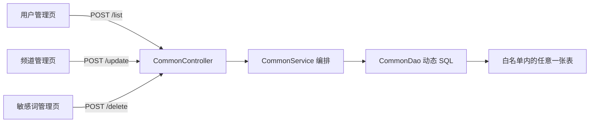

# 通用 Controller 落地：一个类三个方法，接住全部单表接口

编排层与持久层就位之后，通用封装还剩最后一块壳：HTTP 入口。按传统写法，用户管理一个 Controller、频道管理一个、敏感词管理再来一个，每个里面都是那几个增删改查接口，只有表名不同。控制层本来就是四层样板里最没技术含量的一层，也正因此最适合被通用层整体吃掉。落地结果是一个 CommonController，全项目所有管理页的单表请求都从它进出。

## 先给结论

- 控制层收敛为一个 CommonController，类级 `@RequestMapping("/api/v1/admin/common")` 固定入口，URL 不再随表变化。
- 三个方法 list、saveOrUpdate、delete 对应查询、新增和修改（合一）、删除，入参统一是请求壳 `CommonDto`，出参统一是 `ResponseResult`。
- 新增与修改共用一个端点 `/update`，具体执行哪个动作由请求体里的 model 字段决定。
- 控制层只做转发，零业务零校验；参数校验、表开关、合法性检查全部由编排层的八步流水线承担。

## 一个类的入口形状

在 admin 工程的 `controller.v1` 包下新建类，两个注解定下形状，然后注入通用 Service：

```java
package com.study.headline.admin.controller.v1;

import com.study.headline.admin.service.CommonService;
import com.study.headline.model.admin.dtos.CommonDto;
import com.study.headline.model.common.dtos.ResponseResult;
import org.springframework.beans.factory.annotation.Autowired;
import org.springframework.web.bind.annotation.PostMapping;
import org.springframework.web.bind.annotation.RequestBody;
import org.springframework.web.bind.annotation.RequestMapping;
import org.springframework.web.bind.annotation.RestController;

/**
 * 通用接口控制器：全项目单表管理页共用（按画面线课件抄录整理）
 */
@RestController
@RequestMapping("/api/v1/admin/common")
public class CommonController {

    @Autowired
    private CommonService commonService;

    /** 列表查询：分页 + 条件搜索 + 总数统计 */
    @PostMapping("/list")
    public ResponseResult list(@RequestBody CommonDto dto) {
        return commonService.list(dto);
    }

    /** 新增和修改：由 dto.model 区分动作，端点沿用 update 命名 */
    @PostMapping("/update")
    public ResponseResult saveOrUpdate(@RequestBody CommonDto dto) {
        return commonService.saveOrUpdate(dto);
    }

    /** 删除：每次只删一条 */
    @PostMapping("/delete")
    public ResponseResult delete(@RequestBody CommonDto dto) {
        return commonService.delete(dto);
    }
}
```

三个注解各管一件事。`@RestController` 等于 `@Controller` 加 `@ResponseBody`，方法返回的 ResponseResult 直接序列化成 JSON。类级 `@RequestMapping` 定下前缀 `/api/v1/admin/common`，版本段与全小写路径呼应 day01 立下的接口开发规范。三个端点都用 `@PostMapping`，原因是请求体是嵌套 JSON：条件集合 where 与修改字段集合 sets 都是数组，GET 加 query string 表达不了这种结构，统一 POST 最省事。

前缀里的 admin 一段把这套入口圈在管理端：通用五接口只服务后台管理页，不向 App 端暴露。思路篇给骨架时把新增与修改的端点暂定为 save_or_update，真正落进 admin 工程时端点收敛成更短的 update，方法名保留 saveOrUpdate 以提示合一语义，两处代码对照着看不会写岔。

## 三个方法怎么覆盖五类动作

单表管理页要的能力掰开数一数：分页列表、条件搜索、总数统计、新增、修改、删除。三个方法各收编一段：list 把查询、搜索、统计合并成一次请求，返回结果里 list 装行数据、total 装总数，前端分页组件两样都要；saveOrUpdate 用 model 字段分叉，`add` 走新增、`edit` 走修改，入参结构完全一致所以能合一；delete 独立成端点，条件定位一行、只删一条。三个方法共用同一个入参，请求壳的字段长这样：

```java
/**
 * 请求壳：控制层唯一入参（字段按画面线整理）
 */
@Data
public class CommonDto {
    private Integer page;                 // 页码
    private Integer size;                 // 页大小
    private String model;                 // 动作标记：add 新增、edit 修改
    private CommonTableEnum name;         // 目标表，枚举类型即白名单
    private List<CommonWhereDto> where;   // 查询或定位条件集合
    private List<CommonWhereDto> sets;    // 修改字段集合
}
```



这张图在讲入口收敛之后的调用形状：页面上看是三个独立模块，网络层看是同一个 URL 的不同 POST，服务层看是同一条编排骨架。关键路径读法：表名、条件、动作差异全部装进请求体 CommonDto，URL 与方法不感知任何表。

另一种常见设计是按表名生成 URL，比如 `/api/v1/admin/common/ad_sensitive`，路径一眼能看出操作对象。这套封装没有选那条路：表名放在请求体里，用 CommonTableEnum 枚举类型接收，非法表名在反序列化阶段就报错；URL 侧也不用维护动态路由，接口文档按枚举展开即可。两种方案各有取舍，白名单强约束的场景下，请求体加枚举更稳。

## 控制层为什么必须这么薄

转发是控制层的唯一职责。表开关检查、登录人权限、参数底线、字段合法性，全部在编排层八步流水线的前四步完成，控制层再做一遍只会制造两套口径：改了编排层忘了控制层，校验规则就悄悄分叉。控制层保持一行转发的另一个好处是可测试性好，接口行为完全由编排层决定，测一处就是测全部。

启动验证只需要看两样东西。用 debug 模式启动 admin 工程，控制台里 HikariPool 连接池完成初始化，说明数据源配置正常；全程没有 ERROR 级输出，说明 Bean 装配没有冲突，通用接口已经挂载在 `/api/v1/admin/common` 下待命。至于好不好用，要等前端页面连上来逐接口过一遍，那是下一节的活。

控制类里没有一行表名，这个细节值得单独说：新表接入通用层时，CommonController 永远不需要改。四层样板里控制层是最先归零的一层，剩下三层也早已归零，于是「接入一张新表」的成本被压到枚举里的一行配置。

## 常见误区

- **在通用 Controller 里加校验或业务分支。** 校验属于编排层流水线；控制层塞了逻辑，绕过 Controller 的调用路径（比如内部其他 Service 复用编排层）就全部失守，两处规则还会随时间漂移。
- **每张表复制一个 Controller。** 复制一次看着更「清晰」，实际是把 URL、注解、转发全部再抄一遍，通用层收编的样板又从控制层长回来。
- **漏写 `@RequestBody`。** POST 的 JSON 体不会自动绑定到 POJO 参数上，缺了注解请求不报错但 dto 字段全是 null，后续校验报出的错误与真实原因对不上，属于最难排查的一类问题。
- **查询也强行做进 GET。** 条件集合是嵌套数组，query string 表达不了；URL 携带条件值还会原样落进网关与访问日志，参数暴露面变大。

## 面试可能被问到的问题

1. 面试官追问：「所有表共用三个 URL，接口语义靠什么表达？」
   答：语义从 URL 移进了请求体。CommonDto 里的 name 决定操作哪张表，model 决定新增还是修改，端点 list、update、delete 决定动作大类。接口文档按表枚举展开，每张表列出开放的动作与字段，语义并不比按表建 URL 模糊。
2. 面试官追问：「类级 @RequestMapping 与方法级 @PostMapping 是怎么组合生效的？」
   答：Spring 在启动时把两段路径拼接成完整映射，类级前缀加方法级后缀得到 `/api/v1/admin/common/list` 这样的最终地址。前缀集中改一处即可全体生效，方法级只关心自己的动作名，两层各司其职。
3. 面试官追问：「为什么统一用 POST，而不是 RESTful 的 PUT 和 DELETE？」
   答：这套接口的请求体结构在三个端点间完全一致，都是嵌套 JSON 的请求壳；统一 POST 让前端封装只有一个模板，也规避了部分客户端与网关对 PUT、DELETE 支持不一致的坑。资源化语义在这种通用入口里让位于结构统一，是工程取舍而不是教条。
4. 面试官追问：「把表名放进请求体而不是 URL，有什么取舍？」
   答：好处是枚举类型在反序列化时就能挡住非法表名，白名单前置到参数层，URL 也不需要动态注册。代价是 URL 不再自描述，日志与监控里看不到操作对象，需要靠请求体日志补齐；管理后台场景下这个代价可以接受。
5. 面试官追问：「控制层零业务，某个表需要特殊逻辑时怎么办？」
   答：特殊逻辑走两条路，都不进 CommonController。持久化之前的拦截写进编排层前置处理或专用业务接口；持久化之后的补充动作注册成 BaseCommonFilter 增强，按表名挂载。通用入口保持纯净，差异化需求全部旁路解决。

## 配套资料

- 代码：`materials/code/05/头条day06/`。该日资料包解压结果为空（未含源码文件），文中控制器代码按画面线课件抄录整理，包名统一改写为 `com.study.headline`；启动验证要点来自课程运行实录；引用路径截至 `头条dayNN/` 层级，内层目录冠以项目原名，正文统一以「头条类资讯项目」指代。
- 代码：`materials/code/05/头条day01/`，内层资料目录含数据库规范设计说明书与项目原型，可对照用户、频道、敏感词等表名与后台页面结构。
