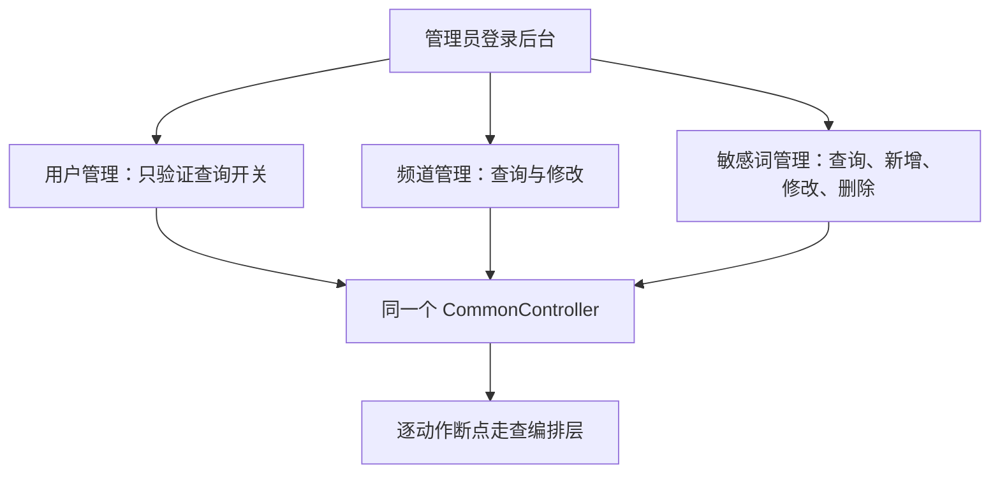

# 通用封装功能测试：三张表四个动作，走完整条链路

后端代码行数变少不等于功能可用。封装把四层样板压到一处之后，最怕「看起来都对」：枚举差一个字母、条件集合少传一项、分页参数越界，任何一处都会让页面沉默或报错。所以通用层写完必须在真实前端上跑一遍，断点跟着请求走，把每条分支都亲眼验证一次。

## 先给结论

- 用户、频道、敏感词三个管理页在专用后端一行未写的情况下全部可用，数据全部来自通用五接口。
- 三个页面的请求进的是同一个 CommonController，断点可见的差异只在请求体里的表名与条件。
- 查询按 where 是否为空分两条 DAO 分支，响应里 list 装行数据、total 装总数。
- 写操作有参数底线：新增禁止携带定位条件，修改与删除必须携带定位条件，违反直接返回参数错误。
- 写操作执行成功后触发按表名分发的后置增强，再统一封装成 ResponseResult 返回。

## 测试路径怎么设计

前台与后台工程都启动，用管理员账号登录后台。测试面覆盖三个模块：用户管理，表枚举里只开放查询，用来验证动作开关；频道管理，查询之外还要过一遍修改；敏感词管理，查询、新增、修改、删除四个动作全走一遍，是这次的主考场。



这张图在讲测试面怎么铺：三个模块的输出都汇到同一个控制器，重点不是页面长什么样，而是同一个入口对不同请求的行为差异。关键路径读法：敏感词模块四个动作齐全，分支覆盖率最高，所以断点走查全部以它为例。

点开用户管理，列表数据直接出来；切到频道，同样有数据；敏感词页也正常。此刻可以确认一件事：这三个模块的后端除了通用封装什么都没写，页面能用，说明通用链路真的在撑着全部请求。

## 断点证明三个页面同源

在编排入口打断点最能说明问题。先在查询方法入口停下，点频道页，请求进来，观察 dto：name 是频道对应的表枚举，page 为 1、size 为 10，where 是空集合。放行，再点敏感词页，请求再次停在同一个断点，这次 name 变成 AD_SENSITIVE，其余结构一模一样。

两个不同的页面、两次不同的数据，走的是同一个类里的同一个方法，参数不同导致了结果不同。这就是入口收敛的直接证据：接口数量不随表增长，增长的只是请求体里的一个枚举值。顺带也验证了枚举反序列化正常，前端传的表名字符串正确映射到了 CommonTableEnum。

## 查询链路：两条分支一个出口

查询编排在断点下逐步放行，关键片段按画面线整理如下：

```java
@Override
public ResponseResult list(CommonDto dto) {
    // 分页参数底线：size 必须为正数
    if (dto.getSize() == null || dto.getSize() <= 0) {
        return ResponseResult.errorResult(AppHttpCodeEnum.PARAM_INVALID);
    }
    String where = getWhere(dto);                       // 把条件集合拼成过滤串
    String tableName = dto.getName().getTableName();    // 表名从表枚举里取
    int start = (dto.getPage() - 1) * dto.getSize();    // 计算偏移量
    if (start < 0) {
        start = 0;                                      // 防御：page 传 0 或负数时归零
    }
    List<Map<String, Object>> list;
    int total;
    if (StringUtils.isEmpty(where)) {
        // 无条件：整表分页
        list = commonDao.list(tableName, start, dto.getSize());
        total = commonDao.listCount(tableName);
    } else {
        // 有条件：先过滤再分页，计数同样要带条件
        list = commonDao.listForWhere(tableName, where, start, dto.getSize());
        total = commonDao.listCountForWhere(tableName, where);
    }
    Map<String, Object> result = new HashMap<>();
    result.put("list", list);
    result.put("total", total);
    return ResponseResult.okResult(result);
}
```

断点下能看到每一步的实际值：本次是无条件查询，where 为空走上面那条分支；每行数据被装进一个 Map，再汇入结果集；total 由单独的计数查询得出，两条分支各自配套一套计数方法，保证过滤后的总数也算得准。偏移量 start 的防御值得一记，page 传 0 或负数时乘出来是负值，不归零的话 SQL 的 limit 直接报错。

## 写操作链路：参数底线与后置增强

新增与修改合在一个编排方法里，model 字段决定走向：

```java
@Override
public ResponseResult saveOrUpdate(CommonDto dto) {
    String model = dto.getModel();
    String where = getWhere(dto);
    String tableName = dto.getName().getTableName();
    if ("add".equals(model)) {
        // 新增不允许携带定位条件，带了说明参数构造有误
        if (!StringUtils.isEmpty(where)) {
            return ResponseResult.errorResult(AppHttpCodeEnum.PARAM_INVALID, "新增数据不能设置条件");
        }
        return addData(dto, tableName);
    }
    // 修改分支：必须携带定位条件，否则拒绝执行
    if (StringUtils.isEmpty(where)) {
        return ResponseResult.errorResult(AppHttpCodeEnum.PARAM_INVALID, "传入的参数值不能为空");
    }
    return updateData(dto, tableName, where);
}
```

新增落库的内部实现里能看到写操作的最后两步：执行插入、触发后置增强。

```java
/** 新增：组装列串与值串，插入成功后触发后置增强（按画面线整理） */
private ResponseResult addData(CommonDto dto, String tableName) {
    String[] sql = buildInsertSql(dto);                 // sql[0] 列串，sql[1] 值串
    if (sql == null) {
        return ResponseResult.errorResult(AppHttpCodeEnum.PARAM_INVALID, "传入的参数值不能为空");
    }
    int temp = commonDao.insert(tableName, sql[0], sql[1]);
    if (temp > 0) {
        doFilter(dto, dto.getName());                   // 按表名分发后置增强
    }
    return ResponseResult.okResult(temp);
}
```

在前端新增一条「测试」敏感词，断点里 model 是 add，sets 集合里躺着词条内容与创建时间两个字段，where 为空，顺利走到 insert；插入返回的影响行数大于 0，后置增强 doFilter 被调用，它按表名去容器里找 BaseCommonFilter 实现，找不到就跳过，这正是增强机制静默降级的正确表现。删除走查同样顺畅：where 集合里只有 id 一项、type 为 eq，定位一行执行删除，之后同样过后置增强再返回。

错误分支也要专门触发：新增请求里塞一个 where，后端立刻返回参数错误，文案就是「新增数据不能设置条件」；把修改或删除请求的 where 清空，得到「传入的参数值不能为空」；size 传 0，连编排层都进不了就被分页校验拦下。三条错误路径都是编排层主动拒绝，而不是 SQL 异常兜底，说明参数底线确实闸在持久化之前。

## 常见误区

- **只点正常流就算测完。** 封装层的价值一半在拒绝非法请求，新增带条件、修改缺条件、分页越界这三类错误分支必须人为触发一遍，确认返回的是参数错误而不是 500。
- **默认不同页面调了不同接口。** 表面上是三个模块，实际是同一控制器的同一方法，断点在同一路径停两次即可证伪；搞不清这一点，排查问题时会在错误的方向上找「另一个 Controller」。
- **列表能显示就忽略 total。** 行数据正常但分页组件页码算不出来，多半是计数查询没进结果 map；两条查询分支各配一套计数方法，漏配任何一条都会在带条件翻页时露馅。
- **修改漏传定位条件。** 前端拼参数时漏了 id 条件，后端应当拒绝而不是全表更新；这类请求如果测试时没覆盖，上线就是事故级 bug。

## 面试可能被问到的问题

1. 面试官追问：「通用封装的功能正确性怎么验证？」
   答：选动作覆盖最全的表把四个动作全走一遍，配合断点确认所有请求进同一入口；正常流之外专门触发参数底线，包括新增带条件、修改缺条件、分页非法；再对照数据库实际数据确认落库结果与页面展示一致。
2. 面试官追问：「新增为什么禁止携带 where 条件？」
   答：新增没有定位语义，携带 where 说明调用方参数构造出错，很可能是把修改的参数模板误用到了新增；在编排层直接拒绝能把这个错误拦在持久化之前，避免生成语义不明的 insert 语句。
3. 面试官追问：「修改缺条件时为什么报错而不静默跳过？」
   答：缺定位条件的修改等于全表更新，是这套封装里后果最严重的误用；返回参数错误并附明确文案，让前端立刻发现构造问题。静默跳过会把一个构造错误藏成一次「成功」，排查成本反而更高。
4. 面试官追问：「分页偏移量为什么做负值归零？」
   答：page 为 0 或负数时偏移量乘出来是负值，多数数据库的 limit 语法不接受负偏移，直接抛 SQL 异常；归零让非法页码退化成第一页，接口不至于 500，同时分页校验仍会对 size 这类硬性错误拒绝。
5. 面试官追问：「写操作成功后为什么还要过后置增强？」
   答：持久化完成只是数据落库，因表而异的业务补充，比如记操作日志、清缓存，要在数据确实写入之后执行才安全。后置增强按表名分发，没有增强需求的表自动跳过，主流程零成本。

## 配套资料

- 代码：`materials/code/05/头条day06/`。该日资料包解压结果为空（未含源码文件），文中编排层代码片段按画面线课件抄录整理（修正了画面转写里的符号与命名笔误），包名统一改写为 `com.study.headline`；测试走查过程来自课程运行实录；引用路径截至 `头条dayNN/` 层级，内层目录冠以项目原名，正文统一以「头条类资讯项目」指代。
- 代码：`materials/code/05/头条day01/`，内层资料目录含数据库规范设计说明书与项目原型，可对照敏感词表结构与后台管理页面。
