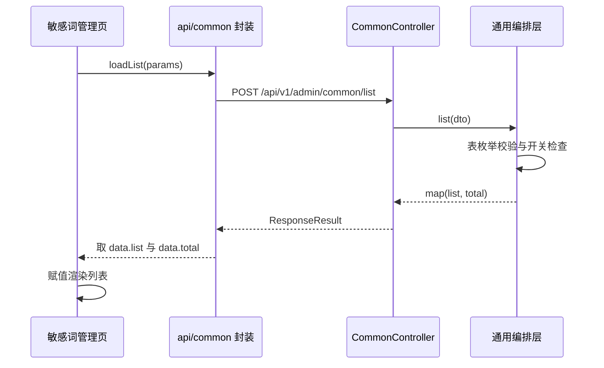

# 通用封装的前台对接：一个 params 声明一张管理页

后端把五接口收进一个入口之后，前端的问题随之而来：用户、频道、敏感词这些管理页，难道每页还要各写一套请求与弹窗？课程给出的答案是复用：主页面只剩一个 params 对象加一份 fields 配置，查询、新增、修改、删除全部由三个通用组件代劳。这一节以敏感词管理为例，把四个动作各自的请求参数形态拆开看清楚，前端要传什么、后端凭什么识别动作，一次讲透。

## 先给结论

- 前端声明操作哪张表，只需要 params.name 给出表枚举名，必须与后端 CommonTableEnum 里的常量一字不差。
- 四个动作共用一套参数骨架：name、page、size、where、sets、model，差异只在哪些字段有值。
- 查询不带 model；新增 model 为 add 且 sets 携带全部字段；修改 model 为 edit 且 where 必须带 id 定位；删除只传 name 加 where。
- 页面渲染由 fields 配置驱动，SearchTool、SearchResult、CommEditor 三个通用组件被各管理页复用，页面只负责传参与回调。

## 页面骨架：一份配置三个组件

敏感词模块的主页面 `index.vue` 集中承载全部声明式配置：

```vue
<script>
import SearchTool from './components/SearchTool.vue'
import SearchResult from './components/SearchResult.vue'
import Editor from './components/CommEditor.vue'
import { loadList, deleteData } from '@/api/common'
import DateUtil from '@/utils/date'

export default {
  data() {
    return {
      // 声明本页管理哪张表、当前页码、页大小、查询条件
      params: {
        name: 'AD_SENSITIVE',
        page: 1,
        size: 10,
        where: []
      },
      total: 0,
      list: [],
      // fields 驱动搜索表单、表格列与编辑弹窗的渲染
      fields: [
        {
          label: '敏感词', name: 'sensitives', type: 'input', placeholder: '请输入敏感词',
          rule: [
            { required: true, message: '请输入敏感词', trigger: 'blur' },
            { min: 2, max: 8, message: '敏感词在 2 到 8 个字符', trigger: 'blur' }
          ]
        },
        // 隐藏字段：新增时随 sets 一起提交，值为当前时间
        { label: '创建时间', name: 'created_time', type: 'hidden', value: DateUtil.format(new Date()) }
      ]
    }
  },
  mounted() {
    this.loadData()                    // 页面加载即触发查询
  },
  methods: {
    loadData() {
      loadList(this.params).then(res => {
        this.list = res.data.list      // 行数据交给表格渲染
        this.total = res.data.total    // 总数交给分页组件
      })
    },
    addData() {
      this.$refs.editor.add()          // entry 为空，model 置为 add
    },
    editData(row) {
      this.$refs.editor.edit(row)      // 整行数据进弹窗，model 置为 edit
    },
    deleteData(row) {
      this.$confirm('确定要删除吗？', '提示').then(() => {
        deleteData({
          name: this.params.name,
          where: [{ filed: 'id', type: 'eq', value: row.id }]
        }).then(() => this.loadData())
      })
    }
  }
}
</script>
```

三个通用组件各管一段：SearchTool 渲染搜索区与新增按钮，点击时回调 addData；SearchResult 拿 list 循环渲染表格列，列头与行内操作按钮也由 fields 和传入的回调决定；CommEditor 是新增与修改共用的弹窗。组件与页面之间靠回调衔接，页面引用这些组件之后，整套增删改查的交互就齐了，页面自己的代码里没有一处直接拼业务接口地址。

## 查询：载荷里就四个键

查询由 mounted 钩子触发，loadData 调 api/common 封装里的 loadList，最终发出一个 POST：



请求载荷的 JSON 形态非常短：

```json
{
    "name": "AD_SENSITIVE",
    "page": 1,
    "size": 10,
    "where": []
}
```

四个键与后端 CommonDto 的字段一一对应：name 是表枚举名，page 与 size 是分页参数，where 是条件集合，无条件查询时给空数组。在浏览器里按 F12 打开网络面板，点频道页再点敏感词页，两次请求的载荷并排一看，差异只有 name 一个值，这也是「同一入口服务所有表」在前端侧的直接证据。响应里取 data.list 与 data.total，分别喂给表格与分页组件；后端按 list 加 total 封装，正好与前端两个渲染出口对齐。

## 表名声明：与枚举一字不差

前端 params.name 能传什么值，由后端表枚举说了算：

```java
/**
 * 通用表白名单：一张表一行登记，声明开放哪些动作（按画面线整理）
 */
@Getter
public enum CommonTableEnum {
    // 每行依次为：查询、新增、修改、删除四个动作开关
    AD_CHANNEL(true, true, true, true),
    AD_SENSITIVE(true, true, true, true),
    // App 端相关表：只开放查询或部分动作
    AP_ARTICLE(true, false, false, false),
    AP_ARTICLE_CONFIG(true, false, true, false),
    AP_USER(true, false, true, false);

    private final boolean query;      // 查询开关
    private final boolean insert;     // 新增开关
    private final boolean update;     // 修改开关
    private final boolean delete;     // 删除开关

    CommonTableEnum(boolean query, boolean insert, boolean update, boolean delete) {
        this.query = query;
        this.insert = insert;
        this.update = update;
        this.delete = delete;
    }
}
```

CommonDto 的 name 字段类型就是这个枚举，前端传来的字符串在反序列化时直接找枚举常量，找得到才进得了编排层，找不到就是一次参数错误。所以前端声明用哪张表时，拼写、大小写都必须与枚举常量完全一致，差一个字母请求就到不了业务逻辑。想给新模块接通用后端，动作只有两步：后端枚举里登记一行，前端把 params.name 改成这个枚举名；动作开关同时决定该表的哪些按钮应该出现，只开查询的表，前端就不该渲染新增与删除入口。

## 新增与修改：一个弹窗两种 model

新增与修改走同一个 CommEditor 弹窗组件，提交逻辑也共用一个方法：

```vue
<script>
import { updateData } from '@/api/common'
export default {
  props: ['title', 'fields', 'table', 'submitSuccess'],
  data() {
    return {
      entry: {},                 // 当前行数据：新增时是空对象
      model: 'add',              // add 新增、edit 修改
      dialogFormVisible: false
    }
  },
  methods: {
    add() {
      this.entry = {}            // 新增没有行数据可回填
      this.model = 'add'
      this.dialogFormVisible = true
    },
    edit(row) {
      this.entry = row           // 修改把整行数据带进弹窗回填
      this.model = 'edit'
      this.dialogFormVisible = true
    },
    submitForm() {
      // 遍历弹窗字段，把值收进 sets，字段名即数据库列名
      let sets = []
      this.fields.forEach(f => {
        sets.push({ filed: f.name, value: this.entry[f.name] })
      })
      updateData({
        name: this.table,
        model: this.model,
        // 修改才携带定位条件，id 取自当前行
        where: this.model === 'edit'
          ? [{ filed: 'id', type: 'eq', value: this.entry.id }]
          : [],
        sets: sets
      }).then(() => {
        this.$message.success('操作成功')
        this.dialogFormVisible = false
        this.submitSuccess()     // 回调主页面刷新列表
      })
    }
  }
}
</script>
```

两种动作的载荷差异一眼可见。修改一条敏感词时的完整请求体：

```json
{
    "name": "AD_SENSITIVE",
    "model": "edit",
    "page": 1,
    "size": 10,
    "where": [
        { "filed": "id", "type": "eq", "value": "2101" }
    ],
    "sets": [
        { "filed": "sensitives", "value": "测试词条" }
    ]
}
```

新增时把 model 换成 add、where 置空数组即可，sets 仍要带全字段，包括那个隐藏的创建时间。where 是完整的三元组：字段名 id、操作类型 eq、值取当前行主键；sets 只需要字段名与新值。提交成功后回调主页面的 loadData，列表自动刷新，弹窗关闭，一次修改的闭环就结束了。

## 删除：只要一个定位条件

删除的参数形态最简：name 加 where，条件里只有 id 一项。页面上点删除先弹确认框，用户点确定才发请求，这一步是前端防误删的第一道闸；后端还有两道，一次只允许删一行、表枚举里 delete 开关关闭就拒绝。三层防线叠在一起，最危险的写操作被压到最坏只损失一行。

理解了四个动作各自的参数形态，写任何一个新模块的前端都变成填空题：params 里填表名，fields 里填字段与校验规则，三个通用组件照常引用。参数传对，后端就执行正确的操作，这也是通用封装对前后端协作的真实要求。

## 常见误区

- **表名拼写与枚举不一致。** 多一个空格、大小写不同，反序列化直接失败，前端只会看到一个参数错误；正确做法是前后端共用同一份枚举名清单，复制粘贴而不是手敲。
- **新增请求带了 where。** 后端立刻返回「新增数据不能设置条件」；新增弹窗的 entry 必须是空对象，别把列表的选中行顺手带进去。
- **修改请求漏了 where 或 sets。** 缺定位条件后端拒绝执行，这是防全表更新的参数底线；sets 为空同样被拒，没有任何字段可写就不该发请求。
- **字段名自创驼峰。** 这套封装里字段名即数据库列名，sensitives、created_time 必须与表列一致；普通接口里实体类的驼峰映射在这条链路上不存在，照搬反而出错。

## 面试可能被问到的问题

1. 面试官追问：「前端怎么声明要操作哪张表、哪个动作？」
   答：表名放在请求体 name 字段，值必须是后端 CommonTableEnum 里的枚举常量，反序列化天然完成白名单校验；动作由 model 加端点共同决定，查询走 list 端点不带 model，写操作走 update 端点带 add 或 edit，删除走 delete 端点只带定位条件。
2. 面试官追问：「查询参数为什么放 POST 请求体，而不是拼在 URL 上？」
   答：条件集合与修改字段都是嵌套数组，query string 表达不了这种结构；请求体形式让四个动作共用同一种参数骨架，前端封装只有一个模板，条件值也不会暴露在 URL 与访问日志里。
3. 面试官追问：「这套通用页面配置与低代码表单是什么关系？」
   答：思路同源，都是配置驱动渲染：fields 声明字段类型、校验与初始值，组件按配置生成表单与表格。差别在粒度，这套封装只覆盖单表管理页，低代码平台还会加数据源编排与流程；管理后台的单表维护恰好是配置化收益最高的场景。
4. 面试官追问：「前端做了删除确认框，后端还需要哪些防线？」
   答：确认框只能防手滑，防不了绕过页面的直接调用。后端要有三道：删除接口限定一次只删一行、表枚举的 delete 开关按表控制、编排层按登录人校验权限；前后端防线各自独立，缺一不可。
5. 面试官追问：「后端给一张新表开放了修改动作，前端要改哪些地方？」
   答：页面级只需要让编辑入口出现，params.name 已指向该表，弹窗与提交逻辑是通用组件不用动；fields 里补上新字段的列声明即可。动作开关出现在后端枚举里，前端按钮的可见性应与其保持一致，避免渲染出后端必然拒绝的操作。

## 配套资料

- 代码：`materials/code/05/头条day06/`。该日资料包解压结果为空（未含源码文件），前端工程亦未随资料包提供，文中 Vue 代码按画面线课件抄录整理，细节按主流写法补全；引用路径截至 `头条dayNN/` 层级，内层目录冠以项目原名，正文统一以「头条类资讯项目」指代。
- 代码：`materials/code/05/头条day01/`，内层资料目录含数据库规范设计说明书与项目原型，可对照敏感词表列名、字段拼写与后台管理页结构。
