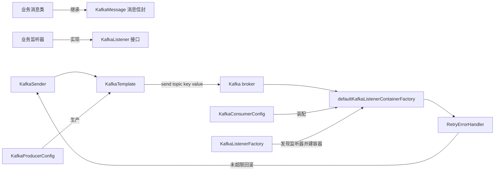

# 把 Spring Kafka 封装成公共组件：消息信封、收发配置与失败重试

> 🔒 安全提示：文中示例的口令/密钥均为课程教学环境演示口径，生产环境的安全要求见《安全与合规须知》。

直接拿 `KafkaTemplate` 发一条消息并不难，难的是每个业务点都要重复回答同一批问题：topic 名写在哪、key/value 用什么序列化、消费失败的消息怎么办、消费者并发开多少。头条类资讯项目里文章审核、消息通知、热文章计算都要过 Kafka，这些答案统一收进 common 工程的一个包里，业务代码只面对两个动作：发与收。这一天资料包里带着九个现成的封装类，位置在 `materials/code/05/头条day07/`，下面逐个拆开看。

## 先给结论

- 封装共九件：消息信封 KafkaMessage、发送器 KafkaSender、生产者配置 KafkaProducerConfig、消费者配置 KafkaConsumerConfig、监听接口 KafkaListener、注册工厂 KafkaListenerFactory、重试错误处理器 RetryErrorHandler、topic 配置 KafkaTopicConfig，外加扫描消息类型的 MessagesRegister。
- topic 命名有约束：完整名以 single 结尾表示单消息通道，以 bus 结尾表示业务消息，中段是自定义的业务名；topic 值统一进 `kafka.properties`，由 KafkaTopicConfig 读成常量，业务代码不硬编码。
- 生产者侧定下 StringSerializer、lz4 压缩、256KB 批量与 10 次重试；消费者侧 StringDeserializer、手动提交位移、8 个并发消费线程。
- 业务异常先走 RetryTemplate 重试 5 次（指数随机退避），耗尽后交给 RetryErrorHandler 回滚到原 topic 重新排队，消息重试超过 10 次或存活超过 1 小时才抛弃。
- 收消息不用 @KafkaListener 注解：实现 KafkaListener 接口并声明 topic，容器启动时由 KafkaListenerFactory 自动建容器完成注册。

## 两个约定：中间件选型与 topic 命名

消息中间件候选里有 ActiveMQ、RabbitMQ、Kafka、RocketMQ、Pulsar，项目选 Kafka，理由一句话：大数据量下的高吞吐与实时流计算能力，审核消息的洪峰和后面的热文章计算都要这层能力。选型之外先立命名约束，topic 的完整名形如 `headline.topic.{业务名}.single`，中段业务名跟着业务走可以自定义，结尾标记通道类型：single 是单条消息通道，bus 是业务消息通道。名字的来源也有讲究，业务里不写死字符串，而是配在 `kafka.properties` 里再读进配置类（该文件未随资料包提供，示例按画面线整理补全）：

```properties
kafka.hosts=localhost:9092
kafka.group=headline.${profiles.name}.${spring.application.name}
# 单消息通道以 single 结尾；业务消息通道以 bus 结尾
kafka.topic.admin-test=headline.topic.admin-test.single
```

消费组名里拼进环境名与应用名，dev、test、prod 三套环境的同名服务各自成组，互不串消息。这份文件由封装类统一加载，生产者与消费者配置类都标着 `@ConfigurationProperties(prefix = "kafka")` 加 `@PropertySource("classpath:kafka.properties")`。

## 消息信封 KafkaMessage：给重试留元数据

业务消息类不直接发裸字符串，而是继承一个抽象信封（包名统一改写为 `com.study.headline.common.kafka`，下同）：

```java
/**
 * Kafka 消息信封：业务消息继承它，自带重试次数与生成时间
 */
public abstract class KafkaMessage<T> {

    @Getter
    int retry;                               // 已重试次数，失败重发时自增
    @Getter
    long time = System.currentTimeMillis();  // 生成时间，用来算消息年龄
    String type;                             // 消息类型，接收端据此还原消息类
    @Setter
    @Getter
    T data;                                  // 消息实体数据

    public KafkaMessage() {}
    public KafkaMessage(T data) { this.data = data; }

    public void addRetry() { this.retry++; }

    protected abstract String getType();     // 由子类声明类型名
}
```

设计动机在失败处理那一环：消息消费失败被回滚重发之后，处理方要能判断「这条消息是不是已经反复失败了」，凭据就是 retry 与 time 两个元数据字段。type 字段服务另一头，MessagesRegister 在启动时反射扫描包下所有 KafkaMessage 子类，把 type 到 Class 的映射收进一张表，接收端拿到消息体后凭 type 反查该反序列化成哪个业务消息类。

## 发送侧：KafkaProducerConfig 与 KafkaSender

连接参数与发送行为分开两层。配置层把生产者的关键参数一次定死：

```java
@Bean
public DefaultKafkaProducerFactory<String, String> producerFactory() {
    Map<String, Object> props = new HashMap<>();
    props.put(ProducerConfig.BOOTSTRAP_SERVERS_CONFIG, this.getHosts());
    props.put(ProducerConfig.RETRIES_CONFIG, 10);             // 失败重试 10 次
    props.put(ProducerConfig.RETRY_BACKOFF_MS_CONFIG, 5_000); // 重试间隔 5 秒
    props.put(ProducerConfig.BUFFER_MEMORY_CONFIG, 3 * MAX_MESSAGE_SIZE);
    props.put(ProducerConfig.KEY_SERIALIZER_CLASS_CONFIG, StringSerializer.class);
    props.put(ProducerConfig.VALUE_SERIALIZER_CLASS_CONFIG, StringSerializer.class);
    props.put(ProducerConfig.MAX_REQUEST_SIZE_CONFIG, 3 * MAX_MESSAGE_SIZE);
    props.put(ProducerConfig.COMPRESSION_TYPE_CONFIG, "lz4"); // lz4 压缩
    props.put(ProducerConfig.BATCH_SIZE_CONFIG, 256 * 1024);  // 批量发送 256KB
    return new DefaultKafkaProducerFactory<>(props);
}

@Bean
public KafkaTemplate<String, String> kafkaTemplate(ProducerFactory producerFactory) {
    KafkaTemplate<String, String> t = new KafkaTemplate<>(producerFactory);
    if (this.producerListener != null) {
        t.setProducerListener(this.producerListener); // 发送回调可选注入
    }
    return t;
}
```

key 与 value 都用 StringSerializer，消息体在发送前统一序列化成 JSON 字符串；批量 256KB 加 lz4 压缩，是高吞吐场景的常规搭配。Spring 管起这个 KafkaTemplate 之后，发送层只剩薄薄一层包装：

```java
@Component
public class KafkaSender {

    @Autowired
    KafkaTemplate<String, String> kafkaTemplate;
    @Autowired
    ObjectMapper mapper;

    /** 发送一个消息 */
    public void sendMesssage(String topic, String key, KafkaMessage<?> message) {
        try {
            this.kafkaTemplate.send(topic, key, mapper.writeValueAsString(message));
        } catch (Exception e) {
            logger.error("send message to [{}] error:", topic, e);
        }
    }
}
```

业务侧调 `sendMesssage` 传 topic、key 与信封对象，信封被 ObjectMapper 转成 JSON 后进 KafkaTemplate。方法名三个 s 的拼写是资料里的原样，拷贝引用时保持一致即可，不必顺手「纠正」成两个 s，改了反而对不上资料。另有一个 `sendMesssageNoWrap` 发裸字符串，注释里写明只供内部使用，业务上一律走带信封的版本。

## 接收侧：KafkaConsumerConfig 装配容器工厂

消费侧的参数更多，核心是把一个 ConcurrentKafkaListenerContainerFactory 配置成项目口径：

```java
@Bean("defaultKafkaListenerContainerFactory")
public ConcurrentKafkaListenerContainerFactory<String, String> kafkaListenerContainerFactory(
        RetryErrorHandler retryErrorHandler) {
    ConcurrentKafkaListenerContainerFactory<String, String> factory =
            new ConcurrentKafkaListenerContainerFactory<>();
    factory.setRetryTemplate(this.buildRetryTemplate());   // 业务异常先走重试模板
    factory.setErrorHandler(retryErrorHandler);            // 重试耗尽交给错误处理器
    factory.getContainerProperties().setAckOnError(false); // 出错不提交位移
    factory.setConsumerFactory(
            new DefaultKafkaConsumerFactory<>(buildComsumerConfig()));
    factory.setConcurrency(KafkaConsumerConfig.CONCURRENCY); // 8 个并发消费线程
    return factory;
}

protected Map<String, Object> buildComsumerConfig() {
    Map<String, Object> propsMap = new HashMap<>();
    propsMap.put(ConsumerConfig.BOOTSTRAP_SERVERS_CONFIG, this.getHosts());
    propsMap.put(ConsumerConfig.ENABLE_AUTO_COMMIT_CONFIG, false); // 手动提交位移
    propsMap.put(ConsumerConfig.KEY_DESERIALIZER_CLASS_CONFIG, StringDeserializer.class);
    propsMap.put(ConsumerConfig.VALUE_DESERIALIZER_CLASS_CONFIG, StringDeserializer.class);
    propsMap.put(ConsumerConfig.GROUP_ID_CONFIG, this.group);
    propsMap.put(ConsumerConfig.MAX_PARTITION_FETCH_BYTES_CONFIG, 8 * 1024 * 1024);
    propsMap.put(ConsumerConfig.SESSION_TIMEOUT_MS_CONFIG, 90_000);
    return propsMap;
}
```

反序列化与生产端严格对称，两端都是 String，这条对称线一旦破坏就会出现乱码或反序列化异常。`ENABLE_AUTO_COMMIT_CONFIG` 关掉自动提交配合 `setAckOnError(false)`，消息处理成功与否由容器说了算，失败时位移不往前走。重试模板与错误处理器的关系是接力：重试模板先在容器内原地重试 5 次，间隔按指数随机退避从 1 秒起步；5 次都失败才把异常抛给 RetryErrorHandler。8 个并发消费线程是按分区数预估的上限，分区不够时多开的线程空转。

## 失败消息的归宿：回滚到原 topic 还是抛弃

RetryErrorHandler 继承日志版的错误处理器，在落日志之后做了真正的事：

```java
@Override
public void handle(Exception thrownException, ConsumerRecord<?, ?> record) {
    super.handle(thrownException, record);
    if (record != null) {
        KafkaMessage<?> message =
                mapper.readValue((String) record.value(), KafkaMessage.class);
        message.addRetry();                              // 重试次数加一
        long time = System.currentTimeMillis() - message.getTime();
        if (message.getRetry() > RETRY_COUNT || time > TIME_OUT) {
            logger.info("超时或者尝试{}次后，抛弃消息[topic:{}][{}]",
                    RETRY_COUNT, record.topic(), record.value()); // 超限抛弃
        } else {
            // 未超限：原样回滚到原 topic，排到队尾再来一遍
            this.sender.sendMesssage(record.topic(), (String) record.key(), message);
        }
    }
}
```

失败消息不走死信队列，而是带着 retry 加一后的信封发回原 topic 重新排队，消费端下一次读到它再试。两条抛弃线：重试超过 10 次，或消息从生成到现在超过 1 小时。凭据正是 KafkaMessage 信封里那两个元数据字段，这也解释了为什么业务消息必须套信封发送。整个封装的协作关系如下图：



关键路径在闭环上：发送侧与接收侧共用一份 `kafka.properties` 与同一套 String 序列化口径，失败消息从错误处理器绕回发送器重新入队，信封里的 retry 与 time 就是这条闭环的记账本。

## 监听器自动注册：实现接口就能收消息

封装刻意绕开了 @KafkaListener 注解，做法是把「声明监听」压进一个接口：

```java
public interface KafkaListener<K, V> extends ConsumerAwareMessageListener<K, V> {

    String topic();   // 声明监听的 topic

    default String factory() { return "defaultKafkaListenerContainerFactory"; }

    default String group() { return "default"; }
}
```

业务监听器实现这个接口、返回自己的 topic，剩下的交给注册工厂在容器启动时统一处理：

```java
@Component
public class KafkaListenerFactory implements InitializingBean {

    @Autowired
    DefaultListableBeanFactory defaultListableBeanFactory;

    @Override
    public void afterPropertiesSet() {
        Map<String, KafkaListener> map =
                defaultListableBeanFactory.getBeansOfType(KafkaListener.class);
        for (String key : map.keySet()) {
            KafkaListener k = map.get(key);
            AbstractKafkaListenerContainerFactory factory =
                    (AbstractKafkaListenerContainerFactory)
                            defaultListableBeanFactory.getBean(k.factory());
            AbstractMessageListenerContainer container = factory.createContainer(k.topic());
            container.setupMessageListener(k);   // 接口本身就继承了消息监听器
            String beanName = k.getClass().getSimpleName() + "AutoListener";
            defaultListableBeanFactory.registerSingleton(beanName, container);
            logger.info("add auto listener [{}]", beanName);
        }
    }
}
```

`afterPropertiesSet` 在 Bean 初始化完成后触发，工厂从 BeanFactory 里捞出所有 KafkaListener 实现类，逐个用统一参数的容器工厂建容器、挂监听、注册单例。相比每个 @KafkaListener 注解各自配置，这条路把重试模板、错误处理器、并发度这些容器级参数集中到一处，新增一个监听器只是「实现接口加返回 topic」两行事。topic 常量的读取同样收口，KafkaTopicConfig 用 `@ConfigurationProperties(prefix = "kafka.topic")` 把 `kafka.topic.admin-test` 宽松绑定成 `adminTest` 字段，发送与接收两端都从这个配置类取名字。

## 常见误区

- **两端序列化不配对。** 生产端 StringSerializer 配消费端 StringDeserializer 是这条链路的对称约定，任何一端换成 JSON 或 Avro 序列化器，另一端就会拿到乱码或直接反序列化异常。
- **绕过 KafkaTopicConfig 硬编码 topic。** topic 名拼进环境与应用名，硬编码会让多环境切换时消息发到错误的通道；取名字只认配置类。
- **把回滚重发当可靠投递。** 消息回滚到队尾意味着可能重复消费与乱序，消费逻辑必须幂等，靠状态机或唯一键挡住重复处理，而不是指望消息只到一次。
- **注解监听与封装监听混用。** @KafkaListener 与封装的容器工厂是两套参数来源，混用会让重试与错误处理口径不一致，一个项目里认准一条路。

## 面试可能被问到的问题

1. 面试官追问：「为什么不直接用 @KafkaListener，要自己封一层？」
   答：@KafkaListener 解决的是单个监听点的声明，项目级要统一的是容器参数与消息规范：重试模板、错误处理器、并发度、序列化口径、topic 命名。封装后这些收敛到一处，业务监听器实现接口即可，新增监听的成本和口径漂移的风险同时下降。
2. 面试官追问：「消费失败的消息最终怎么处理，为什么回滚原 topic 而不是进死信队列？」
   答：失败消息带元数据回滚到原 topic 重新排队，重试超过 10 次或存活超过 1 小时抛弃并落日志。回滚原 topic 让链路保持在同一套监控与配置里，实现简单；死信队列适合消费逻辑本身长期无法处理的消息，需要额外的消费与运维，项目体量下回滚加抛弃线已经够用。
3. 面试官追问：「ackOnError 设为 false 加手动提交，解决什么问题？」
   答：保证失败消息的位移不被跳过。自动提交会在处理失败时也推进位移，消息等于丢了；关掉自动提交后位移由容器控制，配合重试模板与错误处理器，处理成功才提交，失败的消息在重试与回滚闭环里被显式接管。
4. 面试官追问：「KafkaMessage 里 retry 和 time 各起什么作用？」
   答：retry 记录失败重发次数，time 记录消息生成时间，回滚时次数加一，处理方据此算出消息年龄。两条抛弃线分别卡这两个值，防止一条永远处理失败的消息在队列里无限循环。
5. 面试官追问：「消费组的 group.id 为什么拼上环境名与应用名？」
   答：同一份代码会在 dev、test、prod 多套环境跑，组名不区分环境时，不同环境的服务实例会互抢分区，消息被错误环境的实例消费走；拼上环境与应用名让每套环境每个服务自成一组，消费边界与部署边界对齐。

## 配套资料

- 代码：`materials/code/05/头条day07/`。内层资料目录含 Kafka 封装工具类九个真实文件：KafkaProducerConfig、KafkaConsumerConfig、KafkaSender、KafkaMessage、KafkaListener、KafkaListenerFactory、KafkaTopicConfig、MessagesRegister、RetryErrorHandler；源码包名为机构前缀，正文统一改写为 `com.study.headline.common.kafka`，引用路径截至 `头条dayNN/` 层级。`kafka.properties` 未随资料包提供，文中示例按画面线整理补全。
- 环境：课程集群 node01~node03，MySQL root/123456；`kafka.hosts` 按所在环境指向真实 broker 地址。
