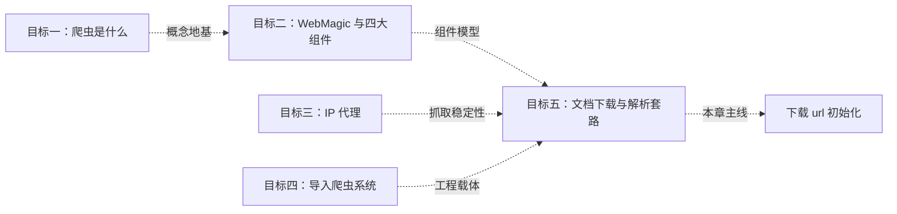

# day08 任务书：爬虫系统进场，采集内容供平台冷启动

> 🔒 安全提示：文中示例的口令/密钥均为课程教学环境演示口径，生产环境的安全要求见《安全与合规须知》。

day07 跑通之后，自媒体内容链完整闭环：提交文章落库、消息进队列、审核三道关、App 端见报。但这套链路有一个前提，得先有创作者来发文。一个刚上线的资讯平台既没有用户也没有作者，App 端打开是空的，冷启动无从谈起。day08 引入第二条内容来源：爬虫系统，从外部内容站自动采集文章入库，让平台在创作者进场之前先有内容可刷。动手之前照例把这一天的目标与技术点映射捋清楚。

## 先给结论

- day08 五个目标：了解爬虫是什么、了解 WebMagic 框架及其四大组件、了解爬虫系统中的 IP 代理、能够导入爬虫系统、知道文档下载与文档解析的套路。
- 爬虫在项目里的定位是内容采集器：从外部内容站按规则抓取文章，落库后供 App 端展示，解决平台冷启动与内容量不足的问题。
- WebMagic 是 Java 系爬虫框架，四大组件 Downloader、PageProcessor、Scheduler、Pipeline 分别管下载、解析、调度去重与持久化，本项目的爬虫系统就按这套组件模型搭建。
- 本章标题里的「下载 url 初始化」是工程落地的第一刀：把待抓取的入口地址收进系统，后面的下载、解析、保存都从这里起跑。
- 本日资料包没有携带源码，概念与工程骨架按画面线讲解，代码示例按本课写法补全。

## 五个目标怎么映射到技术点

五个目标不是并列的清单，概念层供给框架层，框架层支撑工程层，最后收口到下载与解析两套套路：



关键路径在目标五。爬虫是什么回答「为什么要这个系统」，WebMagic 四大组件回答「系统由什么零件组成」，IP 代理回答「怎么让抓取长期稳定」，导入爬虫系统把零件装进工程，四者最后都落成文档下载与文档解析两套可复用的套路，本章先做下载这一半。

## 爬虫在项目里的位置：第二条内容来源

day01 的功能需求结构图里，内容来源一直是两个：自媒体平台与支撑系统下的数据采集。day01 到 day07 把自媒体这条线做完了，day08 补的是另一条：爬虫从外部内容站抓文章，标明来源后落库，与自媒体文章走同一条审核链路进 App 端。两条线共用一套内容消费设施，这正是审核入口的消息体里预留来源类型字段的原因，爬虫稿件接入时通道与状态机都不用动。

技术栈全景里，这一天的出场组件有三个：WebMagic 负责抓取与解析，Quartz 负责定时调度，IP 代理池负责出口轮换。定时抓取放在深夜时段跑，避开平台正常服务的高峰，抓到的最新文章第二天就能推给用户。

## 三块前置知识各管一件事

爬虫是什么，给一个能落地的定义：按一定规则自动抓取万维网信息的程序或脚本，本质是数据采集。从初始 url 出发，抓页面、抽新 url 入队、解析内容、过滤杂质、存进数据库，循环往复直到满足停止条件。

WebMagic 是这套流程的 Java 工程化封装，参考了 Python 圈的爬虫框架设计，底层用 HttpClient 模拟浏览器发请求，用 Jsoup 解析 HTML。四大组件的分工一句话讲完：Downloader 管下载页面，PageProcessor 管解析出需要的内容与新链接，Scheduler 管待抓 url 的队列与去重，Pipeline 管结果的持久化，Spider 引擎把四个组件串成流水线。一个最小可跑的形态预览如下（示例按本课写法补全，下一章展开）：

```java
Spider.create(new ArticleProcessor())   // 解析器：唯一必须自己写的组件
        .addUrl("https://blog.csdn.net/xxx")   // 初始 url，下载 url 初始化的起点
        .thread(5)
        .run();
```

IP 代理解决的是抓取的生存问题。目标站点对高频访问的来源 ip 会封禁，爬虫系统给请求套上代理 ip，用虚拟出口轮换身份，下载组件的配置里就会用到这一层。

## 导入系统，从下载 url 初始化起步

爬虫系统带着初始工程进场，导入后先熟悉里面的工具类，这一步类似 day01 导入主工程的操作。工程骨架就位后，本章的主线任务是下载 url 初始化：爬虫不能漫无目的地在网上游荡，得先拿到一批明确的入口地址，初始化的意义就是把待抓取的 url 收进系统、建好队列与去重，下载组件按这份清单开工。抓取窗口的调度按夜间低峰排布（示例按本课写法补全）：

```yaml
crawler:
  schedule:
    cron: "0 0 0 * * ?"    # 每天零点启动，抓取至清晨五六点
    proxy-pool: true       # 出口走 IP 代理池轮换
```

文档解析的套路留到下一章展开，本章把下载侧打穿。

## 常见误区

- **把爬虫当独立项目学。** 爬虫系统不是游离于主工程之外的玩具，它产出的文章要进同一套审核与检索链路，学的时候要对照自媒体文章的路径看两条线怎么汇合。
- **以为四大组件要同时精通。** 概念课的目标是记住分工模型，会读架构图；组件的定制写法在下载与解析的实操里逐个展开，一次吃透一个。
- **忽略 IP 代理的定位。** 代理不是可选的锦上添花，目标站点的封禁策略决定抓取任务能不能长期跑，单 ip 高频抓取很快就会收到封禁。
- **跳过工具类熟悉直接写业务。** 爬虫系统是初始工程导入，里面的下载、解析、加密工具都是后续课程的建筑材料，先摸清家底再动手。

## 面试可能被问到的问题

1. 面试官追问：「你们的资讯平台为什么要做爬虫系统？」
   答：平台冷启动没有创作者，App 端无内容可展示，爬虫从外部内容站按规则采集文章入库，标明来源后与自媒体文章共用审核与展示链路，先保证有内容可消费，再靠创作者生态逐步替换外部来源。
2. 面试官追问：「为什么选 WebMagic，它和 Python 爬虫比有什么取舍？」
   答：项目主栈是 Java，WebMagic 是纯 Java 的爬虫框架，参考了 Python 爬虫框架的设计，HttpClient 发请求加 Jsoup 解析，四大组件分工清晰，能与 Spring 体系的微服务、消息队列直接整合；跨语言引入 Python 会多一层运维与通信成本，团队技术栈统一更重要。
3. 面试官追问：「下载 url 初始化解决什么问题？」
   答：爬虫要有明确的起点。初始化把一批入口地址收进系统并建立待抓队列与去重，之后下载组件从队列取 url 抓页面，页面里抽出的新 url 再入队，整个抓取循环从这份初始化清单起跑，漫无目的的抓取既浪费资源又容易触碰合规边界。
4. 面试官追问：「爬虫抓来的内容直接进主库吗？」
   答：不直接。采集的文章与自媒体投稿一样过审核链路，来源类型字段区分稿件出身，审核通过才进 App 端；这样合规口径统一，外部内容的质量与风险也在可控范围内。

## 配套资料

- 代码：本日无配套源码包，`materials/code/05/头条day08/` 资料目录为空，爬虫系统的初始工程未随包提供，文中结构与示例按画面线整理并按本课写法补全。
- 参照：阶段三好客租房 day15 的资料里带有一份抓取完成的房源数据 `materials/code/03/day15-房源数据抓取以及实现房源搜索/day15-房源数据抓取以及实现房源搜索/资料/抓取的房源数据/data.json`，字段含房源图片、户型、租金与来源 url，是爬虫产出物的一个实物样例，可对照感受采集结果的数据形态。
- 环境：课程集群 node01~node03，MySQL root/123456；爬虫系统的目标站点与代理池配置在导入工程后按环境补齐。
