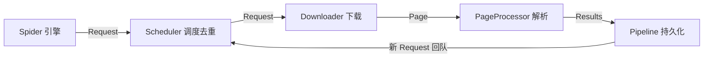

# WebMagic 介绍：四大组件撑起一条抓取流水线

> 🔒 安全提示：文中示例的口令/密钥均为课程教学环境演示口径，生产环境的安全要求见《安全与合规须知》。

爬虫的工作循环五步走：下载页面、解析内容、调度去重、持久化存储。每一环单写都能做，但每一环都有坑：HTTP 客户端的连接管理、HTML 解析的容错、url 去重的数据结构、结果落库的批次控制，从头造一遍轮子代价不小。Java 世界里这套轮子有现成的，叫 WebMagic，也是头条类资讯项目爬虫系统选定的框架。框架的定位、四大组件与 Spider 引擎，连同它与项目爬虫系统的结合点，下面逐层展开。

## 先给结论

- WebMagic 是一个简单灵活的 Java 爬虫框架，设计上参考了 Python 圈的知名爬虫框架 Scrapy，底层用 HttpClient 模拟浏览器发请求，用 Jsoup 解析 HTML。
- 四大组件各管一段：Downloader 负责下载页面，PageProcessor 负责解析页面，Scheduler 负责管理待抓 url 队列与去重，Pipeline 负责结果持久化。
- PageProcessor 是唯一必须用户自己编写的组件，解析规则因站点而异，框架替不了。
- Spider 是引擎，把四个组件组织成流水线，链式调用几行代码就能让爬虫跑起来。
- 核心保持简单，帮助开发的便利功能以扩展方式提供：注解模式开发、XPath 定位、Xsoup 选择器。

## 框架定位：Java 里的 Scrapy

WebMagic 的官方定位一句话：简单灵活的 Java 爬虫框架。简单指核心模型小，四大组件加一个引擎就是全部；灵活指每个组件都有默认实现，也都可以替换定制。它的设计参考了 Scrapy，后者是 Python 生态里最流行的爬虫框架，组件划分与调度思想一脉相承；语言换成 Java 之后，爬虫代码可以和 Spring 体系的微服务、消息队列、ORM 工具无缝共处，这正是资讯项目选它的直接原因。

依赖结构上，WebMagic 分 core 与 extension 两块，工程引入写法如下（版本以实际使用为准，示例按主流写法补全）：

```xml
<dependency>
    <groupId>us.codecraft</groupId>
    <artifactId>webmagic-core</artifactId>
    <version>0.7.3</version>
</dependency>
<dependency>
    <groupId>us.codecraft</groupId>
    <artifactId>webmagic-extension</artifactId>
    <version>0.7.3</version>
</dependency>
```

core 提供四大组件与 Spider 引擎，extension 提供注解模式等便利功能。底下两块基石：HttpClient 负责在后端模拟浏览器发送 HTTP 请求，把页面拿回来；Jsoup 是一个轻量 HTML 解析库，负责在拿回来的页面里定位与抽取内容。

## 四大组件：流水线上的四个工位

框架的主体就是四个组件，按画面线的架构图，数据在这条流水线上流动：



关键路径是这张图里的闭环：Scheduler 把待抓 url 交给 Downloader 下载成 Page，PageProcessor 从 Page 里解析出结果与新链接，结果交给 Pipeline 落库，新链接作为新的 Request 回到 Scheduler 队列，循环直到队列清空。

**Downloader：负责下载。** 框架默认用 HttpClient 实现，输入一个 Request，输出一个 Page。请求头、超时、重试这些连接细节都在这一层，换目标站点要调抓取频率时动的也是它。

**PageProcessor：负责解析。** 四个组件里唯一必须用户自己写的。目标站点的页面结构千差万别，哪段是标题、哪段是正文、哪些链接值得跟进，只有写爬虫的人知道。以抓技术社区文章为例，打开一篇文章页，拿到的 HTML 源码里混着导航、广告、推荐位，标签统统不要，只截正文文本，这段取舍逻辑就写在 process 方法里。

**Scheduler：负责调度与去重。** 管理所有待抓的 url，一个 url 已经爬过就没有必要再爬，去重在这里做。没有这道闸，解析出的新链接无限回队，同一批页面会被反复抓取，抓取系统立刻退化为死循环。

**Pipeline：负责持久化。** 解析出的结果最终要落到本地数据库，存库动作收在这一层。换存储介质时只换 Pipeline，前面的组件毫不知情，流水线的分层红利在换库这种时刻兑现。

## Spider：把组件串起来的引擎

四大组件是零件，Spider 是装配它们的引擎。默认实现替用户把组件装好，一个聚焦爬虫的最小可用版本长这样（示例按主流写法补全，目标站点与解析规则按实际需求定制）：

```java
public class ArticleProcessor implements PageProcessor {

    private Site site = Site.me().setRetryTimes(3).setSleepTime(1000);

    @Override
    public void process(Page page) {
        // 只要正文，标签全部丢弃
        page.putField("title", page.getHtml().xpath("//h1[@class='title-article']/text()").get());
        page.putField("content", page.getHtml().xpath("//div[@id='content_views']/html()").get());
        // 文章详情页链接入队，交给 Scheduler 去重后继续抓
        page.addTargetRequests(
                page.getHtml().links().regex("/article/details/\\d+").all());
    }

    @Override
    public Site getSite() {
        return site;
    }

    public static void main(String[] args) {
        Spider.create(new ArticleProcessor())
                .addUrl("https://blog.csdn.net/xxx")       // 初始 url
                .addPipeline(new ConsolePipeline())         // 换成数据库 Pipeline 即入库
                .thread(5)                                  // 5 个线程并发抓取
                .run();
    }
}
```

几行链式调用里，初始 url、解析器、持久化管道、并发度全部就位。Site 对象携带站点级配置，重试次数与抓取间隔就设在这里，sleepTime 一项同时是限频手段，把抓取压力压在合规区间内。

## 扩展能力：注解、XPath 与 Xsoup

核心需要足够简单，便利功能以扩展方式实现，官方的表述是这些扩展与用户自己写一个扩展没有区别。三件值得认识：**注解模式**的爬虫开发，把解析规则写在注解里，框架反射生成逻辑，适合规则简单的场景；**XPath** 定位，直接用路径表达式指到某个标签，解析起来更方便；**Xsoup**，在 Jsoup 基础上再封一层的选择器引擎，让 XPath 语法跑在 Jsoup 之上，目标是让定位内容尽可能快。项目里解析规则的定制会用到这套工具。

## 与课程项目的结合点

资讯项目的爬虫系统完全按这套组件模型搭建，下载、解析、调度、持久化四步对应四大组件。后面几章的内容都长在这个骨架上：导入爬虫系统后先做下载 url 初始化，把初始 url 收进 Scheduler；下载准备阶段定制 Downloader 的行为，IP 代理池在这一层生效；文档处理阶段按目标站点定义解析规则，那是 PageProcessor 的功课；数据保存则是 Pipeline 的扩展实现。Quartz 定时任务在外面调度整条流水线，夜间窗口批量抓取。

## 常见误区

- **以为 PageProcessor 可以不写。** 错例是引入框架后期待开箱即抓。正解是解析规则因站点而异，四大组件里只有它是必须用户实现的，其余三个都有默认实现可换。
- **把 Spider 当成第五个组件。** 错例是回答四大组件时把 Spider 算进去。正解是 Spider 是引擎，负责组织与调度四个组件，组件是零件，Spider 是装配与驱动它们的机器。
- **无视 Scheduler 的去重。** 错例是解析出的链接不加过滤全部回队，同一批页面被反复抓取。正解是靠 Scheduler 的去重挡住重复 url，队列只进没见过的地址，循环才有终点。
- **解析时把整个 HTML 存下来。** 错例是页面源码原样入库，导航广告全混进去。正解是在 PageProcessor 里只截正文文本，标签丢弃，入库的应是干净的结构化字段。
- **分不清 Xsoup 与 Jsoup。** 错例是以为两者是竞争关系二选一。正解是 Xsoup 架在 Jsoup 之上，把 XPath 语法适配到 Jsoup 的解析引擎，用 XPath 的表达力换 Jsoup 的速度。

## 面试可能被问到的问题

1. 面试官追问：「WebMagic 的四大组件分别负责什么？」
   答：Downloader 下载页面，默认 HttpClient 实现；PageProcessor 解析页面，从 HTML 里抽出正文与新链接，是唯一必须用户编写的组件；Scheduler 管理待抓 url 队列并做去重；Pipeline 把解析结果持久化到数据库。Spider 引擎把四者组织成流水线循环运行。
2. 面试官追问：「为什么只有 PageProcessor 必须自己写？」
   答：下载、调度、持久化的行为相对通用，框架的默认实现能覆盖大多数场景；解析规则完全取决于目标站点的页面结构，哪段是标题、哪些链接值得跟进只有业务方知道，所以这一个组件天然无法替写，其余组件留了扩展点以备定制。
3. 面试官追问：「Scheduler 的去重为什么重要，不做会怎样？」
   答：解析每个页面都会抽出新链接回队，没有去重时同一批 url 会被反复抓取，队列永远清不空，抓取退化成死循环，资源耗尽还可能拖垮目标站点。去重保证一个地址只进一次队列，循环才有停止的一天。
4. 面试官追问：「WebMagic 和 Scrapy 是什么关系？」
   答：设计上的参考关系。Scrapy 是 Python 生态最流行的爬虫框架，WebMagic 借鉴了它的组件划分与调度思想，用 Java 重新实现；选型时主要差异在语言生态，Java 项目里 WebMagic 能与 Spring 体系直接整合，跨语言引入 Scrapy 会多出部署与通信成本。
5. 面试官追问：「Xpath 和 Xsoup 在 WebMagic 里起什么作用？」
   答：两者都用于内容定位。XPath 是路径表达式标准，能直接指到页面里的某个标签；Xsoup 是在 Jsoup 之上封装的选择器引擎，让 XPath 语法跑在 Jsoup 的解析引擎上，兼顾表达力与速度。页面结构复杂时，精确的定位表达式是解析质量的第一保障。
6. 面试官追问：「你们项目里 WebMagic 怎么和定时任务、代理池配合？」
   答：WebMagic 负责单次抓取的流水线，Quartz 在外层按 cron 调度整条流水线，把抓取压在夜间低峰窗口；IP 代理池在下载层生效，请求出口轮换，避免单 ip 高频被封。三层各管各的：框架管流水线，调度管时机，代理管出口。

## 配套资料

- 代码：本日无配套源码包，`materials/code/05/头条day08/` 资料目录为空，框架介绍文本按画面线抄录整理；Maven 依赖与 Processor 示例按 WebMagic 官方主流写法补全，阶段三 day15 资料包中仅存爬虫产出数据、无 WebMagic 源码可引。
- 参照：阶段三好客租房 day15 的资料里带有一份抓取完成的房源数据 `materials/code/03/day15-房源数据抓取以及实现房源搜索/day15-房源数据抓取以及实现房源搜索/资料/抓取的房源数据/data.json`，每条记录含标题、户型、租金与来源 url，可对照感受 PageProcessor 解析与 Pipeline 落库之后的数据形态。
- 环境：课程集群 node01~node03，MySQL root/123456；WebMagic 版本与目标站点解析规则在导入爬虫系统后按环境确定。
