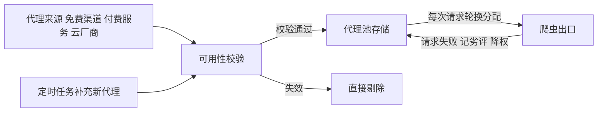

# 代理 IP：让爬虫换个出口持续工作

> 🔒 安全提示：文中示例的口令/密钥均为课程教学环境演示口径，生产环境的安全要求见《安全与合规须知》。

同一台机器对着目标站点抓了一整晚文章，第二天一早所有请求齐刷刷被拒，返回的全是验证页。这不是目标站点出了故障，是出口 ip 被风控盯上了。抓取量一大、频率一高，对方的检测系统第一个处理的就是这个高频来源地址。本机 ip 是爬虫最脆弱的一环，代理 IP 就是为它准备的备胎：把请求出口换掉，采集才能持续下去。

## 先给结论

- 代理 IP 的本质是中转：请求先发给代理服务器，由它转发给目标站点，目标站点看到的是代理的地址而不是本机地址。
- 抓取量过大时目标站点会按访问频率封禁来源 ip，本机 ip 一旦被封整个采集就停摆，换代理出口才能继续。
- 按匿名度分四类：透明代理、匿名代理、混淆代理、高匿代理，匿名度越高越难被识别，被封的几率越低。
- 免费代理失效快、可用率低，用之前必须校验；付费代理与云厂商的代理服务稳定性更好，生产上靠代理池轮换而不是单点代理。
- HttpClient 在请求级配置里挂代理，WebMagic 提供站点级代理与代理池轮换两种挂法；代理解决「换出口」，限频解决「别太吵」，两者要配合使用。

## 为什么需要：封禁与频控

**第一，目标站点的检测逻辑很直接。** 以技术社区站点为例，用浏览器正常访问没有任何问题，因为人的访问频率天然有限。爬虫不一样，它可以在短时间内发起成百上千次请求，单 ip 的访问曲线立刻变成一条陡线，系统检测到访问次数过高就会把这个 ip 封掉，之后这个地址发来的所有请求一律拒绝。ip 被封之后本机连页面都打不开，采集自然无从谈起。

**第二，代理把矛盾从本机转移出去。** 配置代理之后，请求的路径变成「本机发请求到代理服务器，代理服务器转发到目标站点」，目标站点记录并检测的是代理服务器的地址。单点代理同样会被封，所以真正的解法是让出口动起来：一批代理轮流上岗，任何单一地址的请求频率都被摊薄，检测系统盯不出明显异常。

换出口解决的是「身份」问题，压不住「行为」问题。每个出口仍然要控制抓取间隔与总量，全速轮换只会把一批代理一起送进黑名单。

## 匿名度分类：四类代理的暴露程度

| 类型 | 目标站点能看到什么 | 暴露程度 |
|---|---|---|
| 透明代理 | 知道在用代理，还能拿到真实 ip | 完全暴露 |
| 匿名代理 | 知道在用代理，拿不到真实 ip | 半暴露 |
| 混淆代理 | 收到被改写的请求头，来源信息失真 | 较难识别 |
| 高匿代理 | 既看不出代理痕迹，也拿不到真实 ip | 基本不暴露 |

选型的结论顺着这张表走：优先高匿，匿名与混淆次之，透明代理等于没换出口。代理来源上，网上有大量 ip 代理商，部分云厂商也提供代理 IP 服务；免费代理是从公开渠道抓来的地址，失效快、存活期短，直接拿来用经常是请求超时，所以免费地址必须先校验后使用；付费的稳定性明显好一截。测试阶段也应该走代理，避免本机 ip 被封之后整个爬虫系统没法继续用。

## 代理池：让出口动态起来

单点代理挂掉是常态，工程上的解法是代理池。它的完整工作流如下：



关键在两个闭环：校验闭环把不可用的地址挡在池外，劣评闭环把用坏的地址及时降权剔除。进入池里的地址随时可能失效，没有校验与回收的池子会拿脏地址拖垮整条抓取流水线。真正进入抓取阶段时会设置动态代理，指的就是这套轮换机制。头条类资讯项目的爬虫系统里，代理池的生效位置在下载层，也就是 WebMagic 的 Downloader 一侧。

## 两种挂法：HttpClient 与 WebMagic

HttpClient 的代理挂在请求级配置上（示例按本课写法补全）：

```java
// 目标地址不变，代理只决定从哪个出口出去
HttpHost proxy = new HttpHost("127.0.0.1", 8888, "http");
RequestConfig config = RequestConfig.custom()
        .setProxy(proxy)
        .setConnectTimeout(5000)
        .setSocketTimeout(5000)
        .build();
HttpGet get = new HttpGet("https://www.example-site.com/article/1001");
get.setConfig(config);
```

WebMagic 的挂法更贴近项目。站点级代理写在 Site 对象上，代理池轮换用 ProxyProvider（day08 资料包为空，示例按 WebMagic 主流写法补全）：

```java
package com.study.headline.crawler;

import us.codecraft.webmagic.Spider;
import us.codecraft.webmagic.proxy.Proxy;
import us.codecraft.webmagic.proxy.SimpleProxyProvider;

public class ProxyCrawler {

    public static void main(String[] args) {
        Spider.create(new ArticleProcessor())
                .addUrl("https://www.example-site.com/articles")
                // 站点级固定代理的等价写法：
                // Site.me().setRetryTimes(3).setSleepTime(1000)
                //         .setHttpProxy("127.0.0.1", 8888)
                // 代理池轮换：请求出口在多个代理之间切换
                .setProxyProvider(SimpleProxyProvider.from(
                        new Proxy("127.0.0.1", 8888),
                        new Proxy("127.0.0.1", 8889),
                        new Proxy("127.0.0.1", 8890)))
                .thread(5)
                .run();
    }
}
```

`setSleepTime` 的间隔限频加上代理轮换，一个压频率、一个换出口，两条合在一起才构成完整的抗压方案。示例中的代理地址全部用 127.0.0.1 占位，实际接入时按代理商或云服务提供的地址配置。

## 常见误区

- **挂了代理就放开频率抓。** 错例是以为换了出口就查不到，对单代理全速轮换，很快整池被封。正解是代理只解决身份问题，每个出口仍要限频，抓取间隔照设。
- **免费代理抓来直接用。** 错例是不校验直接入池，请求超时、重试堆积，拖慢整条流水线。正解是先校验再入池，失败降权及时剔除。
- **拿透明代理当安全出口。** 错例是看到能转发就用，目标站点连真实 ip 都能拿到。正解是按匿名度选，优先高匿。
- **代理地址写死在代码里。** 错例是单个代理硬编码，一挂全线停摆。正解是代理池加轮换，地址来自配置或存储，随时可换。

## 面试可能被问到的问题

1. 面试官追问：「爬虫为什么需要代理 IP，它的工作原理是什么？」
   答：抓取量大时目标站点会按访问频率封禁来源 ip，本机被封采集就停摆。代理是中转服务器，请求由它转发给目标站点，对方看到的是代理地址；配置一批代理轮换出口，单地址频率被摊薄，采集才能持续。
2. 面试官追问：「透明、匿名、高匿代理有什么区别？」
   答：透明代理不隐藏任何信息，服务器知道用了代理还能拿到真实 ip；匿名代理隐藏真实 ip 但暴露代理身份；高匿代理连代理痕迹都看不到，是最安全的一类；混淆代理改写请求头伪装来源。选型上优先高匿，透明基本不用。
3. 面试官追问：「代理池怎么设计，失效代理怎么处理？」
   答：池子分采集、校验、存储、调度几层：来源候选地址先向稳定目标发测试请求，通过的入池；调度时按请求轮换分配，失败的记劣评降权；定时任务持续补充新地址、剔除失效地址，两个闭环保证池里的地址随时可用。
4. 面试官追问：「WebMagic 里怎么配置代理？」
   答：两种挂法。站点级代理在 Site 对象上 setHttpProxy 指定主机与端口；代理池轮换用 setProxyProvider 传入 SimpleProxyProvider，多个 Proxy 对象在请求间切换。配合 setSleepTime 的间隔限频，频率与出口两个维度都压住。
5. 面试官追问：「用了代理是不是就不需要限频了？」
   答：不是。代理解决的是单地址暴露问题，目标站点对每个来源同样有频控，全速轮换只会加速整池被封。限频控制行为，代理控制身份，两者配合才合规也才稳定。

## 配套资料

- 代码：本日无配套源码包，`materials/code/05/头条day08/` 资料目录为空；代理类型与暴露程度的口径按画面线（WebMagic 官方文档代理 IP 章节）整理，HttpClient 与代理池示例按主流写法补全。
- 参照：阶段三好客租房 day15 的资料里带有一份抓取完成的房源数据 `materials/code/03/day15-房源数据抓取以及实现房源搜索/day15-房源数据抓取以及实现房源搜索/资料/抓取的房源数据/data.json`，每条记录带来源 url，这类数据的采集过程同样受封禁与频控约束。
- 环境：课程集群 node01~node03，MySQL root/123456；代理服务地址在导入爬虫系统后按环境配置，文中示例一律以 127.0.0.1 占位。
