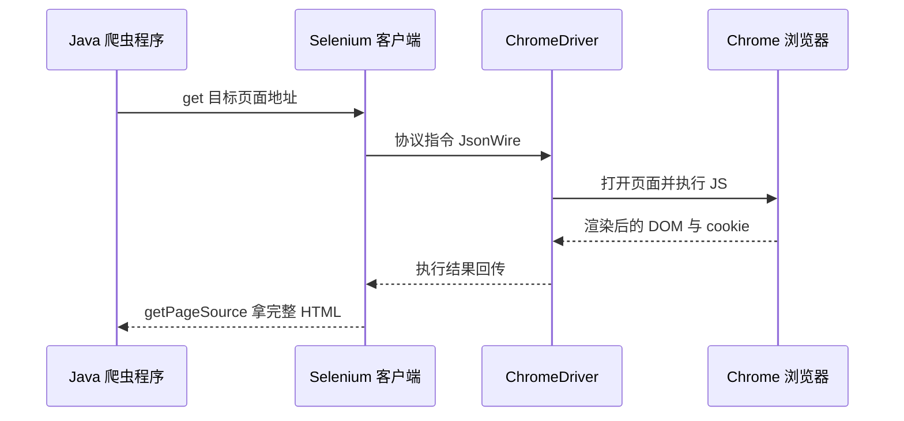

# Selenium 介绍与环境安装：用真实浏览器拿渲染后的页面

> 🔒 安全提示：文中示例的口令/密钥均为课程教学环境演示口径，生产环境的安全要求见《安全与合规须知》。

用 HttpClient 抓一篇文章页，解析时发现标题是空的，正文的位置只有一段压缩过的 JS；同一个地址在浏览器里打开却什么都有。页面是 JS 渲染出来的，纯 HTTP 客户端拿到的只是空壳。爬虫遇到这类站点，就需要 Selenium 这样的工具：驱动一个真实浏览器，把渲染这件事做完再交出页面。

## 先给结论

- Selenium 是浏览器自动化测试工具，爬虫借它调用真实浏览器（本课用 Chrome），拿到渲染完成的页面和必要的 cookie。
- 大量网页由 JS 动态生成，直接请求拿到的 DOM 只有一个空的根元素加一堆 script 标签，正文根本不在源码里。
- ChromeDriver 是 Selenium 与 Chrome 通信的桥梁，两者通过 JsonWire 协议交互，driver 版本必须与浏览器版本对应。
- 安装三步：确认本机 Chrome 版本号，下载对应版本的 chromedriver，解压出 exe 后在程序里指定路径。
- headless 无头模式让浏览器后台运行不弹窗口，服务器环境也能跑。

## 为什么需要：JS 渲染与 JS 生成的 cookie

**第一，页面内容是浏览器执行 JS 之后才出现的。** 官方文档的原话是：由于存在大量网页是动态生成的，用爬虫查看源代码之后发现，网页的 DOM 只有一个 root 根元素和一堆 JS，根本看不到网页的实际内容。正文、评论、列表都是浏览器执行脚本后插进 DOM 的，不执行 JS 就拿不到它们。

**第二，cookie 也由 JS 生成。** 以技术社区站点为例，站点的 cookie 通过 JS 生成，必须经过浏览器才能得到；没有 cookie 支撑，直接调接口往往拿不到想要的数据。Selenium 在这条链路里的用途一句话就能说清：调用 Chrome 浏览器，拿到必要的 cookie 与渲染完成的页面。



这张时序图的关键角色是 ChromeDriver：它是 google 为网站开发人员提供的自动化测试接口，是 Selenium 与 Chrome 浏览器之间通信的桥梁。Selenium 通过 JsonWire 协议与它交互，实质上是对这套协议的底层封装，同时向上提供 WebDriver 这层应用接口。

## Selenium 是什么

Selenium 是一套浏览器自动化测试工具，WebDriver 就是为浏览器自动化测试而设计的接口层；WebMagic 文档专门有一节讲「Selenium 方式下载页面」，把它当作获取页面的补充手段。它支持的浏览器范围很广，Chrome、Firefox、IE 等桌面主流浏览器都在列，移动端的 Android 与 iOS 也有对应驱动。对爬虫而言，它相当于一个可以编程控制的真人浏览器。

headless 模式值得单独说一句：浏览器照常完成加载、执行 JS、渲染 DOM 的全部流程，只是不渲染界面窗口。服务端环境没有显示器，无头模式让 Selenium 爬虫在服务器上照常运行。

## 环境安装三步

**第一步，确认本机 Chrome 的版本号。** 浏览器菜单里打开「帮助」→「关于」，能看到完整版本号，例如 77.0.3865.120。

**第二步，下载与版本对应的 chromedriver。** driver 与 Chrome 有严格的版本对应关系，官方文档给出的对应表节选如下：

| chromedriver 版本 | 对应 chrome 版本 |
|---|---|
| ChromeDriver 2.36 | Chrome v63-65 |
| ChromeDriver 2.35 | Chrome v62-64 |
| ChromeDriver 2.34 | Chrome v61-63 |
| ChromeDriver 2.33 | Chrome v60-62 |

选法就一条：找与浏览器主版本号最接近的 driver。版本列表里带 release 字样的入口不用管，直接进对应版本号目录，按平台下载 win32 包（文件名带 win32，Windows 环境就用它）；项目上线部署到 Linux 时换成 linux64 包。国内有 chromedriver 的公开镜像站点，下载速度比官方源快得多。

**第三步，解压并记下路径。** 下载得到一个压缩包，解压后里面就是一个 chromedriver.exe，把它放到固定目录，等程序来调用。

Java 工程里补上依赖（版本以实际使用为准，示例按本课写法补全）：

```xml
<dependency>
    <groupId>org.seleniumhq.selenium</groupId>
    <artifactId>selenium-java</artifactId>
    <version>3.141.59</version>
</dependency>
```

## 最小可用示例

```java
package com.study.headline.crawler;

import org.openqa.selenium.WebDriver;
import org.openqa.selenium.chrome.ChromeDriver;
import org.openqa.selenium.chrome.ChromeOptions;

import java.util.concurrent.TimeUnit;

public class HeadlessPageFetcher {

    public static void main(String[] args) {
        // 指定 chromedriver.exe 的位置，程序按这个路径调用它
        System.setProperty("webdriver.chrome.driver",
                "D:/tools/chromedriver_win32/chromedriver.exe");
        ChromeOptions options = new ChromeOptions();
        options.setHeadless(true);                  // 无头模式，后台运行不弹窗口
        WebDriver driver = new ChromeDriver(options);
        try {
            driver.get("https://www.example-site.com/article/1001");
            driver.manage().timeouts()
                    .implicitlyWait(5, TimeUnit.SECONDS);   // 留时间给 JS 渲染
            String html = driver.getPageSource();   // 渲染后的完整 HTML
            System.out.println("页面长度：" + html.length());
            // html 交给 Jsoup 或 WebMagic 的解析组件做字段抽取
        } finally {
            driver.quit();                          // 释放浏览器进程
        }
    }
}
```

两个细节值得留意。`getPageSource()` 返回的是渲染后的 DOM，正文已经在了，这与 HttpClient 直接拿到的空壳有本质区别；`quit()` 必须放在 finally 里，driver 不释放，浏览器进程会在后台越积越多。把这段代码封装成自定义 Downloader，就能让 WebMagic 的流水线处理需要渲染的页面，普通页面仍走 HttpClient，各干各的。

## 常见误区

- **driver 版本与浏览器版本对不上。** 错例是随手下个最新 driver，启动时报会话创建失败类异常。正解是按对应表选与浏览器主版本最接近的 driver。
- **在服务器上忘开无头模式。** 错例是本机调试正常，部署到 Linux 后直接起不来，因为服务器没有图形界面。正解是 setHeadless(true) 常开。
- **页面没渲染完就取源码。** 错例是 get 之后立刻 getPageSource，拿到的还是空壳。正解是设置隐式等待，或显式等待某个元素出现再取。
- **只 get 不 quit。** 错例是异常分支漏掉关闭，浏览器进程堆积耗尽资源。正解是 finally 里统一 quit。

## 面试可能被问到的问题

1. 面试官追问：「HttpClient 也能发请求，为什么还要用 Selenium？」
   答：HttpClient 只拿服务器返回的原始源码，JS 动态渲染的页面源码里只有一个空根元素加一堆脚本，正文不在其中；而且这类站点的 cookie 由 JS 生成，没有浏览器就拿不到。Selenium 驱动真实浏览器执行完渲染，交出的才是完整 DOM 与 cookie。
2. 面试官追问：「Selenium、WebDriver、ChromeDriver 三者什么关系？」
   答：Selenium 是自动化测试框架，WebDriver 是它定义的浏览器自动化接口层；ChromeDriver 是 google 提供的接口实现，专门负责与 Chrome 通信，两者之间走 JsonWire 协议。程序调用 Selenium，Selenium 通过 ChromeDriver 驱动 Chrome。
3. 面试官追问：「chromedriver 版本不匹配会怎样，怎么选版本？」
   答：会话创建会直接失败，报 driver 与浏览器版本不匹配类异常。选法是看本机 Chrome 的版本号，找主版本最接近的 driver；Windows 环境下 win32 包即可，Linux 部署换 linux64 包。
4. 面试官追问：「headless 模式是什么，为什么爬虫都用它？」
   答：浏览器不渲染界面窗口，但加载、执行 JS、渲染 DOM 的流程照常走完。服务器没有图形界面，无头模式是唯一可行形态，同时省掉界面渲染的开销，速度更快也更省资源。
5. 面试官追问：「Selenium 抓回来的页面怎么接进爬虫流水线？」
   答：getPageSource 拿到渲染后的 HTML 字符串，交给 Jsoup 解析或包装成 WebMagic 的 Page 走既有解析规则；工程上一般封装成自定义 Downloader，只对需要渲染的 url 走 Selenium，普通页面仍走 HttpClient。

## 配套资料

- 代码：本日无配套源码包，`materials/code/05/头条day08/` 资料目录为空；Selenium 与 ChromeDriver 的说明、版本对应表按画面线（WebMagic 官方文档 Selenium 章节）抄录整理，示例按本课写法补全。
- 参照：阶段三好客租房 day15 的资料里带有一份抓取完成的房源数据 `materials/code/03/day15-房源数据抓取以及实现房源搜索/day15-房源数据抓取以及实现房源搜索/资料/抓取的房源数据/data.json`，每条记录带来源 url，是「先拿渲染后页面、再解析落库」这条链路的产出实物。
- 环境：课程集群 node01~node03，MySQL root/123456；chromedriver 的存放路径在导入爬虫系统后按环境配置。
