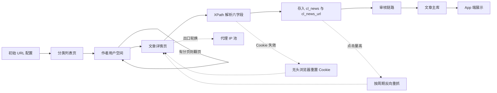

# 爬虫系统需求与设计：把外部内容采集成平台的第二条内容线

> 🔒 安全提示：文中示例的口令/密钥均为课程教学环境演示口径，生产环境的安全要求见《安全与合规须知》。

自媒体链路到 day07 已经闭环：提交文章落库、消息进队列、三道审核、App 端见报。但这条链有一个隐藏前提，得先有创作者来发文。刚上线的资讯平台既没有用户也没有作者，App 端打开是空的，冷启动无从谈起。爬虫系统正是冲着这个问题进场的：从外部内容站自动采集文章入库，让平台在创作者进场之前先有内容可刷。day08 剩下的几讲全是工程落地，动手之前先把需求与设计捋透，后面的代码都按这份蓝图施工。

## 先给结论

- 爬虫系统的定位是内容采集器：抓取外部内容站的文章，标明来源后落库，与自媒体投稿共用同一条审核链路进 App 端，解决平台冷启动与内容量不足。
- 采集动线五步：配置初始 URL、进入作者用户空间拿文章链接、WebMagic 抓取与分页处理、XPath 解析目标字段、保存入库。
- 存储格式与自媒体发布文章完全一致，正文按文本块与图片块存成 JSON 串，前端解析逻辑零改动。
- 反爬两手准备：JS 混淆 Cookie 用无头浏览器方案（Selenium 加 ChromeDriver）先取 Cookie 再重放；代理 IP 池自管理，定时剔除失效代理。
- 点击量高的文章定期反向重抓，回刷阅读量与评论数据，为后期大数据推荐攒特征。

## 需求逐条拆：五句话背后的动作

**第一，配置初始 URL，解析出用户空间链接。** 目标内容站的首页挂着分类导航，点不同分类时地址栏跟着变，变的部分只有后缀，前缀是固定的。程序要做的是把「前缀固定、后缀枚举」的组合全部拼出来，先拿到一批明确的入口地址。对应配置长这样（域名按占位示意）：

```properties
crawler.init.url.prefix=https://example.com/nav/
crawler.init.url.suffix=java,web,arch,db,mobile,ops,sec,cloud,engineering,iot,fund,career
```

前缀加 12 个分类后缀就是 12 个入口。入口之后的动作是进用户空间：文章都挂在作者的账号空间下，抓到一篇就顺着作者空间把整个账号的文章列表拿回来，一篇一篇抓，文章量才铺得开。

**第二，进入用户空间抓文章，有分页就翻页。** 作者文章多时列表会分页，抓取程序要能一页一页翻到底；文章少时没有分页，同一套逻辑照样兼容。翻页次数由配置控制，`crawler.help.nextPagingSize` 就是单次翻页的上限。

**第三，抓取失败要有兜底。** 目标站对没有 Cookie 的请求会返回拦截页，响应里根本没有正文。判断方式是检查响应是否带上了 `acw_sc_v2` 这个 Cookie 键，没有就用无头浏览器以 headless 模式先访问一次，触发验证拿回合法 Cookie，重置之后重新抓取。

**第四，解析只取要的字段。** 标题、作者、发布日期、文章来源、阅读量、评论数据，六个目标字段用 XPath 从页面里定位出来，导航、广告、推荐位统统丢弃，入库的必须是干净的结构化数据。

**第五，高点击量数据定期重抓。** 文章是活的，阅读量、评论数、转发量每天都在涨。系统对点击量高的文章按周期反向抓取，把最新互动数据回刷进库。这件事的真正受益方是后期的大数据推荐：互动数据越新鲜，热门计算与推荐特征就越准，这也是整个采集链路存在的深层意义。

## 设计思路：一条采集链路，两个侧翼，两层调度

需求落到设计上是一条链路加两个侧翼。链路负责把内容采回来，侧翼负责让链路长期活着。



关键路径从初始 URL 起跑：入口进列表页，列表页引到作者空间，空间里的每篇文章抓回来解析入库，入库后与自媒体稿件共用审核链路，审核通过才进文章主库、在 App 端见报。虚线是侧翼：Cookie 失效走无头浏览器兜底，所有出口统一挂代理 IP 池，热文章按周期回刷。

模块按职责切包：`config` 管配置类，`process` 管业务流程（原始数据处理、下载、解析各归其位），`helper` 管协作帮手，`utils` 管工具，`factory` 管代理构建，枚举与公共实体沉到 model 模块与主工程共享。爬虫系统作为独立微服务加入父工程，依赖 model 与 common 两个模块，其余微服务毫不知情。

定时策略分两层。抓取窗口压在夜间低峰，Quartz 按 cron 把整条流水线排在深夜到清晨之间跑，白天不打扰正常服务；更新周期走阶梯配置，`crawler.nextupdatehours=4,16,64,128,256` 表示按热度分档回访，热度越高间隔越短，最冷的一档拉长到 256 小时，抓取预算不浪费在没变化的文章上。

## 数据怎么落：两张表一个格式

落库载体是两张表。`cl_news_url` 是 URL 台账，初始化阶段先把入口地址灌进这张表，之后每个被抓取的地址都在这里有状态记录，去重与更新周期判断都靠它；`cl_news` 是文章表，解析出的标题、作者、正文、互动数据落在这里。资料包没有随包携带建表脚本，DDL 按本课写法补全如下，字段以工程实际为准：

```sql
CREATE TABLE `cl_news_url` (
  `id` bigint NOT NULL COMMENT '主键',
  `url` varchar(512) NOT NULL COMMENT '待抓取或已抓取的地址',
  `document_type` varchar(16) DEFAULT NULL COMMENT '文档类型 INIT/HELP/PAGE/OTHER',
  `handle_type` varchar(16) DEFAULT NULL COMMENT '处理方向 FORWARD/BACKWARD',
  `status` tinyint DEFAULT NULL COMMENT '抓取状态',
  `created_time` datetime DEFAULT NULL COMMENT '入库时间',
  `updated_time` datetime DEFAULT NULL COMMENT '最近更新时间',
  PRIMARY KEY (`id`)
) ENGINE=InnoDB DEFAULT CHARSET=utf8mb4 COMMENT='爬虫URL台账';
```

文章正文的存储格式必须与自媒体发布文章保持一致：内容按块存成 JSON 串，文本块与图片块交替排列。这个格式是前后端的契约，不能轻易动，动了 App 端的解析就得跟着改。

```json
[
  {
    "type": "text",
    "value": "正文第一段文字"
  },
  {
    "type": "image",
    "value": "https://img.example.com/large/xxxx",
    "style": { "height": "810px" }
  }
]
```

评论数据单独处理，一篇文章可能挂多条评论，解析时按评论维度拆开存储；评论接口地址在配置里留了模板位，按文章 id 与页码填充后即可拉取。

## 常见误区

- **把初始 URL 理解成只有一个首页地址。** 错例是拿首页一个地址反复抓。正解是前缀加分类后缀枚举出成批入口，每个入口对应一条内容线，文章量才铺得开。
- **解析时什么都想要。** 错例是整页 HTML 原样入库，导航广告全混进去。正解是只抽六个目标字段，杂质在解析层丢弃。
- **忽略反向抓取。** 错例是文章抓一次就完事。正解是互动数据持续在变，高点击量文章按阶梯周期回刷，否则推荐侧拿到的永远是旧数据。
- **代理池建完不管。** 错例是代理拉一次用到底。正解是定时逐个检测失效即删，池子里随时都是活代理。

## 面试可能被问到的问题

1. 面试官追问：「你们的资讯平台为什么要自建爬虫系统？」
   答：冷启动阶段没有创作者，App 端无内容可展示。爬虫从外部内容站采集文章，标明来源后入库，与自媒体投稿共用审核链路，先保证有内容可消费，再靠创作者生态逐步替换外部来源。
2. 面试官追问：「初始 URL 为什么设计成前缀加后缀枚举？」
   答：目标站点的内容按分类组织，分类栏目的地址规律是前缀固定、后缀变化。配置化之后站点改版只改配置不发代码，后缀增减一个分类就是增减一个入口，扩量成本极低。
3. 面试官追问：「抓取的内容为什么不直接进文章主表？」
   答：先落爬虫侧的 cl_news 与 cl_news_url，URL 台账管去重与状态，文章表攒齐结构化数据后再走审核链路进主库。合规口径统一，外部内容的质量与风险也可控。
4. 面试官追问：「遇到反爬怎么兜底？」
   答：目标站用 JS 混淆 Cookie 验证访问者，直接请求拿不到正文。用无头浏览器先访问一次触发验证，拿到合法 Cookie 后重置请求再抓，判断标志就是配置里固定的 Cookie 键是否存在。
5. 面试官追问：「代理 IP 池的自管理指什么？」
   答：自动拉取新代理入库、定时检测存量代理并剔除失效项，保证池内代理随时可用。出口轮换能显著降低单 IP 高频访问被目标站封禁的概率。
6. 面试官追问：「高点击量文章的重抓周期怎么定？」
   答：按热度阶梯配置，更新间隔从 4 小时起步逐档拉长到 256 小时，热度高的变化快重抓密，冷门文章不值得反复回访，这组间隔直接来自配置项。

## 配套资料

- 代码：本日无配套源码包，`materials/code/05/头条day08/` 资料目录为空，需求文本按画面线抄录整理，表结构、配置与格式示例按本课写法补全。
- 参照：`materials/code/05/头条day12/` 提供了 Kafka Stream 流计算的封装工具类（引用截至 dayNN 层级，内层目录含项目原名），对应高点击量数据的热点统计，与反向抓取需求衔接；阶段三 day15 资料里的抓取产物 `materials/code/03/day15-房源数据抓取以及实现房源搜索/day15-房源数据抓取以及实现房源搜索/资料/抓取的房源数据/data.json` 可对照感受爬虫落库前的数据形态。
- 环境：课程集群 node01~node03，MySQL root/123456；代理池与无头浏览器驱动按 crawler.properties 中的路径配置。
