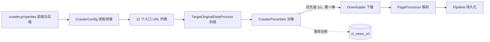

# 爬虫系统导入与初始 URL 获取：把目标站点的入口灌进系统

> 🔒 安全提示：文中示例的口令/密钥均为课程教学环境演示口径，生产环境的安全要求见《安全与合规须知》。

爬虫系统的代码不以「从零建模块」的方式出现，它带着一份写好骨架的初始工程进场。工程导入之后认一遍家底，然后做第一件业务活：把「要抓哪里」从配置文件里的几个字符串，加工成一批结构化的抓取对象。day08 的三讲（导入爬虫工程、初始 URL 获取上与下）在工程侧环环相扣，是后续下载与解析两讲的立足点。

## 先给结论

- 导入四步：解压到父工程根目录、IDE 里以 Maven 模块加入、刷新依赖、核对 pom 继承关系；模块名 `headline-crawler`，与 article、admin 等模块平级。
- 爬虫工程自带两份配置：`application.properties` 放端口与应用名，`crawler.properties` 是爬虫专属物料清单（驱动路径、代理、初始 URL 前后缀、更新周期）。
- `CrawlerConfig` 用 `@Configuration` 加 `@PropertySource` 加 `@ConfigurationProperties` 三注解组合读配置，`getInitCrawlerUrlList()` 把前缀与 12 个分类后缀拼成入口列表。
- 业务流接口 `ProcessFlow` 有三个方法：`handle` 主业务、`getComponentType` 组件类型、`getPriority` 优先级；初始化流程靠优先级插到下载之前执行。
- URL 字符串升格为 `CrawlerParseItem` 对象：拼时间戳防重、文档类型置 INIT、处理方向置 FORWARD。

## 工程导入：四步把模块挂进父工程

初始工程解压后是一个独立的 Maven 模块，导入动作分四步。

**第一，解压到父工程根目录。** 把爬虫工程的压缩包解压到头条类资讯项目父工程目录下，与 article、admin 这些模块平级摆放，解压完删掉压缩包。

**第二，在 IDE 里把模块加进来。** 刚解压完的目录在工程树里是灰色的，表示它还没被 Maven 识别。在 Maven 面板点加号，选中爬虫工程目录下的 `pom.xml`，确认后模块就挂上了。

**第三，刷新依赖。** 刷新后灰色消失，模块树恢复正常，报错一般是依赖还没下载完，等索引建好即可。过程中 IDE 可能弹出 VCS root 映射的提示，与代码无关，可以直接忽略。

**第四，核对 pom 继承关系。** 爬虫模块的 parent 指向父工程，版本号跟着父工程走。父工程的 modules 清单里登记这个新成员：

```xml
<modules>
    <module>headline-common</module>
    <module>headline-utils</module>
    <module>headline-model</module>
    <module>headline-article</module>
    <module>headline-behavior</module>
    <module>headline-user</module>
    <module>headline-admin</module>
    <!-- 爬虫系统模块，day08 加入 -->
    <module>headline-crawler</module>
</modules>
```

爬虫模块自己的 pom 里，除 parent 外还带了一批依赖，可以按用途分成四组：

```xml
<dependencies>
    <!-- 组一：项目内部模块，复用实体与工具 -->
    <dependency>
        <groupId>com.study</groupId>
        <artifactId>headline-model</artifactId>
        <version>1.0-SNAPSHOT</version>
    </dependency>
    <dependency>
        <groupId>com.study</groupId>
        <artifactId>headline-common</artifactId>
        <version>1.0-SNAPSHOT</version>
    </dependency>
    <!-- 组二：微服务基建 -->
    <dependency>
        <groupId>org.springframework.cloud</groupId>
        <artifactId>spring-cloud-starter-netflix-eureka-client</artifactId>
    </dependency>
    <dependency>
        <groupId>org.springframework.boot</groupId>
        <artifactId>spring-boot-starter-web</artifactId>
    </dependency>
    <dependency>
        <groupId>org.springframework.boot</groupId>
        <artifactId>spring-boot-starter-test</artifactId>
        <scope>test</scope>
    </dependency>
    <dependency>
        <groupId>org.springframework.cloud</groupId>
        <artifactId>spring-cloud-starter-openfeign</artifactId>
    </dependency>
    <!-- 组三：Jackson 多格式支持，解析目标站返回的 JSON/XML 数据 -->
    <dependency>
        <groupId>com.fasterxml.jackson.dataformat</groupId>
        <artifactId>jackson-dataformat-toml</artifactId>
    </dependency>
    <dependency>
        <groupId>com.fasterxml.jackson.dataformat</groupId>
        <artifactId>jackson-dataformat-xml</artifactId>
    </dependency>
    <!-- 组四：WebMagic 爬虫框架 -->
    <dependency>
        <groupId>us.codecraft</groupId>
        <artifactId>webmagic-core</artifactId>
        <version>0.7.3</version>
    </dependency>
    <dependency>
        <groupId>us.codecraft</groupId>
        <artifactId>webmagic-extension</artifactId>
        <version>0.7.3</version>
    </dependency>
</dependencies>
```

WebMagic 依赖是爬虫的发动机，四大组件与 Spider 引擎都在这两个包里；model 模块里则放着爬虫侧的枚举与解析条目实体，供工程内部共享。依赖清单里还有两类不起眼但少不了的角色：Lombok 负责把实体类的 getter、setter、构造方法压缩成注解，爬虫侧实体多而字段杂，收益明显；网络请求客户端（HttpClient 一族）撑起工具类的底层访问通道，下载页面、拉代理走的都是它。

复用是导入式建模块的最大红利。爬虫工程不重新定义一套枚举与实体，而是直接依赖 model 与 common 两个内部模块：枚举长在 model 里，工具长在 common 里，主工程与爬虫工程各取所需。这样做的直接后果是两条内容线天然对齐，爬虫产出的文章对象与自媒体发布的文章对象是同一个类的实例，入库与审核环节不需要任何转换代码。eureka 客户端依赖则让爬虫服务注册进注册中心，将来网关或调度服务要触发抓取任务，按服务名就能找到它。

## 认一遍家底：包结构与两份配置

导入完成的爬虫工程长这样（资料包未随包提供源码，结构按画面线整理）：

```text
headline-crawler
├── pom.xml
└── src/main/java/com/study/headline/crawler
    ├── CrawlerApplication.java              # 引导类
    ├── config
    │   ├── CrawlerConfig.java               # 爬虫专属配置类，初始化主角
    │   └── InitConfig.java                  # 通用装配：Jackson、MyBatis、Kafka
    ├── process
    │   ├── ProcessFlow.java                 # 业务流接口
    │   ├── AbstractProcessFlow.java         # 流程抽象基类
    │   ├── entity
    │   │   ├── ProcessFlowData.java         # 流程上下文数据
    │   │   └── CrawlerParseItem.java        # 爬虫解析条目
    │   ├── original
    │   │   ├── AbstractOriginalDataProcess.java
    │   │   └── impl/TargetOriginalDataProcess.java
    │   └── download/                        # 下载组件，后续几讲填充
    ├── helper/                              # Cookie 与流程帮手，后续填充
    ├── utils/                               # 无头浏览器客户端等工具
    └── factory/                             # 代理工厂
└── src/main/resources
    ├── application.properties               # 端口与应用名
    └── crawler.properties                   # 爬虫专属配置
```

引导类与通用装配都是熟面孔：`InitConfig` 里装配的 Jackson、MyBatis、Kafka 与主工程同款，直接拷过来。`helper`、`utils`、`factory` 三个包里躺着的工具类暂时不用逐个研究，用到的时刻再展开讲解印象更深。`process` 包是重头，爬虫的核心业务代码都写在它下面。

配置文件里，`application.properties` 只放微服务基建：

```properties
server.port=${port.crawler}
spring.application.name=${sn.crawler}

redis.host=${spring.redis.host}
redis.port=${spring.redis.port}
redis.timeout=${spring.redis.timeout}
redis.password=${spring.redis.password}
```

端口号与应用名用 `${}` 占位，值由父级统一规划；redis 一组现阶段还用不到，先占位待用。真正要紧的是 `crawler.properties`，逐键过一遍（域名按占位示意）：

```properties
# windows
webdriver.chrome.driver=D:/develop/chromedriver_win32/chromedriver.exe
# linux
webdriver.chrome.driver=/usr/local/bin/chromedriver

proxy.get.url=http://proxy-api.example.com/fetch?num=50&port=80
proxy.validate.url=http://ip-check.example.com/
# 是否启用代理 IP
proxy.isUsedProxyIp=true

target.comment.url=https://example.com/comment/list/{id}/{page}
crux.cookie.name=acw_sc_v2

crawler.init.url.prefix=https://example.com/nav/
crawler.init.url.suffix=java,web,arch,db,mobile,ops,sec,cloud,engineering,iot,fund,career
crawler.help.nextPagingSize=10

# 反向抓取的更新周期（小时）
crawler.nextupdatehours=4,16,64,128,256
```

`webdriver.chrome.driver` 指向无头浏览器驱动，windows 与 linux 各一条，linux 的路径不带 exe 后缀，部署服务器时切换写法。代理三键管出口轮换：拉取地址、校验地址、启用开关。`target.comment.url` 是评论接口的地址模板，抓评论数据时按文章 id 与页码填充。`crux.cookie.name` 的值 `acw_sc_v2` 是反爬 Cookie 的固定键名，判断抓取内容是否有效就靠它，这个名字不能改。最后四键就是初始 URL 的前后缀、翻页上限与反向抓取的阶梯周期。

两份文件分开不是随手为之，而是配置分层：端口、应用名、中间件地址这类微服务通用项放 `application.properties`，跟主工程其他服务口径一致；驱动路径、代理开关、目标站点地址模板这些爬虫专属项全部集中到 `crawler.properties`，再用 `@PropertySource` 单独加载。专属配置不混进通用文件的好处是边界清晰，调代理、换目标站点只需要动一个文件，评审与回滚都好操作；后文的代理工厂、无头浏览器客户端也都从这个文件读值，一份配置供全工程使用。

## CrawlerConfig：从配置文件到入口列表

配置值躺在文件里只是字符串，要变成程序里的入口列表，得经过一个配置类。三注解各司其职：

```java
package com.study.headline.crawler.config;

import org.apache.commons.lang3.StringUtils;
import org.springframework.boot.context.properties.ConfigurationProperties;
import org.springframework.context.annotation.Configuration;
import org.springframework.context.annotation.PropertySource;

import java.util.ArrayList;
import java.util.List;

@Configuration
@PropertySource("classpath:crawler.properties")
@ConfigurationProperties(prefix = "crawler.init.url")
public class CrawlerConfig {

    /** 入口地址前缀，如 https://example.com/nav/ */
    private String prefix;
    /** 分类后缀枚举，逗号分隔 */
    private String suffix;

    public List<String> getInitCrawlerUrlList() {
        List<String> initCrawlerUrlList = new ArrayList<>();
        if (StringUtils.isNotBlank(suffix)) {
            // 配置值按逗号分隔，分割符必须与配置一致
            String[] urlArray = suffix.split(",");
            if (urlArray != null && urlArray.length > 0) {
                for (int i = 0; i < urlArray.length; i++) {
                    String initUrl = urlArray[i];
                    if (StringUtils.isNotBlank(initUrl)) {
                        // 配置项万一直接给了完整地址，就不再拼前缀
                        if (!initUrl.toLowerCase().startsWith("http")) {
                            initUrl = prefix + initUrl;
                        }
                        initCrawlerUrlList.add(initUrl);
                    }
                }
            }
        }
        return initCrawlerUrlList;
    }

    public String getPrefix() { return prefix; }
    public void setPrefix(String prefix) { this.prefix = prefix; }
    public String getSuffix() { return suffix; }
    public void setSuffix(String suffix) { this.suffix = suffix; }
}
```

`@Configuration` 把类注册成配置类，`@PropertySource("classpath:crawler.properties")` 指定从爬虫专属文件读值，`@ConfigurationProperties(prefix = "crawler.init.url")` 按 `crawler.init.url.prefix` 与 `crawler.init.url.suffix` 两个键把值绑到字段上。绑定生效的前提是提供 setter，没写 setter 时字段永远是 null，这是初学者最常见的静默失败。

`getInitCrawlerUrlList()` 的逻辑四步走：判空保护、按逗号分割、逐项过滤空白、拼接返回。分割符值得单独强调，配置值是逗号分隔，代码里就要 `split(",")`，画面线上出现过按分号分割的版本，跑起来入口列表恒为空还不报错，属于典型的静默坑。循环体里多做了一层防御：万一配置项里直接写了完整地址，转小写后判断它以 `http` 开头就不再拼前缀，配置的容错性换来了灵活性。

读取方式上，用 `@ConfigurationProperties` 而不是散装的 `@Value`，是按「一组相关配置一个载体」的思路走的。初始 URL 的前缀与后缀是成对出现、一起消费的语义单元，绑进同一个类之后，`getInitCrawlerUrlList()` 就是挂在数据旁边的加工方法，配置与加工逻辑内聚在一处；后续下载准备阶段的代理工厂要读代理键，无头浏览器客户端要读驱动路径，各自再挂各自的配置类或工具。`@PropertySource` 单独指定文件还有一层意义，`application.properties` 里的占位符 `${port.crawler}` 是父级规划的变量，`crawler.properties` 里的值是爬虫自持的实值，两套来源互不干扰。

12 个分类后缀对应 12 个入口，从 `https://example.com/nav/java` 一直到 `https://example.com/nav/career`，这就是初始化要交给下游的全部起点。

## 业务流三方法：handle、组件类型、优先级

WebMagic 的抓取循环顺序是固定的：下载、解析、调度、持久化，这个顺序框架内部写死，不能也不该变。麻烦在于，爬虫系统里有些准备性环节天然要赶在下载之前跑：初始 URL 不加工成对象，下载组件拿到的就只是裸字符串；Cookie 不就位，下载下来的就是拦截页。往框架里塞自定义顺序行不通，项目索性在框架外面套了一层业务流队列，每个环节实现 `ProcessFlow` 接口并上报自己的三个属性，调度器按优先级把环节依次唤醒：

- `handle(ProcessFlowData)`：环节的主业务入口；
- `getComponentType()`：环节与 WebMagic 组件的对应关系，不属于框架组件分工的返回 null；
- `getPriority()`：优先级，决定这一棒在流水线上的先后位置。



初始化环节要抢在下载之前执行，是整条流水线的第一棒，优先级定为 10。抽象层把公共骨架抽出来：

```java
package com.study.headline.crawler.process.original;

import com.study.headline.crawler.process.AbstractProcessFlow;
import com.study.headline.crawler.process.entity.ProcessFlowData;
import com.study.headline.model.crawler.enums.CrawlerEnum;

public abstract class AbstractOriginalDataProcess extends AbstractProcessFlow {

    @Override
    public void handle(ProcessFlowData processFlowData) {
        // 原始数据处理阶段的主逻辑交给子类的解析方法，这里不做事
    }

    @Override
    public CrawlerEnum.ComponentType getComponentType() {
        // 不属于 WebMagic 组件分工的环节，返回 null
        return null;
    }

    @Override
    public int getPriority() {
        return 10;
    }
}
```

`AbstractOriginalDataProcess` 继承流程抽象基类 `AbstractProcessFlow`，把「原始数据处理」这一类环节定型：`handle` 留空，主逻辑在子类实现的解析方法里；`getComponentType` 返回 null，因为这个阶段产出的是待抓对象，还不进入框架的组件分工；优先级默认 10，子类直接继承。以后新增的公共组件与方法都往这层抽，所有爬虫流程类都从它继承。

`ProcessFlowData` 是环节之间传递的上下文载体，携带处理方向、本次任务的配置快照等信息，`handle` 的入参就是它。抽象层把 `handle` 留成空实现并不是偷懒，而是职责切分：原始数据处理阶段真正的产出物在子类的 `parseOriginalRequestData` 方法里生成，`handle` 的作用是保住「所有环节统一从这一个入口被调度」的契约，调度器只见 `handle`，具体干活的是谁它不关心。这种「接口定契约、抽象类定骨架、实现类填血肉」的三层结构，在后文下载组件、解析组件里会反复出现，认准一次后面全是复读。

## 目标站点实现类：字符串升格为 ParseItem

抽象层定了骨架，目标站点的差异在实现类里填。填充之前先认识两个实体：`ParseItem` 是 model 模块里的解析条目抽象基类，`CrawlerParseItem` 是爬虫侧的具体实现，字段包含 id、摘要、url、图集 url、标签等，初始化阶段只需要填 url、文档类型与处理方向三项。流程上下文 `ProcessFlowData` 则携带着处理方向等信息在环节之间传递。

```java
package com.study.headline.crawler.process.original.impl;

import com.study.headline.crawler.config.CrawlerConfig;
import com.study.headline.crawler.process.entity.CrawlerParseItem;
import com.study.headline.crawler.process.entity.ProcessFlowData;
import com.study.headline.crawler.process.original.AbstractOriginalDataProcess;
import com.study.headline.model.crawler.enums.CrawlerEnum;
import com.study.headline.model.crawler.pojo.ParseItem;
import org.springframework.beans.factory.annotation.Autowired;
import org.springframework.stereotype.Component;

import java.util.List;
import java.util.stream.Collectors;

@Component
public class TargetOriginalDataProcess extends AbstractOriginalDataProcess {

    @Autowired
    private CrawlerConfig crawlerConfig;

    @Override
    public List<ParseItem> parseOriginalRequestData(ProcessFlowData processFlowData) {
        List<ParseItem> parseItemList = null;
        // 从 CrawlerConfig 中获取初始 URL 列表
        List<String> initCrawlerUrlList = crawlerConfig.getInitCrawlerUrlList();
        if (null != initCrawlerUrlList && !initCrawlerUrlList.isEmpty()) {
            parseItemList = initCrawlerUrlList.stream().map(url -> {
                ParseItem parseItem = new CrawlerParseItem();
                // 拼时间戳，保证重复初始化时地址不撞车
                url = url + "?rn=" + System.currentTimeMillis();
                parseItem.setUrl(url);
                // 初始化入口页对应的文档类型
                parseItem.setDocumentType(CrawlerEnum.DocumentType.INIT);
                // 处理方向透传给下游环节
                parseItem.setHandleTypes(processFlowData.getHandleTypes());
                return parseItem;
            }).collect(Collectors.toList());
        }
        return parseItemList;
    }
}
```

方法名 `parseOriginalRequestData` 直译过来是「解析原始请求数据」，入参是流程上下文，出参是条目列表。 Stream 的 `map` 把每个 URL 字符串加工成一个 `CrawlerParseItem`，三处赋值各有含义。

**拼时间戳。** `?rn=` 后面跟 `System.currentTimeMillis()`，同一次启动里 12 个入口各带各的时间戳，不同批次初始化同一入口时地址也不相同。这一步看似多余，实则是在与下游的去重机制配合：URL 台账按地址去重，初始化任务希望每次调度都完整重跑一遍入口，加上时间戳后每个批次的地址都是「新地址」，不会被台账里的旧记录挡掉。

**文档类型。** `DocumentType` 枚举圈定了爬虫面对的所有页面形态：

```java
public enum DocumentType {
    INIT,       // 初始化入口页
    HELP,       // 帮助类页面
    PAGE,       // 列表与分页页
    OTHER       // 其他页面
}

public enum ComponentType {
    NORMAL, PAGEPROCESSOR, PIPELINE, DOWNLOAD
}

public enum HandleType {
    FORWARD,    // 正向：从入口往文章方向抓
    BACKWARD    // 反向：从已入库文章回抓互动数据
}
```

初始化阶段产出的全部是分类入口页，文档类型统一置 INIT；列表页、分页页的 PAGE 留给后续环节。`ComponentType` 描述环节与 WebMagic 组件的对应关系，`HandleType` 描述抓取方向：正向抓新文章，反向抓更新，当前全部正向。

**处理方向。** 直接从流程上下文透传，类型是 `HandleType`，后续下载与解析环节就靠它区分这条数据该走抓文章的逻辑还是走回刷数据的逻辑。

写法上用 Stream 的 `map` 而不是 for 循环，图的是「转换意图一眼可读」：列表进、对象出、逐条加工、收集返回，加工的每一步都写在 lambda 里，后续要加字段赋值时往里塞一行就行。挑不出来毛病的话，for 循环与 Stream 在这里没有性能差别，12 条数据的量级连讨论的资格都没有。

到这里初始化的内存侧加工完毕：12 个带时间戳、带类型、带方向的 `CrawlerParseItem` 已经在列表里待命，优先级第一棒的身份保证它们第一时间被调度。

## 灌库收口：cl_news_url 台账

光有内存列表，抓取循环还转不起来。初始化的终态是把入口 URL 灌进 `cl_news_url` 台账：每个地址一行，文档类型、处理方向、抓取状态随行记录，后续下载环节从台账取活，去重与更新周期判断也在台账上做。把这张表看懂了，调度侧的三个问题就都有了着落：`status` 字段标出待抓、抓取中、已完成几个状态，断点续抓靠它恢复现场；`url` 上的唯一性约束承担去重，重复初始化的地址插不进表；`document_type` 与 `handle_type` 让下载组件按类型与方向选择行为。某种意义上，这张台账就是爬虫系统自带的持久化调度队列，WebMagic 的 Scheduler 管单次任务内的去重，台账管跨批次、跨调度的全局状态，两层各司其职。灌库之后的样例数据长这样（DDL 与样例按本课写法补全）：

```sql
INSERT INTO cl_news_url (id, url, document_type, handle_type, status, created_time) VALUES
  (1, 'https://example.com/nav/java?rn=1571137280460', 'INIT', 'FORWARD', 0, NOW()),
  (2, 'https://example.com/nav/web?rn=1571137280461', 'INIT', 'FORWARD', 0, NOW()),
  (3, 'https://example.com/nav/arch?rn=1571137280462', 'INIT', 'FORWARD', 0, NOW());
```

表结构与对象字段一一对应：`document_type` 对 `DocumentType`，`handle_type` 对 `HandleType`，时间戳拼在 `url` 里随地址入库。台账有了数据，下载组件才有了「按单施工」的依据。

## 常见误区

- **分割符与配置值不一致。** 错例是配置用逗号、代码按分号 `split`，入口列表恒为空且不报错。正解是让分割符跟配置走，再配一个列表非空断言。
- **配置类忘了写 setter。** 错例是只定义字段不加 setter，`@ConfigurationProperties` 绑不进值，字段全 null。正解是补齐 setter 或直接继承带 setter 的写法。
- **初始 URL 不拼时间戳。** 错例是入口地址原样入队，第二次初始化被去重挡掉，定时任务成了摆设。正解是加 `?rn=` 时间戳，让每批初始化都能完整重跑。
- **以为 handle 空着是漏写。** 错例是看到抽象类里 handle 方法体为空就在里面堆逻辑。正解是原始数据处理阶段的主逻辑在子类的 `parseOriginalRequestData`，handle 的职责边界按流程分层走。

## 面试可能被问到的问题

1. 面试官追问：「爬虫工程为什么做成独立微服务，而不是塞进 article 服务？」
   答：采集与消费的节奏完全不同。爬虫按夜间低峰窗口批量跑，资源消耗集中在下载与解析，独立成服务后可以单独伸缩、单独发布，挂了也不影响文章服务；两边只通过共享的 model 模块与数据库衔接。
2. 面试官追问：「@ConfigurationProperties 绑定自定义 properties 文件要哪几步？」
   答：三注解组合，@Configuration 注册配置类，@PropertySource 指定文件路径，@ConfigurationProperties 按前缀绑定字段；字段必须提供 setter，否则绑定静默失败，值永远为 null。
3. 面试官追问：「初始 URL 为什么拼时间戳？」
   答：与台账去重机制配合。定时调度要求初始化任务每次都完整重跑入口，而地址在台账里是唯一的，不加时间戳第二批就会被挡；带上毫秒时间戳后每批地址都是新地址，重复初始化不被误杀。
4. 面试官追问：「业务流的优先级机制解决什么问题？」
   答：WebMagic 的流水线顺序固定，但爬虫系统里有些准备性环节必须赶在下载之前执行。每个环节实现 ProcessFlow 上报优先级，调度器按优先级排队唤醒，初始化环节定 10 抢第一棒，框架固定顺序不受影响。
5. 面试官追问：「DocumentType 和 HandleType 两个枚举怎么配合？」
   答：一个管页面形态，一个管抓取方向。初始化入口页是 INIT 加 FORWARD，列表分页是 PAGE 加 FORWARD，回刷阅读量评论的反向抓取是 BACKWARD；下载与解析环节按这两个维度的组合选择处理逻辑。
6. 面试官追问：「初始 URL 要不要落库？」
   答：要。光在内存里传，任务一停状态就丢了。cl_news_url 台账记录每个地址的文档类型、处理方向与抓取状态，去重、断点续抓、更新周期判断都依赖台账，初始化的验收标准就是台账里有完整入口数据。

## 配套资料

- 代码：本日无配套源码包，`materials/code/05/头条day08/` 资料目录为空，爬虫初始工程未随包提供；工程结构、配置与类按画面线整理，SQL 样例按本课写法补全。
- 参照：`materials/code/05/头条day07/` 资料目录（引用截至 dayNN 层级，内层目录含项目原名）中有消息队列封装工具类，与 `InitConfig` 里的 Kafka 装配同源，可对照感受工程内部模块的复用方式。
- 环境：课程集群 node01~node03，MySQL root/123456；无头浏览器驱动按 `crawler.properties` 中的路径放置，测试需本机可访问目标站点。
