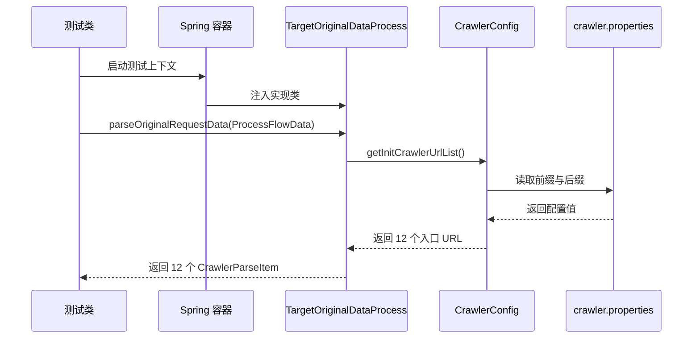
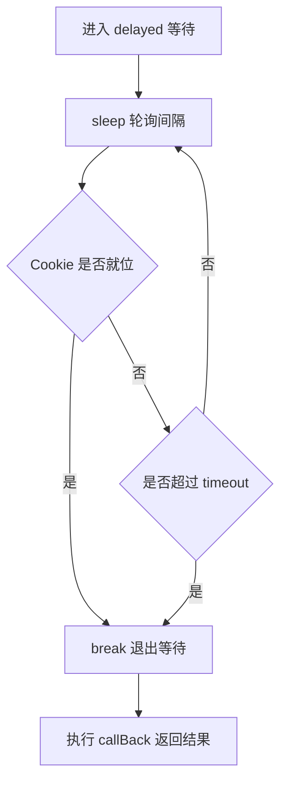

# 初始 URL 获取测试与下载准备工具类：数据先验证，弹药先备齐

> 🔒 安全提示：文中示例的口令/密钥均为课程教学环境演示口径，生产环境的安全要求见《安全与合规须知》。

初始化的三段代码已经落进工程：配置类读入口、抽象层定骨架、实现类把 URL 升格为抓取对象。写完不等于能用，得先跑一次测试把数据验掉；验证通过之后，下载环节才敢开工。而下载要面对的是带反爬的目标站点，工具弹药必须在写下载逻辑之前备齐。三讲连成一条线：初始化测试、下载准备的工具类（上）、工具类（下），从验证数据一路讲到把代理、Cookie、延迟等待与无头浏览器客户端逐个就位。

## 先给结论

- 初始化测试是标准 Spring Boot 测试：`@SpringBootTest` 加 `@RunWith(SpringRunner.class)`，注入实现类，new 一个 `ProcessFlowData`，断点数 12 条数据，逐条核对 URL 时间戳与文档类型。
- 测试前的两处收尾别漏：实现类方法末尾补 `return`（忘了返回，列表永远是 null），优先级补默认值 10。
- 代理三件套：`CrawlerProxy` 实体管抽象，`CrawlerProxyFactory` 按通道构建代理，HttpClient 的 `HttpHost`、WebMagic 的 `Proxy`、无头浏览器的 Selenium `Proxy` 三种形态全带空值校验。
- Cookie 两件套：`CrawlerCookie` 实体带 `isExpired` 过期判断；`DelayedCallback` 定延迟骨架，`DelayedUtils` 阻塞等待 Cookie 就位，并发过滤保证同一时间只有一个并发去更新 Cookie。
- `SeleniumClient` 是 Cookie 兜底下载的载体：从 `crawler.properties` 找驱动路径，`getCrawlerHtml(url, proxy, cookieName)` 返回 `CrawlerHtml`，抓一个占位站点首页即可验证通道。

## 初始化测试：12 条数据的验收动作

测试类没有任何特殊设计，就是标准 Spring Boot 测试套路：

```java
package com.study.headline.crawler.test;

import com.study.headline.crawler.process.entity.ProcessFlowData;
import com.study.headline.crawler.process.original.impl.TargetOriginalDataProcess;
import com.study.headline.model.crawler.pojo.ParseItem;
import org.junit.Test;
import org.junit.runner.RunWith;
import org.springframework.beans.factory.annotation.Autowired;
import org.springframework.boot.test.context.SpringBootTest;
import org.springframework.test.context.junit4.SpringRunner;

import java.util.List;

@SpringBootTest
@RunWith(SpringRunner.class)
public class TargetOriginalDataProcessTest {

    @Autowired
    private TargetOriginalDataProcess targetOriginalDataProcess;

    @Test
    public void testParseOriginalRequestData() {
        List<ParseItem> parseItemList =
                targetOriginalDataProcess.parseOriginalRequestData(new ProcessFlowData());
        System.out.println(parseItemList);
    }
}
```

被测方法需要一个 `ProcessFlowData` 入参，测试里直接 new 一个空对象，处理方向走默认的正向即可；上下文对象在真实调度时由调度器组装，测试阶段只关心它提供的缺省值够不够方法跑通。用 debug 模式跑，启动日志里能看到数据源与 Hibernate 初始化的痕迹，说明爬虫工程带着主工程同款的自动装配在跑，Spring 容器先起、再注入被测类、最后调用方法，整条链路在测试里被完整走了一遍。



断点上要核对的就三处。第一处是集合大小：12 条，与配置里 12 个分类后缀一一对应，少一条都是分割或过滤出了问题。第二处是首条数据：URL 形如 `https://example.com/nav/arch?rn=1571137280460`，后缀 arch 前面挂着前缀，末尾拼着毫秒时间戳，文档类型是 INIT。第三处是第二条数据：后缀换成 web，类型不变，说明枚举赋值对每条都生效而不是只赋了第一条。不想打断点的话，控制台的打印也能看出大概：12 个对象被整行吐出来，URL、类型、方向都在值里，肉眼扫一遍即可确认拼装顺序没有错位。

跑通之前现场踩了两个坑，都属于收尾类疏漏。一是实现类的方法末尾忘了 `return`，集合加工得再漂亮，方法返回的是 null，测试打印出来自然扑空；二是优先级当时还是抽象类里的默认值，正式定为 10，保证初始化抢流水线第一棒。这两个坑在测试里一并修掉，初始化的内存侧就此验收完毕，接下来轮到下载环节。

验证做得这么细不是仪式感，而是防连锁返工。初始化产出的每条数据都带着类型与方向，后续下载、解析环节就靠这些字段路由逻辑：类型错一条，下载组件对页面形态的假设就错一条；方向错一条，反向回刷的数据就会顺着正向通道乱跑。入口数据是整条流水线的源头，源头对账花十分钟，后面省掉的可能是整批数据的返工。

## CrawlerProxy：代理的最小抽象

下载准备的第一件工具是代理实体。不管底层通道是 HttpClient、WebMagic 还是无头浏览器，代理的信息量就两个：主机与端口。抽象到最省：

```java
@Setter
@Getter
public class CrawlerProxy implements Serializable {

    private String host;
    private Integer port;

    public CrawlerProxy(String host, Integer port) {
        this.host = host;
        this.port = port;
    }

    /** 获取代理信息，形如 host:port */
    public String getProxyInfo() {
        return host + ":" + port;
    }

    @Override
    public boolean equals(Object o) {
        if (o == null || o.getClass() != getClass()) {
            return false;
        }
        CrawlerProxy that = (CrawlerProxy) o;
        return host.equals(that.host) && port.equals(that.port);
    }

    @Override
    public int hashCode() {
        return Objects.hash(host, port);
    }
}
```

`getProxyInfo()` 把两个属性拼成 `host:port` 字符串，这个串后面会频繁出现，Cookie 缓存拿它当 key，日志拿它当标识。`equals` 与 `hashCode` 按 host 加 port 重写不是装饰，代理池是集合结构，去重与移除都依赖这两个方法，不重写的话两个内容相同的代理会因为引用不同而被当成两个对象，失效代理从池子里移不掉。

需要代理的背景在需求阶段已经明确：目标站对单 IP 高频访问会封禁，出口必须轮换。代理从 `crawler.properties` 里配置的拉取地址批量取回，取回来校验可用性后进池子，下载时随机取一个挂上。这条供给链路在后面的帮助类里会展开，实体与工厂先把「代理长什么样、怎么翻译」定下来。

## CrawlerProxyFactory：一个抽象，三种通道形态

同一个 `CrawlerProxy`，落到不同下载通道里要用不同的原生对象表达，工厂的职责就是按通道转换，每个方法都先做空值校验，代理不可用就返回 null，让调用方走本机出口：

```java
public class CrawlerProxyFactory {

    /** 不使用代理 */
    private static final String NOT_USE_PROXY = "NOT_USE_PROXY";

    /**
     * HttpClient 通道的代理
     */
    public static HttpHost getHttpHostProxy(CrawlerProxy crawlerProxy) {
        if (null != crawlerProxy
                && StringUtils.isNotBlank(crawlerProxy.getHost())
                && null != crawlerProxy.getPort()) {
            return new HttpHost(crawlerProxy.getHost(), crawlerProxy.getPort());
        }
        return null;
    }

    /**
     * WebMagic 框架的代理
     */
    public static us.codecraft.webmagic.proxy.Proxy getWebmagicProxy(CrawlerProxy crawlerProxy) {
        if (null != crawlerProxy
                && StringUtils.isNotBlank(crawlerProxy.getHost())
                && null != crawlerProxy.getPort()) {
            return new us.codecraft.webmagic.proxy.Proxy(
                    crawlerProxy.getHost(), crawlerProxy.getPort());
        }
        return null;
    }

    /**
     * 无头浏览器通道的代理
     */
    public static org.openqa.selenium.Proxy getSeleniumProxy(CrawlerProxy crawlerProxy) {
        if (null != crawlerProxy
                && StringUtils.isNotBlank(crawlerProxy.getHost())
                && null != crawlerProxy.getPort()) {
            org.openqa.selenium.Proxy proxy = new org.openqa.selenium.Proxy();
            proxy.setProxyType(Proxy.ProxyType.MANUAL);
            proxy.setHttpProxy(crawlerProxy.getProxyInfo());
            return proxy;
        }
        return null;
    }
}
```

三个方法各喂一条通道。`getHttpHostProxy` 产出的 `HttpHost` 是 HttpClient 的代理载体，而 WebMagic 默认的下载器底层就是 HttpClient，所以这是平时走得最多的通道；`getWebmagicProxy` 产出 WebMagic 自己的 `Proxy` 对象，用于框架的代理注入，本质与 HttpHost 同源，只是包装形态不同；`getSeleniumProxy` 产出无头浏览器用的代理对象，走的是浏览器通道。通道的选用顺序跟成本有关：HttpClient 快且轻，是默认选择；无头浏览器要拉起一个真实浏览器进程，重且慢，只在 Cookie 场景下兜底使用。工厂把「代理是同一个抽象、通道各有各的方言」这件事封装掉，后面写下载逻辑时只管取代理、报通道，转换交给工厂。

空值校验不只是防御式编程的姿势。代理来源是外部拉取接口，网络抖动、额度用尽都会返回空列表或残缺数据，工厂在转换这一关把 host 为空白、port 为 null 的脏数据全部拦下，返回 null 交由调用方降级到本机出口，下载流程不会因为一个坏代理中断。常量 `NOT_USE_PROXY` 则是「不使用代理」的哨兵值，调用方拿不到代理时用它占位，与「转换失败返回 null」区分开，上层看标记就知道走的是哪条路。三个方法全做成静态的，理由是工厂不持有任何可变状态，转换是纯函数，入参定则输出定，谁用谁调，不需要先拿实例。

## CrawlerCookie 与延迟等待：Cookie 就位前先别动

Cookie 侧的实体同样很小，关键是它带着过期语义：

```java
@Setter
@Getter
public class CrawlerCookie implements Serializable {

    private String name;
    private String value;
    private String domain;
    private String path;
    private Date expire;
    private boolean isRequired;

    /** 校验是否过期 */
    public boolean isExpired() {
        boolean flag = false;
        if (null != expire) {
            flag = expire.getTime() <= (new Date()).getTime();
        }
        return flag;
    }
}
```

`isExpired()` 用过期时间与当前时间做比较，缓存里的 Cookie 每次取用前都过一遍这道闸，过期即视为不可用。`isRequired` 字段标记这条 Cookie 是否必须携带，等待判断只盯着必须的键，非必须的过期了不用惊动流程。真正有意思的是等待骨架。目标站的反爬 Cookie 由页面里的 JS 算出来再写入浏览器，写入需要时间，请求发得太早拿到的就是拦截页。还有一个绕不开的特性：这类关键 Cookie 与出口 IP 绑定，换一个代理就要拿一份对应的新 Cookie，Cookie 与代理天然成对出现，这也是后文 Cookie 帮助类按代理分组缓存的直接原因。等待逻辑被抽成一个回调接口加一个工具类：

```java
public interface DelayedCallback {

    /** 轮询间隔，防止 CPU 空转，默认 1 秒 */
    long sleepTime();

    /** 等待上限，到点自动退出，防止无限阻塞 */
    long timeout();

    /** 目标条件是否就位，例如 Cookie 是否已写入 */
    boolean isExist();

    /** 退出等待后的回调产出 */
    Object callBack();
}

public class DelayedUtils {

    public static void delayed(long delayedTime) {
        try {
            Thread.sleep(delayedTime);
        } catch (InterruptedException e) {
            e.printStackTrace();
        }
    }

    /**
     * 延迟等待：条件就位或超时即退出，返回回调结果
     */
    public static Object delayed(DelayedCallback callback) throws InterruptedException {
        boolean flag = false;
        long sleepTime = callback.sleepTime();
        long timeout = callback.timeout();
        long currentTime = System.currentTimeMillis();
        while (true) {
            Thread.sleep(sleepTime);
            long duration = System.currentTimeMillis() - currentTime;
            boolean isExist = callback.isExist();
            if (isExist) {
                flag = true;
            } else if (duration > timeout) {
                flag = true;
            }
            if (flag) {
                break;
            }
        }
        return callback.callBack();
    }
}
```

`sleepTime()` 与 `timeout()` 是一对防守搭档：间隔 1 秒轮询一次，避免 while 循环空转吃满 CPU；上限时间到点自动退出，避免页面迟迟不给 Cookie 时线程永远卡死。`isExist()` 是条件，`callBack()` 是产出，接口本身没有任何实现，具体逻辑在调用现场用匿名内部类填。



循环的两个出口都通向同一个 `callBack`，差别只在退出原因，调用方拿到结果后再自行判断这次等待是「等到了」还是「超时了」：拿等待时长与上限比一下就能区分，等到了就继续往下走，超时了就记一条失败日志、把这次下载标记为待重试。工具里还配了一个并发过滤：并发抓取时多个线程同时发现 Cookie 缺失，如果都去触发更新，浏览器通道瞬间被挤爆。过滤的形态是一个内部实体，记录当前时间、10 秒时间窗与放行标记：

```java
static class ConcurrentEntity {
    /** 当前时间 */
    private long currentTime = System.currentTimeMillis();
    /** 时间窗，10 秒 */
    private long timeInterval = 10000;
    /** 是否放行 */
    private boolean available = true;
}
```

判定规则是计数不大于 1 才放行：同一时间窗内只有第一个抢到的并发拿到 `available` 为 true 的资格去更新 Cookie，其余并发拿到 false，进入上面的等待循环干等，Cookie 一旦就位全体放行。十个并发只出一个更新者，这就是「多并发只取一个」的全部含义。两个工具在真实抓取里是组合拳：下载组件里多个线程同时发现 Cookie 失效，先抢并发过滤的资格，抢到的走无头浏览器通道领新 Cookie，没抢到的把 `isExist` 挂到等待循环上轮询，资格发放与条件等待一进一出，既保护了浏览器通道，又不会让任何线程白等。

## SeleniumClient：兜底下载的发动机

无头浏览器客户端是这几件工具里体量最大的，先看它的三个常量，个个有来头：

```java
private static final long SLEEP_TIME = 1000;

/** 读取 crawler.properties 配置文件 */
private static final ResourceBundle resourceBundle = ResourceBundle.getBundle("crawler");

/** JSON 数据页的 XPath 抽取路径 */
public static final String SELENIUM_JSON_DATA_PATH = "//pre/text()";
```

`ResourceBundle.getBundle("crawler")` 直接按文件名把 `crawler.properties` 读进来，驱动路径、代理配置全在包里；`SELENIUM_JSON_DATA_PATH` 指向页面里 `pre` 标签下的文本，等真正抓 JSON 形态的数据页时用它做 XPath 抽取。核心方法按画面线的执行轨迹整理如下（方法签名按主流写法补全）：

```java
public CrawlerHtml getCrawlerHtml(String url, CrawlerProxy proxy, String cookieName) {
    CrawlerHtml crawlerHtml = new CrawlerHtml();
    crawlerHtml.setUrl(url);
    crawlerHtml.setProxy(proxy);
    WebDriver driver = initDriver();
    try {
        driver.get(url);
        // 匿名回调：每隔 1 秒看一次 Cookie 是否就位，超时即退出等待
        DelayedUtils.delayed(new DelayedCallback() {
            @Override
            public boolean isExist() {
                Set<Cookie> cookieSet = driver.manage().getCookies();
                return isExistCookieName(cookieSet, cookieName);
            }
            @Override
            public long sleepTime() { return SLEEP_TIME; }
            @Override
            public long timeout() { return DEFAULT_TIMEOUT; }
            @Override
            public Object callBack() { return null; }
        });
        crawlerHtml.setHtml(driver.getPageSource());
    } finally {
        driver.quit();
    }
    return crawlerHtml;
}
```

执行轨迹与调试时看到的一致：先 new 出 `CrawlerHtml` 实体把 URL 与代理装进去，代理暂时没用就传 null；`initDriver()` 按 `ResourceBundle` 里的键找到驱动路径初始化浏览器驱动；驱动发请求访问目标页；匿名回调接管等待，每秒看一次 Cookie 是否写到位；`getPageSource()` 把渲染完成的页面源码装进实体，最后关掉驱动返回。入参里的 `cookieName` 就是为了配合等待判断，访问目标站时把 `crawler.properties` 里的 `acw_sc_v2` 传进来，等待逻辑才有明确的验收标准。

三个入参的分工值得单独说清：`url` 是唯一必填，它决定请求去哪；`proxy` 决定出口，传 null 就走本机 IP，适合本地验证通道，正式抓取时由代理供给方填上；`cookieName` 决定等待条件，null 意味着不等待、抓完即走，目标站场景必须传值，否则页面 JS 还没写完 Cookie 源码就回传了。一个方法三个开关，从「随手验证通道」到「带 Cookie 的正式抓取」用同一套代码覆盖。

驱动生命周期是这条链路里最容易被忽略的细节。浏览器驱动是一个独立进程，`initDriver()` 拉起它，代码里 `finally` 块中的 `quit()` 负责关掉它，写进 `finally` 而不是主流程尾部，是为了页面渲染抛异常时驱动也能被回收。漏掉这一步的后果在长时间运行的爬虫里最明显：每抓一页泄漏一个浏览器进程，抓几百页后系统内存被吃光，机器变得整批缓慢，排查时看到的现场与 Cookie 问题毫无关系，极难定位。

值得一提的是 `SeleniumClient` 不走 Spring 装配，内部常量靠 `ResourceBundle` 自取配置，实例由 Cookie 帮助类直接 new 出来持有。无头浏览器通道本身重，按需创建、用完即弃比常驻容器更合适，这也解释了它的方法全是静态可用的形态。

给它配一个最小测试：

```java
@SpringBootTest
@RunWith(SpringRunner.class)
public class SeleniumClientTest {

    @Autowired
    private SeleniumClient seleniumClient;

    @Test
    public void test() {
        CrawlerHtml crawlerHtml =
                seleniumClient.getCrawlerHtml("https://www.example.com", null, null);
        System.out.println(crawlerHtml.getHtml());
    }
}
```

测试抓的是占位站点首页，代理与 Cookie 名都传 null，走本机出口，验证的是「通道本身能跑通」。前提是本机能上网，毕竟真实请求要发出去。跑完控制台打印出完整的页面源码，说明从配置读取、驱动初始化、请求发送到源码回传的全链路没有断点，下载侧的工具就此备齐，下一讲就可以组装下载组件了。

## 常见误区

- **改掉 Cookie 键名。** 错例是觉得 `acw_sc_v2` 难记换个自定义名。正解是这个键名要与目标站写入的 Cookie 严格一致，等待判断与校验逻辑都按它查，改名等于把验收标准弄丢。
- **延迟等待不设上限。** 错例是 while 循环只判断条件不判断超时，页面异常时线程永久阻塞，并发一多线程池瞬间耗尽。正解是 `timeout()` 必须给值，到点退出走超时分支。
- **代理形态张冠李戴。** 错例是把 HttpClient 的 `HttpHost` 直接塞给无头浏览器用，通道不认这个类型。正解是按通道调用工厂对应方法，转换的事交给工厂。
- **测试跑不起来先怀疑代码。** 错例是控制台报驱动找不到就到处改业务类。正解是按顺序查三件事：本机网络是否可达、驱动路径与系统是否匹配、`crawler.properties` 是否在 classpath 上。

## 面试可能被问到的问题

1. 面试官追问：「初始化的测试为什么用 @SpringBootTest 而不是纯 JUnit？」
   答：被测方法依赖 Spring 容器里的配置类装配，@SpringBootTest 会启动完整上下文，配置类的绑定、依赖注入、数据源与 Hibernate 的自动装配全部真实生效；纯 JUnit 跑的是空环境，验证不了装配链路。
2. 面试官追问：「DelayedCallback 的 sleepTime 和 timeout 各防什么？」
   答：sleepTime 防空转，轮询间隔 1 秒，避免 while 循环高频查条件吃满 CPU；timeout 防死等，目标条件迟迟不就位时到点自动退出，把线程还回去。一个管效率，一个管安全。
3. 面试官追问：「为什么同一时间只放一个并发去更新 Cookie？」
   答：Cookie 更新要过无头浏览器通道，进程重、耗时长，多线程同时触发会把通道挤爆还会互相覆盖。用时间窗加计数过滤，窗内第一个并发拿到放行资格去更新，其余进入等待循环，Cookie 就位后集体放行。
4. 面试官追问：「CrawlerProxy 为什么要重写 equals 和 hashCode？」
   答：代理池用集合管理，添加去重、失效移除都基于对象相等性判断。不重写时相等性退化成引用比较，同一个代理换一次实例化就被当成新对象，失效代理从池子里清不掉，池子越滚越大。
5. 面试官追问：「SeleniumClient 和 WebMagic 的下载组件是什么关系？」
   答：互为补充。WebMagic 默认下载器走 HttpClient，轻快，是常规通道；SeleniumClient 走真实浏览器，能执行页面 JS，专门解决 Cookie 验证场景拿不到正文的问题。下载组件的组装策略是默认走前者，失败回退后者。
6. 面试官追问：「URL 上拼时间戳会不会带来副作用？」
   答：抓取阶段没有，它保证每批初始化都能绕过台账去重完整重跑；解析阶段要注意入参 URL 带着查询串，与站内链接匹配或落库记录原始地址时需要把 rn 参数剥掉，避免同一页面出现两个地址记录。

## 配套资料

- 代码：本日无配套源码包，`materials/code/05/头条day08/` 资料目录为空，工具类与测试类按画面线整理，方法骨架按本课写法补全，接口与常量名以工程实际为准。
- 参照：`materials/code/05/头条day07/` 资料目录（引用截至 dayNN 层级，内层目录含项目原名）里的封装工具类与本节工具类的组织方式同源，可对照阅读；阶段三 day15 的抓取产物 `materials/code/03/day15-房源数据抓取以及实现房源搜索/day15-房源数据抓取以及实现房源搜索/资料/抓取的房源数据/data.json` 可对照解析产出的数据形态。
- 环境：课程集群 node01~node03，MySQL root/123456；无头浏览器驱动按 `crawler.properties` 配置的路径放置，测试需本机可访问外网。
