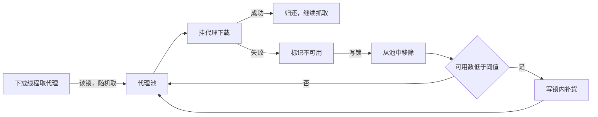

# 帮助类与下载类：Cookie 管理、代理供给与兜底下载组件

> 🔒 安全提示：文中示例的口令/密钥均为课程教学环境演示口径，生产环境的安全要求见《安全与合规须知》。

代理实体、延迟等待与无头浏览器客户端就位之后，下载环节还差最后一层协作胶水：谁来管理 Cookie 缓存、谁来供给代理、谁来承载下载本身。day08 的收尾两讲合并展开，把帮助类与下载类一次讲透，讲完下载准备工作全部收口。

## 先给结论

- `CookieHelper` 按「代理 IP 到 Cookie 列表」的粒度管理 Cookie，`ConcurrentHashMap` 缓存、命中即返、未命中走无头浏览器领新，强制更新与懒更新两种语义分开。
- `CrawlerHelper` 是流程侧帮手，把 `CrawlerParseItem` 挂到 WebMagic 的 `Request` 属性上随数据流转，并对外提供下载数据校验入口。
- `CrawlerProxyProvider` 是代理池供给者：读写锁护并发、随机取可用代理、失效移除、达到阈值自动补货。
- `ProxyHttpClientDownloader` 拷贝自 WebMagic 的 `HttpClientDownloader` 再改造：默认 HttpClient 下载，失败回退 `SeleniumClient`，Cookie 场景的正文由回退兜住。

## CookieHelper：代理与 Cookie 成对管理

背景在延迟等待那一节已经交代：目标站的关键 Cookie 与出口 IP 绑定，换代理就要配一份新 Cookie。这条特性决定了缓存的粒度不能是全局一份，而要按代理分组：

```java
public class CookieHelper {

    /**
     * 代理 ip 存储的地方：key 为 host:port，value 是该代理对应的 Cookie 列表
     */
    private Map<String, List<CrawlerCookie>> proxyCookieCacheMap =
            new ConcurrentHashMap<String, List<CrawlerCookie>>();

    /** 数据锁 */
    private final String SYNCHRONIZED_TAG = "SYNCHRONIZED_TAG";

    private SeleniumClient seleniumClient = new SeleniumClient();

    public List<CrawlerCookie> getCookieList(String url, CrawlerProxy proxy) {
        List<CrawlerCookie> cookieList = getProxyCookieListGroup(proxy);
        if (null != cookieList && !cookieList.isEmpty()) {
            return cookieList;
        }
        // 缓存未命中：走无头浏览器拉取新 Cookie 后回填
        List<CrawlerCookie> newList = getNewCookieInitList(url, cookieName, proxy);
        updateCookie(newList, proxy);
        return newList;
    }
}
```

缓存的 key 是代理的 `getProxyInfo()` 字符串，value 是配对的 Cookie 列表。取 Cookie 的逻辑两分支：命中直接返回，未命中调 `getNewCookieInitList` 让 `SeleniumClient` 出马领一份新 Cookie，回填缓存再返回。更新语义有两种，`updateCookie` 做的是懒更新，缓存为空才补；强制更新则先清空该代理分组的旧 Cookie 再重取，用在 Cookie 明确失效的场景。并发线程在两组操作间靠 `SYNCHRONIZED_TAG` 同步，并发过滤只放一个线程去领新 Cookie，其余线程等它回填。

CookieHelper 要被全工程注入使用，得先进 Spring 容器。装配动作落在 `CrawlerConfig` 里，顺手把 Cookie 键名也从配置带进来：

```java
@Value("${crux.cookie.name}")
private String cookieName;

@Bean
public CookieHelper getCookieHelper() {
    return new CookieHelper(cookieName);
}
```

`@Value` 把 `crux.cookie.name` 注进配置类，再通过 `@Bean` 构造出持有这个键名的帮助类。其他类要用时直接 `@Autowired` 注入即可，键名从配置来而不是硬编码，换站点改配置不改代码。

## CrawlerHelper：Request 上的搬运与校验

WebMagic 的 `Request` 自带一个属性容器，`put` 与 `get` 能往请求对象上挂自定义数据，`CrawlerHelper` 的第一职责就是利用这一点做流程侧的数据搬运：

```java
public void setParseItem(Request request, CrawlerParseItem parseItem) {
    request.put(KEY_PARSE_ITEM, parseItem);
}

public CrawlerParseItem getParseItem(Request request) {
    return (CrawlerParseItem) request.get(KEY_PARSE_ITEM);
}
```

初始化阶段产出的 `CrawlerParseItem` 就靠这两行随请求流转：下载前挂上去，下载与解析环节按 key 取下来，条目里的文档类型、处理方向一路跟着请求走，各环节拿到的上下文不会断。第二职责是校验，对外暴露一个下载数据校验入口，内部委托给校验回调：

```java
public boolean validate(String content) {
    boolean flag = true;
    if (StringUtils.isEmpty(content)) {
        flag = false;
    }
    // 命中页面跳转特征，说明拿到的是反爬页而非正文
    if (flag && content.contains(LOCATION_RELOAD)) {
        flag = false;
    }
    return flag;
}
```

校验规则朴素但有效：内容为空直接判不合格；内容里带页面跳转的特征串，说明目标站把访问者引去了验证页，返回的 HTML 根本不是正文，同样不合格。这套默认规则在 `CrawlerConfig` 里装配成 `DataValidateCallBack` 的实现，注册进容器，需要扩展时换一个回调实现即可，校验入口的调用方不用动。

## CrawlerProxyProvider：代理池的供给与更新

代理实体与工厂解决了「代理长什么样、怎么翻译」，供给者解决「代理从哪来、坏了怎么办」。先看它的骨架字段：

```java
private ReadWriteLock lock = new ReentrantReadWriteLock();
private Lock readLock = lock.readLock();
private Lock writeLock = lock.writeLock();
private Random random = new Random();

/** 是否启用代理 IP */
@Value("${proxy.isUsedProxyIp}")
private boolean isUsedProxyIp;

/** 动态代理 IP 自动更新阈值 */
private int proxyIpUpdateThreshold = 10;
```

读写锁的选择有讲究：取代理是高频读操作，多线程并发读互不阻塞；补货与移除是低频写操作，写时必须独占。读多写少的场景下，读写锁比全量互斥的 `synchronized` 吞吐高得多。启用开关从配置读，阈值控制补货时机，池内可用代理掉到阈值之下就触发拉新。

```java
public void updateProxy() {
    // 读锁升级为写锁，独占补货
    readLock.unlock();
    writeLock.lock();
    try {
        if (isUsedProxyIp && null != proxyProviderCallBack) {
            // 回调拉取新代理填充池子
            proxyProviderCallBack.update();
        }
    } finally {
        writeLock.unlock();
        readLock.lock();
    }
}
```

补货动作走回调，供给者自己不关心代理从哪个接口拉，把「怎么拉」留给回调实现，「什么时候拉」由开关与阈值决定。失效代理的处理是另一个入口：某个代理下载失败被标记不可用时，从池子的集合里直接移除，移除同样要拿写锁。



这张图就是代理池的全部生命周期：取走走读锁，移除与补货走写锁，失败标记触发移除，可用数掉到阈值以下触发补货，池子自动循环，长期运行不需要人工干预。

## ProxyHttpClientDownloader：改造过的下载组件

下载组件在 WebMagic 里是四大组件之一，框架自带 `HttpClientDownloader`。项目的做法不是从零写一个，而是把原版整体拷过来改造，放在 `process.download` 包下命名 `ProxyHttpClientDownloader`。拷贝的理由很直接：原版里连接池管理、状态码判断、字符集处理这些通用逻辑全是现成且久经考验的，要改的只有一处，失败分支。

先看协作字段，四个帮手全部注入：

```java
@Autowired
private CookieHelper cookieHelper;
@Autowired
private CrawlerHelper crawlerHelper;
@Autowired
private CrawlerProxyProvider crawlerProxyProvider;
@Autowired
private SeleniumClient seleniumClient;

private final Map<String, CloseableHttpClient> httpClients = new HashMap<>();
private HttpClientGenerator httpClientGenerator = new HttpClientGenerator();
```

`HttpClientGenerator` 按站点生成 `CloseableHttpClient`，生成的客户端按域名缓存在 Map 里，同一站点的请求复用连接池，这是原版带来的家底。四个注入项里前三个来自 Spring 容器，第四个 `SeleniumClient` 是工具类形态，由帮助类持有。下载组件本身也要注册成 Spring Bean 才能用上这些注入，组装 Spider 时通过 `setDownloader` 挂进流水线，代理供给者则由 `setProxyProvider` 注入，与框架的代理体系打通。

改造后的 `download` 主流程骨架如下（原版逻辑从略，标注出改造点）：

```java
@Override
public Page download(Request request, Task task) {
    // ……原版：按站点取客户端、组装请求头、携带代理发起 HttpClient 请求……
    try {
        Page page = downloadByHttpClient(request, task);
        if (null != page && page.isDownloadSuccess()) {
            return page;
        }
    } catch (Exception e) {
        // HttpClient 通道失败，继续走兜底
    }
    // 改造点：原版没有的分支，失败后用无头浏览器再抓一次
    CrawlerHtml crawlerHtml = seleniumClient.getCrawlerHtml(
            request.getUrl(), null, cookieHelper.getCookieName());
    // 把无头浏览器拿回的源码组装成 Page 返回
    return buildPageFromCrawlerHtml(request, task, crawlerHtml);
}
```

改造点的意图一句话说清：WebMagic 默认用 HttpClient 下载，对普通站点完全够用；目标站这类要靠页面 JS 写 Cookie 才给正文的场景，HttpClient 通道拿回来的要么是拦截页要么直接失败，所以在失败分支补了一道无头浏览器回退。回退能成功的关键在前面几节的铺垫：`SeleniumClient` 能等 Cookie 就位再取源码，`CookieHelper` 能按代理配对缓存 Cookie，缓存命中时回退连浏览器都不用拉。绝大多数请求仍走轻快的 HttpClient 通道，只有真正被反爬拦截的少数请求才付出浏览器成本，兜底的代价被压到最小。

下载准备工作到此全部就位：配置、工具、帮助、代理供给、下载组件五层各就各位，下一步就是解析目标站页面、把内容落进库里的环节。

## 常见误区

- **Cookie 缓存不分代理。** 错例是全局一份 Cookie 列表，A 代理领的 Cookie 挂到 B 代理的请求上全被目标站拒绝。正解是按 `host:port` 分组缓存，代理与 Cookie 成对取用。
- **移除失效代理不拿写锁。** 错例是池子直接 remove，与其他线程的读操作并发，取到已删除的代理或漏移。正解是所有写操作走写锁，读操作走读锁。
- **回退逻辑写进主流程。** 错例是所有请求一律先走无头浏览器，代理池与性能全被浏览器进程拖垮。正解是 HttpClient 优先，失败才回退，兜底只在被拦截的少数请求上付成本。
- **帮助类忘了注册成 Bean。** 错例是类上不加注解也不写 `@Bean`，注入点拿到 null，运行期空指针。正解是配置类里统一装配，注入前先跑一次上下文确认装配齐全。

## 面试可能被问到的问题

1. 面试官追问：「Cookie 为什么要和代理 IP 绑定管理？」
   答：目标站的关键 Cookie 与出口 IP 绑定，同一份 Cookie 换个出口就失效。缓存按代理分组、取用时成对领取，才能保证每个请求都带着与自身出口匹配的合法身份，这是抓取稳定的第一道闸。
2. 面试官追问：「代理池为什么用读写锁而不是 synchronized？」
   答：取代理是每个下载线程都要做的高频读，补货与移除是低频写。读写锁让并发读互不阻塞，写时才独占，读多写少场景下吞吐明显高于全量互斥；synchronized 简单但会把读也串行化，代理池这种热路径不值得。
3. 面试官追问：「下载失败回退无头浏览器的触发条件怎么设计？」
   答：两层判断。请求抛异常或返回页校验不合格（内容为空、命中跳转特征）都算 HttpClient 通道失败，进入回退；回退前先查 Cookie 缓存，代理配对的 Cookie 命中就直接带 Cookie 重发，未命中才拉起浏览器领新 Cookie，把最贵的动作放在最后。
4. 面试官追问：「为什么拷贝 WebMagic 的 HttpClientDownloader 改造，而不是继承扩展？」
   答：原版的 download 方法是私有流程，失败分支没有留出可覆盖的扩展点，继承只能整体重写 download，等于换个方式重造轮子。拷贝改造后连接池、状态码、字符集这些经受过考验的逻辑原样保留，改动面收敛在失败分支，升级框架时也有清晰的 diff 可对照。
5. 面试官追问：「requestValidation 校验什么特征，为什么有效？」
   答：两道判断，内容非空且不含页面跳转特征串。反爬拦截页的特点是正文没有、只有一段跳转 JS，命中特征即说明目标站没有把正文交出来，这比正则匹配正文结构更快也更通用，能覆盖拦截页形态变化的情况。

## 配套资料

- 代码：本日无配套源码包，`materials/code/05/头条day08/` 资料目录为空，帮助类与下载组件按画面线整理，方法骨架与校验规则按本课写法补全，以工程实际为准。
- 参照：`materials/code/05/头条day07/` 资料目录（引用截至 dayNN 层级，内层目录含项目原名）里的封装工具类，与帮助类的装配方式同源，可对照阅读 Spring Bean 注册与注入的写法。
- 环境：课程集群 node01~node03，MySQL root/123456；代理池拉取地址与无头浏览器驱动路径均在 `crawler.properties` 中配置。
