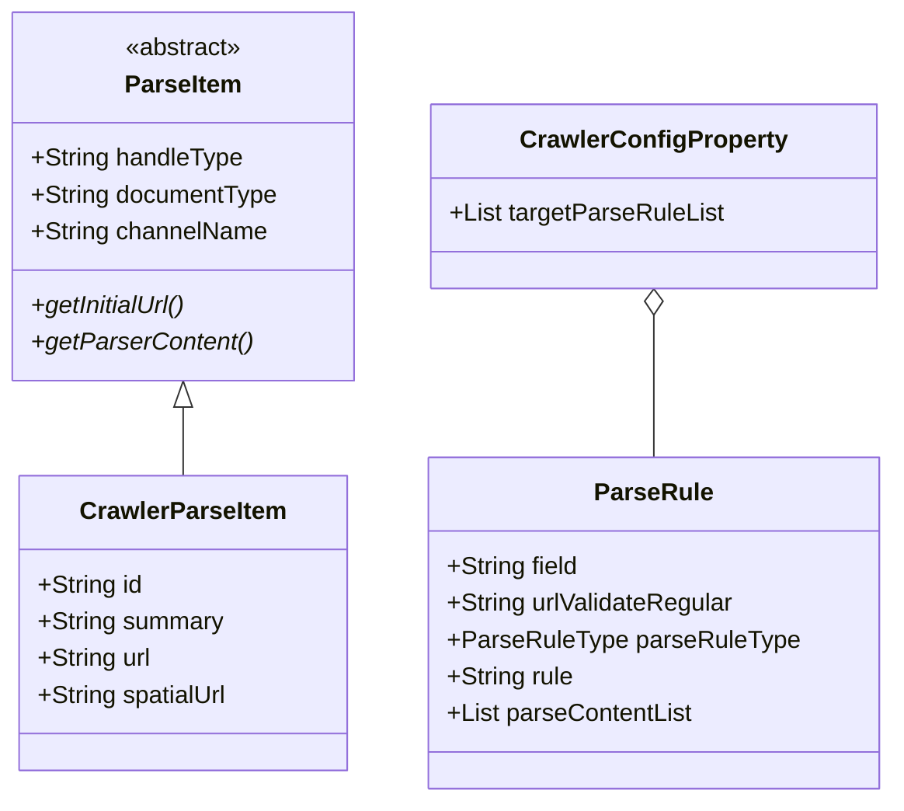
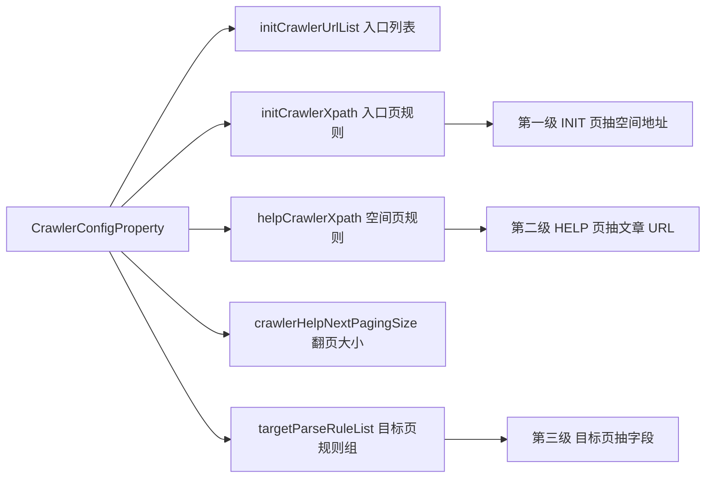
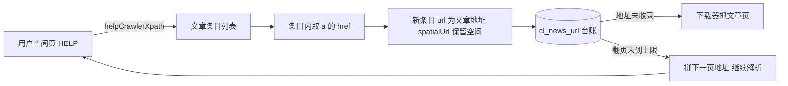
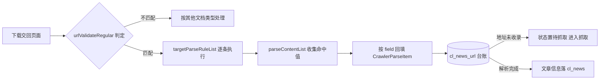

# 爬虫系统初始化的文档处理：三级解析链路与规则驱动落地

## 先给结论

- 下载准备工作收口之后，页面源码真能拿回来了，新问题是几百 KB 的 HTML 怎么变成库里的一条文章记录：文档处理这一组五讲回答的就是这件事。
- 核心设计是规则驱动：页面形态不同，解析器与解析规则就不同，全部规则集中在 CrawlerConfigProperty 一个载体上，数据与规则分离，换站点改规则不改实体。
- 解析分三级：分类入口页解析出作者空间地址，空间页解析出该作者全部文章 URL 含分页，文章页解析出标题、作者、正文等字段。
- 列表页不直接产出文章，绕道用户空间，换来按作者收齐、翻页统一、来源归属清晰三样好处。
- 三个前置实体分工明确：ParseItem 是抽象骨架，CrawlerParseItem 是爬虫侧实现承载，ParseRule 是一条规则一个字段的载体，校验与解析两个字段分工不同。
- 规则的家是 CrawlerConfigProperty，落点是爬虫配置类里的一个 Bean 方法，五讲按初始页规则、空间页规则加翻页大小、目标页规则组的顺序逐个装配。
- XPath 推导方法比表达式本身更值钱：开发者工具选中元素，从根路径逐层下钻，按 class 谓词收敛到条目级。
- 目标页九个字段九条规则逐条装进集合，取值收尾分三种：取文本用 /text()，取属性用 /@href，取整块结构用 html 兜底；规则要多篇文章交叉验证后再定稿。

## 第1部分：爬虫系统初始化_文档处理_思路分析

下载准备工作已经收口：Cookie、代理、兜底下载组件全部就位，页面源码真的能拿回来了。新问题马上顶上来：一份几百 KB 的 HTML 怎么变成库里的一条文章记录？直接在分类列表页上抠正文，抠到的全是标题和链接；文章的地址也不直接躺在列表页上，得先进作者的「个人空间」绕一圈。day08 的文档处理一组五讲从思路分析开始，这一讲先把整条解析链路的骨架立起来。

### 文档处理在流水线里的位置

WebMagic 的抓取循环顺序固定：下载、解析、调度、持久化。前几讲把下载环节武装到位，解析环节接下来接棒，文档处理就是解析环节的落地：输入是下载器交回的 HTML 文本与挂在请求上的解析条目，输出有两类，对中间页面是下一级待抓 URL，对目标页才是填充完字段的结构化数据。页面从「一坨源码」变成「带类型的抓取对象」，靠的不是一段万能解析代码，而是三组各管一段的规则。

三级链路长这样：


图中每个箭头都是一次「解析加再下载」：中间两级解析只负责按规则抽出下一级 URL，抽出后重新提交下载处理器，走到目标页那一级才真正开始提取字段。台账在每一步都留着记录，去重与断点续抓靠它兜底。

### 三步走，一级一个目标

讲义把文档处理拆成三个步骤，每一步目标单一，串起来正好是三级页面形态。

**第一步，解析初始化 URL 获取列表页，把列表页数据提交给下载处理器。** 初始化灌进来的入口是 `https://example.com/nav/java` 这样的分类页，页面上每条文章记录都挂着作者空间链接。这一步不碰正文，只做一件事：从当前分类里把所有文章的空间地址收出来。收完重新提交下载处理器，把空间页一张张拉回来。分类页源码里，条目是「列表容器、条目、条目体」的嵌套结构，解析从最外层容器开始逐层收敛。

**第二步，解析列表页后获取最终需要处理的 URL，交给下载处理器。** 打开某个用户空间，目标变成抓取这个空间下的全部文章 URL。文章不多的作者一页装得下，文章多的作者要翻页，翻多深由 `crawler.help.nextPagingSize` 控制。这一步依然不解析内容，产出还是 URL，只是层级从「空间」落到了「文章」。

**第三步，解析最终页，把解析数据交给下一级。** 在文章页上打开开发者工具或直接看源码，标题、作者、发布时间、正文、标签、频道都在 DOM 里有稳定位置。逐项提取后交给下一级组件做清洗与保存，文档处理到这一步才真正产出内容。

三步合起来一句话：从分类页找到文章线索，但不真正解析列表，先进入文章的用户空间，抓全文章 URL，再去请求文章 URL 抓最终页面。三种页面形态的 DOM 骨架差异一目了然：

```html
<!-- 分类入口页：列表容器包条目，条目里找空间链接 -->
<ul class="feedlist_mod">
    <li class="clearfix">
        <div class="article-item-box"> 条目内容 </div>
    </li>
</ul>

<!-- 用户空间页：文章列表包条目，条目里 h4 包 a -->
<div class="article-list">
    <div class="article-item-box">
        <h4><a href="/article/details/102575415">文章标题</a></h4>
    </div>
</div>

<!-- 文章页：标题与正文各有稳定容器 -->
<h1 class="title-article">文章标题</h1>
<div id="content_views"><p>正文段落</p></div>
```

类名取自演示站点页面结构，地址按占位示意，换站点要重新看 DOM。三级结构一层比一层贴近内容，规则也一层比一层好写。

### 规则驱动与类职责划分

三级形态如果让一个解析器加一堆 if-else 扛，每换一个站点、每加一个字段都要动核心代码。头条类资讯项目的做法是把「怎么解析」从代码里剥出来，变成一条条规则，解析器只保留两件事：按文档类型路由，按规则执行。

类职责随之分成四层：`ParseItem` 家族当数据载体，`ParseRule` 承载单条规则，`CrawlerConfigProperty` 把全部规则集中成一个可注入的配置属性，各解析处理器按文档类型挑规则组执行。规则集中载体长这样：

```java
/**
 * 爬虫配置属性：全部解析规则的集中载体
 */
@Setter
@Getter
public class CrawlerConfigProperty implements Serializable {
    /** 初始化请求 URL 列表 */
    private List<String> initCrawlerUrlList;
    /** 初始化页面的 xpath 表达式 */
    private String initCrawlerXpath;
    /** 帮助页面，即用户空间页的提取规则 */
    private String helpCrawlerXpath;
    /** 开启自动翻页功能 */
    private Integer crawlerHelpNextPagingSize;
    /** 目标页面提取规则 */
    private List<ParseRule> targetParseRuleList;
}
```

五个属性正好对应三级链路：入口列表与入口页规则管第一级，空间页规则与翻页大小管第二级，目标页规则组管第三级。解析器拿到页面后按文档类型挑规则组执行，抽出的下一级 URL 换字段装进新的 `CrawlerParseItem`，类型标记随之升级，形成闭环；单条规则 `ParseRule` 与解析条目 `CrawlerParseItem` 的逐字段设计，留给后面几讲展开。

规则驱动最直接的收益在换站点：规则集中在配置属性里，换目标站先重看 DOM、重写规则表达式，解析器骨架一行不动。另一个收益在可测性：每条规则是独立表达式，拿一份源码就能离线验证抽得准不准，不必把整个抓取流程跑一遍。

## 第2部分：爬虫系统初始化_文档处理_文档处理实体类介绍

思路定了：三级链路，规则驱动。要把链路落到代码上，得先认清三个前置实体：一个抽象骨架、一个爬虫侧实现、一个规则载体。类不多，字段设计却藏着后面所有解析动作的伏笔：两个 URL 字段对应两个层级的入口，两个规则字段对应「该不该解析」与「怎么解析」两件事。这一讲把三个类逐字段过一遍，后面的规则定义才能写得不糊涂。

### ParseItem：转换后对象的抽象骨架

`ParseItem` 定义的是转换后对象的骨架，放在 model 模块里供主工程与爬虫工程共享：

```java
/**
 * 解析封装对象
 */
public abstract class ParseItem implements Serializable {

    /**
     * 处理类型，有正向 反向两种
     */
    private String handleType = null;
    /**
     * 文档的类型
     */
    private String documentType = null;
    /**
     * 渠道名
     */
    private String channelName;

    /**
     * 获取初始的 URL
     */
    public abstract String getInitialUrl();

    /**
     * 获取需要处理的内容
     */
    public abstract String getParserContent();

    // getter/setter 略
}
```

**三个公共字段各有出处。** `handleType` 标处理方向，取值来自 `CrawlerEnum.HandleType`，正向从入口往文章抓，反向从已入库文章回刷互动数据，当前全部正向；`documentType` 标页面形态，取值来自 `CrawlerEnum.DocumentType`，INIT 是初始化入口页，HELP 是用户空间页，PAGE 是列表与分页页，OTHER 兜底；`channelName` 是渠道名，把这条数据所属的频道随条目携带，入库时按渠道归属。两个字段都声明成 `String` 而不是枚举，图的是序列化与台账映射省事：`cl_news_url` 表的 `document_type`、`handle_type` 列直接存枚举名，写入读出不用转换。

**两个抽象方法是契约的核心。** `getInitialUrl()` 让每个子类回答「你的初始 URL 是什么」，`getParserContent()` 让每个子类回答「你要处理的内容是什么」。初始化条目的初始 URL 是分类入口，文章条目的待处理内容是正文，各不相同，但调度侧面对的永远是同一个抽象，调用处不需要 instanceof 逐个判断。配合 `Serializable`，条目可以在流程上下文里随请求流转，也能进缓存、进消息。

### CrawlerParseItem：爬虫侧的实现与承载

抽象骨架定了契约，爬虫侧的实现把业务字段填进来：

```java
/**
 * 爬虫解析条目
 */
public class CrawlerParseItem extends ParseItem {
    /**
     * 爬虫 id
     */
    private String id;
    /**
     * 摘要
     */
    private String summary;
    /**
     * 博客 url
     */
    private String url;
    /**
     * 个人空间 URL
     */
    private String spatialUrl;

    // 目标页解析后再填充：标题、副标题、作者、发布日期、
    // 阅读量、评论数量、转发量、图文内容与压缩后的内容等
    // getter/setter 略
}
```

字段按用途分三组看。

**定位组。** `id` 是爬虫记录标识，`url` 是文章页地址，`spatialUrl` 是个人空间地址。两个 URL 字段正好对应三级链路的两个层级入口：初始化页解析产出空间地址装进 `spatialUrl`，空间页解析产出文章地址装进 `url`，一条记录从哪个层级来、要往哪个层级去，看这两个字段就够了。

**内容组。** `summary` 是摘要；目标页解析完成后，标题、作者、发布日期、阅读量、评论数量、转发量与图文内容再逐项填进来。图文内容体量可能很大，工程里复用文章展示环节用过的压缩与解压工具类，内容压缩后单独存一份，传输与落库都轻。

**类型组。** 继承来的 `handleType`、`documentType`、`channelName` 在初始化阶段就赋值，全程透传，下载与解析环节靠它们路由。

内存侧条目之外，持久化侧还有文档信息实体 `CrawlerDocInfo` 与 `cl_news_url` 台账表一一对应，初始化与三级解析产出的 URL 最终都以它落库，字段按表列对齐：地址、文档类型、处理方向、抓取状态与时间。画面线没有展开它的逐字段定义，按本课写法补全即可，不另立一套口径。流程上下文 `ProcessFlowData` 则负责在环节之间携带处理方向等调度信息，与条目是两种角色。

### ParseRule：一条规则一个字段

解析对象的形状有了，解析动作的形状靠 `ParseRule` 表达：

```java
/**
 * 解析规则
 */
public class ParseRule {
    /**
     * 指定字段
     */
    private String field;
    /**
     * URL 校验规则
     */
    private String urlValidateRegular;
    /**
     * 解析规则类型
     */
    private CrawlerEnum.ParseRuleType parseRuleType;
    /**
     * 规则
     */
    private String rule;
    /**
     * 指定内容列表
     */
    private List<String> parseContentList;

    public String getRule() {
        return rule;
    }
    public void setRule(String rule) {
        this.rule = rule;
    }
    public List<String> getParseContentList() {
        return parseContentList;
    }
    public void setParseContentList(List<String> parseContentList) {
        this.parseContentList = parseContentList;
    }
    // 其余 getter/setter 略
}
```

**`field` 管「装到哪」。** 值写明解析结果装进条目的哪个字段，`title`、`author` 这类名字，解析器按名字回填 `CrawlerParseItem`。

**`urlValidateRegular` 与 `rule` 是两类规则，最容易被混为一谈。** 校验规则是 URL 的正则判定，回答「这条规则适不适用于当前地址」，比如带 `/article/details/` 路径特征的地址才让正文规则生效，避免文章页的规则跑到列表页上空跑；解析规则才是真正定位取值的表达式。前者是门卫，后者是搬运工。

**`parseRuleType` 管「用什么方式解析」。** 课程里统一选 `CrawlerEnum.ParseRuleType.XPATH`，定位交给 XPath 表达式；枚举预留其他类型做扩展，当前不展开。**`parseContentList` 管「命中多处怎么办」。** 正文由多个段落组成，标签可能不止一个，解析命中的多个值逐项装进列表，字段层面天然支持一对多。

三类实体的协作关系一张类图说清：



继承线解决「数据长什么样」，聚合线解决「规则从哪来」：`CrawlerParseItem` 是被填充的数据，`ParseRule` 挂在 `CrawlerConfigProperty` 的规则组里被解析器消费，数据与规则在实体层就分了家。这样拆的收益前面已经提过，换站点改规则不动实体，加字段先动实体再补规则，两条线各自演进。

## 第3部分：爬虫系统初始化_文档处理_初始化url解析规则定义

实体认完，规则要真正写进工程。规则的家是 `CrawlerConfigProperty`，落点是爬虫配置类里的一个 `@Bean` 方法，全工程共用这一份。这一讲完成装配动作的第一半，并把第一组规则（初始页的 XPath 表达式）亲手推导出来：表达式本身不长，DevTools 里从根节点逐层下钻的方法才是可以带走的本事。

### 五个属性，一张地图

装配之前先把地图看全。`CrawlerConfigProperty` 的五个属性不是随手罗列，每个都能在三级链路上找到自己的岗位：



入口列表与入口页规则搭档完成第一级；空间页规则与翻页大小搭档完成第二级，翻页大小决定第二级抓多深；目标页规则组管第三级。这张图也是后面三讲的目录：本讲装前两个属性，用户空间规则那一讲补第三、四个，目标页那一讲补第五个。

### @Bean 装配：一个载体一次注入

属性载体的实例要进 Spring 容器才能被注入使用，装配动作落在 `CrawlerConfig` 里。返回值类型就是要让容器管理的类型，方法体里 new 出来、逐项设值、返回：

```java
/**
 * CrawlerConfigProperty Bean
 */
@Bean
public CrawlerConfigProperty getCrawlerConfigProperty() {
    CrawlerConfigProperty property = new CrawlerConfigProperty();
    // 初始化 URL 列表
    property.setInitCrawlerUrlList(getInitCrawlerUrlList());
    // 初始化 xpath 表达式
    property.setInitCrawlerXpath(getInitCrawlerXpath());
    return property;
}
```

`@Bean` 把返回值放进容器，后续解析处理器、流程类都用 `@Autowired` 注入这同一个实例，规则全工程一份，不存在两套口径。第一个 setter 直接复用配置类里现成的 `getInitCrawlerUrlList()`，也就是初始化阶段把前缀与分类后缀拼出来的那 12 个入口；第二个 setter 的取值来自一个私有方法或字段，下一节展开。之所以用手工 `@Bean` 而不是 `@ConfigurationProperties` 自动绑定，是因为这五个属性来源不一：有配置文件键、有现成方法的返回值、还有后续手工构造的规则组，它本质是「应用层视图」的组装结果，不是一对一的键值绑定，把组装逻辑集中在一个方法里边界最清楚。

### 初始页 XPath 的推导过程

表达式怎么来？打开入口页 `https://example.com/nav/java`，按 F12 点选一条文章记录，元素路径立刻浮出来。推导口诀是「从根开始，逐层收敛」：

**第一，从根路径的列表容器起笔。** 写 `//ul`，先圈住页面上装载文章列表的容器。用 `//` 而不是 `/` 起头，表示跨层级找后代，不关心中间隔了几层，比数层级的写法抗变动。

**第二，按 class 谓词逐层收窄。** 容器下面是条目 `li`，页面上 `li` 很多，必须用 class 谓词筛，收敛到带 `clearfix` 的那批条目。一个元素常挂多个 class，谓词里不必抄全串，取一个能唯一收敛的即可，class 顺序或增删都不影响命中。

**第三，落点到条目级就收手。** 条目体是 `div.article-item-box`，作者空间链接就藏在条目里。课堂演示时从列表容器一路点到承载空间链接的 `a` 标签才停手，把整条路径走了一遍；最终代码里表达式收敛到条目这一层，链接留给下一级处理时再细分。写完的规则如下（类名取自演示站点，换站点要重新看 DOM）：

```java
/**
 * 初始化页面的 xpath 表达式
 */
private String initCrawlerXpath =
        "//ul[@class='feedlist_mod']//li[@class='clearfix']//div[@class='article-item-box']";
```

逐层读一遍：`//ul[@class='feedlist_mod']` 圈列表容器，`//li[@class='clearfix']` 圈条目，`//div[@class='article-item-box']` 落到条目体，两个 `//` 都允许跨层，页面结构微调时表达式更耐用。宽窄的取舍也要掂量：写得太宽，广告位与推荐位会混进来；写得太窄，DOM 一改就抽空。收敛到「条目」级别是平衡点，条目内部再分字段是下一级的事。

规则写完不等于能用，拿一份真实页面源码，用 Xsoup 离线执行一遍表达式，看抽出来的条目数量与内容对不对，再交给解析器。Xsoup 是 WebMagic 体系里执行 XPath 的工具，表达式语法与浏览器一致，验证成本极低。

### 下一级 URL 的标记与翻页占位

初始页解析的产出是空间地址，这些地址在新条目上怎么标记？`CrawlerParseItem` 的字段分工在这里发挥作用：空间地址装进 `spatialUrl`，文档类型从 INIT 升级为 HELP，处理方向透传 FORWARD，新条目重新提交下载处理器去抓空间页。台账按地址去重，同一批初始化的时间戳机制保证入口重跑不被误杀，这些在初始化讲里已经铺好。

五个属性里的 `crawlerHelpNextPagingSize` 也顺手就位。它从爬虫专属配置里读值，配置文件里已经有现成的键：

```properties
crawler.help.nextPagingSize=10
```

```java
// 用户空间页翻页大小，读自 crawler.properties
private Integer crawlerHelpNextPagingSize =
        Integer.parseInt(resourceBundle.getString("crawler.help.nextPagingSize"));
```

`resourceBundle` 按基名加载 `crawler.properties`，键值以字符串读出再转成 `Integer`。语义记住两点：值为 0 不分页，大于 1 按页数推进，第二级抓多深由它说了算。等价的写法是配置类已用 `@PropertySource` 加载了这份文件，直接 `@Value("${crawler.help.nextPagingSize}")` 注入效果相同，按工程已有口径二选一即可。这个字段的 setter 留到用户空间规则那一讲挂进 `@Bean`，与 `helpCrawlerXpath` 成对出现。

## 第4部分：爬虫系统初始化_文档处理_用户空间解析规则定义

初始页规则把空间地址收上来之后，下载器把空间页一张张拉回，轮到第二级。空间页是「按作者收文章」的中转站，页面结构比初始页浅，规则好写；真正的增量是翻页策略，不带上它，高产作者只能抓到第一屏。这一讲把 `helpCrawlerXpath` 与翻页大小写进配置，装配推进到第三个、第四个属性，并给目标页规则组占好位。

### 空间页条目的结构与规则推导

推导方法与初始页一脉相承：打开某个用户空间，按 F12 点选一篇文章条目，元素路径浮出来。这回的层级浅得多，从文章列表容器到链接只隔三四层：

```html
<div class="article-list">
    <div class="article-item-box">
        <h4><a href="/article/details/102575415">文章标题</a></h4>
    </div>
</div>
```

按层起笔：`//div[@class='article-list']` 圈住列表容器，`//div[@class='article-item-box']` 圈住条目，条目里 `h4` 包着 `a`，链接就挂在 `a` 上。写出来的表达式是：

```java
/**
 * 用户空间页（帮助页）的 xpath 表达式
 */
private String helpCrawlerXpath =
        "//div[@class='article-list']//div[@class='article-item-box']";
```

**表达式停在条目层，不写死到 `a`。** 最终要获取的确实是 `a` 标签的 `href`，但条目里除了链接还有标题文本、发布日期等信息，一次定位到条目，多个字段都能从条目内部往下取；写死到 `a` 反而把条目上其他可提取的信息丢掉了。取值时再从条目里收窄到 `h4/a`，规则复用同一批条目。

**多 class 的处理课堂上有现成示范。** 目标元素的 class 属性常带多个值，全抄进谓词既冗长又脆弱，页面把 class 顺序一调、增删一个修饰 class，全量匹配就失灵。取其中一个能唯一收敛的 class 写进谓词，定位效果一样，抗变动能力强得多。这一点与初始页推导时同一口径：从根开始逐层收敛，`//` 跨层，class 挑稳的。

空间页规则与初始页规则还有一处结构性的差别：初始页的目标藏在条目更深处（空间链接），空间页的目标就贴在条目表层（文章链接），所以表达式短。规则的长短不是功力问题，页面结构决定一切，类名一律以 DevTools 实测为准，地址按占位示意。

### 翻页大小：第二级的抓取深度

空间页与初始页最大的不同是必须面对分页。文章少的作者一页装得下，文章多的作者要翻页，抓多深由 `crawlerHelpNextPagingSize` 控制。上一讲已经把它读进了配置类：

```properties
crawler.help.nextPagingSize=10
```

```java
// 用户空间页翻页大小，读自 crawler.properties
private Integer crawlerHelpNextPagingSize =
        Integer.parseInt(resourceBundle.getString("crawler.help.nextPagingSize"));
```

取值语义两条：值为 0 就不分页，只抓第一页；大于 1 按页数推进，10 就是把前 10 页的文章都收进来。这个值定义的是一个范围、一个总量概念，而不是一个简单的开关，要抓多深完全由配置值决定，调深度改配置即可，代码不用动。

### 装配推进与目标页占位

属性载体补上第三、第四个 setter，装配方法推进成这样：

```java
/**
 * CrawlerConfigProperty Bean
 */
@Bean
public CrawlerConfigProperty getCrawlerConfigProperty() {
    CrawlerConfigProperty property = new CrawlerConfigProperty();
    // 初始化列表
    property.setInitCrawlerUrlList(getInitCrawlerUrlList());
    // 初始化规则定义
    property.setInitCrawlerXpath(initCrawlerXpath);
    // 用户空间下的解析规则
    property.setHelpCrawlerXpath(helpCrawlerXpath);
    // 用户空间页翻页大小
    property.setCrawlerHelpNextPagingSize(crawlerHelpNextPagingSize);
    // 目标页规则组，下一讲填充
    property.setTargetParseRuleList(getTargetParseRuleList());
    return property;
}
```

最后一个 setter `setTargetParseRuleList` 先占位：目标页要抓的字段多，标题、作者、发布时间、阅读量、评论数、正文，每一项都有独立的解析规则，所以接收的是一个 `List<ParseRule>` 集合而不是单条规则，集合里的每一项装一个字段的那条规则。构造细节留给目标页那一讲，本讲先把方法名与调用挂上，编译期就能看出缺一个私有方法，补一个返回空集合的桩即可通过。



这张图把第二级的两股输出画全了：一股是文章地址，装进 `url`、保留 `spatialUrl`、类型升级为目标页，经台账去重后交给下载器；另一股是翻页，页数未到 `crawlerHelpNextPagingSize` 上限就拼下一页地址继续解析，两条线都汇回台账。空间地址之所以要在条目上保留，反向抓取回刷互动数据时按作者维度找回入口全靠它，丢了这个字段，第二级的产出就断了两条线之一。

## 第5部分：爬虫系统初始化_文档处理_目标页解析规则

前两级解析都在抽 URL，第三级终于轮到抽内容。目标页规则组是 `CrawlerConfigProperty` 的最后一个属性，也是文档处理真正的产出环节：标题、作者、发布时间、标签、个人空间、阅读量、点赞数、评论数、正文，九个字段九条规则，逐条装进集合。清单写完，`@Bean` 装配收口，day08 的初始化与解析规则链路全部闭合。

### 目标页规则组：集合与方法骨架

目标页的规则不是一个表达式，而是一组。配置类里补一个私有方法，建集合、逐条装、返回：

```java
/**
 * 目标页面提取规则
 */
private List<ParseRule> getTargetParseRuleList() {
    List<ParseRule> parseRules = new ArrayList<ParseRule>();
    // 标题：定位 h1，取文本
    parseRules.add(new ParseRule("title", CrawlerEnum.ParseRuleType.XPATH,
            "//h1[@class='title-article']/text()"));
    // 作者：定位昵称链接，取文本
    parseRules.add(new ParseRule("author", CrawlerEnum.ParseRuleType.XPATH,
            "//a[@class='follow-nickname']/text()"));
    // 后续字段逐条往下装
    return parseRules;
}
```

三参构造各管一事：`field` 声明解析值装进条目的哪个字段；`parseRuleType` 声明解析方式，课程统一用 XPath 定位；`rule` 是定位表达式本体。规则类型做成枚举是为扩展留口，将来某字段换成 JSON 路径或正则，加枚举值即可，解析器执行分支不动。

### 九条规则逐字段过

九个字段的表达式汇总成一张清单（字段名按本课写法整理，以工程实际为准；类名取自演示站点，地址按占位示意）：

| 字段 | 提取目标 | 表达式 |
|---|---|---|
| `title` | 文章标题 | `//h1[@class='title-article']/text()` |
| `author` | 作者名 | `//a[@class='follow-nickname']/text()` |
| `publishTime` | 发布时间 | `//span[@class='time']/text()` |
| `labels` | 标签地址 | `//div[@class='tags-box']/a/@href` |
| `personSpace` | 个人空间 | `//a[@class='follow-nickname']/@href` |
| `readCount` | 阅读量 | `//span[@class='readCount']/text()` |
| `likes` | 点赞数 | `//div[@class='tool-box']/ul[@class='menu-list']/li[@class='btn-like-box']/button` |
| `commentCount` | 评论数 | `//div[@class='tool-box']/ul[@class='menu-list']/li[@class='to-commentBox']/p` |
| `content` | 正文 | `//div[@id='content_views']//p` |

这张清单里藏着三个值得单说的点。

**文本、属性、整块，三种收尾各有去处。** 标题、作者、发布时间、阅读量要的是纯文本，表达式以 `/text()` 收尾；标签与个人空间要的是地址，以 `/@href` 收尾，属性名前加 `@` 符号；正文段落里嵌着图片与内联标签，取 `text()` 会把结构剪碎，先用整块内容兜住，清洗与保存时再拆分文本与图片。取什么形态的值，在表达式尾部就定了。

**一个锚点出两个字段。** 作者名与个人空间地址挂在同一个 `a` 标签上：`follow-nickname` 锚点取 `text()` 是作者，取 `@href` 是空间地址。两条规则共用锚点、各取所需，这是字段级规则灵活性的直观体现，列级设计做不到这么省。

**规则必须交叉验证。** 课堂写标签规则时现场返了一趟工：先按直觉写成 `span` 开头的路径，换一篇文章按 F12 一对，结构对不上，标签区实为 `div.tags-box` 包 `a`，最终改成取 `a` 的 `href`。不同文章页的 DOM 有差异，有的带标签、有的带分类专栏，凭一篇文章的记忆写规则不可靠，表达式要在多篇样本上逐一命中再定稿，优先选结构稳定的层级。

点赞与评论的路径最深，从工具条容器 `tool-box` 一路走到按钮与计数节点，一层谓词都省不得；阅读量则相反，页面上同 class 的节点出现不止一次，命中多处的问题下一节正好有它的去处。

### URL 判定与多处命中

字段级规则之外，`ParseRule` 还有两个字段在这张清单里蓄势：`urlValidateRegular` 与 `parseContentList`。

**`urlValidateRegular` 承担 URL 判定。** 下载回来的页面要先确认是不是正文页再套规则，判定依据是地址特征：带 `/article/details/` 这类路径段的地址才视为目标页，列表页与空间页被挡在门外。校验是字段级的，每条规则带着自己的正则门卫，规则只会在适配的地址上生效，文章页的规则跑不到列表页上空转。地址形态换站点要重写，与 DOM 同理。

**`parseContentList` 承接多处命中。** 正文由几十个 `p` 组成，标签可能挂好几个，一次定位命中多个节点是常态，命中的值逐项装进结果列表，一个字段天然支持一对多。阅读量那种同 class 节点重复出现的场景也走这条路：列表里装了两个值，清洗阶段取权威的那个，规则层只负责如实收集。



从判定到回填一条线读完：页面先过 URL 门卫，规则组逐条执行，命中值先进结果列表再按字段名回填条目，台账同步记录地址与状态。文章信息最终落 `cl_news`，地址与状态落 `cl_news_url`，两张表各管内容与调度。

### 装配收口与 day08 全景

规则组就绪，`@Bean` 方法补上最后一个 setter，五个属性全部装配完毕：

```java
/**
 * CrawlerConfigProperty Bean
 */
@Bean
public CrawlerConfigProperty getCrawlerConfigProperty() {
    CrawlerConfigProperty property = new CrawlerConfigProperty();
    // 初始化 URL 列表
    property.setInitCrawlerUrlList(getInitCrawlerUrlList());
    // 初始化 xpath 表达式
    property.setInitCrawlerXpath(initCrawlerXpath);
    // 用户空间下的解析规则
    property.setHelpCrawlerXpath(helpCrawlerXpath);
    // 翻页大小
    property.setCrawlerHelpNextPagingSize(crawlerHelpNextPagingSize);
    // 目标页面提取规则
    property.setTargetParseRuleList(getTargetParseRuleList());
    return property;
}
```

到这里 day08 的主线全部就位：配置层把端口、代理、驱动、初始 URL、翻页周期逐键就绪；下载准备层把 Cookie、代理池、无头浏览器兜底组装成可用的下载组件；文档处理层把初始化 URL 解析成三级规则驱动的处理链。地址状态在台账上流转：待抓取、抓取中、已完成、失败后回待抓取重试，去重靠地址唯一约束，断点续抓与反向抓取的更新周期都在台账上挂账。规则驱动的收益也随之兑现，换站点重看 DOM、重写这组规则，链路骨架与实体一行不动。

## 常见误区

- **在列表页直接抠正文。** 错例是拿分类页源码找 `<p>` 正文，抠到的全是标题与链接。正解是按三级链路走，正文只在文章页上提取。
- **空间页只抓第一页。** 错例是解析完首屏就收工，高产作者漏掉大半文章。正解是按 `crawlerHelpNextPagingSize` 翻页，值为 0 不分页，大于 1 按页数推进。
- **三级页面混用一组规则。** 错例是拿文章页的规则去解析空间页，字段全抽空。正解是按文档类型路由，每级页面形态对应自己的规则组。
- **把解析写成代码里的大杂烩。** 错例是 if-else 堆在解析器里，站点一换全线重写。正解是规则配置化，解析器只做路由与执行。
- **校验规则与解析规则混填。** 错例是把 XPath 表达式填进 `urlValidateRegular`，门卫岗上站了个搬运工。正解是校验字段填 URL 正则，解析字段按 `parseRuleType` 填对应表达式。
- **字段类型与存储口径脱节。** 错例是把 `documentType` 声明成枚举又直接落库，台账列存不进去。正解是实体字段用 `String` 承载枚举名，与表列口径一致。
- **实例化抽象类。** 错例是直接 `new ParseItem()`，编译不过。正解是按层级实例化 `CrawlerParseItem`，抽象方法由实现类兑现。
- **大正文不压缩直接传输。** 错例是图文内容原样在流程里传递，内存与带宽都吃亏。正解是复用压缩工具类，压缩后随条目流转。
- **表达式从中间层起笔。** 错例是直接写 `//div[@class='article-item-box']`，页面上其他区域出现同 class 元素就误收。正解是从根路径的容器逐层收敛，路径带上下文才有排他性。
- **class 谓词抄全串。** 错例是把元素的全部 class 拼进谓词，页面 class 顺序一变就失配。正解是取一个能唯一收敛的 class。
- **规则写完不验证。** 错例是表达式直接上线，抽空了才发现。正解是拿单页源码用 Xsoup 离线跑一遍，核对条目数与内容。
- **装配对象忘了 return。** 错例是 `@Bean` 方法设完值没有返回，容器里注册的是 null。正解是方法末尾返回载体，注入点再验证非空。
- **表达式写死到 `a` 标签。** 错例是规则直接定位到 `h4/a`，条目上发布日期等其他信息取不到，改需求就要改规则。正解是停在条目层，取值时再往下收。
- **翻页大小当开关用。** 错例是设 0 以为会抓全站，实际 0 就是不分页。正解是按量级配置页数上限，0 表示明确关闭翻页，大于 1 才推进页数。
- **丢掉 spatialUrl。** 错例是产出条目只填 `url`，来源空间信息断链。正解是文章地址与来源空间成对填充，按作者维度的去重与回刷都依赖它。
- **class 谓词全量匹配。** 错例是把多个 class 抄全，页面微调即失配。正解是挑一个能唯一收敛的 class。
- **规则只在一篇文章上验证。** 错例是按单页结构写完即上线，换篇文章就抽空。正解是多篇样本交叉命中后定稿，优先稳定层级。
- **取值收尾不区分。** 错例是所有字段都取 `text()`，标签地址、空间地址全被剪断，正文结构被剪碎。正解是文本用 `/text()`，属性用 `/@href`，整块用 `html` 兜底。
- **计数直接当数字用。** 错例是把阅读量文本原样入库当数值算。正解是解析层如实收集，清洗层去单位、去空白、转类型。
- **多处命中只取一个值就丢列表。** 错例是正文段落只留第一条。正解是逐项装进 `parseContentList`，取舍留给清洗阶段。

## 面试可能被问到的问题

1. 面试官追问：「为什么不直接在列表页抓文章，要绕道用户空间？」
   答：列表页只能看到分类下的一部分文章，而用户空间收录了该作者的全部文章。先进空间再拿文章 URL，可以按作者把内容收齐，翻页策略也统一在空间页上处理，来源归属清楚，后续按作者维度去重与统计都方便。
2. 面试官追问：「文档处理的输入输出各是什么？」
   答：输入是下载器交回的页面 HTML 文本与挂在请求上的解析条目；输出有两类，对中间页面是下一级待抓 URL，重新提交下载处理器，对目标页是填充完字段的结构化条目，交给清洗与保存环节。
3. 面试官追问：「规则驱动具体怎么落地，换站点要动什么？」
   答：每级页面形态对应一组解析规则，集中在 CrawlerConfigProperty 里，单条规则用 ParseRule 表达，解析器只按文档类型路由并执行规则。换站点重看 DOM、重写规则表达式即可，解析器骨架与数据载体都不动。
4. 面试官追问：「三级解析产出的 URL 怎么避免重复抓取？」
   答：每一级 URL 都落库到 cl_news_url 台账，地址上的唯一性约束承担去重，重复地址插不进来；初始化入口拼时间戳是特例，保证定时调度每批都能完整重跑入口。
5. 面试官追问：「ParseItem 为什么设计成抽象类加两个抽象方法？」
   答：抽象类圈定所有解析对象的公共契约，三个公共字段保证方向、类型、渠道全程可路由；两个抽象方法强制每个实现类回答初始 URL 与待处理内容从哪来，调度侧只依赖抽象，新增页面形态只需新增子类，不用改调用方。
6. 面试官追问：「handleType 和 documentType 为什么用 String 而不是枚举字段？」
   答：这两个字段要与台账表的列直接对应，列里存的就是枚举名；用 String 承载枚举名，序列化、落库、读回都不需要转换层，也避免了枚举反序列化的兼容性问题，取值约束由枚举在赋值侧把关。
7. 面试官追问：「urlValidateRegular 和 rule 两个字段怎么分工？」
   答：urlValidateRegular 是 URL 校验正则，决定一条规则在什么地址上生效，是前置的门卫；rule 是解析表达式，决定命中后从页面哪里取值。前者挡住不适用的页面，后者负责提取，职责分离后规则可以按页面形态自由组合。
8. 面试官追问：「CrawlerParseItem 里 url 和 spatialUrl 分别承载什么？」
   答：spatialUrl 装作者空间地址，是初始化页解析的产出、空间页抓取的入口；url 装文章页地址，是空间页解析的产出、正文抓取的入口。两个字段把三级链路的层级流转显式落在实体上，来源与去向都查得到。
9. 面试官追问：「图文内容为什么要压缩存储？」
   答：正文可能几十 KB 甚至更大，还夹带图片描述等结构，原样在流程里传递、反复落库，内存与存储都被大字段吃掉。压缩后传输成本低，展示侧再用配套的解压工具还原，工程里文章展示环节已有现成的压缩解压工具类可复用。
10. 面试官追问：「CrawlerConfigProperty 为什么用 @Bean 手工装配，而不是 @ConfigurationProperties 自动绑定？」
   答：五个属性来源不一，有配置文件键、有现成方法返回值、有手工构造的规则组，它是规则的应用层视图而不是键值映射。@Bean 把组装逻辑集中在一处，来源差异被封装在方法里，容器里始终只有一份，注入口径统一。
11. 面试官追问：「XPath 表达式怎么从页面推导出来？」
   答：开发者工具选中目标元素看元素路径，从根路径的列表容器起笔，按 class 谓词逐层收窄，落点选在能覆盖后续字段的条目级。过程中用 // 跨层而不是数层级，class 只取能唯一收敛的一个，写完拿真实源码离线验证。
12. 面试官追问：「/ 和 // 在 XPath 里有什么区别，表达式为什么多用 //？」
   答：/ 是严格父子路径，层级数错一个就失配；// 是跨层级找后代，不关心中间隔几层。页面 DOM 常有无关的包裹层变动，用 // 写关键锚点之间的路径更抗调整，代价是语义稍宽，需要 class 谓词补上排他性。
13. 面试官追问：「初始页解析产出的空间地址怎么标记与流转？」
   答：装进 CrawlerParseItem 的 spatialUrl 字段，文档类型升级为 HELP，处理方向透传 FORWARD，新条目重新提交下载处理器抓空间页；cl_news_url 台账同步记录，唯一性约束挡住重复地址。
14. 面试官追问：「翻页大小为什么要做成配置项？」
   答：不同站点、不同作者的页容量与抓取深度需求不同，硬编码意味着每次调整都要改代码发版。crawler.help.nextPagingSize 放在爬虫专属配置里，0 关翻页、大于 1 定页数，运维改配置即可，抓取深度随目标站点灵活伸缩。
15. 面试官追问：「空间页解析为什么停在条目层，而不是直接取 a 标签？」
   答：条目里除了文章链接还有标题、发布日期等信息，停到条目层一次定位，多个字段共用这批节点往下取；写死到 a 会让规则失去复用性，后续加字段就得加规则，定位层与取值层分开才好扩展。
16. 面试官追问：「crawlerHelpNextPagingSize 的取值语义是什么？」
   答：它是第二级抓取深度的上限，0 表示不分页只抓第一页，大于 1 表示按页数推进，比如 10 就是前 10 页都收。它定义的是范围而不是开关，配置化之后不同站点的抓取深度随配置伸缩，不用改代码。
17. 面试官追问：「空间页解析产出的新条目要填哪些字段？」
   答：文章地址装 url，来源空间装 spatialUrl，文档类型升级为目标页取值，处理方向透传 FORWARD，渠道随上下文携带。url 与 spatialUrl 成对出现，抓取的去向与来源都有据可查。
18. 面试官追问：「第二级规则与第一级规则最大的区别是什么？」
   答：一是页面结构更浅，表达式更短；二是必须处理分页，第一级入口列表是有限集合，第二级的文章列表可能深达几十页，翻页大小与下一页地址的拼接逻辑只在这一级出现。
19. 面试官追问：「同一批空间页重复调度怎么防止重复抓？」
   答：每一页解析出的地址都过 cl_news_url 台账，地址唯一性约束让重复记录插不进去；翻页地址同样入账，已抓过的页与已收过的文章都不会重复提交下载。
20. 面试官追问：「为什么目标页规则组是 List 而不是单条规则？」
   答：目标页要提取标题、作者、发布时间、阅读量、评论、正文等多个字段，每个字段有自己的定位表达式与取值方式，一条 ParseRule 只负责一个字段，集合承载全部字段级规则，解析器按字段名回填条目。
21. 面试官追问：「ParseRule 的三参构造分别传什么？」
   答：字段名声明值装到条目哪个字段，规则类型声明用什么方式解析，课程统一选 XPATH，规则本体是定位表达式。类型枚举化给扩展留了口，后续换 JSON 路径或正则只需加枚举值与执行分支。
22. 面试官追问：「text()、@href、html 三种收尾怎么选？」
   答：要纯文本用 text()，要属性值用 @href 这类属性选择器，要保留内部结构的整块内容用 html 兜底。标题、作者、时间取文本，标签与空间地址取属性，正文含图片与内联标签取整块，清洗时再拆。
23. 面试官追问：「一个字段命中多处怎么处理？」
   答：ParseRule 的 parseContentList 逐项收集命中值，字段天然一对多。正文几十个段落、标签多个地址都完整进列表；同 class 重复出现的计数节点也先如实收集，权威值的取舍放在清洗阶段，规则层不做业务判断。
24. 面试官追问：「目标页的 URL 判定怎么做？」
   答：靠 ParseRule 的 urlValidateRegular 字段级校验，用地址特征正则判定，比如带 /article/details/ 路径段的地址才套用目标页规则组。校验前置到规则层，不适用的页面直接被门卫挡掉，规则不会在错误页面上空转。
25. 面试官追问：「解析出的数据最终落到哪里，状态怎么流转？」
   答：文章信息落 cl_news，地址与状态落 cl_news_url 台账；状态在待抓取、抓取中、已完成之间流转，失败回待抓取重试。台账的唯一约束承担去重，断点续抓与反向抓取的更新周期判断都挂在台账上。
26. 面试官追问：「为什么规则表达式必须用 DevTools 实测而不是凭印象写？」
   答：同一站点不同文章页的 DOM 存在差异，标签区有的是文章标签、有的是分类专栏，凭一页印象写出的路径换页就失效。实测选中元素拿到真实路径，再多篇交叉验证选稳定层级，课堂现场就返工过一次标签规则，这是最直接的证据。

## 配套资料

- 代码：本日无配套源码包，`materials/code/05/头条day08/` 资料目录为空；三级链路与类职责按画面线整理，示例为按本课写法补全。
- 参照：`materials/code/05/头条day07/` 资料目录（引用截至 dayNN 层级，内层目录含项目原名）中有消息队列封装工具类，其配置类与 Bean 装配的组织方式，可与规则集中配置的思路对照阅读。
- 代码：本日无配套源码包，`materials/code/05/头条day08/` 资料目录为空；三个实体按画面线逐字段整理，字段注释与未展开部分按本课写法补全。
- 参照：`materials/code/05/头条day07/` 资料目录（引用截至 dayNN 层级，内层目录含项目原名）中有消息队列封装工具类，其配置类与工具类的字段组织方式，可与实体的分组思路对照阅读。
- 代码：本日无配套源码包，`materials/code/05/头条day08/` 资料目录为空；装配代码与 XPath 规则按画面线整理，推导过程与等价写法按本课写法补全。
- 参照：`materials/code/05/头条day07/` 资料目录（引用截至 dayNN 层级，内层目录含项目原名）中有消息队列封装工具类，其配置类读键与 Bean 注册的写法，可与本讲的装配方式对照。
- 代码：本日无配套源码包，`materials/code/05/头条day08/` 资料目录为空；空间页规则与翻页配置按画面线整理，条目结构与占位方法按本课写法补全。
- 参照：`materials/code/05/头条day07/` 资料目录（引用截至 dayNN 层级，内层目录含项目原名）中有消息队列封装工具类，其配置键的组织与注入写法，可与翻页配置的读取方式对照。
- 代码：本日无配套源码包，`materials/code/05/头条day08/` 资料目录为空；九条规则与装配收口按画面线整理，字段名与地址按本课写法补全，以工程实际为准。
- 参照：`materials/code/05/头条day07/` 资料目录（引用截至 dayNN 层级，内层目录含项目原名）中有消息队列封装工具类，其配置类私有方法组织与 Bean 收口的写法，可与本讲的装配方式对照。
