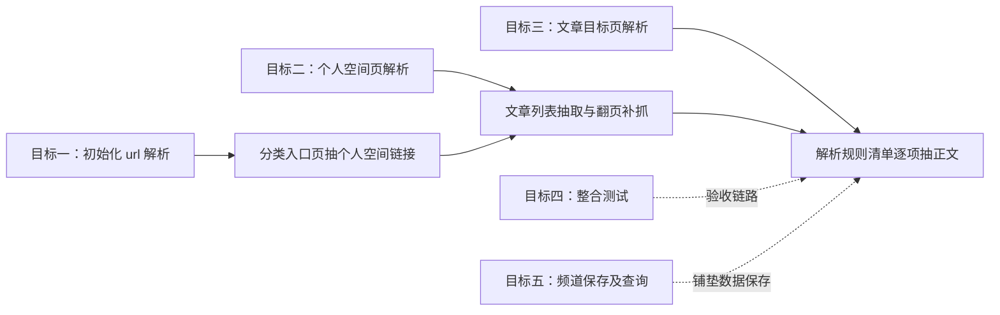

# day09 任务书：文档解析三连击，把抓回来的页面变成结构化数据

> 🔒 安全提示：文中示例的口令/密钥均为课程教学环境演示口径，生产环境的安全要求见《安全与合规须知》。

day08 收尾时，爬虫系统的下载侧已经全部就位：配置、工具、帮助类、代理供给与下载组件五层各司其职，入口 URL 也灌进了台账。但一条主链路始终空着，下载组件把页面源码拿回来之后没有人接手，文章正文、作者空间这些真正有价值的数据还没有被摸出来。day09 的主线就是补上这一环：文档解析，顺带把写了很久的爬虫代码第一次整体串起来跑一遍。

课件给出的任务清单是五条：完成爬虫初始化 url 的解析代码、完成个人空间页的解析、完成文章目标页的解析、进行整合测试、编写频道数据的保存及查询。五条目标看着分散，实际是一条链上的五个关卡，前三个层层递进，第四个做验收，第五个为数据保存环节铺垫。

## 先给结论

- 五个目标按链路排序：初始化 URL 解析、个人空间页解析、文章目标页解析、整合测试、频道数据的保存及查询。
- 解析重点三块：初始化 URL 怎么解析（分类入口页里抽个人空间链接）、个人空间页怎么解析（文章列表与翻页一并处理）、文章目标页怎么解析（最终文章信息逐项抽取）。
- 解析器的写法走模板套路：抽象类把流程骨架固定住，子类按页面形态填差异钩子，多个解析器靠文档类型判断与优先级分工。
- 整合测试是这一天的关键节点：此前每讲只写代码不整体跑，今天把初始化、下载、解析串成一条线看真实效果。
- 频道数据从目标页爬取出来，结合数据库做保存或查询，为接下来的数据保存做准备。

## 五个目标怎么映射到技术点

五个目标不是并列的清单，前三关共用一套解析骨架，第四关验收骨架，第五关把解析产出接进数据库：



关键路径在 T1 到 T3 这条主线上：文档解析的骨架是抽象处理器加规则清单，三个解析器分别对着三类页面填钩子，链路上的数据每过一级就升格一次类型；整合测试把这三级串起来验证，频道保存则站在链条末端，把爬出来的频道数据交给数据库。

## 解析三连击：一条链上的三关

**第一关，初始化 URL 的解析。** 这里的「初始化」与 day08 那个「初始 URL 的获取」同名不同事：day08 把入口地址从配置加工成抓取对象灌进台账，解决「要抓哪里」；day09 的第一个目标对的是入口页下载回来的源码，解决「抓回来的页面上有什么」。分类入口页上没有文章，只有指向作者主页的链接，这一关的任务就是按配置的抽取路径把这些个人空间链接抽出来，升格为下一级类型交出去。

**第二关，个人空间页的解析。** 作者主页上躺着这位作者的全部文章链接，文章少的空间一页装得下，文章多的空间会自动翻页。所以这一关的考点有两个：把第一页的文章链接抽全，以及把翻页的文章链接补全。抽出来的链接继续向下一级投递，离最终的文章信息只剩一步。

**第三关，文章目标页的解析。** 链条的终点是文章详情页，标题、正文、发布时间、评论数这些最终要入库的信息全在这一页的源码里。抽取靠的不是散落的字符串，而是解析规则清单：每条规则带名称与表达式，按规则逐项抽取，结果直接对号入座。

## 整合测试与频道保存：验收和铺垫

解析三关写完，代码量已经不小，但从 day08 至今每讲都在写、没有整体跑过。整合测试这一关把初始化、下载、解析串成完整链路，从入口页开始走一遍，看数据能不能一路推到文章信息这一层。跑批类的系统最怕链路各段都对、拼起来不通，整合测试就是把拼接处暴露出来，趁改动还小赶紧修。

频道保存是本日的收尾铺垫。文章页上带着频道信息，频道数据从目标页爬取出来，结合数据库做保存或查询，这直接服务于接下来的数据保存环节：文章落库时频道要能对上号，频道表先有数据，文章入库才不缺维度。目标页的解析规则清单里已经把频道相关的字段圈了进去，保存动作到时按字段取值即可。

解析侧的抽取路径与分页参数都从配置来，抽取相关的键值预览如下（示例按本课写法补全，具体值按目标站页面结构填）：

```properties
# 初始化分类页上抽取个人空间链接的路径
crawler.init.url.path=//div[@class='menu-list']//a
# 个人空间页上抽取文章链接的路径
crawler.help.crawlerXPath=//div[@class='article-list']//a
# 个人空间翻页补抓页数上限，默认 10
crawler.help.nextPagingSize=10
```

目标页要抽的字段则以规则对象清单的形式集中注册，每条规则三要素：名称、类型、表达式（节选示例，表达式按目标站页面结构定制）：

```java
parseRules.add(new ParseRule("commentCount", CrawlerEnum.ParseRuleType.XPATH,
        "//div[@class='tool-bar']//span[@class='comment-count']"));
parseRules.add(new ParseRule("content", CrawlerEnum.ParseRuleType.XPATH,
        "//div[@class='content_rich']"));
```

两份物料一配置一清单，覆盖了三类页面解析的全部参数来源：页面链接抽取看配置，文章字段抽取看清单，站点改版时改这两处即可，解析代码本身不动。

## 常见误区

- **把 day09 的「初始化 url 解析」当成 day08 的重复。** 错例是以为初始化已经做完，这一目标无活可干。正解是区分「获取」与「解析」：前者收地址进台账，后者解析入口页源码抽下一级链接。
- **只盯着单页抽取不考虑翻页。** 错例是空间页解析只处理第一页，文章多的作者漏抓大半。正解是解析方案里把翻页补抓设计进去，页数上限走配置。
- **解析规则散落硬编码。** 错例是把 XPath 表达式写成字符串常量散在各个方法里，站点一改版全工程翻找。正解是集中成规则清单与配置键，改物料不改代码。
- **攒到最后才整合测试。** 错例是三关全写完再跑，出了问题排查面横跨三个解析器。正解是每关写完先自测，整合测试放在解析侧收口时做，拼接处的口径趁早对齐。

## 面试可能被问到的问题

1. 面试官追问：「解析环节解决什么问题，下载完直接存库不行吗？」
   答：下载拿到的是整页源码，导航、广告、推荐位混在一起，直接入库既浪费存储又没法检索。解析环节按规则把标题、正文、链接这些有效字段抽成结构化数据，同时把下一级要抓的链接识别出来，是源码到入库数据之间的加工车间。
2. 面试官追问：「三类页面为什么分开写解析器，而不是一个解析器全包？」
   答：页面结构、抽取路径、升格出去的类型完全不同，一个类全包会让条件分支层层嵌套。分开后每个解析器只认自己那类页面，用文档类型判断加优先级分工，新增页面形态就是新增一个子类，已有解析器不动。
3. 面试官追问：「整合测试为什么要等到解析写完才做？」
   答：解析是链路上最后一个有独立产出的环节，它就位后从入口到文章信息的全链路才闭环，这时候串起来才有完整的验证价值；更早整合只能验证半条链，晚于这个时点则缺陷积累过多，修复成本升高。

## 配套资料

- 代码：本日无配套源码包，`materials/code/05/头条day09/` 资料目录为空，目标清单与配置键按画面线整理，示例按本课写法补全。
- 参照：`materials/code/05/头条day07/` 资料目录（引用截至 dayNN 层级，内层目录含项目原名）里的封装工具类，可对照感受工程内部模块的组织方式。
- 环境：课程集群 node01~node03，MySQL root/123456；整合测试需要本机可访问目标站点，示例站点一律以 example.com 占位。
