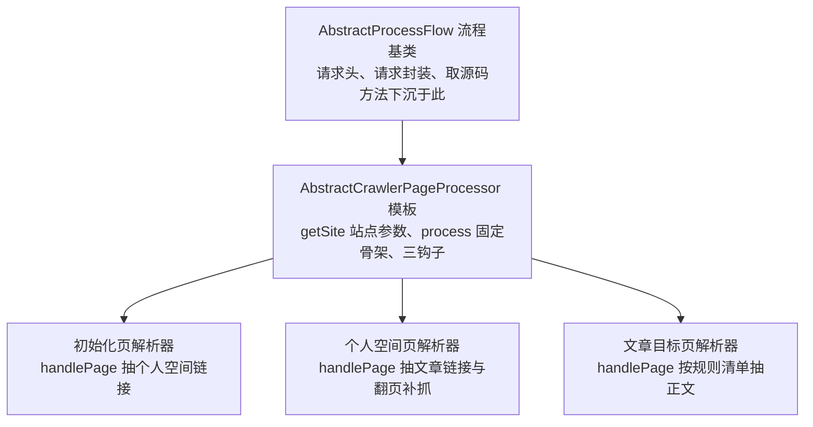

# 文档解析前置准备：解析规则工具类与页面处理器抽象骨架

> 🔒 安全提示：文中示例的口令/密钥均为课程教学环境演示口径，生产环境的安全要求见《安全与合规须知》。

下载组件把页面源码拿回来之后，下一个动作是解析。解析和下载的脾气完全不同：下载面对的是协议与网络，写好一遍全站通用；解析面对的是页面结构，分类入口页、个人空间页、文章页长得各不一样，要抽的字段一大把，动作却高度重复，按规则从源码里抽一块内容、过滤有效性、把结果交给下一级。如果每写一个解析器都从零来一遍，重复代码很快会把工程拖垮。

day09 的前置准备四讲做的就是打底工作：认识解析规则工具类 `ParseRuleUtils`，把 `Spider` 引擎与目标页解析规则纳入 `CrawlerConfig` 统一管理，把请求头与请求封装这类通用方法下沉到流程基类 `AbstractProcessFlow`，最后搭出解析侧的模板骨架 `AbstractCrawlerPageProcessor`。骨架立住之后，后面的初始化解析器、个人空间页解析器、目标页解析器全是往钩子里填血肉。

## 先给结论

- 解析的公共动作沉淀在 `ParseRuleUtils`：规则清单进、抽取结果出，有效规则过滤独立成方法，规则与解析动作分离。
- 目标页的解析规则以 `ParseRule` 对象清单的形式集中注册，每条规则带名称、类型与表达式三要素，站点改版改清单不改代码。
- `Spider` 引擎对象纳入 `CrawlerConfig` 统一管理，解析器最终都要挂到这台引擎上跑。
- `AbstractProcessFlow` 下沉通用方法：随机 User-Agent 与 Accept 请求头、`getHeaderMap`、按 URL 或解析条目封装 `Request`、向请求追加数据。
- `AbstractCrawlerPageProcessor` 是解析侧模板：继承流程基类并实现 `PageProcessor`，站点参数与流程骨架固定在模板里，`handlePage`、`isNeedHandleType`、`isNeedDocumentType` 三个钩子留给子类。
- 解析出的链接统一经 `addSpiderRequest` 升格为 `CrawlerParseItem` 条目，带上方向与文档类型交给下一级。

## 解析规则工具类：规则进，内容出

先把规则本身说清楚。一条解析规则要回答三个问题：抽什么、按什么语法抽、表达式长什么样。课程把这三件事封装进 `ParseRule` 对象（字段按画面线整理）：

```java
public class ParseRule {

    /** 规则名称，对应抽取结果的字段名，如 commentCount、content */
    private String name;

    /** 抽取类型，当前全部走 XPATH */
    private CrawlerEnum.ParseRuleType parseType;

    /** 抽取表达式，按类型给值 */
    private String expression;
}
```

类型是枚举 `ParseRuleType`，本项目的规则清一色 XPATH，表达式就是一条 XPath 路径。三条信息为什么要装成对象而不是散着传：名称是抽取结果与入库字段之间的对号牌，类型决定表达式按什么语法解释，表达式是定位内容的路径。三个属性绑定在一起流转，方法签名里一个参数就带全，后续规则要加属性（比如抽取后的清洗方式）也只扩对象，调用方签名不动。

规则对象不干活，干活的是工具类，`ParseRuleUtils` 放在 utils 包下，全部静态方法，谁用谁调。工具类做成静态的道理与代理工厂一脉相承：它不持有任何可变状态，入参定则输出定，没有实例化的必要，也没有并发共享数据的隐患：

```java
public static List<ParseRule> parseRuleList(Html html, List<ParseRule> parseRuleList) {
    // 第一步：按规则清单逐条抽取，结果回填进规则对象
    List<ParseRule> ruleList = parseContent(html, parseRuleList);
    // 第二步：过滤出有效规则
    List<ParseRule> effectiveParseRuleList = getEffectiveParseRuleList(ruleList);
    return effectiveParseRuleList;
}

/**
 * 获取有效的抓取规则
 */
private static List<ParseRule> getEffectiveParseRuleList(List<ParseRule> parseRuleList) {
    return parseRuleList;
}
```

方法两步走：`parseContent` 拿着页面包装对象 `Html` 与规则清单，逐条按表达式抽取，把抽到的内容挂回规则对象；`getEffectiveParseRuleList` 做有效性过滤。画面线里这一步还是直通实现，细节到具体使用时再展开，骨架先立住的意义在于两步的边界已经划清，抽取与过滤互不掺和，后续加校验只动过滤方法。

入参里的 `Html` 是 WebMagic 提供的 HTML 包装对象，页面源码字符串进去就具备 XPath 查询能力，它把 Jsoup 的 DOM 解析与 Xsoup 的选择器引擎包在一起，解析代码面对的始终是同一个查询接口，底下引擎怎么协作不用关心。抽出来的内容回填进规则对象而非另起结果集，好处是规则与它的产出始终在一个对象里，遍历清单就能同时看到「要什么」与「抽到了什么」，后续组装数据不用两头对。

工具类与规则对象搭配，就形成了「规则进、内容出」的固定姿势，后面所有解析动作都复用这一套。

**规则清单集中注册。** 规则不能散落在各处硬编码，目标页要抽的字段清单统一注册在 `CrawlerConfig` 里（节选，表达式按目标站页面结构定制）：

```java
/** 目标页解析规则清单 */
public List<ParseRule> getTargetParseRuleList() {
    List<ParseRule> parseRules = new ArrayList<>();
    parseRules.add(new ParseRule("commentCount", CrawlerEnum.ParseRuleType.XPATH,
            "//div[@class='tool-bar']//span[@class='comment-count']"));
    parseRules.add(new ParseRule("content", CrawlerEnum.ParseRuleType.XPATH,
            "//div[@class='content_rich']"));
    return parseRules;
}
```

`commentCount` 抽评论数，`content` 抽正文，这只是清单节选，完整清单会覆盖标题、发布时间、阅读量等全部要入库的字段。规则集中一处注册的价值在维护侧：目标站改版，改清单里的表达式就行，解析代码一行不动；评审与回滚也都落在同一处。

## Spider 入容器与通用方法下沉

**Spider 先进容器。** 解析页面要用 `Spider`，它是 WebMagic 提供的爬虫引擎对象，解析器、下载组件最终都要组装到它身上。课程把 Spider 统一交给 `CrawlerConfig` 管理，容器里一份，谁要用谁注入，具体的组件组装动作留到组件整合环节完成。提前入容器的好处有两层：一层是口径收拢，与其让各处随手 new 出互不相识的引擎实例，不如从源头保证全工程面对的是同一台引擎；另一层是装配顺序可控，Spring 容器先把配置、帮助类、解析器逐个备齐，组件整合时按名注入即可，不会出现引擎先起、零件没齐的空窗。

**请求头下沉到流程基类。** 解析页面发请求要带 User-Agent 与 Accept。User-Agent 是浏览器身份标识，目标站会按它识别访问者；项目里把它做成字符串数组，随机取一条，与代理池的出口轮换呼应，出口 IP 在换，浏览器指纹也跟着换，两者一起转才像真实用户。取请求头的入口是一个方法：

```java
public Map<String, String> getHeaderMap() {
    Map<String, String> headerMap = new HashMap<>();
    headerMap.put(UserAgentParameterName, getUserAgent());
    headerMap.put(AcceptParameterName, getAccept());
    return headerMap;
}
```

`getUserAgent()` 从数组里随机挑一条，`getAccept()` 返回客户端可接收的内容类型声明。两个键名是 HTTP 协议的标准头名，Map 装好之后，站点配置与请求封装两个方向都能直接消费。

**请求封装与数据挂载。** 流程基类里还预置了请求封装的方法，两种形态（按画面线整理）：

```java
/** 按 URL 封装 WebMagic 请求 */
public Request getRequest(String url) {
    Request request = new Request();
    request.setUrl(url);
    return request;
}

/** 按解析条目封装请求，条目随请求流转 */
public Request getRequest(ParseItem parseItem) {
    Request request = getRequest(parseItem.getUrl());
    crawlerHelper.setParseItem(request, parseItem);
    return request;
}

/** 向请求里追加自定义数据 */
public void addDataToRequest(Request request, String key, Object value) {
    request.put(key, value);
}
```

这里的 `Request` 是 WebMagic 包下的请求对象，不是 Servlet 规范里那个，它自带属性容器，`put` 与 `get` 能挂自定义数据。按 URL 封装是最简形态，按条目封装则多做一步，把解析条目挂到请求属性上，下载与解析环节按 key 取回，条目里的类型与方向一路跟着走，上下文不断线。这三个方法全部下沉在 `AbstractProcessFlow`，所有子类随取随用。

## 抽取页面处理器：一个类两个身份

骨架的核心是抽象页面处理器。课件给它的一句话定位：处理页面并解析数据，将通过下载组件拿回的数据进行解析处理，从配置中拿到解析类去进行数据的解析。通用语义上它把页面分两层：HelperList 是列表页，TargetList 是文章页；博客站里列表页是文章列表、文章页是文章详情，论坛站里是帖子列表与帖子详情，电商站里是分类列表与商品详情。对应到本项目，三级页面依次是分类入口页、个人空间页、文章目标页。

这个抽象类有双重身份。一边继承 `AbstractProcessFlow`，拿到流程队列的调度资格与全部通用方法；另一边实现 WebMagic 的 `PageProcessor` 接口，拿到框架的回调资格。两个身份缺一不可：只实现 `PageProcessor` 不继承流程基类，解析器就游离在业务流队列之外，请求头、请求封装这些通用方法全要自己重写；只继承流程基类不实现接口，WebMagic 不认它，框架下载完页面没有回调可走。抽象层把两个身份捏在一个类里，子类继承一次全拿到。

顺手能想到的替代方案是让每个解析器直接实现 `PageProcessor`，站点参数与请求头各自写一遍。这类代码写三遍就腻：站点参数全站一致、请求头全站一致、结果组装姿势全站一致，不一样的只有页面抽取本身。把一致的部分上提到抽象类，差异的部分留给子类，正是模板方法模式的标准开场。骨架四方法如下：

```java
public abstract class AbstractCrawlerPageProcessor
        extends AbstractProcessFlow implements PageProcessor {

    @Override
    public void handle(ProcessFlowData processFlowData) {
        // 页面处理器的驱动来自 WebMagic 的 process 回调，流程入口保持空实现
    }

    @Override
    public CrawlerEnum.ComponentType getComponentType() {
        // 本环节对应 WebMagic 的页面解析组件
        return CrawlerEnum.ComponentType.PAGEPROCESSOR;
    }

    @Override
    public void process(Page page) {
        // WebMagic 的核心接口方法：公共骨架固定在这里，页面差异交给子类钩子
        handlePage(page);
    }
}
```

`handle` 保持空实现，与原始数据处理阶段同一个道理：调度器只认 `handle` 这个统一入口，页面处理器的真正驱动是 WebMagic 回调 `process`，空实现守住「所有环节统一被调度」的契约。`getComponentType` 返回 `PAGEPROCESSOR`，向调度器上报自己对应框架的解析组件。`process` 是 WebMagic 约定的回调方法，框架下载完一页就会调它，模板在这里只做一件事，把页面转交 `handlePage`，差异全部推给子类。

## 站点参数：getSite 把重试与超时焊进模板

`PageProcessor` 还有一个必须实现的方法 `getSite`，站点级参数都在这里定：

```java
@Override
public Site getSite() {
    Site site = Site.me()
            .setRetryTimes(getRetryTimes())          // 失败重试次数
            .setRetrySleepTime(getRetrySleepTime())  // 重试间隔，毫秒
            .setSleepTime(getSleepTime())            // 两次抓取间隔，毫秒
            .setTimeout(getTimeout());               // 请求超时，毫秒
    // 请求头统一下发到站点配置
    Map<String, String> headerMap = getHeaderMap();
    if (null != headerMap && !headerMap.isEmpty()) {
        for (Map.Entry<String, String> entry : headerMap.entrySet()) {
            site.addHeader(entry.getKey(), entry.getValue());
        }
    }
    return site;
}

public int getRetryTimes() { return 2; }
public int getRetrySleepTime() { return 1000; }
public int getSleepTime() { return 1000; }
public int getTimeout() { return 10000; }
```

四个参数各有分工。重试次数 2，下载偶发失败再补试两次，超过就交给兜底通道；重试间隔 1000 毫秒，失败后缓一秒再试，别紧着打；抓取间隔 1000 毫秒，两次请求之间保持一秒节奏，既控制频率又降低被目标站盯上的概率；超时 10000 毫秒，给慢页面留足时间，又不至于把线程吊死。数字全部做成方法而不是塞进链式调用，某个站点要特殊调参时，子类重写一个方法即可，模板的链式结构一行不动。

循环体里 `site.addHeader` 把基类下沉的请求头逐条下发到站点配置，WebMagic 发出的每个请求都会带上 User-Agent 与 Accept。判空条件是 `null != headerMap && !headerMap.isEmpty()`，方向别写反，写反了请求头一个都发不出去还不报错。

## 模板方法模式：流程固定，钩子留白

模板方法模式用一句人话讲：流程的骨架与先后顺序在父类里定死，骨架上留几个空位，子类往空位里填自己的动作，调用的入口与顺序始终不变。解析器是标准的应用场景：抽取前取类型、抽取、结果交下一级，这个先后顺序不会变，会变的只有抽哪条路径、交出去算什么类型，这两件事就是钩子。

整条解析侧的继承结构如下：



关键路径从上往下读：顶层流程基类提供通用能力，中间模板定死解析流程与站点参数，三个子类各填各的钩子。以后新增一种页面形态，就是再加一个子类，模板与基类一行不动，这正是模板方法模式要的红利。

钩子三件套的声明（按画面线整理）：

```java
/** 子类钩子：处理本环节对应的页面 */
public abstract void handlePage(Page page);

/** 子类钩子：是否处理该方向的数据 */
public abstract boolean isNeedHandleType(String handleType);

/** 子类钩子：是否处理该类型的页面 */
public abstract boolean isNeedDocumentType(String documentType);
```

两个 isNeed 钩子是多解析器并存时的身份验证。一条数据带着处理方向与文档类型在链上流转，每个解析器先报身份，处理正向的、处理 INIT 页的，路由时按身份放行，不匹配的数据自动滑给别的解析器。钩子只做声明不做判断，判断的口径是 `CrawlerEnum` 枚举的 `name()` 字符串比对，比对放在子类里而不是模板里，为的是子类有特殊放行需求时（比如某个解析器要同时接两类页面）重写即可，模板的调用方式不变。

还有一处结构细节值得留意，模板类本身不加 `@Component`。抽象类不能实例化，注册成 Bean 没有意义；注册的是各子类，每个子类一个 Bean，容器里的解析器清单就是这几个注册项，组件整合时把清单取出来逐个接线即可。

**通用解析与结果组装。** 模板里还预置了两类通用方法。第一类是基于规则清单的 URL 解析：

```java
public List<String> helpParseRuleList(List<ParseRule> helpParseRuleList) {
    List<String> helpList = new ArrayList<>();
    for (ParseRule parseRule : helpParseRuleList) {
        // 每条规则执行后带出抽取内容清单，工具类从清单里收出链接
        List<String> urls = ParseRuleUtils.getUrls(parseRule, parseRule.getParseContentList());
        helpList.addAll(urls);
    }
    return helpList;
}
```

「规则进、URL 出」，一条规则可能抽出多个链接，循环加 `addAll` 一次收齐。第二个是本节的重头，结果组装方法：

```java
public void addSpiderRequest(List<String> urlList, Request request,
        CrawlerEnum.DocumentType documentType) {
    List<ParseItem> parseItemList = new ArrayList<>();
    if (!urlList.isEmpty()) {
        for (String url : urlList) {
            CrawlerParseItem crawlerParseItem = new CrawlerParseItem();
            crawlerParseItem.setUrl(url);
            // 处理方向从当前请求上取，保持透传
            crawlerParseItem.setHandleType(crawlerHelper.getHandleType(request));
            // 文档类型由调用方指定，决定下一级由谁接手
            crawlerParseItem.setDocumentType(documentType);
            parseItemList.add(crawlerParseItem);
        }
    }
    // 组装完成的条目整批交出去
    addSpiderRequest(parseItemList);
}
```

三处赋值各有含义。url 直接落；handleType 从当前请求上取，当前这条数据怎么来的，抽出的新链接就沿同一个方向走；documentType 是唯一由调用方决定的字段，抽出的链接该算哪类页面，下一级解析器就按这个类型认领。组装完的条目整批交给重载方法，由 `CrawlerHelper` 统一收口，最终进入 Spider 待抓队列的接线在组件整合环节完成。有了这个出口，子类的钩子写起来就只剩两件事，抽链接、调 `addSpiderRequest`。

## 解析器注册与路由

模板搭完，解析器的注册与路由规则一并立好。子类加 `@Component` 注入 Spring 容器，容器里多个解析器并存；谁接手哪一页，靠两个 isNeed 判断身份，先后顺序靠 `getPriority` 排定。优先级草案是初始化页解析器 100、个人空间页解析器 110、文章目标页解析器更大，排在最后处理，等列表都摸全了才轮到它出手。路由的具体接线由流程调度统一完成，模板这一层只负责把身份与顺序上报清楚。

优先级的数字有两套序列，容易混。一套是流程队列里初始化环节的 10，那是原始数据处理环节在整条业务流队列上的位置；另一套是解析器之间的 100 与 110，这是页面解析环节内部的接力顺序。两套序列互不干扰，前一套决定初始化抢在下载前跑，后一套决定入口页先解析、空间页后解析、文章页最后解析。看到 `getPriority` 返回 100 之类的大数，对照的是解析器序列，不要与流程优先级的 10 混为一谈。

路由时机的取舍也顺带交代：页面下载完触发 `process` 回调，回调里先查这条数据的文档类型与处理方向，逐个询问解析器的身份，身份匹配者优先级最高的接手。判断动作轻，全是字符串比对，不会成为链路瓶颈；真正的价值是解析器之间零耦合，谁也不引用谁，全靠类型字段对话。

数据流由此定型：页面源码进来，钩子抽取，`addSpiderRequest` 升格条目，条目进请求队列等下一轮下载解析。每个环节只做自己的事，解析器不碰库、不碰队列实现，职责单一让后面所有的扩展都在子类层发生。

## 常见误区

- **把 process 当成子类的重写点。** 错例是每个子类都重写 `process` 塞解析逻辑，模板骨架被绕开，公共动作复制出好几份。正解是 `process` 固定在模板里，子类只实现 `handlePage`。
- **请求头判空写反。** 错例是 `null != headerMap && headerMap.isEmpty()`，逻辑变成「为空才遍历」，请求头发不出去还不报错。正解是 `!headerMap.isEmpty()`，配合非空断言。
- **钩子方法不接参数直接放行。** 错例是 `isNeedHandleType` 无视入参一律返回 true，所有数据都放进来，路由形同虚设。正解是按传入的方向与类型做 `name().equals()` 判断。
- **解析规则散落硬编码。** 错例是 XPath 表达式作为字符串写死在解析方法里，站点改版全工程翻找。正解是集中成 `ParseRule` 清单注册进配置类，改清单不改代码。

## 面试可能被问到的问题

1. 面试官追问：「模板方法模式在你们的解析器里怎么体现的？」
   答：AbstractCrawlerPageProcessor 固定了站点参数、process 回调与结果组装的骨架，handlePage 承担页面差异，isNeedHandleType 与 isNeedDocumentType 承担身份识别，三个钩子留给子类。调用的入口与顺序始终不变，新增页面形态只需加子类，模板不动。
2. 面试官追问：「解析器为什么同时继承流程基类又实现 PageProcessor？」
   答：两个身份各管一边。继承流程基类拿到流程队列的调度资格、优先级上报与通用方法下沉的红利；实现 PageProcessor 拿到 WebMagic 的 process 回调资格，框架下载完页面按它驱动解析。缺一个身份，要么进不了统一调度，要么接不到框架回调。
3. 面试官追问：「getSite 里四个参数分别管什么？」
   答：重试次数管失败后补试几回，重试间隔管补试的节奏，抓取间隔管两次请求之间的频率控制，超时管单次请求最多等多久。四个值都做成方法，特殊站点重写即可调整，模板链式结构不动。
4. 面试官追问：「addSpiderRequest 为什么要传 Request 与 documentType？」
   答：Request 是上下文来源，处理方向要从当前请求上取回透传，保证新链接沿同一条链走；documentType 决定抽出的链接算哪类页面，下一级解析器按它认领。一个管连续性，一个管路由。
5. 面试官追问：「解析规则集中成清单管理有什么好处？」
   答：规则与解析动作分离，站点改版只改清单里的表达式；规则对象带名称与类型，抽取结果直接对号入座；清单统一注册在配置类里，多个解析器共用一套管理口径，评审与回滚落在同一处。
6. 面试官追问：「请求头里的 User-Agent 为什么要做成数组随机取用？」
   答：目标站按 User-Agent 识别访问者，固定值配上高频访问就是显眼的脚本特征。数组随机取用让每次请求的浏览器身份有变化，与代理池的出口 IP 轮换配合，身份与出口一起转，抓取行为才接近真实用户分布，这是解析前置准备里成本最低的反反爬措施。

## 配套资料

- 代码：本日无配套源码包，`materials/code/05/头条day09/` 资料目录为空，工具类与抽象类按画面线整理，方法骨架与默认参数按本课写法补全，以工程实际为准。
- 参照：`materials/code/05/头条day07/` 资料目录（引用截至 dayNN 层级，内层目录含项目原名）里的封装工具类，与解析规则工具类「静态方法、无状态、谁用谁调」的组织方式同源。
- 环境：课程集群 node01~node03，MySQL root/123456；解析抽取路径与分页大小等键值在 `crawler.properties` 中配置，示例站点一律以 example.com 占位。
