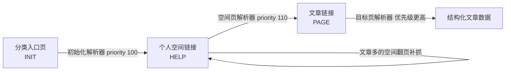

# 初始化 URL 解析器与个人空间页解析：从分类页一路摸到文章列表

> 🔒 安全提示：文中示例的口令/密钥均为课程教学环境演示口径，生产环境的安全要求见《安全与合规须知》。

模板骨架立住之后，解析侧进入填钩子的阶段。这一批四讲先填两个子类：初始化 URL 解析器对分类入口页动手，把页面上的个人空间链接抽出来；个人空间页解析器接手作者主页，把空间里的文章链接摸全，文章多的空间还要按配置页数从第二页起补抓。两个解析器跑通，链路就从「入口」推进到了「文章列表」，离最终的文章信息只差一步。

## 先给结论

- 第一个子类 `CrawlerInitPageProcessor` 只做一件事：对分类入口页源码跑一条 XPath，把全部个人空间链接抽出来，升格为 HELP 类型交下一级。
- 第二个子类 `CrawlerHelpPageProcessor` 接手个人空间页：第一页文章链接与入口页同一套 `xpath().links().all()` 抽取链路，文章多的空间按配置页数从第二页起补抓。
- 补抓三步走：剥追踪后缀拼分页地址、逐页发请求拿源码、同一条 XPath 抽链接合并；连续失败超过 2 页熔断退出，宁可少抓不恋战。
- 发请求的方法 `getOriginalRequestHtmlData` 下沉到大父类：HttpClient 优先，校验不合格由无头浏览器兜底。
- 解析器身份三件套：`isNeedHandleType` 认方向、`isNeedDocumentType` 认页面类型、`getPriority` 排先后，初始化 100、空间页 110，目标页解析器更大。
- 抽出的链接统一经 `addSpiderRequest` 升格为 PAGE 类型条目进入请求队列，地址随流程推进落到 `cl_news_url` 台账并逐级更新状态。

## 三个子类的分工：一条链上的三级接力

解析侧的子类有三个，对应三类页面形态：初始化页解析器管分类入口页，个人空间页解析器管作者主页，文章目标页解析器管文章详情页。一条数据沿链推进，每过一级文档类型就升格一次：INIT 进来的分类页，出去的是 HELP 链接；HELP 进来的空间页，出去的是 PAGE 链接；PAGE 进来的文章页，出去的就是解析完成的结构化内容。



关键路径读两处：链路上每一级只认自己的文档类型，类型不对的数据直接放行给别的解析器；翻页补抓发生在空间页一级，第二页以后的页面源码不走 WebMagic 的下载回调，由解析器自己发请求拿回来抽，这是本节与常规解析最大的差别。

为什么拆成三个子类而不是一个解析器包圆：三类页面的抽取路径、页面结构、升格出去的类型全不一样，包在一个类里条件分支会层层嵌套，改一级页面容易误伤另外两级。拆开后每个解析器只对自己那级页面的结构负责，配置里每级页面一条抽取路径，出错的影响面收敛在一级之内。条目在链上流转时字段也逐级丰满：入口页一级只填 url、方向与 INIT 类型；空间页一级接手后填上 PAGE 类型；到目标页一级，标题、正文、作者这些业务字段才有值可填，前面两级不为后两级预填任何业务数据。

## 初始化 URL 解析器：分类页里抽空间链接

**第一，类声明与身份。** `@Component` 交给 Spring 管理，继承模板 `AbstractCrawlerPageProcessor`，钩子逐个实现：

```java
@Component
public class CrawlerInitPageProcessor extends AbstractCrawlerPageProcessor {

    @Autowired
    private CrawlerConfigProperty crawlerConfigProperty;

    @Override
    public void handlePage(Page page) {
        // 初始化分类页上抽个人空间链接的路径，配置而来
        String initPath = crawlerConfigProperty.getInitCrawlerPath();
        // 对页面源码跑 XPath，抽出全部个人空间链接
        List<String> helpList = page.getHtml().xpath(initPath).links().all();
        // 升格为 HELP 类型，交由下一级解析器处理
        addSpiderRequest(helpList, page.getRequest(), CrawlerEnum.DocumentType.HELP);
    }

    @Override
    public boolean isNeedHandleType(String handleType) {
        return CrawlerEnum.HandleType.FORWARD.name().equals(handleType);
    }

    @Override
    public boolean isNeedDocumentType(String documentType) {
        return CrawlerEnum.DocumentType.INIT.name().equals(documentType);
    }

    @Override
    public int getPriority() {
        return 100;
    }
}
```

**第二，抽取链路逐段读。** `page.getHtml()` 把下载回来的源码包成可查询对象；`xpath(initPath)` 按配置的表达式圈定链接所在的页面区域；`links()` 从圈定范围里把链接地址收出来；`all()` 以集合返回。四段是 WebMagic 与 Xsoup 的固定写法，换页面只换表达式，链路不动。

表达式为什么不直接写 `//a` 全抓：入口页上除了作者卡片的链接，还混着导航、分类、页脚与外部合作链接，全抓进来一堆无效地址，下游白白多跑几轮下载与解析。配置的表达式先圈定作者卡片所在的容器区域，`links()` 只在圈内收地址，无效链接在源头就被挡掉。表达式的值按目标站页面结构填写，示例形态如下（示例按本课写法补全）：

```properties
# 初始化分类页上抽个人空间链接：先圈容器，links 收地址
crawler.init.url.path=//div[@class='author-list']
```

**第三，配置载体认清楚。** 注入的配置载体是 `CrawlerConfigProperty`，抽取路径与分页参数这类抓取物料都在它身上，与管初始化入口清单的 `CrawlerConfig` 分工：那份 `getInitCrawlerUrlList` 是初始化环节灌台账用的入口地址，这里要的是「在这类页面上怎么找链接」，同名带 init，取的却是解析路径，别拿混。

**第三，身份与顺序。** `isNeedHandleType` 认正向，`isNeedDocumentType` 认 INIT，两个判断都过它才接手这一页。优先级 100，比流程队列里初始化环节的 10 靠后，又比空间页解析器的 110 靠前，先有空间链接才有空间页可抓，顺序由优先级压住。

## 个人空间页解析器：先看分页还是不分页

**现象先看清。** 打开几个作者主页对比：文章少的空间一页装得下，页面上没有翻页区；文章多的空间自动分页，地址从第一页变成第二页、第三页，形如 `/article/list2`、`/article/list3`。只抓第一页，热门作者的多数文章会直接漏掉。所以空间页解析器的钩子里除了常规抽取，还要多一件补抓的事。

**类声明与注入。** 类上 `@Component` 加 `@Log4j2`，日志密度会比其他环节高，提前把日志句柄备好：

```java
@Component
@Log4j2
public class CrawlerHelpPageProcessor extends AbstractCrawlerPageProcessor {

    @Autowired
    private CrawlerConfigProperty crawlerConfigProperty;

    @Autowired
    private CrawlerHelper crawlerHelper;
}
```

**发请求的方法先下沉。** 补抓要自己发请求拿源码，这个动作空间页每页要用一次，目标页后面也要用，所以直接下沉到最大的父类 `AbstractProcessFlow`，所有子类都能用：

```java
@Autowired
private SeleniumClient seleniumClient;

@Autowired
private CrawlerProxyProvider crawlerProxyProvider;

/**
 * 获取原始请求数据：HttpClient 优先，校验不合格走无头浏览器兜底
 */
public String getOriginalRequestHtmlData(String url) {
    // 随机取代理，出口轮换
    CrawlerProxy proxy = crawlerProxyProvider.getRandomProxy();
    // 按代理取配对的 Cookie 列表
    List<CrawlerCookie> cookieList = cookieHelper.getCookieList(url, proxy);
    // HttpClient 通道优先请求
    String htmlData = getHttpClientRequestData(url, null, cookieList, proxy);
    // 校验不合格说明拿到的是拦截页，转无头浏览器再抓一次
    if (!crawlerHelper.validate(htmlData)) {
        CrawlerHtml crawlerHtml =
                seleniumClient.getCrawlerHtml(url, proxy, cookieHelper.getCookieName());
        htmlData = crawlerHtml.getHtml();
    }
    return htmlData;
}
```

方法三段式：取代理与配对 Cookie 备好身份，HttpClient 通道先走一趟，取回源码过校验，命中拦截特征就升级到无头浏览器通道再抓一次。请求成本控制也在这里收口，绝大多数请求走轻快的 HttpClient，只有被反爬拦住的少数才付出浏览器代价（方法骨架按画面线整理并按主流写法补全）。

下沉的位置也有讲究，方法放在 `AbstractProcessFlow` 而不是解析侧模板 `AbstractCrawlerPageProcessor`，因为父类之下还有原始数据处理等其他分支，将来任何一个流程环节要用源码都取得到。每个补抓请求都随机取代理、按代理配 Cookie，day08 下载准备阶段攒下的那套身份轮换设施在这里被逐页复用，补抓十页就是十次独立身份的访问，目标站看到的是十个不同的访客，而不是同一个脚本连点十下。

## handlePage 主流程：类型、URL、规则与日志一次备齐

空间页解析器的钩子，上半段把做解析要用的东西备齐：

```java
@Override
public void handlePage(Page page) {
    // 处理方向从请求上取，当前全部正向
    String handleType = crawlerHelper.getHandleType(page.getRequest());
    // 记录起始时间，方法出口算耗时
    long currentTime = System.currentTimeMillis();
    // 当前页面地址，也就是个人空间页的 url
    String requestUrl = page.getRequest().getUrl();
    log.info("开始解析帮助页，url: {}, handleType: {}", requestUrl, handleType);
    // 空间页上抽文章链接的 XPath
    String helpCrawlerXPath = crawlerConfigProperty.getHelpCrawlerXPath();
    // 分页补抓页数上限，默认 10
    Integer helpNextPagingSize = crawlerConfigProperty.getHelpNextPagingSize();
    // 第一页的文章链接
    List<String> helpUrlList = page.getHtml().xpath(helpCrawlerXPath).links().all();
    // 分页补抓与结果投递接在后面
}
```

日志口径说明一下，代码里的 Help 指的就是个人空间页，日志文案沿用这个叫法。开始一条日志、完成一条日志，带上 URL 与处理方向，出口算耗时，后期排查时哪一页慢、哪一页方向传错，日志里一眼可见。爬虫是长时跑批任务，日志密度比在线服务更高，URL 与类型是定位问题的两把钥匙。

三个取值点的写法各有一层意思。处理方向用 `crawlerHelper.getHandleType(page.getRequest())` 从请求属性上取，而不是写死 FORWARD：当前这条数据是正向任务投进来的还是反向回抓任务投进来的，请求上带着标记，解析器跟着标记走，将来反向回抓的场景复用同一套解析器时不用改代码。页面地址用 `page.getRequest().getUrl()` 取请求侧的原始地址，而不是从解析结果里挑，解析结果还没有产出，要的就是「这一页是谁」的原始坐标。起始时间戳用 `System.currentTimeMillis()` 记录，出口处做差得耗时，整合测试看效果时，每一级解析花多久、瓶颈在哪一级，全靠这组数字说话。

## 分页补抓：把第二页以后的文章摸全

**地址怎么拼。** 从入口页抽出的空间链接统一带着追踪后缀，形如 `?utm_source=feed`，这串参数对分页没有意义，直接往后面拼页码反而分不了页，要先剥掉再换成分页路径。两个常量先立住：

```java
/** 空间链接的追踪后缀，拼分页地址前先剥掉 */
private final String helpUrlSuffix = "?utm_source=feed";

/** 分页路径前缀，后拼页码，如 /article/list2 */
private final String helpPageSuffix = "/article/list";

/**
 * 生成第二页起的分页地址清单
 */
private List<String> generateHelpPagingUrlList(String url, Integer pageSize) {
    List<String> pagePagingUrlList = new ArrayList<>();
    // 剥掉追踪后缀，换成分页路径前缀
    String pageUrl = url.replace(helpUrlSuffix, helpPageSuffix);
    // i 从 1 起但页码是 i+1：第一页已经解析过，从第二页开始补抓
    for (int i = 1; i < pageSize; i++) {
        pagePagingUrlList.add(pageUrl + (i + 1));
    }
    return pagePagingUrlList;
}
```

循环变量从 1 起但页码取 `i + 1`，生成的地址从第二页开始到第 pageSize 页，第一页已经抓回来解析过，不重复造地址。后缀替换是这方法的灵魂：`?utm_source=feed` 整串剥掉，原地换上 `/article/list`，后续拼上页码就是站点认的分页地址。

**补抓怎么跑。** 逐页发请求、逐页校验、逐页抽取：

```java
/**
 * 获取分页补抓出的文章链接
 */
private List<String> getHelpPagingDocUrl(List<String> pagePagingUrlList) {
    long currentTime = System.currentTimeMillis();
    log.info("开始进行分页抓取，共 {} 个页面", pagePagingUrlList.size());
    List<String> docPageUrlList = new ArrayList<>();
    // 失败计数：连续失败超过阈值直接放弃本轮，防止空转
    int failCount = 0;
    if (null != pagePagingUrlList && !pagePagingUrlList.isEmpty()) {
        for (String url : pagePagingUrlList) {
            log.info("开始进行 help 页分页处理，url: {}", url);
            // 发请求拿源码，HttpClient 优先、无头浏览器兜底
            String htmlData = getOriginalRequestHtmlData(url);
            // 校验通过才抽取
            boolean validate = crawlerHelper.validate(htmlData);
            if (validate) {
                // 与第一页同一条抽取链路
                Html html = new Html(htmlData);
                List<String> urlList = html.xpath(helpCrawlerXPath).links().all();
                if (null != urlList && !urlList.isEmpty()) {
                    docPageUrlList.addAll(urlList);
                } else {
                    failCount++;
                }
            } else {
                failCount++;
            }
            if (failCount > 2) {
                // 连续多页拿不到数据，停止本轮补抓
                break;
            }
        }
    }
    log.info("分页抓取 DOC 页面完成，耗时: {}ms", System.currentTimeMillis() - currentTime);
    return docPageUrlList;
}
```

`new Html(htmlData)` 是 WebMagic 提供的 HTML 包装对象，页面源码字符串进去，XPath 查询能力就有了，与 `page.getHtml()` 拿到的对象同源，所以后面的抽取链路与第一页一字不差。Xsoup 的三段式在补抓页面上再走一遍：`xpath(helpCrawlerXPath)` 圈定文章链接所在区域，表达式与第一页是同一个配置键，站点对翻页后的列表区不做结构改动时，一条表达式两级通用；`links()` 在圈内收地址，`all()` 以集合返回。两条失败路径都走 `failCount++`，校验不合格算失败，抽不出链接也算失败。熔断的账要算清：连续三页拿不到有效数据，大概率是站点改版或者请求被拦，继续逐页打既浪费请求又可能加重封锁，宁可这轮少抓一些，抓取是周期性任务，下一轮调度自然补上。

页数上限做成配置项也有实际考量：不同作者的文章量差异极大，热门作者几百篇要翻十几页，普通作者两三页见底，写死一个数要么补抓不足要么空打太多页。`crawler.help.nextPagingSize` 默认 10，语义是「最多往回翻几页」，循环里 `i < pageSize` 也就是最多生成第二页到第 pageSize 页共 pageSize 减 1 个地址；对翻得早的空间，列表页不存在时请求自然拿不到有效数据，失败计数随后熔断，配置的上限只是天花板而不是必跑的次数。

**总入口与触发条件。** 补抓的入口方法按后缀判断要不要走：

```java
private List<String> getDocPageUrlList(String url, Integer pageSize) {
    List<String> docPageUrlList = new ArrayList<>();
    // 入口页抽出的空间链接统一带追踪后缀，以它为补抓的触发条件
    if (url.endsWith(helpUrlSuffix)) {
        List<String> pagePagingUrlList = generateHelpPagingUrlList(url, pageSize);
        docPageUrlList = getHelpPagingDocUrl(pagePagingUrlList);
    }
    return docPageUrlList;
}
```

不带后缀的地址说明不是标准入口页产出的空间链接，补抓不启动，方法原样返回空集合，调用方拿空集合不合并，逻辑自然退化成只抓第一页。

## 解析结果的去向：条目升格与台账状态推进

钩子的收尾把两路链接合成一个列表投出去：

```java
// 分页大小大于 1 才值得翻页补抓，默认 10
if (null != helpNextPagingSize && helpNextPagingSize > 1) {
    List<String> docPageUrlList = getDocPageUrlList(requestUrl, helpNextPagingSize);
    if (null != docPageUrlList && !docPageUrlList.isEmpty()) {
        // 补抓回来的链接并入第一页列表
        helpUrlList.addAll(docPageUrlList);
    }
}
// 全部文章链接统一升格为 PAGE 类型条目，交由下一级解析器
addSpiderRequest(helpUrlList, page.getRequest(), CrawlerEnum.DocumentType.PAGE);
log.info("解析帮助页数据完成，url: {}, handleType: {}, 耗时: {}ms",
        requestUrl, handleType, System.currentTimeMillis() - currentTime);
```

第一页与补抓页合并成同一个列表、一次投递，下游看到的这一位作者的文章链接是完整的一份。文档类型统一指定 PAGE，目标页解析器就按这个类型认领。身份与优先级照模板口径上报：

```java
@Override
public boolean isNeedHandleType(String handleType) {
    return CrawlerEnum.HandleType.FORWARD.name().equals(handleType);
}

@Override
public boolean isNeedDocumentType(String documentType) {
    return CrawlerEnum.DocumentType.HELP.name().equals(documentType);
}

@Override
public int getPriority() {
    // 比初始化解析器的 100 大一级，排在它后面处理
    return 110;
}
```

投出去的每条链接随流程推进落到 `cl_news_url` 台账上，条目字段与台账列一一对应：`url` 记地址，`document_type` 记 INIT、HELP、PAGE 的推进位置，`handle_type` 记正向还是反向，`status` 标出待抓与已完成。类型从 INIT 到 HELP 再到 PAGE 一级级推进，地址唯一性承担去重，状态回查支撑断点续抓。解析器自身不碰数据库，它只负责把数据升格成交接形态，落库的时点在下载与保存环节收口，两层职责分开，解析逻辑才能保持纯粹。

到这里，链路上前两级的解析全部落地：入口页的源码变成了一批带 HELP 类型的空间链接，空间页的源码变成了一批带 PAGE 类型的文章链接，翻页的文章也补齐了。下一讲轮到第三个子类，文章目标页解析器按规则清单把最终的文章信息抽出来。

## 常见误区

- **分页地址不剥追踪后缀。** 错例是带着 `?utm_source=feed` 直接拼 `/article/list2`，站点认不出这是列表地址，补抓页拿回来的全是异常响应。正解是先 `replace` 剥后缀再拼分页路径。
- **补抓不设熔断。** 错例是循环里只发请求不记失败，站点封锁后每轮补抓打满十页全是拦截页，代理与 Cookie 额度白白烧掉。正解是失败计数超阈值立即 `break`，宁可少抓不恋战。
- **抽取链路漏了 links 与 all。** 错例是 `xpath(expr)` 直接当列表遍历，拿到的是元素包装对象而不是地址串。正解是补全 `links().all()`，地址集合才算出炉。
- **第一页与补抓页分两批投递。** 错例是各自 `addSpiderRequest` 一次，两批条目分开流转，下游按批处理时同一位作者的文章被拆成两段，统计与去重口径都被打乱。正解是合并成一个列表后一次投递。
- **把解析器优先级与流程优先级混为一谈。** 错例是看到初始化环节的优先级 10，就把初始化解析器也定成 10，解析器之间的接力顺序被压乱。正解是两套序列各管一段，流程队列的 10 管环节位置，解析器的 100 与 110 管页面解析的先后。

## 面试可能被问到的问题

1. 面试官追问：「初始化解析器为什么只抽链接不做内容解析？」
   答：分类入口页上没有文章内容，只有指向作者主页的链接。每级解析器只处理本级页面上存在的信息，链接交下一级，内容抽取留给目标页，职责单一，页面改版时的影响面也小。
2. 面试官追问：「空间页分页补抓为什么解析器自己发请求，而不让框架继续抓？」
   答：框架的抓取队列是异步调度的，逐页补抓要保证顺序推进与失败熔断在一个方法里闭环。解析器自己发请求能立刻校验、立刻抽取、连续失败立即停，控制粒度比把地址回灌队列细得多。
3. 面试官追问：「HttpClient 与无头浏览器怎么分工？」
   答：HttpClient 轻快，是默认通道；无头浏览器能执行页面 JS，专门解决 Cookie 反爬拿不到正文的问题。取回源码先过校验，命中拦截特征才升级到浏览器通道，最贵的动作留给少数请求。
4. 面试官追问：「HELP 与 PAGE 两个文档类型怎么配合推进？」
   答：HELP 标记个人空间页这一级，空间页解析器只认它；PAGE 标记文章链接这一级，交给目标页解析器认领。类型随链接逐级升格，台账上的文档类型同步推进，路由靠它，断点续抓也靠它。
5. 面试官追问：「分页补抓连续失败为什么两页就停？」
   答：连续多页失败基本是站点改版或请求被拦，继续打满只会浪费请求并加重封锁。阈值小而硬，本轮少抓的部分等下个调度周期自然补上，抓取是周期性任务，单轮损失可接受。
6. 面试官追问：「解析结果为什么不直接写库？」
   答：解析的产出是结构化条目，落库要考虑去重、状态推进与事务边界，属于下载与保存环节的职责。解析器只把链接升格成带类型的条目投进队列，两层解耦后，解析逻辑可以单独测试，落库策略也可以单独调整。

## 配套资料

- 代码：本日无配套源码包，`materials/code/05/头条day09/` 资料目录为空，两个解析器与分页补抓逻辑按画面线整理，方法骨架与配置键按本课写法补全，示例站点一律以 example.com 占位。
- 参照：`materials/code/05/头条day07/` 资料目录（引用截至 dayNN 层级，内层目录含项目原名）里的封装工具类，可对照感受工程内部模块的复用方式。
- 环境：课程集群 node01~node03，MySQL root/123456；解析抽取路径、分页大小等键值在 `crawler.properties` 中配置，测试需要本机可访问目标站点。
