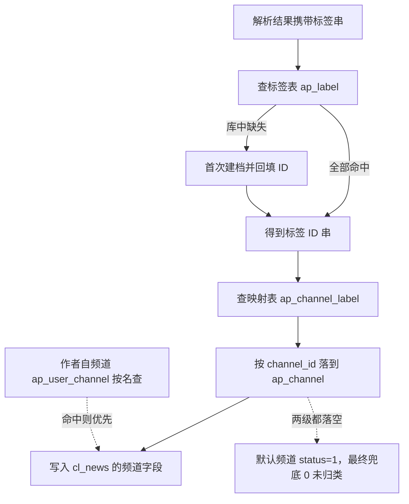

# 频道数据保存思路：把文章标签翻译成频道归属

> 🔒 安全提示：文中示例的口令/密钥均为课程教学环境演示口径，生产环境的安全要求见《安全与合规须知》。

下载与解析两级跑通之后，爬虫停在保存的门口。解析器抽出的结构化数据里标题、正文、作者、标签俱全，可标签只是一串逗号分割的字符串，`cl_news` 台账上的 `channel_id` 还空着。App 端的频道页按频道取文章，没有频道归属的文章等于白爬。保存准备从频道做起，先把「标签怎么变成频道」这笔账算清楚，后面几讲的 Mapper 与 Service 才有处安放。

## 先给结论

- 标签自由生长：解析出什么就收什么，库里没有的标签首次出现时由保存流程直接建档；频道是运营维护的维度数据，爬虫不能随手新增。
- 标签与频道是多对多关系，靠映射表 `ap_channel_label` 连接；一篇文章可以有多个标签，但只归一个频道，默认取映射到的第一个。
- 频道归属的完整判定链分四级：作者自频道按名查 `ap_user_channel` 优先，其次标签映射出的公共频道，再兜底 `ap_channel.status` 标记的默认频道，最终兜底 0 表示未归类。
- 映射表的 `ord` 排序位当前业务用不上但设计保留，为「同一标签挂多个频道时按权重取值」留口。
- 与频道并列的保存准备还有 IP 代理池，课程把这部分笔记整体挪到了下一天，这批内容只做频道。

## 频道为什么先行

数据保存的准备环节有两块业务：频道与 IP 代理池。两块都指向同一个目标，让 `cl_news` 台账在正式落库前字段齐备。爬虫文章的附加信息要靠标签、频道这几张维度表补齐，代理池则保障请求身份。代理池的思路分析与实体定义课程已经备好，动手环节整体挪到下一天，频道因此成了本批唯一的动手对象。

频道的紧迫性来自 App 端的展示规则。频道页是资讯 App 的首屏入口，用户订阅什么频道就看什么内容，文章进入 App 信息库时必须带频道 ID。爬虫文章先进爬虫库 `cl_news`，审核通过后才迁入 App 信息库，但频道归属要在爬虫侧就定下来：审核环节只判内容质量，不替文章决定归类。

**标签与频道是两种性质的维度。** 标签来自外部站点的文章页，站长打什么标签爬到什么，`MyBatis`、`docker` 这类词完全不可预知，标签表必须允许运行时新增。频道是平台自己的栏目体系，叫什么名、哪个是默认频道，全部由运营说了算。性质不同决定了写入策略不同：标签可增，频道只读。保存流程拿到标签串后查标签表，查不到的当场建档，这一步叫标签自增长；频道永远只查不建。

## 三张表各管一段

频道映射涉及三张表，外加一张自频道表：`ap_label` 存标签，`ap_channel` 存频道，`ap_channel_label` 存两者的映射，`ap_user_channel` 存平台用户的自频道。频道表的建表语句如下：

```sql
CREATE TABLE `ap_channel` (
  `id` int(11) unsigned NOT NULL AUTO_INCREMENT COMMENT '主键',
  `name` varchar(100) DEFAULT NULL COMMENT '频道名称',
  `description` varchar(255) DEFAULT NULL COMMENT '频道描述',
  `status` tinyint(1) unsigned DEFAULT NULL COMMENT '是否默认频道',
  `code` varchar(50) DEFAULT NULL COMMENT '频道编码',
  `created_time` datetime DEFAULT NULL COMMENT '创建时间',
  PRIMARY KEY (`id`)
) ENGINE=InnoDB DEFAULT CHARSET=utf8mb4 COMMENT='频道信息表';
```

```sql
CREATE TABLE `ap_channel_label` (
  `id` int(11) unsigned NOT NULL AUTO_INCREMENT COMMENT '主键',
  `channel_id` int(11) unsigned NOT NULL COMMENT '频道ID',
  `label_id` int(11) unsigned NOT NULL DEFAULT '0' COMMENT '标签ID',
  `ord` int(5) unsigned NOT NULL DEFAULT '0' COMMENT '排序',
  PRIMARY KEY (`id`),
  KEY `idx_label_id` (`label_id`)
) ENGINE=InnoDB DEFAULT CHARSET=utf8mb4 COMMENT='频道标签映射表';
```

频道表里最值得留意的是 `status`，注释写的是「是否默认频道」。这个字段是频道判定链的最后一道兜底：标签映射落空、自频道也没有着落时，文章挂到 `status` 为 1 的默认频道上。映射表按标签 ID 查频道，`idx_label_id` 这个普通索引正好服务这条查询路径，索引名沿用规范里 `idx_` 前缀表示普通索引的约定。

自频道表按冗余设计口径把频道名冗余了进来，频道名极少修改，按名查询免一次联表：

```sql
CREATE TABLE `ap_user_channel` (
  `id` int(11) unsigned NOT NULL AUTO_INCREMENT COMMENT '主键',
  `channel_id` int(11) unsigned NOT NULL COMMENT '频道ID',
  `name` varchar(100) DEFAULT NULL COMMENT '冗余频道名，按名查询免联表',
  `is_default` tinyint(1) DEFAULT '0' COMMENT '是否该用户的默认频道',
  `created_time` datetime DEFAULT NULL COMMENT '创建时间',
  PRIMARY KEY (`id`),
  KEY `idx_channel_id` (`channel_id`)
) ENGINE=InnoDB DEFAULT CHARSET=utf8mb4 COMMENT='用户频道表';
```

两条判定链在此汇合。公共频道链是标签映射这条：标签查到 ID，ID 查映射行，映射行带出频道 ID。自频道链更短：作者在平台建有自频道时，按频道名直接命中 `ap_user_channel`，文章优先挂自频道。下图把两条链画在一起：



图的入口在左上：标签串先进标签表，缺的补齐，然后沿映射表落到频道；虚线两条是兜底与优先路径，自频道命中就绕过映射，映射落空就滑向默认频道。

## 五步映射与设计的 why

映射流程一共五步：解析结果取标签串，可能多个也可能没有；按名批量查标签表，缺失的建档；拿标签 ID 查映射表；按 `channel_id` 定位频道；多个标签只归一个频道，默认取第一个。举例说，一篇文章带 MyBatis 与 docker 两个标签，映射查询命中 MyBatis 频道，文章就归 MyBatis 频道，docker 只作为标签留在台账上。

**为什么用中间表而不是同名匹配。** 标签名与频道名恰好相同的场景可以「按名对齐」，但名称对不上时就断了，比如标签是 `springboot` 而频道叫 Spring 生态。中间表由运营维护映射关系，能表达非同名映射，也能用 `ord` 表达顺序；频道表结构完全不受标签侧变化影响。`ord` 当前用不上，但设计保留：将来同一标签挂多个频道时，按 `ord` 权重取第一个，业务升级不用改表。

**为什么一篇文章只归一个频道。** 多个标签理论上映射出多个频道，但频道页不允许同一篇文章重复出现在多个入口，信息流会重复曝光，阅读与推荐统计也会重复计数。产品口径是取第一个，第一个是谁由映射查询的结果顺序保证，测试环节会专门验证这个约定。

**为什么标签可以建档而频道不行。** 标签建档解决的是「新词不断出现」的问题，外部社区的标签词表每天都在膨胀，人工维护永远滞后。频道是产品栏目的骨架，随便新增会打乱运营体系与用户订阅，所以频道只读、标签自增长，写入权限在这两类维度上是刻意分开的。

## 常见误区

- **拿标签名直接当频道名匹配。** 错例是跳过映射表，`ap_channel.name` 与标签串做等值比较，同名场景能跑通，改名或非同名标签一出现就整批未归类。正解是走 `ap_channel_label` 映射，同名只是映射的一种特例。
- **映射落空直接抛异常。** 错例是查不到映射行就中断保存，一篇标签冷门的文章把整批任务卡住。正解是按判定链逐级兜底：自频道、默认频道，最终 0 未归类，文章照常入库，归类问题留给运营。
- **认为一篇文章该挂多个频道。** 错例是把每个标签映射出的频道都写进文章，频道页重复曝光、统计重复计数。正解是单频道归属，默认取第一个，标签本身仍完整保留在文章上。
- **把自频道与公共频道混为一谈。** 错例是作者建了自频道，文章却还按公共频道映射挂载，作者主页聚合不到自己的内容。正解是自频道优先判定，命中即挂载，映射链作为回退。

## 面试可能被问到的问题

1. 面试官追问：「标签与频道的映射为什么用中间表？」
   答：标签与频道是多对多关系，而且两者的名称体系并不同源，标签来自外部站点，频道由运营定义。中间表能表达非同名映射与排序位，频道表结构不受标签侧变化影响；直接同名匹配只能覆盖特例，扩展性差。
2. 面试官追问：「一篇文章有多个标签，为什么只归一个频道？」
   答：多个标签会映射出多个候选频道，但频道页不允许同一篇文章重复曝光，统计口径也会重复计数。产品约定默认取第一个，顺序由映射查询结果保证，标签完整保留在文章上作为检索维度。
3. 面试官追问：「标签查不到时为什么选择建档而不是丢弃？」
   答：标签词表在外部站点持续膨胀，丢弃会让新标签的文章丢失检索维度，下次遇到还是查不到。首次出现即建档形成自增长，配合标签名唯一索引防止并发重复插入，标签维度就随着抓取逐步完善。
4. 面试官追问：「channel_id 为 0 是异常吗？」
   答：不是异常，是合法的兜底值，语义是未归类。判定链走到最后一级仍无着落时给 0，文章照常保存，归类问题留给后续修正。异常只在查询链路本身出错时出现，那一步记错误日志并返回空。
5. 面试官追问：「自频道和公共频道在数据上怎么区分？」
   答：公共频道在 `ap_channel`，由运营维护；自频道是用户维度表 `ap_user_channel`，记录用户与频道的归属关系，按频道名冗余一列便于直接查询。文章保存时自频道优先判定，命中就挂，未命中再走标签映射。

## 配套资料

- 代码：`materials/code/05/头条day09/` 资料目录为空，实体与表结构按画面线整理、按本课写法补全（引用路径截至 `头条dayNN/` 层级，内层目录名含项目原名，不进入正文）；示例站点一律以 example.com 占位。
- 参照：`materials/code/05/头条day01/`，数据库规范设计说明书，`uk_` 与 `idx_` 索引前缀、字段注释与冗余设计口径出自它。
- 环境：课程集群 node01~node03，MySQL root/123456；标签、频道与映射数据在导入脚本生成的库里查验。
