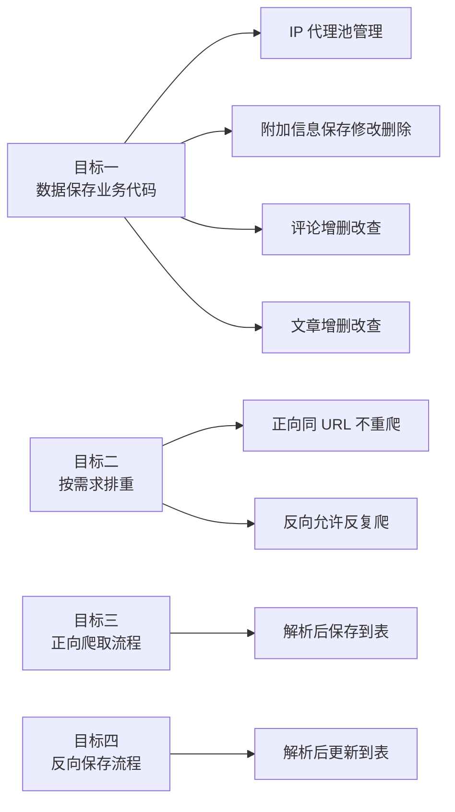
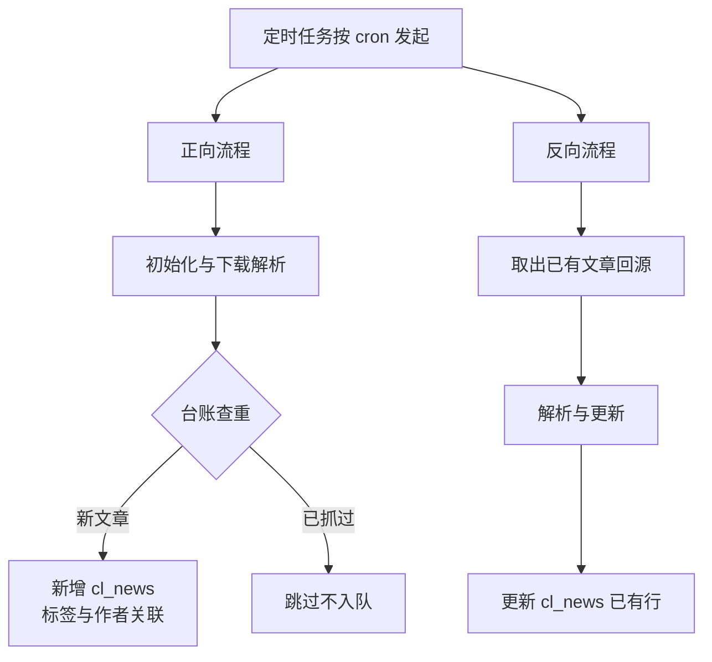

# 爬虫数据保存日的目标地图：落库、排重与正反向两条流程

> 🔒 安全提示：文中示例的口令/密钥均为课程教学环境演示口径，生产环境的安全要求见《安全与合规须知》。

day09 把频道映射的准备做完了，day10 进入真正的数据保存。这一天的开篇是一节目标课，画面上只有一页大纲，信息量却不小：四个目标里藏着 day10 全天的工作分解，其中「排重」的规则在正向与反向两个方向上刻意设计成不对称的，这是当天最容易被忽略的题眼。把目标与技术点对上号，后面每一讲才知道自己站在地图的哪个位置。

## 先给结论

- 四个目标：完成数据保存的业务代码、掌握按系统需求排重的流程、熟练正向爬取数据的流程、熟练反向爬取数据保存的流程。
- 数据保存的业务代码拆四块：IP 代理池管理、爬虫文章附加信息的保存修改删除、评论信息增删改查、文章增删改查，文章这一块是当天分量最重的。
- 排重规则不对称：正向爬取同一个 URL 不能爬两次，反向可以反复爬取；前者是增量抓新，后者是回源更新。
- 正向与反向共用解析能力，落库动作不同：正向往 `cl_news` 台账新增文章并做标签、作者关联，反向把解析结果更新回已有行。
- 正向批次由定时任务按 cron 周期发起，排重挡住已抓过的 URL，两条线在调度层衔接。

## 四个目标逐条拆

课件目标栏原文四条：完成数据保存的业务代码，掌握根据系统需求排重的流程，能够熟练正向爬取数据的流程，熟练了解反向爬取数据保存的流程。四条不是并列关系，第一条是当天的产出物，后三条是支撑它的能力项：排重决定哪些数据允许进入保存环节，正向流程管新文章的进店，反向流程管旧文章的更新。

业务代码的四块各有归属。**IP 代理池管理**是准备动作，对代理池做增删改查，并设置 IP 的可用与不可用状态；**爬虫文章的附加信息**指文章解析出来之后的标签、作者、频道这类补充数据的保存修改删除，day09 的频道映射就是附加信息的一部分；**评论信息**与**文章**的增删改查是保存的主体，其中文章的增删改查直接决定 `cl_news` 台账的数据形态，是全天最重要的模块。

把目标与技术点对齐成一张图，day10 的路线一目了然：



图里最值得盯的是 B 与 C、D 的关系：排重规则差异（B）决定了一条 URL 走哪条流程，走正向的新文章落新增，走反向的旧文章落更新，C 与 D 的保存动作因此不同。

## 排重：正向挡重复，反向要重复

**正向排重解决的是增量问题。** 正向批次从初始化 URL 出发，沿链接链路一路抓到文章页，抓取又是周期性任务，cron 到点就发起一轮。没有排重的话，每一轮都会把同一批文章重新下载、重新解析、重新入库，`cl_news` 台账被同一篇文章塞满重复行，请求额度也白烧。正向的排重口径因此很硬：同一个 URL 只处理一次，重复的直接挡在入队环节。

**反向不排重是业务需求决定的。** 反向流程面向台账里已有的文章，回到源站点重新抓一遍，目的是刷新会变化的数据：阅读量涨了、评论数变了、正文被作者修改过。这些字段天然随时间变化，不反复抓就永远是旧值。反向的本质是「对已知文章做体检」，恰恰要绕过正向的排重规则。

两条规则背后是同一张台账。`cl_news_url` 上 URL 唯一，文档类型与状态字段记录每条地址的处理进度，正向排重查的是「这条地址是否已经处理完」，反向回源查的是「哪些已完成的文章需要刷新」。排重不是简单去重，而是带状态的调度依据，这也是课件把「掌握按系统需求排重」单列为目标的原因：排重策略要贴着业务需求设计，照搬通用方案会两边都做错。

## 正向与反向的保存闭环



正向从调度发起，经下载解析到入库，`cl_news` 台账新增一行，同时把标签、作者这些附加信息关联上：标签走 day09 写好的映射服务变成 ID 串与频道归属，作者做关联建档，文章行挂上作者与频道。反向省掉查重，直接从台账取已有文章回源，解析结果落到更新语句上，只动会变化的字段。

两条流程共用下载与解析的全部设施，差别集中在保存动作：新增走完整关联，更新走字段刷新。这个共用关系是解析器按文档类型路由的价值兑现，同一套解析代码在两个方向上都能复用，保存侧各自收口。

## IP 代理池先行：day10 第一块业务

课件章节把「数据保存准备」排在最前，准备的第一节就是 IP 代理池。需求分析一句话：对 IP 代理池的管理，包括增删改查，设置可用 IP 和不可用 IP。day08 讲的是代理的获取侧，随机取代理、按代理配 Cookie，day10 补管理侧：代理可增可删，用坏了标记不可用，可用状态好的优先取用。

实体按画面线先行，字段按需求补全：

```java
package com.study.headline.model.crawler.pojos;

import lombok.Data;
import java.util.Date;

/** IP 代理池实体，字段按需求分析补全 */
@Data
public class ClipPool {
    private Integer id;
    /** 代理地址 */
    private String ip;
    /** 端口 */
    private Integer port;
    /** 是否可用：true 可用，false 不可用 */
    private Boolean isAvailable;
    private Date createdTime;
}
```

`isAvailable` 是这张表的灵魂字段。下载环节每次请求都从池里取代理，不可用的代理混在池里，请求失败率会节节升高，所以可用性标记要有维护闭环：请求失败命中拦截特征就标记不可用，管理端可以人工复核与增删。代理池的增删改查是标准的单表操作，为后续保存业务热身正合适。

## 常见误区

- **反向也套用排重规则。** 错例是把「同 URL 不重爬」当成全局铁律，反向回源被挡住，阅读量与评论数永远是抓取当天的旧值。正解是排重按方向分治，正向挡重复、反向放行。
- **排重只比较 URL 字符串。** 错例是在内存里拿 URL 集合去重，进程重启即失效，台账状态也不更新。正解是落在 `cl_news_url` 台账上，URL 唯一加状态字段，断点续抓与排重共用一套数据。
- **把目标课当过场跳过去。** 错例是直接跳到后面的代码课，写文章增删改查时不清楚它与评论、附加信息的边界，改一处影响面判断不准。正解是先把目标与技术点的映射过一遍，模块边界清楚了再动手。
- **代理池只加不维护。** 错例是只做新增，不可用的代理一直留在池里被反复取用，请求成功率越来越低。正解是可用性标记闭环，失败降级、复核恢复，增删改查四件套一个不少。

## 面试可能被问到的问题

1. 面试官追问：「爬虫的正向排重和反向为什么规则不同？」
   答：正向是增量抓取，同一篇文章重复入库是脏数据，重复下载还浪费请求额度，所以同 URL 只处理一次；反向是对已有文章回源刷新，阅读量、评论数这类字段随时间变化，必须反复抓才能保持新鲜。两条规则服务两个业务目的，排重策略要按方向分治。
2. 面试官追问：「排重的数据结构怎么选？」
   答：小规模内存去重可用哈希集合，但进程重启就丢；项目落在数据库台账上，URL 建唯一索引、状态字段记录处理进度，排重、断点续抓、统计共用一份数据。超大规模场景可以引入布隆过滤器或 Redis 集合做前置筛查，台账仍是最终依据。
3. 面试官追问：「反向回源的频率怎么定？」
   答：按文章的热度与变化频率分层，热门文章变化快回源勤一些，冷门文章拉长周期，配合调度做错峰。频率过密请求成本高还容易触发反爬，过疏数据陈旧，经验上从统一周期起步，再按实际变化率调整分层策略。
4. 面试官追问：「正向批次的定时调度怎么设计？」
   答：调度按 cron 周期触发，批次从初始化 URL 清单开始推进，批次之间留出处理间隔避免叠加；单批失败要有补偿，下一轮调度自然重试未完成的地址，这正是台账状态字段的价值。调度只管发起，批次内部的重试、熔断由流程环节自己收敛。
5. 面试官追问：「IP 代理池的可用性怎么维护？」
   答：两个来源，自动与人工。自动侧在请求失败或命中拦截特征时把代理标记不可用，避免反复撞墙；人工侧由管理端增删改查、复核恢复。取用侧优先取可用状态好的代理并保持轮换，让每个出口的访问频率都在安全范围内。

## 配套资料

- 代码：`materials/code/05/头条day10/` 资料目录为空，目标清单与章节结构按画面线整理，`ClipPool` 实体字段按需求分析补全（引用路径截至 `头条dayNN/` 层级，内层目录名含项目原名，不进入正文）。
- 参照：`materials/code/05/头条day01/`，数据库规范设计说明书，`is_xxx tinyint(1)` 表达是否、`idx_` 索引前缀等建表口径出自它。
- 环境：课程集群 node01~node03，MySQL root/123456；正向批次的 cron 配置在爬虫工程配置文件中维护，排重与台账相关的表以导入脚本生成的库为准。
