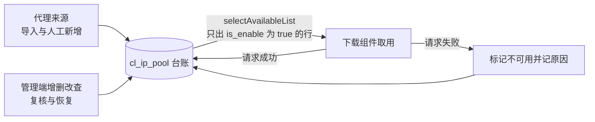
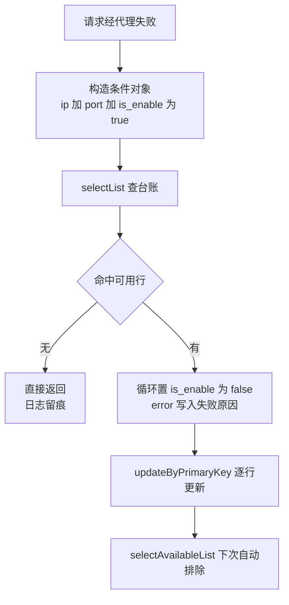
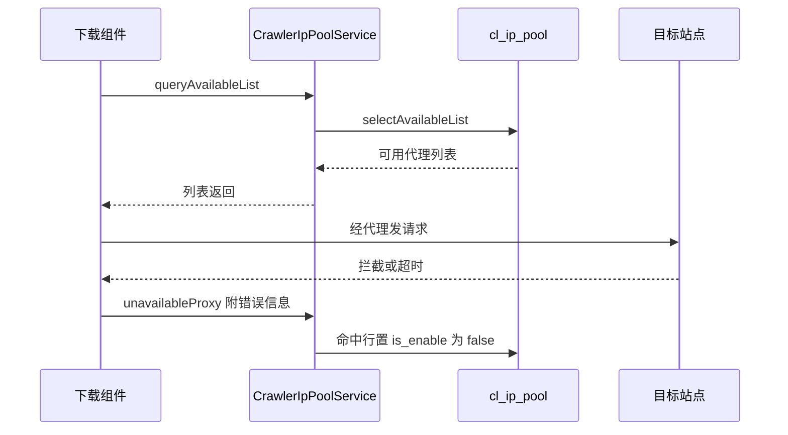

# 数据保存准备_ip代理池实战：需求建模、Mapper 与 Service 开发、测试对账

> 🔒 安全提示：文中示例的口令/密钥均为课程教学环境演示口径，生产环境的安全要求见《安全与合规须知》。

## 先给结论

爬虫要稳，先给代理出口建一本带状态的台账：ip 代理池三个动作是存代理、取代理、标记失效，落到一张状态表、一个实体、一套 Mapper 与 Service。全系列三讲从需求建模讲到测试对账。
第一讲做需求拆解与表结构设计，字段名以表为准，XML 固定条件也用 and 开头，为动态 SQL 留好拼接位。第二讲把七个方法收口成一个 Service 接口，实现层只做薄编排，失效标记走先查再改的闭环。第三讲用两条用例对账：保存后库里见真章，判存在走正反两面。没测到的方法与下载侧的联动也交代了边界。
先看第一讲的表结构再往下读，字段身份是后面所有代码的锚点。全程围绕一个原则：代理池的每个动作都要能对账，库里没有的数等于没发生。
三讲依次是：
- 需求分析与 Mapper 定义：三个动作一本账、表结构字段身份与 XML 写法。
- Service 代码编写：七个方法一张脸、薄编排与失效标记闭环。
- 测试：保存用例、执行对账与判存在的正反两面。

## 第1部分：IP 代理池的需求与 Mapper：给代理出口建一本带状态的台账

数据保存的四块业务里，IP 代理池排第一个动手。day08 已经把「怎么用代理」讲透：`CrawlerProxy` 抽象出 host 与 port，`CrawlerProxyFactory` 按通道把它翻译成 HttpClient、WebMagic、无头浏览器各自的原生对象。到了真正建池子的时候，问题换了一批：代理从哪来、坏了谁记账、管理端怎么增删。免费代理失效率极高，内存集合一重启就清零，代理的来源、可用状态、失败原因必须有一本持久台账，这张表就是 `cl_ip_pool`。这一讲把需求、表、实体与 Mapper 一次铺平，Service 留给下一讲。

### 需求拆开：三个动作一本账

**代理是消耗品，这是建表的根本原因。** 免费代理失效快、存活期短，付费代理与云厂商的服务稳定但成本高；无论哪种来源，池子里的地址都在持续折旧。内存集合装不下这些状态：进程重启全部归零，失败原因无处可记，人工维护也没有入口。落库之后，代理的每一次状态变化都有一行记录可查、可改、可追溯。

**需求对应的动作有三类，各有各的使用方。** 取用方是下载组件，抓取前从表里查出可用代理，用选中的出口发请求；反馈方是失败处理逻辑，请求失败后把代理标记为不可用并留下原因；管理方是人工维护，供应商导入新代理、复核被标记的行、删除彻底失效的地址。三者共用一张表，需求原文里「设置当前 IP 可用或不可用，查询可用的」说的就是取用与反馈这两路，增删改查说的是管理这一路。

需求与方法的对应关系画成一张图：



图的骨架是台账与三类使用方的连线：左路新增进池，右路取用走可用查询，下方失败回标记。闭环的效力在「失败即降级」这一跳：被置为不可用的行，下一次可用查询自动排除，池子自我净化。标记动作的具体实现是下一讲 Service 的内容，本讲先把台账与访问通道铺好。

### 表结构：一个字段一个身份

建表语句按画面线整理（day10 资料包未随带脚本，DDL 以课堂讲解的表结构为准补全）：

```sql
CREATE TABLE `cl_ip_pool` (
  `id` int(11) unsigned NOT NULL AUTO_INCREMENT COMMENT '主键',
  `supplier` varchar(60) DEFAULT NULL COMMENT '代理供应商',
  `ip` varchar(60) DEFAULT NULL COMMENT 'IP 地址',
  `port` int(11) DEFAULT NULL COMMENT '端口',
  `username` varchar(60) DEFAULT NULL COMMENT '鉴权用户名',
  `password` varchar(60) DEFAULT NULL COMMENT '鉴权密码',
  `code` int(11) DEFAULT NULL COMMENT '状态码',
  `duration` int(11) DEFAULT NULL COMMENT '访问耗时（毫秒）',
  `error` varchar(255) DEFAULT NULL COMMENT '不可用原因',
  `is_enable` tinyint(1) DEFAULT NULL COMMENT '是否可用',
  `ranges` varchar(255) DEFAULT NULL COMMENT '可用范围',
  `created_time` datetime DEFAULT NULL COMMENT '创建时间',
  PRIMARY KEY (`id`)
) ENGINE=InnoDB DEFAULT CHARSET=utf8 COMMENT='IP 代理池';
```

**身份与接入组。** `ip` 与 `port` 是代理的最小身份，取用与判存在都靠这一对；`supplier` 记供应商，当前只接了一家，字段留出来是给多供应商对比留口；`username` 与 `password` 服务需要鉴权的代理，免费渠道用不上，接付费通道时要填。

**状态与诊断组。** `is_enable` 是这张表的灵魂字段，可用与不可用的裁决全落在它身上，`tinyint(1)` 表达是否是建表规范的固定写法；`code` 记录校验或请求返回的状态码，`duration` 记录校验时测得的访问耗时，两者一起给「这个代理好不好用」提供量化依据；`error` 存不可用原因，人工复核时一眼看到这行为什么被降级；`ranges` 记可用范围，比如代理适用的地区或站点。

两处细节值得停留。一是 `duration`：画面上的注释写的是「有效时长」，但可用列表按它升序取用的用法说明，它实际承担的是访问耗时语义，注释按用法修正，这正是规范里「字段含义变化要及时更新注释」的落地。二是 `ranges` 这个名字：`range` 是 MySQL 保留字，规范明确禁用保留字做列名，加了 s 的 `ranges` 是刻意的规避。导出的建表语句里 `AUTO_INCREMENT` 水位显示库里已经导入过一批代理，课程直接在真实数据上继续推进。

### 实体与 Mapper：字段名以表为准

实体与表列一一对应：

```java
package com.study.headline.model.crawler.pojos;

import lombok.Data;
import java.util.Date;

/** IP 代理池实体，与 cl_ip_pool 表列一一对应 */
@Data
public class ClipPool {
    private Integer id;
    /** 代理供应商 */
    private String supplier;
    /** IP 地址 */
    private String ip;
    /** 端口 */
    private Integer port;
    /** 鉴权用户名，需要鉴权的代理才填 */
    private String username;
    /** 鉴权密码 */
    private String password;
    /** 校验或请求返回的状态码 */
    private Integer code;
    /** 访问耗时（毫秒），校验代理时测得 */
    private Integer duration;
    /** 不可用原因 */
    private String error;
    /** 是否可用：true 可用，false 不可用 */
    private Boolean isEnable;
    /** 可用范围 */
    private String ranges;
    /** 创建时间 */
    private Date createdTime;
}
```

**包装类型是刻意的。** `port`、`code`、`duration` 全部用 `Integer` 而不是 `int`，因为 `insertSelective` 靠「属性是否为 null」决定这一列写不写，基本类型永远有值，没赋值也会被当成 0 插进库，动态插入「没填就不写」的语义就没了。包装类型才能表达「这个字段没填」。

Mapper 接口按家底写法铺，CRUD 六件套加两个业务查询：

```java
package com.study.headline.crawler.mappers;

import com.study.headline.model.crawler.pojos.ClipPool;
import java.util.List;

public interface ClipPoolMapper {

    int deleteByPrimaryKey(Integer id);

    int insert(ClipPool record);

    int insertSelective(ClipPool record);

    ClipPool selectByPrimaryKey(Integer id);

    int updateByPrimaryKeySelective(ClipPool record);

    int updateByPrimaryKey(ClipPool record);

    /** 按条件对象查询，非空属性即过滤条件 */
    List<ClipPool> selectList(ClipPool record);

    /** 查询可用代理，按访问耗时升序 */
    List<ClipPool> selectAvailableList(ClipPool record);
}
```

`selectList` 的条件传递走条件对象路线：查询条件装进 `ClipPool` 实体，非空属性就是过滤条件，SQL 侧统一用占位符拼接，不再走注解上拼条件的老路，条件与 SQL 集中在一处维护。`selectAvailableList` 是为取用方专设的方法，语义固定为「只出可用行」，调用方不用每次自己拼状态条件。

### XML：固定条件也用 and 开头

XML 的骨架与前几讲一致：`namespace` 对准接口全名，`resultMap` 做列到属性的对账，`Base_Column_List` 收口列清单。本讲真正的新东西是条件片段与可用列表两条：

```xml
<sql id="Base_Column_where">
    <where>
        <if test="supplier != null and supplier != ''">
            and supplier = #{supplier}
        </if>
        <if test="ip != null and ip != ''">
            and ip = #{ip}
        </if>
        <if test="port != null and port != ''">
            and port = #{port}
        </if>
        <if test="isEnable != null and isEnable != ''">
            and is_enable = #{isEnable}
        </if>
        <!-- 其余字段同理，逐列补齐 -->
    </where>
</sql>

<select id="selectList" resultMap="BaseResultMap">
    select
    <include refid="Base_Column_List"/>
    from cl_ip_pool
    <include refid="Base_Column_where"/>
</select>

<select id="selectAvailableList" resultMap="BaseResultMap">
    select
    <include refid="Base_Column_List"/>
    from cl_ip_pool
    <where>
        and is_enable = true
        <if test="duration != null and duration != ''">
            <![CDATA[ and duration <= #{duration} ]]>
        </if>
    </where>
    order by duration
</select>
```

`Base_Column_where` 把每个字段的条件各写一个 `<if>`，`<where>` 标签负责剥掉块内第一个多余的 `and`，于是固定条件与动态条件可以并排写成同一种形态。`selectAvailableList` 里 `and is_enable = true` 吃到的就是这个红利：它永远成立，写进 where 后与动态的耗时条件自然拼接。耗时比较包在 `CDATA` 里，`<=` 中的小于号在 XML 里属于特殊字符，不包会被当成标签解析。

`order by duration` 是这条查询点睛的一笔。代理按访问耗时升序排列，响应快的排前面，取用方从列表头拿代理，慢出口自然沉底。耗时数据来自校验环节，校验得越勤，排序越可信。
## 第2部分：代理池 Service：把代理的存取与失效标记收口成七个方法

Mapper 把 SQL 备齐了，但让业务代码直接摸 Mapper 有代价：判存在要「构造条件、查询、判空」三步，标记失效要「查、改」两步，这些组合散落在各个调用点迟早走样。Service 层把动作收口：存代理、判存在、更新、按条件查、查可用、删除、失效标记，七个方法就是代理池对外的全部面容。这一讲把接口与实现写完，重点讲清失效标记那一步为什么要先查再改。

### 接口：七个方法一张脸

```java
package com.study.headline.crawler.service;

import com.study.headline.model.crawler.core.proxy.CrawlerProxy;
import com.study.headline.model.crawler.pojos.ClipPool;
import java.util.List;

public interface CrawlerIpPoolService {

    /** 保存代理 */
    void saveCrawlerIpPool(ClipPool clipPool);

    /** 检查代理是否存在，条件为 host 加 port */
    boolean checkExist(String host, int port);

    /** 按主键更新 */
    void updateCrawlerIpPool(ClipPool clipPool);

    /** 按条件对象查询 */
    List<ClipPool> queryList(ClipPool clipPool);

    /** 查询可用代理列表 */
    List<ClipPool> queryAvailableList(ClipPool clipPool);

    /** 按主键删除 */
    void delete(ClipPool clipPool);

    /** 把请求失败的代理标记为不可用，并记录失败原因 */
    void unavailableProxy(CrawlerProxy proxy, String errorMsg);
}
```

参数设计各有用意。判存在收 host 与 port 两个散参而不收实体，因为代理的最小身份就是这一对值，调用方手里往往只有一个刚拉取到的原始代理，没有整行实体可给；删除收实体但实际用它的 id，与查询方法的实体条件风格保持统一；条件查询与可用查询都收实体，条件语义由调用方的赋值决定，同一个接口不用为「按 ip 查」「按供应商查」各开一个方法。

`unavailableProxy` 的两个参数是全接口里信息量最大的：`CrawlerProxy` 是 day08 下载准备阶段立好的运行时抽象，除 host 与 port 外不带任何台账信息；`errorMsg` 是失败现场的第一手描述。这个方法就是运行时与台账的接口，下载组件请求失败时拿着代理对象来报告，台账负责记账。

### 实现：一层薄编排

实现类挂 `@Service` 交给容器，`@Log4j2` 备好日志句柄，唯一的依赖是 `ClipPoolMapper`，六个常规方法每个都只有一两行：

```java
package com.study.headline.crawler.service.impl;

import com.study.headline.crawler.service.CrawlerIpPoolService;
import com.study.headline.model.crawler.core.proxy.CrawlerProxy;
import com.study.headline.model.crawler.pojos.ClipPool;
import com.study.headline.crawler.mappers.ClipPoolMapper;
import lombok.extern.log4j.Log4j2;
import org.springframework.beans.factory.annotation.Autowired;
import org.springframework.stereotype.Service;
import java.util.List;

@Service
@Log4j2
@SuppressWarnings("all")
public class CrawlerIpPoolServiceImpl implements CrawlerIpPoolService {

    @Autowired
    private ClipPoolMapper clipPoolMapper;

    @Override
    public void saveCrawlerIpPool(ClipPool clipPool) {
        clipPoolMapper.insertSelective(clipPool);
    }

    @Override
    public boolean checkExist(String host, int port) {
        ClipPool clipPool = new ClipPool();
        clipPool.setIp(host);
        clipPool.setPort(port);
        List<ClipPool> clipPools = clipPoolMapper.selectList(clipPool);
        if (null != clipPools && !clipPools.isEmpty()) {
            return true;
        }
        return false;
    }

    @Override
    public void updateCrawlerIpPool(ClipPool clipPool) {
        clipPoolMapper.updateByPrimaryKey(clipPool);
    }

    @Override
    public List<ClipPool> queryList(ClipPool clipPool) {
        return clipPoolMapper.selectList(clipPool);
    }

    @Override
    public List<ClipPool> queryAvailableList(ClipPool clipPool) {
        return clipPoolMapper.selectAvailableList(clipPool);
    }

    @Override
    public void delete(ClipPool clipPool) {
        clipPoolMapper.deleteByPrimaryKey(clipPool.getId());
    }

    // unavailableProxy 见下一节
}
```

**保存选 `insertSelective`。** 代理数据来源不一，免费渠道拉来的地址常常只有 ip 与 port，鉴权与范围字段全是 null；选择性插入让没赋值的列留数据库默认值，`useGeneratedKeys` 把自增主键回填进实体，调用方拿着回填后的对象继续流转。

**判存在就是条件查询加判空。** host 与 port 装进新建的实体，`selectList` 查回结果，非空即存在。判空写 `null != list && !list.isEmpty()`：MyBatis 的列表查询正常不会返回 null，但把 null 判断留在最前不增加成本，习惯统一后所有列表处理都不用再想。

**更新按主键全量覆盖。** `updateByPrimaryKey` 把实体所有列写回，前提是实体字段完整。什么实体会是完整的？从数据库查出来的。什么实体不完整？手工 new 出来的。这条分界线是两个更新方法的选型依据，下一节失效标记正好用到。

### 失效标记：先查再改的完整闭环

```java
@Override
public void unavailableProxy(CrawlerProxy proxy, String errorMsg) {
    ClipPool query = new ClipPool();
    query.setIp(proxy.getHost());
    query.setPort(proxy.getPort());
    // 只圈当前仍可用的行，已标记过的不重复处理
    query.setIsEnable(true);
    List<ClipPool> clipPools = clipPoolMapper.selectList(query);
    if (null != clipPools && !clipPools.isEmpty()) {
        for (ClipPool clipPool : clipPools) {
            clipPool.setIsEnable(false);
            clipPool.setError(errorMsg);
            clipPoolMapper.updateByPrimaryKey(clipPool);
        }
    }
}
```



这个方法设计成先查再改，而不是一条按 ip 与 port 的 update 直搓，理由有三个。**第一，要拿到完整实体。** 标记动作用的是全量更新，全量更新需要字段齐全的实体，只有查询能提供；查询条件里带上 `is_enable` 为 true，把已经标记过的行挡在外面，不做重复写。**第二，要留可观测性。** 查询命中说明这个代理确实在台账里且当前可用，降级动作有日志；查询落空说明请求用了一个台账之外的代理，这本身就是值得记录的异常信号。**第三，语句收敛。** 复用按主键更新的通用语句，XML 不用为「按 ip 加 port 更新」再开一条专用 SQL，台账操作继续收敛在 CRUD 家底里。

免费代理失效率高，这个方法在真实运行里被调用得非常频繁，每次请求失败都可能触发一次查询加更新；付费代理与云厂商的服务失效率低，调用频率随之下降。接口与表结构完全不变，差异只体现在数据上，这正是「状态由数据表达」的好处：代理质量的变化不触发代码改动。

取用侧的衔接在 day08 已经铺好：下载组件拿到 `queryAvailableList` 的结果后构造 `CrawlerProxy`，`CrawlerProxyFactory` 按通道翻译成原生代理对象挂到请求上；请求失败时回调 `unavailableProxy`，池子完成一次自我净化。台账、取用、反馈三点连成环，代理池才真正活起来。
## 第3部分：代理池测试：两条用例对上保存与判存在的账

Service 七个方法写完，测试环节的问题跟着来：全测还是挑着测？课堂为省时间只测两个代表，但口径要说在前面：正式开发里每个方法都要测过，才有资格提交、部署、上线。测试过程里还埋着一个经典的假现场：明明插入成功了，库里却翻不到数据，先别急着改代码。这一讲把保存与判存在两条用例走完整，顺带把代理池与下载侧的联动想清楚。

### 测试骨架与保存用例

```java
package com.study.headline.crawler.test;

import com.study.headline.crawler.service.CrawlerIpPoolService;
import com.study.headline.model.crawler.pojos.ClipPool;
import org.junit.Test;
import org.junit.runner.RunWith;
import org.springframework.beans.factory.annotation.Autowired;
import org.springframework.boot.test.context.SpringBootTest;
import org.springframework.test.context.junit4.SpringRunner;
import java.util.Date;

@SpringBootTest
@RunWith(SpringRunner.class)
public class CrawlerIpPoolServiceTest {

    @Autowired
    private CrawlerIpPoolService crawlerIpPoolService;

    @Test
    public void testSaveCrawlerIpPool() {
        ClipPool clipPool = new ClipPool();
        // 随手造的占位串，连 IP 格式都不满足，只为让保存与对账有据可依
        clipPool.setIp("2222.3333.444.5555");
        clipPool.setPort(1111);
        clipPool.setIsEnable(true);
        clipPool.setCreatedTime(new Date());
        crawlerIpPoolService.saveCrawlerIpPool(clipPool);
    }
}
```

两个注解的分工在 day09 频道查询的测试课已经对过：`@RunWith(SpringRunner.class)` 换掉 JUnit 默认执行器，`@SpringBootTest` 拉起完整应用上下文，注入的 `crawlerIpPoolService` 是带着数据源与 Mapper 的真实 Bean。测试方法命名用 `test` 加被测方法名，一眼对出对象。

保存用例的数据是随手造的：ip 敲成 `2222.3333.444.5555`，这个串连 IP 的格式都不满足，各段数值早超了 255，属于故意的占位，只为让保存与后续查询有据可依。表结构对它不做拦截，说明格式校验的职责在入池前的校验环节，不在表上；真实代理接入时，地址用 `127.0.0.1` 这类占位先验证通道，正式数据由校验环节把关。`isEnable` 置 true、`createdTime` 记当前时间，四个字段正好覆盖一次完整插入。

### 执行与对账：库里见真章

用例跑完，控制台走完 Spring 启动日志与 HikariPool 的连接痕迹，方法没有抛错。集成测试的验收动作是两步：执行，然后到库里对账。打开数据库客户端查 `cl_ip_pool`，现场偏偏在第二步卡住：执行成功，表里翻不到刚插的行。

排查的结论与代码毫无关系：客户端上留着之前会话设置的过滤条件，查询结果被条件拦掉了，清掉过滤条件一刷新，数据安安稳稳躺在表里。这个假现场值得记牢：**数据库客户端也是软件，过滤条件、排序视图、未刷新的结果集都会制造「数据不见了」的错觉，怀疑代码之前先把工具自身排除。** 排查顺序应当是客户端状态、连接的库与 schema，最后才是业务代码。

### 判存在的正反两面

```java
@Test
public void testCheckExist() {
    // 正例：刚保存过的组合，应判存在
    System.out.println(crawlerIpPoolService.checkExist("2222.3333.444.5555", 1111));
    // 反例：改动一位，应判不存在
    System.out.println(crawlerIpPoolService.checkExist("2222.3333.444.5556", 1111));
}
```

先拿刚存进去的 host 与 port 走正例，控制台打出 true，条件对象查询与判空逻辑都工作正常；再把 ip 改动一位走反例，同样打出 false，不存在的组合没有被误报。判断类方法的测试必须正反各踩一次：只测正例，判空写反了照样通过；只测反例，条件拼接错了也可能返回 false，两种残缺都发现不了。

打印只是给人看的，课堂用打印是为了节奏，工程里要把关键返回值换成断言，让用例自带验收标准，回归时不再依赖人眼盯输出。

### 没测的方法与下载侧联动

剩余方法的测试要点一张清单说清：`queryList` 验条件命中与不命中；`queryAvailableList` 验只出 `is_enable` 为 true 的行且耗时升序成立；`updateCrawlerIpPool` 改完对账；`delete` 删后查无；`unavailableProxy` 标记后，可用列表不再出现该行且 error 写入了原因。每个方法的口径都是「动作加对账」，与两个示范用例同构，照着写即可。

代理池测试收尾之后，真正用它的地方在下载侧，把联动画成时序：



时序的关键在最后两跳：请求失败后，下载组件把代理对象与错误信息交给 `unavailableProxy`，台账里对应行被置为不可用；下一次 `queryAvailableList` 返回的列表里，这条代理就消失了。取用与反馈两端都以 Service 为唯一入口，池子的状态始终由数据说话，测试锁住的正是这个环的两端。
## 常见误区

- **实体属性自造名字。** 错例是把 `is_enable` 起成 `isAvailable` 之类的别名，`resultMap` 对不上号，查出来的状态永远是 null，可用判断全部失灵。正解是字段名以表为准，列与属性一一对应，改表时同步改实体与映射。
- **数量字段用基本类型。** 错例是 `port` 声明成 `int`，`insertSelective` 的判空永远成立，没填端口也插入 0。正解是可空字段一律用包装类型，让 null 能表达「没填」。
- **条件查询手拼字符串。** 错例是拿 ip 变量直接拼 where 子句，代理数据来自外部渠道，注入口等于开在明面上。正解是条件装实体走 `#{}` 占位，预编译语义不丢。
- **可用列表不带排序。** 错例是 `selectAvailableList` 只过滤不排序，取到哪个算哪个，慢代理拖累整批抓取。正解是按耗时升序，快的优先。
- **手工实体配全量更新。** 错例是 new 一个只带 id 与状态的实体去调 `updateByPrimaryKey`，其余列全被 null 覆盖，一行代理数据半残。正解是全量更新只喂查出来的实体，手工实体走 `updateByPrimaryKeySelective`。
- **数字字段判空带上空串。** 错例是条件片段里写成 `port != ''`，OGNL 会把数字 0 与空串判成相等，port 或状态码为 0 的行永远查不出来。正解是数字类型只判 null，空串判断只留给字符串。
- **判存在先查全表再内存比对。** 错例是把全表拉回内存循环找 host 与 port，数据量一大网络与内存两头浪费。正解是条件下推给 SQL，命中与否由 where 与索引完成。
- **失效标记不记原因。** 错例是只把 `is_enable` 置 false，error 留空，人工复核时不知道这行为什么被降级。正解是 error 写入失败现场信息，与自动标记配套，复核才有依据。
- **库里没数据先改代码。** 错例是执行成功但表里查不到，立刻回头改 Service 或 XML。正解是先排除工具侧因素：过滤条件、排序视图、连接的库与 schema 是否对得上，最后才轮到业务代码。
- **测试数据留在池子里。** 错例是随手造的代理 `isEnable` 为 true，测完不清理，正式抓取一启动它就被当真代理取用，白白消耗重试。正解是测完删除或置为不可用，脏数据不留活口。
- **打印当验收。** 错例是控制台输出一眼扫过就算通过，回归时无人再盯输出。正解是关键返回值写断言，用例自带预期。
- **非法格式的测试串混进正式数据。** 错例是觉得能存进去就行，把入池前的格式校验省掉，脏格式在真实抓取时以请求超时的形式暴雷。正解是测试串与正式数据分清口径，校验环节把格式拦在池外。

## 面试可能被问到的问题

1. 面试官追问：「代理池为什么落库而不用内存集合？」
   答：代理是持续折旧的资源，台账要跨批次、跨重启保留状态。落库后失败原因可追溯、管理端可人工复核、取用与标记两个闭环共用一份数据；内存集合重启即丢，也没给人工维护留入口。

2. 面试官追问：「selectList 的条件是怎么传的？」
   答：条件装进实体对象，非空属性即过滤条件，XML 里用条件片段统一按 #{} 占位拼接。相比注解拼串，条件与 SQL 集中维护，占位符保住预编译，注入风险被挡掉。

3. 面试官追问：「is_enable 由谁写、什么时候写？」
   答：两个写入方。自动侧在请求失败或校验不通过时把代理置为不可用并记错误信息；人工侧由管理端增删复核。读方是可用列表查询，只取 true 的行。一个字段承载裁决，所有使用方口径一致。

4. 面试官追问：「可用列表为什么按访问耗时排序？」
   答：duration 记录的是校验时测得的响应耗时，升序让快代理排在列表头，取用方优先拿到高吞吐的出口。代理池的意图就是把好代理先用起来，排序是这个意图的直接体现。

5. 面试官追问：「列名 ranges 是笔误吗？」
   答：不是。range 是 MySQL 保留字，直接用作列名会踩保留字禁用的规范红线，加 s 的 ranges 是刻意的规避。同理 desc、order 这类词也不能直接做列名。

6. 面试官追问：「Service 只有薄薄一层编排，价值在哪？」
   答：收口动作、统一事务边界与日志口径，业务方不直接摸 Mapper，换数据访问实现时业务代码不动。失效标记这类多步操作必须有人负责编排，散在调用方里迟早走样。

7. 面试官追问：「updateByPrimaryKey 和 updateByPrimaryKeySelective 怎么选？」
   答：看实体来源。查出来的实体字段全，全量覆盖安全且语义明确；手工构造的实体字段残缺，必须走选择性更新。混用的故障表现是字段被 null 悄悄覆盖，排查时要对比更新前后的整行数据。

8. 面试官追问：「checkExist 为什么返回 boolean 而不返回实体？」
   答：调用方只问在不在，语义上不需要整行数据；返回 boolean 契约简单，也不会诱导调用方依赖一个半截实体。真要用到行数据时再走 queryList，两个方法各管各的语义。

9. 面试官追问：「unavailableProxy 为什么先查再改，不直接写一条按 ip 加 port 的 update？」
   答：先查拿到主键与完整实体，复用通用更新语句，XML 不新增专用 SQL；查询还能限定只处理可用行，顺带留下降级日志。代价是多一次查询，失效标记的频率完全扛得住，用通用性换一条专用语句是划算的。

10. 面试官追问：「免费代理与付费代理对这套 Service 有什么影响？」
   答：接口与表结构不变，变化的是失效率：免费池的 unavailableProxy 调用频繁、补货任务重；付费池两者都轻。状态由数据表达，代理质量差异不触发代码改动，只影响运维节奏。

11. 面试官追问：「这种测试和纯单元测试的边界怎么划？」
   答：要验证 SQL、映射与容器装配的走集成测试，真实起容器连真实库；判空、拼接这类纯逻辑可以脱离容器做单元测试。代理池的 Service 测试属于前者，价值在于把 MyBatis 绑定与数据源装配一起验掉。

12. 面试官追问：「测试数据怎么设计与管理？」
   答：正反例成对设计，覆盖命中、不命中与边界；数据随手造可以，但要标记口径并在用例结束后还原，不污染共享库。集成测试指向专用测试库，绝不碰生产数据。

13. 面试官追问：「unavailableProxy 这类改状态的方法怎么测？」
   答：四步：准备一条可用行，调用方法传入失败代理与错误信息，断言行状态变为不可用且 error 有值，再用可用列表查询确认它已不在结果里。顺带重复调用一次验证幂等，第二次应查不到可用行而直接返回。

14. 面试官追问：「集成测试起容器很慢，怎么权衡？」
   答：按验证目标取舍：提交前跑核心链路的集成用例，纯逻辑下沉为无容器单元测试日常跑。容器慢是真实性的代价，SQL 层的错只有真实库能暴露，砍掉集成测试省下的时间会在联调阶段加倍还回去。

15. 面试官追问：「测试通过的标准是什么？」
   答：三件事：方法不抛错只是底线，返回值符合预期是及格，库表数据与预期对上账才算通过。改状态的方法还要验证副作用边界，该变的变了，不该变的没动。

## 配套资料

- 代码：`materials/code/05/头条day10/` 资料目录为空，表结构、实体与 Mapper 均按画面线整理，SQL 按本课写法补全（引用路径截至 `头条dayNN/` 层级，内层目录名含项目原名，不进入正文）。
- 参照：`materials/code/05/头条day01/`，数据库规范设计说明书，`is_xxx tinyint(1)` 表达是否、禁用保留字、字段必须带注释的口径出自它。
- 环境：课程集群 node01~node03，MySQL root/123456；代理池表在爬虫库中查验，示例代理地址一律以 127.0.0.1 占位。
- 代码：`materials/code/05/头条day10/` 资料目录为空，Service 接口与实现按画面线整理、按本课写法补全（引用路径截至 `头条dayNN/` 层级，内层目录名含项目原名，不进入正文）。
- 参照：`materials/code/05/头条day01/`，数据库规范设计说明书，字段注释与可空字段选型的判断依据出自它的建表口径。
- 环境：课程集群 node01~node03，MySQL root/123456；运行前确认 `cl_ip_pool` 表已建、MyBatis 扫描路径包含爬虫模块的 mappers 包。
- 代码：`materials/code/05/头条day10/` 资料目录为空，测试类按画面线整理、按本课写法补全（引用路径截至 `头条dayNN/` 层级，内层目录名含项目原名，不进入正文）。
- 参照：`materials/code/05/头条day01/`，数据库规范设计说明书，测试对账所用的表结构与字段注释口径出自它。
- 环境：课程集群 node01~node03，MySQL root/123456；测试前确认爬虫库可达、`cl_ip_pool` 表已建，用例产生的数据测完清理。
